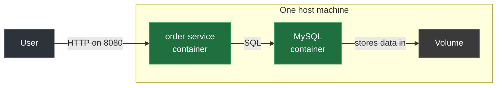
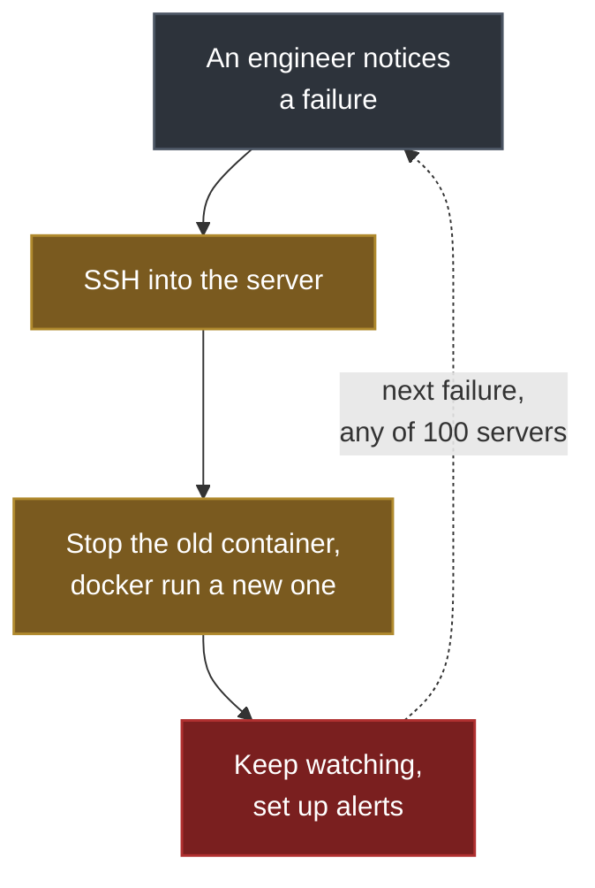
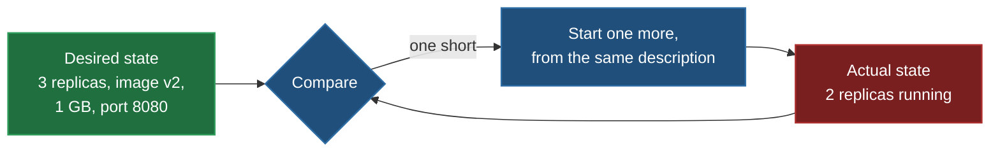
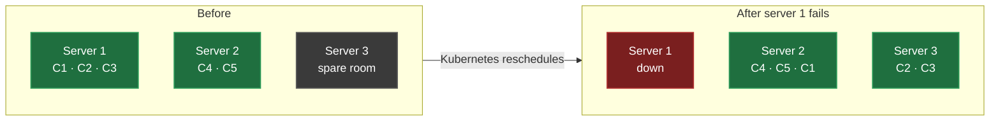
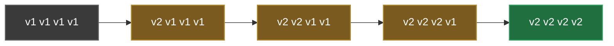

Kubernetes is built on top of containers, so it starts where containers leave off. If the container idea below makes sense, Kubernetes will too — most of it is the same idea applied to a fleet of machines instead of one.

An application is more than its code. The bookshop's order service is a Spring Boot application, built by Maven into a jar, and the jar on its own will not run: it needs a particular Java runtime, its libraries, its configuration and the other software it depends on. **Docker** packages all of that into one file called an **image**. A **container** is a running copy of an image — an isolated process that has everything the image packed — and because the image carries everything, the container behaves the same on any machine that runs it.

With Docker, building the image and starting a container from it are two commands:

```bash
docker build -t order-service .
docker run -p 8080:8080 order-service
```

The first builds an image named `order-service` from the instructions in the current directory. The second starts a container from it, and connects port 8080 on the machine to port 8080 inside the container, which is where Spring Boot listens.

The order service also talks to MySQL, and MySQL gets a container of its own. **Docker Compose** is a tool that starts several related containers from one file: it creates the private network the two containers talk over, and a **volume** — storage on the machine that outlives any container — where MySQL keeps its data, so the data survives when the MySQL container is replaced.



For a small application this works perfectly, and nothing below says otherwise. **Docker answers one question: how do I package my application and run it the same way everywhere?** It never claimed to answer the question that arrives when the application grows.

## One machine is a demo; production is a fleet

A demo has one server running one container of the application and perhaps one of the database. A real production system is not built that way. An application under real load runs as several identical copies, each called a **replica**, spread over several servers, so that one server going down leaves the others serving. The point of running several replicas on several machines is that a single failure is survivable.

Put a number on it. **100 servers running 500 application containers** — five on each — and alongside them the containers for the databases, the Redis caches and the message brokers, with replicas of their own.

Now consider what managing that by hand involves. Something goes wrong on one server, and an engineer has to notice. They log in to that server remotely over **SSH**, the standard tool for opening a command line on another machine, as the administrator account with full control of it. They stop the broken container, start a new one from the existing image, and then keep watching it, with some kind of alert in place to tell them which container went down next time. That is one incident on one server. Across 100 servers and 500 containers it is not a job anybody can do, and the problems come in several distinct shapes.



## Problem one: a container crashes

A server runs three containers: the order service, MySQL, and a **helper** — a small companion program that supports the order service, shipping its logs for instance. Helpers get a proper explanation in the pods note. For whatever reason — and the reasons are many — the order service container crashes.

| Container on the server | State |
|---|---|
| order-service | crashed |
| MySQL | running |
| helper | running |

Without anything managing it, two things have to happen, in order. First, **somebody has to notice** that the container has crashed. Then somebody has to start another one. Every minute between the crash and the replacement is downtime, and every user who arrives in that window gets an error.

What you actually want is to say something once and have it stay true:

> I always want 3 copies of my application running.

## The central idea: desired state against actual state

That sentence is the most important idea in Kubernetes, and everything else in this folder is machinery for honouring it.

You do not tell Kubernetes what to do step by step. You describe what you want — and the description can be specific:

> 3 replicas of order-service, using image version 2, with 1 GB of memory each, exposing port 8080.

That description is the **desired state**. Kubernetes then looks at what is actually running — the **actual state** — and compares the two, continuously. Suppose the three replicas run on three different servers and one of them crashes. The actual state is now two replicas, the desired state is three, and Kubernetes starts a third without anybody asking it to. Because the description is what it works from, the replacement is not a guess: it is again image version 2, again 1 GB of memory, again port 8080.



**This continuous process of pulling the actual state back to the desired state is called reconciliation.** Is that the same thing as self-healing? Yes, exactly — healing is what reconciliation looks like from the outside when the thing that drifted was a crashed container.

> [!tip] **Declarative, not imperative.**
> Describing the final state you want and letting the system work out the steps is called **declarative** management. The alternative — issuing each step yourself, `docker run` here, `docker stop` there — is **imperative**. The whole of Kubernetes is built on the declarative side: you change the description, and the system changes the world to match.

> [!info] **This was run, not just read.**
> On a single-node cluster, three replicas of a small container were asked for and then one was deleted by hand. Within seconds the deleted one was terminating and a brand-new replica, with a new name, was already running. The cluster's own event log recorded that one of Kubernetes' built-in supervisors, a **controller**, had created the replacement. Which component that is, and how it does it, is in the architecture note.

> [!warning] **Reconciliation guarantees that Kubernetes keeps trying. It does not guarantee that nothing is ever down.**
> Between the crash and the replacement there is still a gap — shorter than an engineer noticing and logging in, but not zero. That is why you ask for three replicas rather than one: while one is being replaced, the other two are still serving.

## Problem two: scaling

The bookshop starts with one container of the order service on one server, and that is fine. Then more people start using it, and one container on one server can no longer carry the load.

The manual answer is to add servers — server 1, server 2, server 3, server 4 — and run a replica on each. That means typing `docker run` on every one of them, and when one replica goes down by mistake, noticing it and starting it again while the others carry on. Going from 4 replicas to 8 means doing all of it again, by hand.

With Kubernetes you change one number in the description:

> replicas = 5

and Kubernetes places five replicas across the servers it has and keeps there being five. The same reconciliation from problem one applies: if one of the five crashes, it is replaced from the existing image.

> [!question] **Do replicas of one application run side by side on the same server?**
> The short answer is that they go on different servers — one replica on one server, the next on a second, the third on a third — because putting every replica on the same server is not really scaling at all: one server failing would take all of them down together.
>
> **Going further, checked against the Kubernetes documentation:** spreading the replicas is what Kubernetes aims for, not something it promises. If you configure nothing, it behaves as if told to spread the replicas of one application across machines with a tolerance of 3 and the instruction `ScheduleAnyway` — a preference it will break when there is nowhere better to put a replica. On a single-node cluster all three replicas of the test above sat on the same machine, because there was only one.

## Problem three: a whole server crashes

A crashed container is one problem. **A crashed server is more serious**, because a server never runs just one container.

Server 1 runs containers C1, C2 and C3. Server 2 runs C4 and C5. Server 1 goes down — the physical machine fails, or its location has an earthquake or a fire, or something goes wrong at the software level — and all three of its containers disappear at once. Leaving their replicas aside for the moment, those three containers have to be started somewhere else, on machines that are still alive, and kept there until server 1 comes back.

Kubernetes does that placement itself. It might put C1 on server 2, and C2 and C3 on a server 3 that already exists and has room.



In a real cluster those containers would already have replicas elsewhere, and the rescheduling still happens — the replicas keep serving while the lost containers are replaced.

## Problem four: shipping a new version

Ten replicas of `order-service:v1` are running — ten containers, on ten servers. A developer writes new code, and now `order-service:v2` has to replace them.

The naive approach is two steps:

1. Stop all the old replicas.
2. Start all the new replicas.

Between step 1 finishing and step 2 finishing, **zero containers are running**, and any user who reaches a server in that window finds the application unavailable. That window is **downtime**. The same thing happens for other planned work — stopping the application to run a database migration script and then starting it again.

The way round it is a **rolling update**: replace the replicas a few at a time, so that some are always serving. The idea is older than Kubernetes — [[../06-Deployment-Strategies/02-Rolling-Deployment|rolling deployment]] and its alternatives are covered as strategies in their own right — but without Kubernetes somebody has to carry it out, by hand or with scripts they wrote and maintain. Kubernetes performs it itself: take one replica down, bring up v2 in its place, then the next, layer by layer, until every replica runs v2 and at no point are all of them down.



## Problem five: where should a container run?

In Kubernetes, a server that belongs to the managed fleet is called a **node** — any machine taking part, whatever kind it is. Take five nodes, A to E. Each already runs some containers, and each has a different amount of CPU left to give.

| Node | CPU still free |
|---|---|
| A | 90% |
| B | 20% |
| C | 50% |
| D | 70% |
| E | 10% |

A new container arrives, and it needs **2 CPU cores and 4 GB of RAM** to run. Somebody has to decide where it goes. Node B and node E, with 20% and 10% free, are poor choices; node A or node D, with 90% and 70%, are the likely ones. Then the next container arrives, and the decision has to be made again with the numbers changed, and then the next.

Developers should not be sitting down to inspect every machine and choose one, container after container. Kubernetes makes this placement decision itself, through a component called the **kube-scheduler** — which the architecture note takes apart.

> [!note] **The same pressure exists for everything else a fleet needs.** How configuration reaches each replica, how CPU and memory are shared out, how the services find each other and how they are exposed to the outside are all questions the manual approach has to answer by hand. They are part of the case for Kubernetes. How the services find each other and how they are exposed get a note of their own later in this folder, and so does how configuration reaches each replica; how CPU and memory are shared out is a subject of its own.

## So what is Kubernetes?

> **Kubernetes is a container orchestration platform.** It manages the deployment, scaling, networking, availability and lifecycle of containerised applications across a cluster of machines.

**Orchestration** means directing every action across the fleet: which container runs on which node, what happens when a container crashes, what happens when a server crashes, how scaling happens, how work gets scheduled. **Lifecycle** means when each container should come up and when it should go down. Put shortly, Kubernetes tries to keep your desired state true — and its job, stated in one line, is to manage your containers. Nothing more and nothing less.

| | Docker | Kubernetes |
|---|---|---|
| Solves | packaging an application with everything it needs, and running it consistently | managing many containers across many machines |
| Unit it works with | an image and the containers made from it | a description of the desired state |
| One-line model | runs containers | manages containers at scale |

They solve related but different problems, and Kubernetes does not replace Docker's packaging: the images it runs are the same images.

## When not to use it

> [!warning] **Kubernetes is expensive, and most applications do not need it.**
> If the application runs on one server, or two or three, with three or four containers between them, those can be managed by hand easily, and Kubernetes would only add cost and complexity. **It earns its place when the containers number in the hundreds and the servers in the dozens** — 500 containers across 100 servers is the scale it is built for — and when the production architecture has become so complicated that managing it manually is impossible, or next to impossible. Most companies, startups especially, never reach that point.
>
> There is a running joke about exactly this mistake: a team's production application gets its first real users, and the immediate conclusion is that it is time to integrate Kubernetes. You do not put tools into a system for the sake of it.

> [!question] **Do the replicas use extra resources?**
> Each replica uses the memory and CPU of its own server and its own container. That is the cost of replication everywhere, not something special to Kubernetes — a database run as a primary with replicas uses resources on every machine it is replicated to. Everything in a replicated system is paid for once per copy.
