## The cluster, split in two

A **Kubernetes cluster** is the set of machines Kubernetes manages. Each of them is a **node**, the previous note's word for any machine taking part. Kubernetes divides the nodes into two roles.

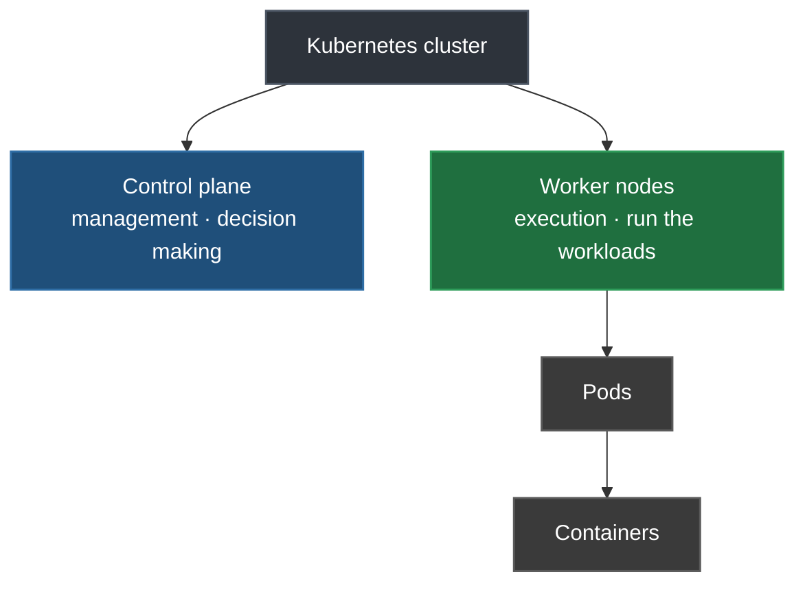

The **control plane** makes the decisions: which container goes to which server, what happens if a server goes down — every rule from the five problems. It is the **brain** of the cluster, because the thinking happens there. It does not run your application.

The **worker nodes** are the machines your application actually runs on. They run the **workloads**(general word for whatever Kubernetes runs on your behalf). In these first notes a workload is always your application: its containers, with as many replicas as the description asks for.

> [!important] **Worker nodes run the workloads; they are not where the cluster's data lives.**
> It is easy to say the workers store the containers or store the data, and it is wrong. What a worker does is **run** containers. The cluster's own record of what should exist is kept by the control plane, as the etcd section below explains, and your application's data lives in your application's database, wherever that runs.

There can be many of each. Worker nodes are multiplied for capacity and replication, and the control plane can be multiplied too, depending on how far the management side has been scaled.

## What a node is

**A node is any machine taking part in the cluster**: a physical server, a virtual machine (a whole computer simulated in software on a bigger physical one), or a cloud server rented by the hour, such as an AWS EC2 instance. Whatever it is, if it does a server's job inside the cluster, Kubernetes calls it a node, and so does everybody working with it.

> [!tip] **If you have used Jenkins, this split will feel familiar.**
> Jenkins has the same shape: a [[../05-CI-CD/08-Controller-And-Agents|controller]] that decides what runs, and agents that run it, all of them called nodes. Kubernetes uses the same pattern at a different scale: a control plane that decides and worker nodes that execute. Nothing below depends on knowing Jenkins.

The whole hierarchy, which comes back over and over, is:

> **Cluster → Node → Pod → Container**

The **pod** is a level between the node and the container, and the third note is about why it exists. Until then, this note talks about placing and running containers. That is a simplification, but every component below does exactly the job described for it either way.

The components below are introduced in the order a request meets them, and a map of the cluster grows by one component per section. In each version **the component that section introduces is blue**, the ones from earlier sections are grey, and you stay dark grey, as does kubectl once its own section is behind you.

## Talking to the cluster: kubectl

Suppose the order service has already been packaged as an image, `bookcart/order-service:v1`. With Docker you would type `docker run` and get a container. Now you want Kubernetes to run it and manage it, so you need a way to give Kubernetes instructions, and that means a command-line tool.

The tool is **kubectl**, the Kubernetes command-line tool. Its name gets pronounced several ways (kube-c-t-l, kube-control, kube-cuttle) and they all mean the same program. It is installed on your laptop or another management machine, and it is the thing you talk to. On its own it is only a client with nothing to talk to; getting a whole cluster running on your own machine for it is where the local-cluster note starts.

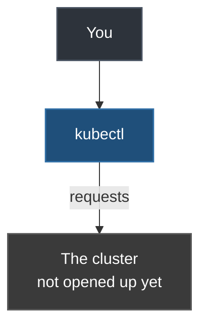

A command looks like this, and the syntax is not the point yet:

```bash
kubectl get nodes
```

In plain English: Kubernetes, show me the nodes in this cluster. Run against a one-node cluster, the answer looks like this:

```text
NAME     STATUS   ROLES           AGE     VERSION
devops   Ready    control-plane   3m42s   v1.37.2+k3s1
```

## The API server: the front desk

**kubectl is only an interface.** It is the same relationship as a terminal and a shell: the terminal is the window you type into, and the shell behind it does the work. Behind kubectl, the thing that receives your request is the **API server**, properly named **kube-apiserver**.

Think of it as the gateway or front desk of the control plane. Everything you ask for arrives here first. It is called an API server because that is what it is: it exposes an **API**, a defined set of requests a program will accept, and like any API it serves requests to **create**, **read**, **update** and **delete** things. What it creates, reads, updates and deletes are **descriptions**, the desired state from the previous note:

| Request | What the API server does with it |
|---|---|
| Create | records a new description: three replicas of order-service, say |
| Read | returns what exists: the nodes, the containers, their configuration |
| Update | records a changed description: image v2 instead of v1, or five replicas instead of three |
| Delete | removes a description, so what it described should no longer exist |

So `kubectl get nodes` really means: API server, give me information about the nodes. The API server looks it up and returns it.

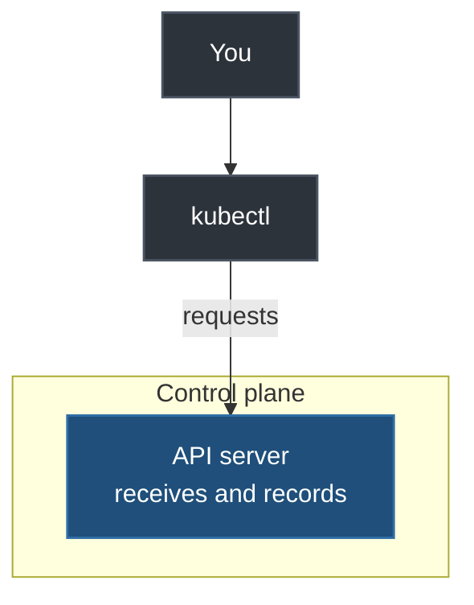

> [!important] **The front desk records decisions; it does not make them, and it does not start containers.**
> The API server is sometimes described as the part that takes the decisions, or the part that creates containers and servers to scale. It is neither. It checks a request, records it, and answers. Deciding where things run, noticing that the actual state has drifted, and starting containers are each done by a different component, below — and each of them learns what to do by asking the API server what has been recorded. That is why everything goes through it: **kubectl → API server** for you, and a line to the API server for every other component, as the map shows once it fills in.

## etcd: the cluster's memory

When you tell Kubernetes what you want — three replicas of the order service, image version 2, 1 GB of memory, port 8080 exposed — that description has to be stored somewhere. And it is not only your description. Kubernetes has to remember which nodes exist, which applications should exist, how many replicas of each, what configuration they have, and what is currently running and what is not.

Suppose it kept that on one of its nodes, and the node went down. Kubernetes comes back up and finds it has forgotten everything. That cannot be allowed. **Kubernetes needs permanent, persistent storage for its own state**, for the same reason any database keeps its data on disk that outlives the program using it.

That store is **etcd**, a **distributed key-value store**. A key-value store keeps data as pairs: a key, and the value stored under it. Amazon's DynamoDB is a well-known database of the same family; which database stores data in which shape is a system design question rather than a DevOps one. A simplified, imaginary pair of entries:

| Key | Value |
|---|---|
| application | payment-service |
| replicas | 3 |

The real format is more involved than this, but the shape (a key and the state stored under it) is the point.

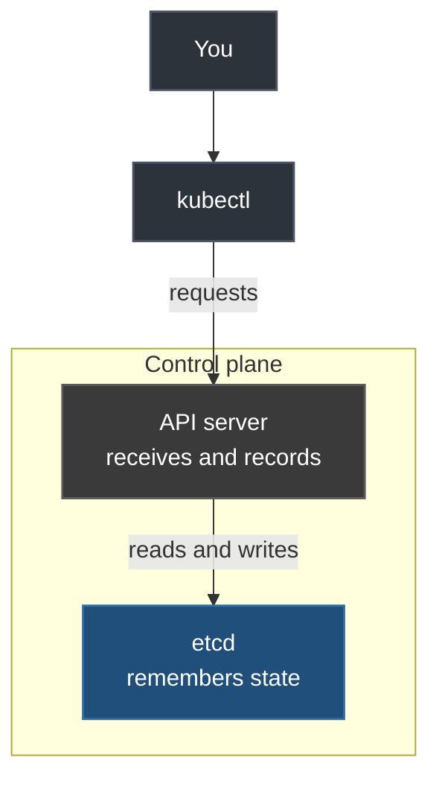

> [!warning] **etcd is not your application's database.**
> It is Kubernetes' own store, for the cluster's state. Your Spring Boot application keeps its customers and orders in MySQL, exactly as before; it does not put anything in etcd, and you will not access etcd yourself. Kubernetes uses it in the background, and it is the API server that reads from it and writes to it when a request needs data stored or fetched.

> [!note] **Going further: a small cluster may not be running etcd at all.**
> etcd is the standard store and the one Kubernetes documents. Lightweight distributions can swap it for something else: the single-node k3s cluster used to check these notes keeps its state in a SQLite file, `state.db`, unless it is told to use etcd. The job is the same; only the engine differs.

## The scheduler: deciding where

The API server has recorded the request and etcd holds the description. Now a new workload needs a node. The previous note talked about this choice in percentages of CPU left; Kubernetes actually reasons in absolute amounts (CPU cores and gigabytes of memory), so here are three worker nodes described that way:

| Worker | CPU available | RAM available |
|---|---|---|
| worker 1 | 1 core | 1 GB |
| worker 2 | 8 cores | 16 GB |
| worker 3 | 2 cores | 4 GB |

The new container needs **2 CPU cores and 3 GB of RAM**. Worker 1 cannot take it: one core, and not enough memory. Worker 2 can, comfortably. Worker 3 can as well, but taking it would use both of worker 3's cores and leave that node completely full.

Someone has to make that choice, and that component is the **kube-scheduler**. Its job, in one line: **find an appropriate node for a newly created workload.** It watches the API server for workloads that do not have a node yet, decides which worker each one goes to based on how much CPU and memory each node has free, and reports the choice back to the API server, which records it.

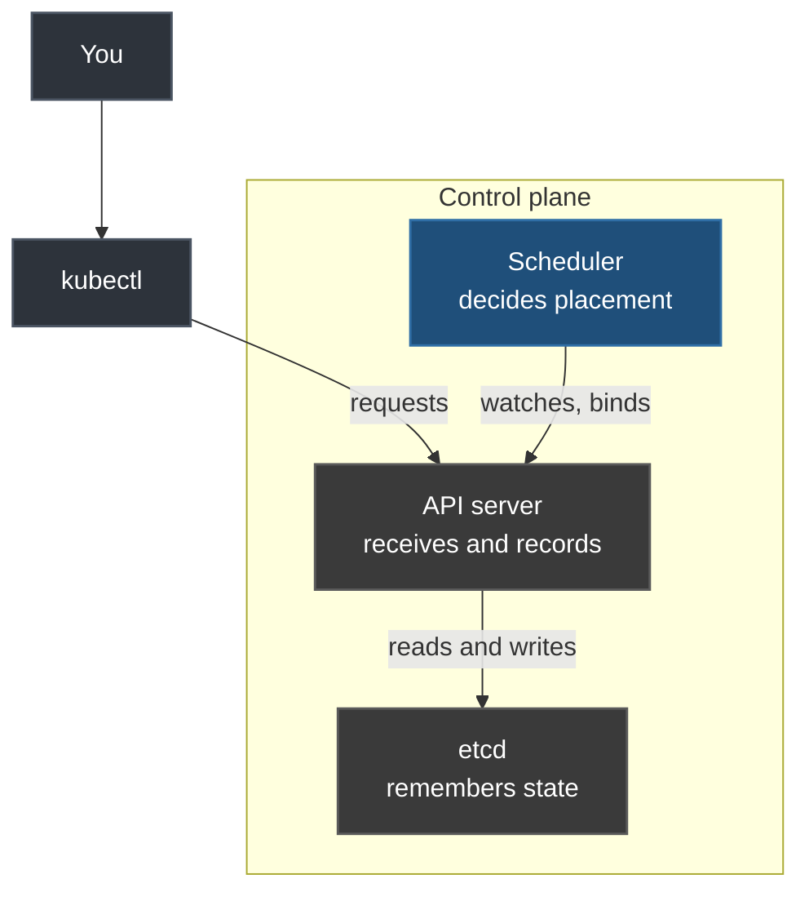

> [!important] **The scheduler only decides where. It does not start anything.**
> It produces a placement (this workload should run on worker 2) and stops there. Running it is somebody else's job, on the node itself. **Checked against the documentation:** reporting the decision back to the API server is a step called **binding**, and the node's agent runs the workload from there.

How exactly it chooses (first fit, or comparing every node) is the obvious next question. **Going further:** the documentation describes two steps, **filtering**, which drops every node where the workload cannot run at all, and **scoring**, which ranks the nodes that remain, and the workload goes to the highest score.

> [!failure] **What it looks like when no node fits.**
> On the one-node cluster, which has 2 CPUs to give, a workload asking for 3 CPUs and 3 GB was submitted. It was accepted — and then sat there, never started:
> ```text
> too-big   0/1   Pending   0     5s
> 0/1 nodes are available: 1 Insufficient cpu. preemption: 0/1 nodes are available: 1 Preemption is not helpful for scheduling.
> ```
> Filtering threw out the only node. **A workload stuck in `Pending` with an `Insufficient cpu` or `Insufficient memory` reason means the scheduler found nowhere to put it**. The fix is a smaller request or a bigger cluster, not a restart.

## The kubelet: the agent on every node

The scheduler has chosen worker 2. But worker 2 is just a server: a machine does not start containers because someone in the control plane wrote its name down. Something on worker 2 has to pick up that decision and make it happen.

That something is the **kubelet**: the Kubernetes agent, and there is one on **every** worker node. It watches the API server for workloads assigned to its own node, and its responsibility is simple: **make sure the workloads assigned to its node are actually running on that node.**

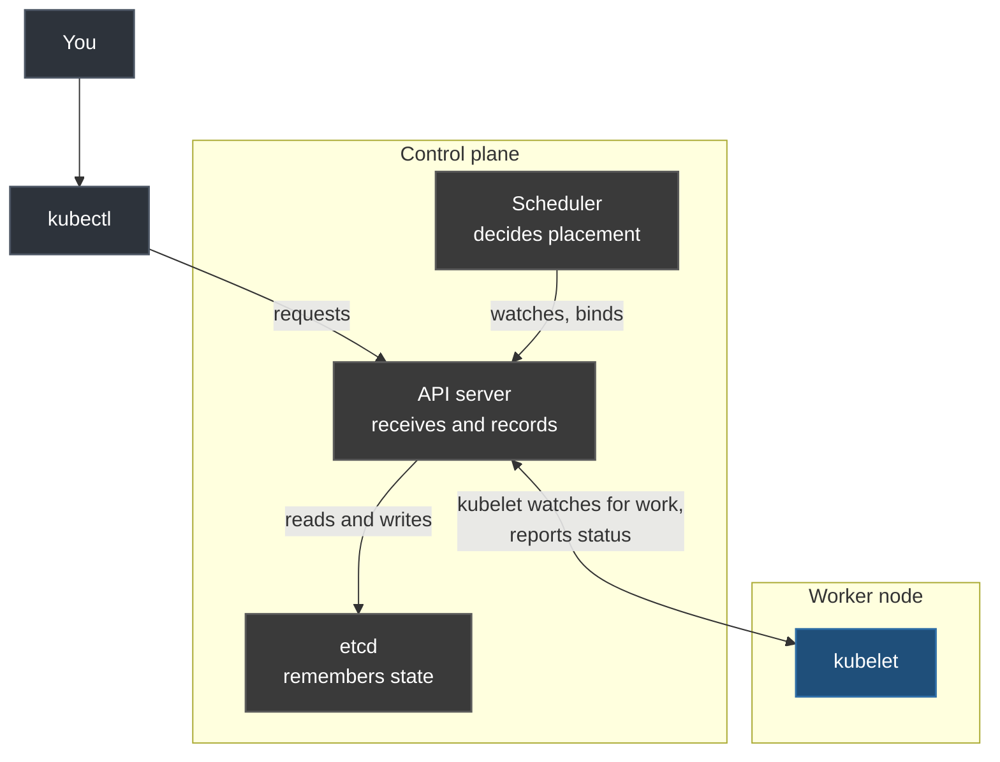

> [!question] **Is the kubelet the worker?**
> No. The kubelet is an agent; the worker is the node, the server itself. The kubelet is the part of Kubernetes that lives on the worker and acts for it.

## The container runtime: what actually runs containers

Can the kubelet create a Linux container itself? **No.** It needs a **container runtime**, and it uses that runtime to create every container it runs.

The relationship is the one from the first note: you type `docker run`, and Docker's machinery actually builds the container. The kubelet is in your position (it is the agent that knows what should run and gives the instruction), and the runtime is the part that does it. The common runtimes are **containerd** and **CRI-O**.

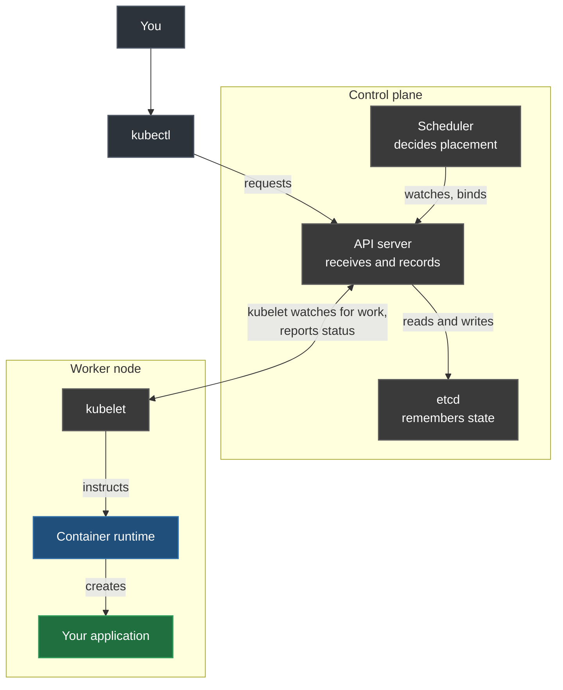

## The controller manager: the supervisor

Go back to the central idea: you said you want three replicas of your application, and Kubernetes keeps that true. Look at the components so far. The scheduler decides placement. etcd stores. The API server receives and records. kubectl only sends messages on. **None of them checks** whether three replicas are actually running, notices that one went down by mistake, and asks for a new one.

That job belongs to the **controller manager**, the next part of the control plane. Its responsibility in one line: **make the actual state equal the desired state.** It runs a set of **controllers** — think of them as **supervisors**, each one constantly checking whether the part of the cluster it looks after matches what was asked for:

> Desired: 3. Actual: 2. Controller: we need one more.

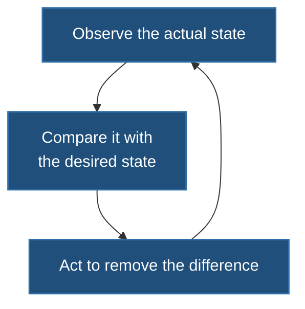

That loop is reconciliation, from the first note, and this is the component that does it. **Checked against the documentation:** controllers are control loops that watch the cluster's state and move the current state toward the desired one, and Kubernetes' built-in controllers run inside the kube-controller-manager.

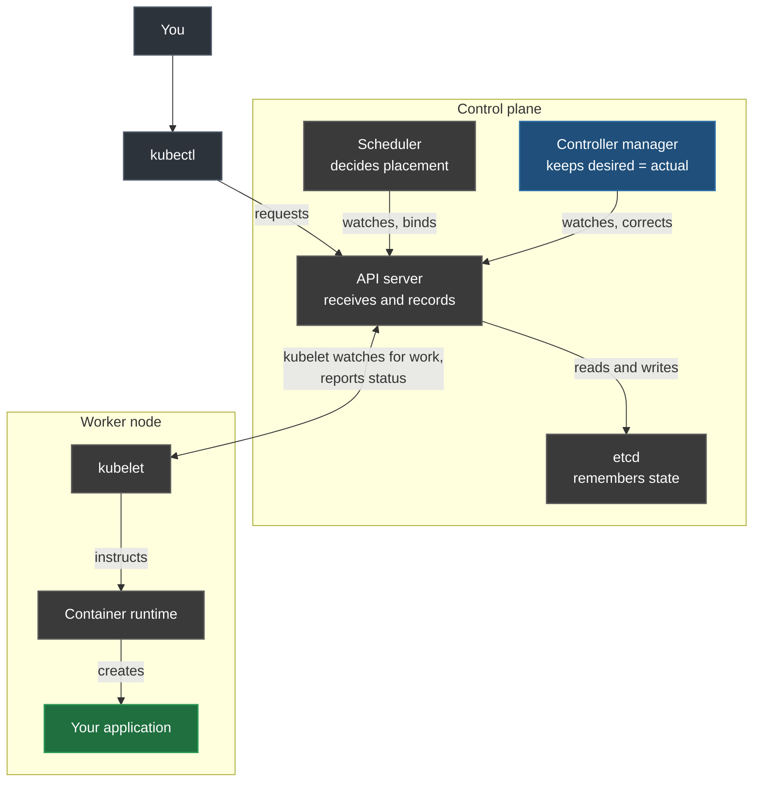

## kube-proxy: networking between services

A worker node holds one more component. Applications in a cluster have to talk: the front end talks to the back end, and a client (Postman, or another application) talks to the application. Each of those is a network call, and behind it sits networking configuration: which network, which address, which port number, how the message gets to the right container.

Kubernetes has an abstraction for exactly this, called a **Service**: one stable name and address that stands in front of a set of replicas, so that callers do not need to know which containers exist right now or where they run. Services are a subject of their own, with a note of their own later in this folder. The component on each node that helps make them work is **kube-proxy**. For now: **it maintains the networking rules on the node that send traffic for a Service to the right containers**, so that a container is not an island and one service can reach another.

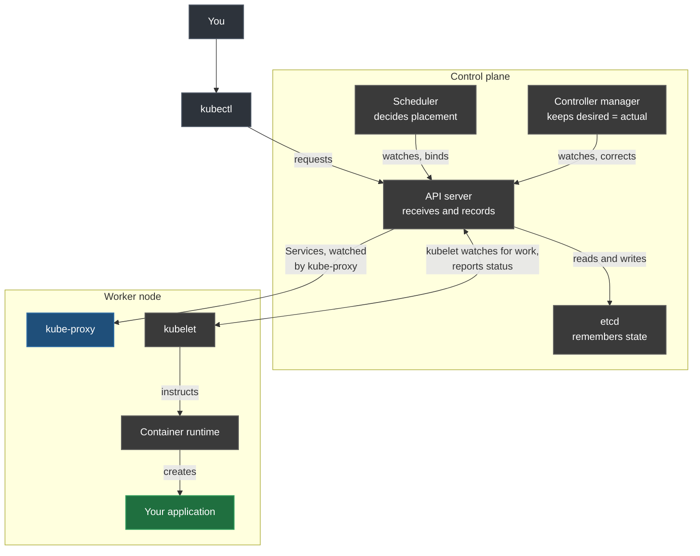

> [!question] **Are ingress and egress part of kube-proxy?**
> **Ingress** is traffic coming into the cluster from outside it; **egress** is traffic leaving it for somewhere outside. The answer is yes and no: kube-proxy is involved in moving traffic, but the full path in and out of a cluster involves more than kube-proxy, and the Services note comes back to it.

> [!note] **Going further:** Kubernetes' own component list marks kube-proxy as **optional**. Some networking plugins implement the same rules themselves, and a cluster using one of them does not run kube-proxy.

## The whole picture

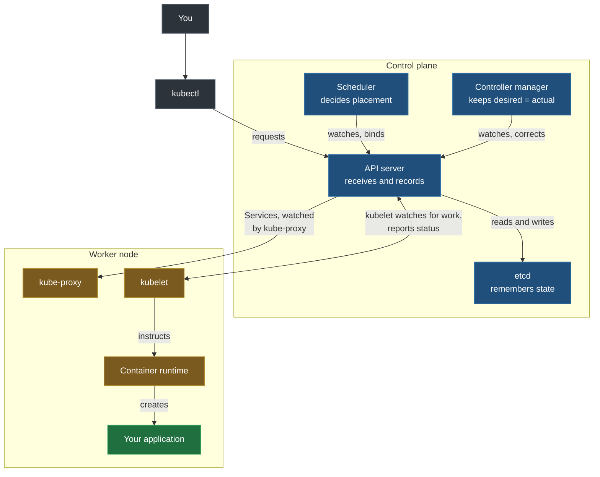

Kubernetes' own documentation draws the same cluster like this:

![[08-Kubernetes/Images/components-of-kubernetes.png]]

Every hexagon in it is a component from this note except one: **c-c-m**, the **cloud controller manager**, which the documentation marks as optional. Its job is to integrate the cluster with the underlying cloud provider, which is why it is drawn with the only arrow leading out of the cluster, to the cloud provider's API. kubectl and the container runtime are not drawn.

Trace one request through it (three replicas of order-service, image v2, 1 GB, port 8080):

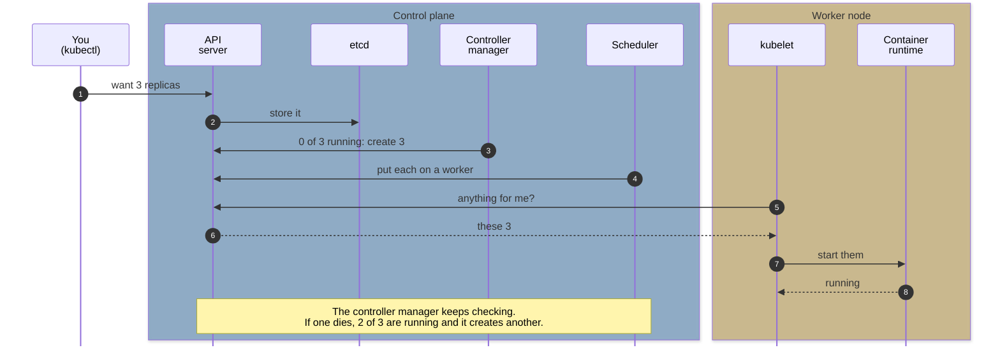

| Component          | Where             | Its job                                                         |
| ------------------ | ----------------- | --------------------------------------------------------------- |
| kubectl            | your machine      | the command-line tool you talk to Kubernetes with               |
| API server         | control plane     | receives and records every request; the gateway into Kubernetes |
| etcd               | control plane     | persistent memory of the cluster's state                        |
| Scheduler          | control plane     | chooses the node a new workload runs on                         |
| Controller manager | control plane     | keeps the actual state equal to the desired state               |
| kubelet            | every worker node | the agent that makes sure its node's workloads run              |
| Container runtime  | every worker node | actually creates and runs the containers                        |
| kube-proxy         | every worker node | maintains the networking rules behind Services                  |