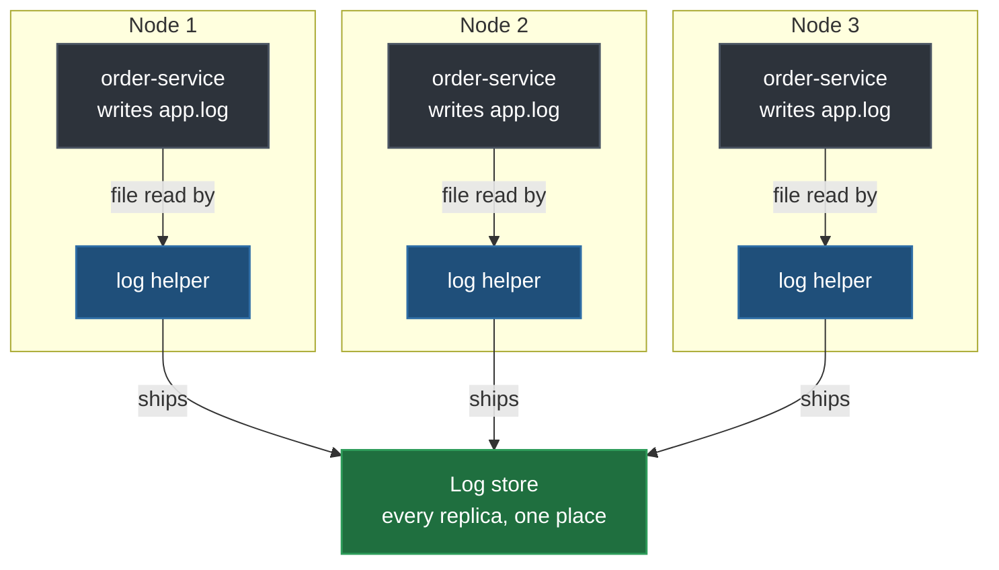
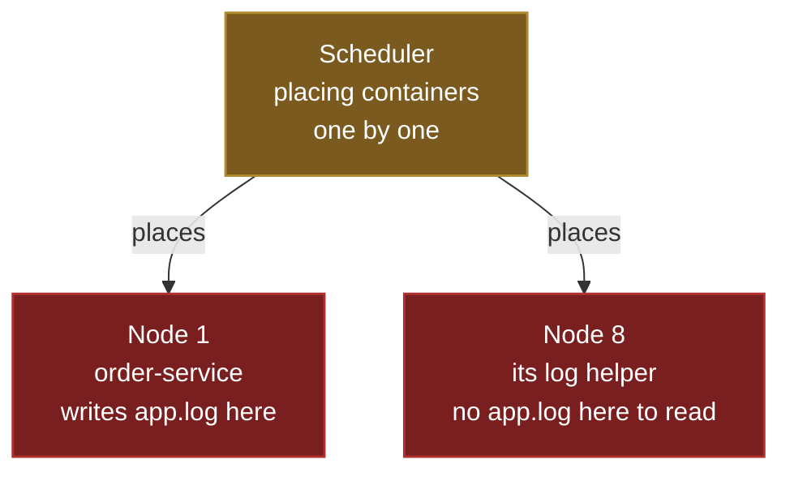
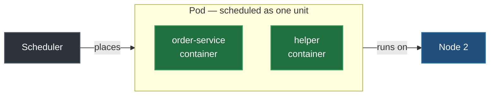
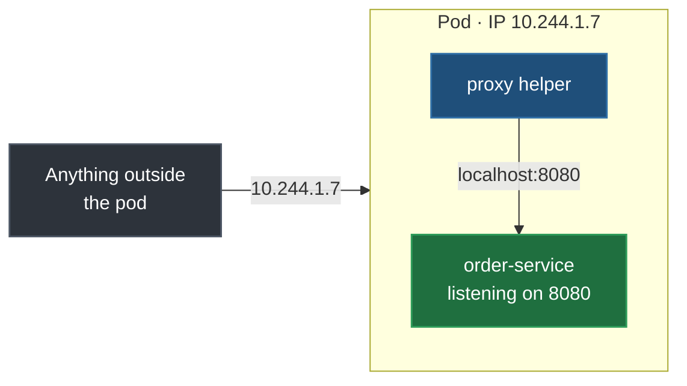

The architecture note described the scheduler choosing a node for a container and the kubelet getting that container started, and set one level of the hierarchy aside: the pod, sitting between the node and the container. This note picks up the question it skipped: does Kubernetes place and manage individual containers directly?

It is the obvious assumption, and it looks like it would work. A worker node already runs the `user-service`, `payment-service` and `order-service` containers. A fourth container needs placing, and the node has a core and some RAM free. The scheduler could pick this node for the new container, that node's kubelet could tell its container runtime to start it, and the job is done. Nothing in that chain is broken.

**Normally, Kubernetes does not do this.** It wraps containers in a unit called a **Pod**, and to see why, look at an application that is not just one container.

## The problem: containers that belong together

The order service runs in one container. Next to it is a second container: a **helper**, the small companion program the first note mentioned. The clearest helper to start with is the one that handles logs, because logging is really two jobs and only one of them belongs to the order service.

| Job | Who does it | For the order service |
|---|---|---|
| **Writing** a log line | the application | `log.info("order placed")` appends a line to `/app/logs/app.log` |
| **Shipping** it to one central place | the helper | reads each new line of that file and sends it to a log store |

The writing never moves. The order service keeps calling `log.info()` exactly as before, and each line lands in a file on the machine its container is running on. The trouble is that a file on one machine is only useful on that machine. Run three replicas of the order service on three nodes and there are three separate `app.log` files, so finding out why one customer's order failed means logging into each server in turn and searching each file. And when a node fails, its file goes down with it, at exactly the moment you need it.

Shipping fixes both problems. A log helper runs beside each replica, watches its `app.log`, and sends every new line, as soon as it is written, to a log store that lives off the nodes. There, the logs of all three replicas can be searched in one place, and they outlive any machine.



Logs are the most common job for a helper, and the others follow the same pattern: something one application needs, run in a container of its own beside it.

- holding configuration, or heavy extra libraries, that the application uses;
- acting as a proxy for its network traffic, or writing proxy-related information;
- preparing or creating files for it;
- running scheduled jobs (the periodic tasks Linux calls cron jobs) that nobody wants inside the main application.

The application could do some of this itself (the order service could ship its own logs, for instance), and sometimes it does. When the extra work is heavy, it goes in a separate container so the main one stays lean. Some teams do this, some never need to.

**A helper is not a microservice, and the log helper shows why.** `payment-service` talks to `order-service` over HTTP, and a network call reaches a server anywhere, so those two can run on different servers without any issue. The log helper does not talk to the order service over the network at all. It reads a file, and a file sits on one machine's disk. So the helper only works where it can reach that file, and at the very least that means the same machine. How two containers on one machine get at the same file is the shared storage section further down.

Now let the scheduler place containers individually. Nothing stops it from doing this:



The relationship breaks. On node 8 the helper has no file to read, so it does nothing at all, while the order service on node 1 keeps writing a log that nobody ships. A helper cannot, or should not, exist on its own; it is useful only next to the application it serves. What you want is simple: these two always land on the same node, together, every time.

## The answer: the Pod

Kubernetes' answer is to say: put both of them **in one Pod**.

> **A Pod is a group of related containers that are scheduled and managed together, on one node.**

**The scheduler then places pods, not containers:** it decides which node a pod goes to, and whatever is inside the pod (one container, two, or more) goes there together. Everything the architecture note said about placing and running containers holds with the pod as the unit: the scheduler places pods, the kubelet runs the pods assigned to its node, and the runtime creates the containers inside them. Kubernetes still manages your containers, but indirectly: what it looks after directly is the pod, and the containers come with it.



**Checked against the documentation:** Kubernetes defines Pods as the smallest deployable units of computing that you can create and manage. There is no smaller thing it deploys. The hierarchy from the architecture note is complete now:

> **Cluster → Node → Pod → Container**

## Most pods hold one container

Having said all that, **the most common pod by far contains exactly one container**: the application. Most applications have no helper at all, so the pod wraps just the order service and nothing else.

That can look strange — a pod for a single container? — but **a pod is still necessary**, because Kubernetes manages pods, not containers. Whether a pod holds one container or several, the pod is there. The documentation says the same: the one-container-per-Pod model is the most common Kubernetes use case.

> [!danger] **Never put separate microservices into one pod.**
> Pods group a main application with its own helpers. They are not a way of grouping an architecture. Taking `user-service`, `payment-service` and `order-service` (three microservices) and putting them in one pod is a very wrong approach, and makes no sense. Each gets its own pod: a pod for the user service with its container, one for payment, one for orders. If one of them needs a helper, the helper goes in that service's pod.
>
> The reason is everything from the first note. These services need to **scale independently, fail independently and deploy independently**. Bundle them, and the payment service cannot get five replicas without the other two getting five as well; a crash in one takes the pod down for all three; a new version of one means redeploying all three.

> [!danger] **Never put several replicas of one service into one pod either.**
> Can one service's multiple replicas share a pod? No. The whole value of replicas comes from keeping them apart, so that if one server goes down by mistake, the other replicas are still alive. Put them in one pod and they land on one node, and one node failing takes every replica with it: you have not replicated anything. **One pod means one application**; occasionally that application's helper rides along with it.

> [!question] **Do microservice architectures use helpers at all?**
> Yes. Even in a microservice architecture, a service often keeps separate helpers — for logs, for proxies, for libraries — and they are seen in real applications. They go in the same pod as the service they help.

## What containers in a pod share

Putting containers in one pod is not just a scheduling convenience. **Containers in the same pod share certain resources**, and the two that matter here are networking and storage.

### One network identity

**A pod gets its own IP address.** Say Kubernetes gives a pod the address `10.244.1.7`. That is the pod's address; to talk to the pod, you talk to that IP. **The containers inside it do not have IP addresses of their own**. They live inside the pod's single network identity.

That leaves three kinds of thing in a cluster, and only two of them have an address:

| Thing | Has its own IP? | Example |
|---|---|---|
| **Node**, the server | yes | `192.168.1.21` |
| **Pod** | yes, one per pod, even when several pods share a node | `10.244.1.7`, `10.244.1.8` |
| **Container** | no; it uses its pod's IP | the order service is reached at `10.244.1.7` |

This is a change from Docker on its own. There, each container on the default bridge network got an address of its own, such as `172.17.0.2` and `172.17.0.3`, and that address was private to its host. In Kubernetes the address moves up one level, from the container to the pod, and every pod's address can be reached from any other pod in the cluster, on any node.

That has a direct, useful consequence for containers in the same pod. Suppose the order service has a proxy helper, the third kind of helper in the list above, which receives the service's network traffic and forwards it on. If the order service listens on port 8080, the helper reaches it at:

> `localhost:8080`

To each of them, the other is on localhost, exactly the way you run MySQL and Spring Boot side by side on your own laptop and connect with `localhost`. This is the biggest practical benefit of the pod: one network identity for the whole group, so its members talk to each other through localhost.



> [!bug] **Going further: shared ports cut both ways.**
> Sharing one network namespace means sharing one set of ports. Two containers in the same pod cannot both listen on 8080, any more than two programs on your laptop can. Tried on the check cluster (a small cluster used to test the claims in these notes) with two web servers both told to use 8080, the first started and the second died on startup, over and over, leaving the pod at one of two containers ready:
> ```text
> portclash   1/2   Error   2 (19s ago)   20s
> httpd: bind: Address already in use
> ```
> Containers in different pods have no such conflict, because each pod has its own IP. Three replicas of the order service on one node can all listen on 8080: one is `10.244.1.7:8080`, another `10.244.1.8:8080`, and the two never meet. Docker on its own needed host ports 8081, 8082 and 8083 to run three copies on one machine, because they all sat behind the host's single address; pods do not.

### Shared storage

Containers in a pod can also share **volumes**: the same idea as the volume in the first note, storage that is not inside any one container, here mounted into several containers of the same pod at once. The order service writes its log to `/app/logs/app.log`; the log helper in the same pod mounts the same volume and reads the same file, and ships it wherever logs go.


The kinds of volume Kubernetes offers are a subject of their own, outside this folder. For now: **same pod → can share networking → can share volumes.** On the check cluster, an application container appended a line to a log file on a shared volume and the helper container, mounting that volume at a different path, read the line straight back.

> [!question] **Is a helper container in the same pod called a sidecar?**
> **Yes, and the documentation confirms it.** Kubernetes calls them **sidecar containers**, secondary containers that run alongside the main application container within the same Pod. The log helper and the proxy helper in this note are both sidecars. **Going further:** Kubernetes now has built-in support for sidecars that start before the main container and keep running beside it; it has been on by default since v1.29 and stable since v1.33.

> [!question] **Can a pod be brought up and down like starting and stopping a service, to change the application's properties?**
> That belongs with interacting with pods, which is where the next note starts: creating a pod by hand, inspecting it and deleting it — and why pods are not managed by hand at all. Changing an application's settings without rebuilding anything is the subject of the ConfigMaps note.

> [!note] **Going further: you rarely create pods yourself.**
> The documentation is direct about it: usually you do not create pods directly, even for a single container, but through a higher-level object such as a **Deployment**. A Deployment holds a description like the first note's three replicas of the order service, and has the pods created from it. It is what keeps reconciliation running for those pods: when one dies, a replacement is created to bring the count back to three. Deployments have a note of their own later in this folder.
