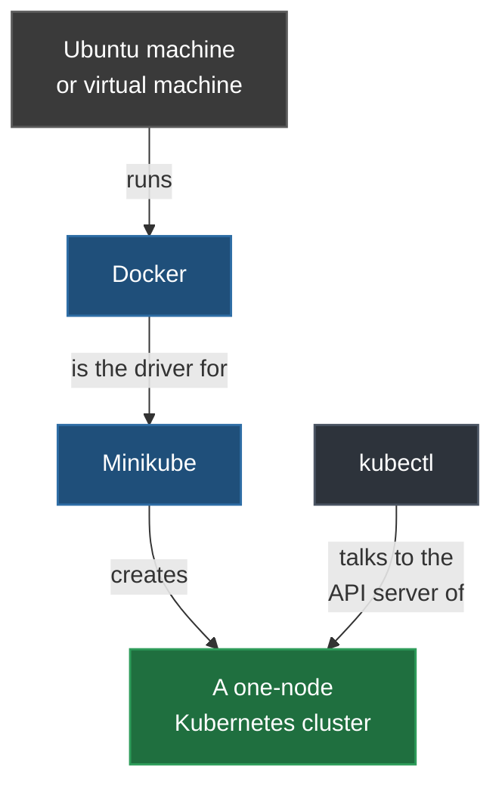
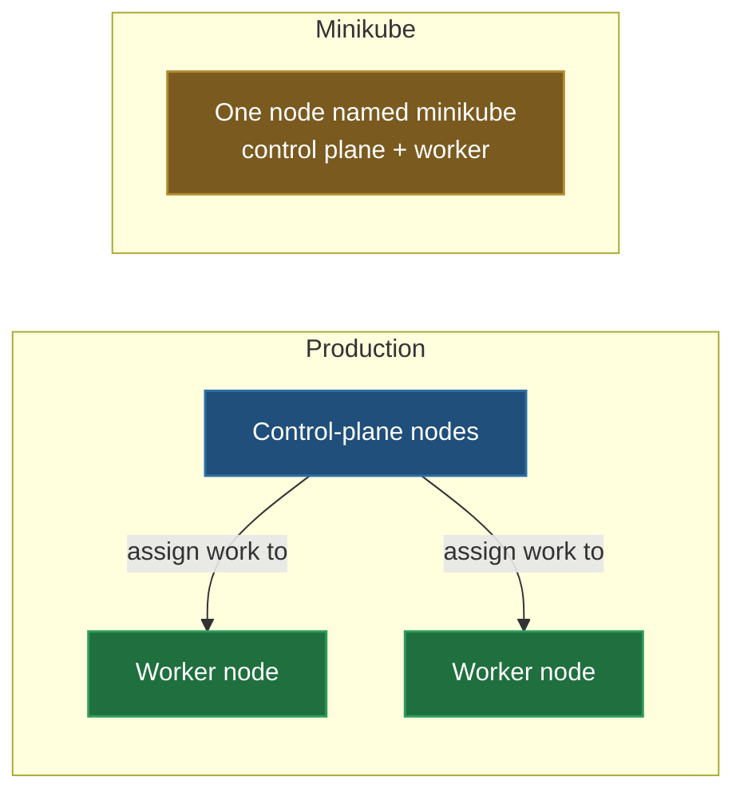
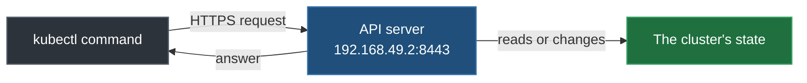
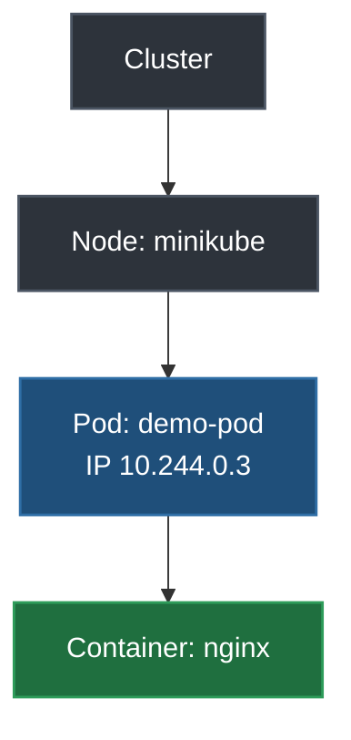
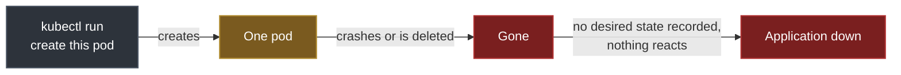
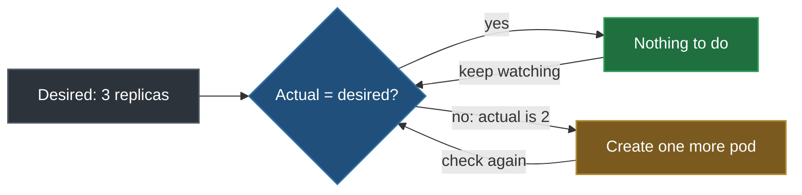

The first three notes stayed with the architecture: a control plane that decides and records, worker nodes that run the workloads, and the pod as the unit Kubernetes places. Everything so far has been described rather than touched. This note builds a cluster on one machine, looks at the parts the architecture note named, runs a first pod by hand — and then shows why running pods by hand is exactly what Kubernetes exists to stop you doing.

## What you need on your own machine

Two separate things are needed, and they are easy to confuse.

The first is **kubectl**, the command-line tool from the architecture note. Every instruction you give Kubernetes goes through it to the API server. But kubectl is only a client. On its own it has nothing to talk to.

The second is **a cluster for it to talk to**: a control plane with its API server, etcd, scheduler and controller manager, and at least one worker with a kubelet and a container runtime. Building that by hand is a serious job, and production clusters are built differently again. For learning, a tool that creates a complete cluster in one command is enough, and the standard one is **Minikube**. It describes itself, in its own help text, as provisioning and managing local Kubernetes clusters optimized for development workflows.

One more thing must already be there: **Docker**. Kubernetes manages containers, so something has to run them, and Minikube can use Docker to create its node. Without Docker installed, this setup does not start.



> [!question] **Can Docker Desktop be used instead?**
> Docker Desktop is one way of getting Docker onto a laptop, with a graphical front end. Whichever way Docker arrives, get comfortable with the command-line tools, because a server has no desktop: every real cluster you touch is driven from a terminal.

## Installing kubectl and Minikube

Every command below was run, in this order, on an Ubuntu 26.04 virtual machine with 4 GB of RAM, on an Apple Silicon Mac. The output in the first three notes came from a different cluster on that same machine — **k3s**, a lightweight Kubernetes distribution, whose one node was called `devops`. From here on the output comes from Minikube, so the node is called `minikube` and the version is Minikube's.

Install kubectl and check the client:

```bash
sudo snap install kubectl --classic
kubectl version --client
```

Minikube is distributed per processor architecture, so check which one the machine is:

```bash
dpkg --print-architecture
```

On an Apple Silicon Mac running Ubuntu in a virtual machine, the answer is `arm64`. Download the matching package, install it, remove the installer and check:

```bash
curl -LO https://storage.googleapis.com/minikube/releases/latest/minikube_latest_arm64.deb
sudo dpkg -i minikube_latest_arm64.deb
rm minikube_latest_arm64.deb
minikube version
```

On an ordinary Intel or AMD machine the architecture is `amd64`, and the file name changes to match. Check that Docker is installed and running, since Minikube will build on it:

```bash
docker --version
docker ps
```

Tell Minikube to use Docker as its driver — the thing it creates the Kubernetes node with. Minikube remembers this as the default from then on:

```bash
minikube config set driver docker
```

Then start the cluster. On a machine with roughly 4 GB of RAM, give it 2,500 MB and leave the rest for the machine itself:

```bash
minikube start --memory=2500mb --preload=false
```

The last lines of a successful start:

```text
* Preparing Kubernetes v1.37.0 on containerd 2.3.4 ...
* Configuring CNI (Container Networking Interface) ...
* Verifying Kubernetes components...
* Done! kubectl is now configured to use "minikube" cluster and "default" namespace by default
```

> [!failure] **The start failed first, with a clock problem rather than a Kubernetes one.**
> The first `minikube start` on the check machine stopped at its preflight checks, with every image pull refused in the same way:
> ```text
> [ERROR ImagePull]: failed to pull image registry.k8s.io/kube-apiserver:v1.37.0: ...
> tls: failed to verify certificate: x509: certificate has expired or is not yet valid:
> current time 2026-11-04T18:08:51Z is before 2026-11-09T06:18:15Z
> ```
> Read the last line: the machine believed it was 4 November, and the registry's certificate only became valid on the 9th. The virtual machine's clock had fallen twelve days behind after being suspended, so a perfectly good certificate looked like it was not valid yet. Its time service knew — it reported the clock as about 1,018,000 seconds slow — but corrects drift gradually. Forcing it to jump to the right time fixed it at once:
> ```bash
> sudo chronyc makestep
> ```
> Then `minikube delete` and `minikube start` again. **An x509 not-yet-valid or expired error on a machine that was just woken up is worth checking against the clock before anything else.**

## What Minikube builds: one node doing both jobs

```bash
minikube status
```

```text
minikube
type: Control Plane
host: Running
kubelet: Running
apiserver: Running
kubeconfig: Configured
```

These are the parts from the architecture note. The **host** is the machine the node runs on — here, a container Docker created. The **kubelet** is the agent that runs the node's workloads. The **apiserver** is the front desk. **kubeconfig** is the file that tells kubectl which cluster to talk to and how, and `Configured` means kubectl is already pointed at this one.

The architecture note described a cluster split in two: control-plane nodes that decide, and worker nodes that run the workloads. In production they are separate machines, and there are several of each. **Minikube creates one node and gives it both jobs** — the architecture note's closing tip, that a one-node cluster is both halves at once. It is the control plane, and it is also the worker that pods land on. Running separate machines for each role just to learn would mean a second computer for every node; a single node that plays both parts teaches the same thing. When the same work moves to a cloud provider, the roles go back onto separate machines.



## Looking at the cluster

```bash
kubectl cluster-info
```

```text
Kubernetes control plane is running at https://192.168.49.2:8443
CoreDNS is running at https://192.168.49.2:8443/api/v1/namespaces/kube-system/services/kube-dns:dns/proxy
```

Every node has an IP address, and `192.168.49.2` is this one's. Because the only node is also the control plane, the control plane's address is the node's address, and port `8443` is where its API server listens. **CoreDNS** is the cluster's internal name service: it lets workloads find each other by name instead of by address, which matters a great deal when Services arrive later in this folder. It is reached through the same address, because the API server is the gateway to everything.

Every kubectl command follows the same path: the command goes to the API server, and the API server works out what to do with it and answers.



How many nodes does the cluster have?

```bash
kubectl get nodes
```

```text
NAME       STATUS   ROLES           AGE   VERSION
minikube   Ready    control-plane   32s   v1.37.0
```

One node, named `minikube`, in the `Ready` state. Its role is listed as `control-plane` only, even though it also does a worker's job. `AGE` is how long ago it was created and `VERSION` is the Kubernetes version on it. Straight after `minikube start` the status can read `NotReady` for half a minute while the node's networking comes up; that is not a fault.

For more detail, add `-o wide`. `kubectl get` gives a summary; `-o wide` adds columns:

```bash
kubectl get nodes -o wide
```

```text
NAME       STATUS   ROLES           AGE   VERSION   INTERNAL-IP    EXTERNAL-IP   OS-IMAGE                         KERNEL-VERSION             CONTAINER-RUNTIME
minikube   Ready    control-plane   14s   v1.37.0   192.168.49.2   <none>        Debian GNU/Linux 12 (bookworm)   7.0.0-38-generic (arm64)   containerd://2.3.4
```

The **internal IP** is the node's address inside the cluster's network. There is no **external IP** — an address reachable from outside — because nothing outside needs to reach this node yet. The OS image, kernel version and container runtime describe the machine. The runtime is **containerd**, the runtime named in the architecture note. None of this needs memorising; the point is that the cluster is running and the pieces are where the architecture says they are.

## The control plane is made of pods

The control-plane components from the architecture note are running right now, and they can be listed:

```bash
kubectl get pods -n kube-system
```

```text
NAME                               READY   STATUS    RESTARTS   AGE
coredns-559f6c778d-4qnld           0/1     Running   0          23s
etcd-minikube                      1/1     Running   0          29s
kindnet-sn58j                      1/1     Running   0          23s
kube-apiserver-minikube            1/1     Running   0          29s
kube-controller-manager-minikube   1/1     Running   0          29s
kube-proxy-kvn6n                   1/1     Running   0          23s
kube-scheduler-minikube            1/1     Running   0          29s
storage-provisioner                1/1     Running   0          28s
```

`-n kube-system` picks the **namespace** to look in. A namespace is a named partition of one cluster, so that different sets of objects can be kept apart; `kube-system` is the one Kubernetes keeps its own components in. Ordinary work goes into the namespace called `default`, which is where kubectl looks when no namespace is given.

The list is the architecture note made real: the **API server**, **etcd**, the **scheduler** and the **controller manager** of the control plane, plus **kube-proxy** and **CoreDNS**. On this kind of cluster, those components themselves run as pods. `kindnet` is the networking plugin Minikube installs to connect pods to each other, and `storage-provisioner` creates disks when something asks for one — the StatefulSet note relies on it.

## Your first pod

Is anything running in the default namespace?

```bash
kubectl get pods
```

```text
No resources found in default namespace.
```

Nothing. Now run one container in one pod. With Docker, you would turn an image into a container with `docker run`. **Here Docker is not used to start the container at all**; you ask Kubernetes, and Kubernetes has its own runtime start it.

Any image would do — a Spring Boot application's image, say. Building one first is a long detour, so use an image that already exists, the way MySQL in the first note ran from a ready-made image rather than one built for it. **nginx** is a web server, often used as a **reverse proxy** — a server that receives requests on an application's behalf and passes them on to it — or as a load balancer, which spreads requests across replicas. Its official image exists ready-made, and the `alpine` variant is a small one. Given just `nginx:alpine`, Kubernetes pulls it from Docker Hub, the public registry, and makes a container from it.

```bash
kubectl run demo-pod --image=nginx:alpine --port=80
```

```text
pod/demo-pod created
```

In plain English: create a pod called `demo-pod`, put one container in it made from the image `nginx:alpine`, and note that the container listens on port 80. Port 80 is where nginx serves web pages by default.

```bash
kubectl get pods
```

```text
NAME       READY   STATUS              RESTARTS   AGE
demo-pod   0/1     ContainerCreating   0          1s
```

A few seconds later:

```text
NAME       READY   STATUS    RESTARTS   AGE
demo-pod   1/1     Running   0          8s
```

**READY counts containers inside the pod**, not pods. The number on the right is how many containers the pod has, and the number on the left is how many of them are ready:

```text
READY
1 / 1
↑   ↑
│   └── containers in the pod
└────── containers that are ready
```

So `0/1` means the pod exists and its one container is not ready yet — here, because the image was still being pulled. Wait a little; a simple pod gets there in seconds, and a heavier one takes longer.

Where is it running?

```bash
kubectl get pods -o wide
```

```text
NAME       READY   STATUS    RESTARTS   AGE   IP           NODE       NOMINATED NODE   READINESS GATES
demo-pod   1/1     Running   0          8s    10.244.0.3   minikube   <none>           <none>
```

The pod has **its own IP address**, `10.244.0.3` — the pod note's rule that every pod gets one. It runs on the node `minikube`, in that node's worker role. The last two columns are about scheduling details and can be ignored for now.



You gave a pod name and an image, and Kubernetes did the rest. Behind that one command, the path is the one the architecture note traced: kubectl → API server, which records the pod → scheduler, which picks a node → that node's kubelet → its container runtime, which pulls the image and starts the nginx container.

Delete it:

```bash
kubectl delete pod demo-pod
```

```text
pod "demo-pod" deleted from default namespace
```

```bash
kubectl get pods
```

```text
No resources found in default namespace.
```

Gone, and nothing brought it back.

## Why you never run pods like this

That was a demonstration, and in practice nobody manages pods this way — **no creating them by hand and no deleting them by hand**. Look at what just happened. A pod was created directly, and nothing was watching it. Take the order service — a Spring Boot application — running in one pod, and then that pod disappears. Many things can cause it:

- the node it ran on has a problem;
- someone deletes the pod;
- the container crashes;
- the application is redeployed;
- the infrastructure underneath changes.

When a pod created with `kubectl run` disappears, **nobody notices and nothing replaces it**. The command said create this pod, and that was done. It never said keep one of these running. Kubernetes holds no desired state about it, so there is nothing to reconcile against, and the application is simply down until a person spots it and starts it again.



If restarting things by hand were acceptable, Kubernetes would not be needed: Docker can start a container by hand perfectly well. Kubernetes exists so that nobody has to keep track of which container is up and which is down. As a developer or a DevOps engineer, the thing you care about is your application, not the containers. Containerising the application is a step in getting it onto servers, and Kubernetes automates that step the way Jenkins and GitHub Actions automated the deployment process. And production is not three pods: it is pod A, pod B, pod C and hundreds more, possibly half a million containers, and nobody is going to deploy and redeploy those by hand.

What you actually want to say is one sentence: **keep three replicas of this application running.** Desired 3, actual 0 — Kubernetes creates them, ideally on different worker nodes, and the actual count becomes 3. One is lost, actual falls to 2, and Kubernetes creates another. That is the reconciliation loop from the first note, and the component that runs it is the **controller manager** from the architecture note.



> [!question] **Is the controller manager a cron job that checks every few seconds?**
> It can be pictured that way, but it is not exactly a cron job — a scheduled task run at fixed times. **Checked against the documentation:** a controller is a control loop that watches the shared state of the cluster through the API server and makes changes to move the current state towards the desired state. It reacts to changes as they are reported, rather than waking up on a timer and looking. The effect is the one that matters: a gap between desired and actual is noticed almost immediately. And the controller does not start containers itself; as the architecture note showed, it records that a new pod is needed, the scheduler picks the node, and that node's kubelet has it started.

> [!question] **Do you define the size and memory of a pod?**
> Not of the pod as such. You describe the containers, and the pod is created for those containers; what the containers need decides what the pod needs. How much CPU and memory a container may ask for and use is its own subject, outside this note.

## A controller per kind of requirement

So the job is no longer create this pod. It is a requirement, and requirements come in different shapes:

| Requirement | Kubernetes object that handles it |
|---|---|
| Always keep three interchangeable pods running | **ReplicaSet** |
| Run three copies of my application, and replace them gradually when a new version ships | **Deployment** |
| Run one copy of this pod on every node | **DaemonSet** |
| Run three database pods and keep each one's identity and disk | **StatefulSet** |

These are called **workload controllers**, or workload resources: you write down which one you want and what it should maintain, and the matching controller inside the controller manager does the managing. Which one to use depends on the application, and the next two notes take them one at a time, starting from the problem each one solves. Before any of them can work, though, there is a question none of them can avoid: of all the pods in a cluster, how does a controller know which ones are its own? That is where the next note begins.

> [!info] **Versions, checked 2026-11-16.**
> Minikube v1.39.0, which creates Kubernetes v1.37.0 by default, on containerd 2.3.4. **The snap command above installs kubectl 1.35.10**, because snap's default channel lagged two releases behind. kubectl is supported within one minor version of the cluster, and every command against the 1.37 cluster printed:
> ```text
> Warning: version difference between client (1.35) and server (1.37) exceeds the supported minor version skew of +/-1
> ```
> Snap had no 1.37 channel at the time of writing, and moving to the 1.36 channel removed the warning:
> ```bash
> sudo snap refresh kubectl --channel=1.36/stable
> ```
> Expect the version numbers here to drift; the check is `kubectl version`, which prints the client and the server side by side.
