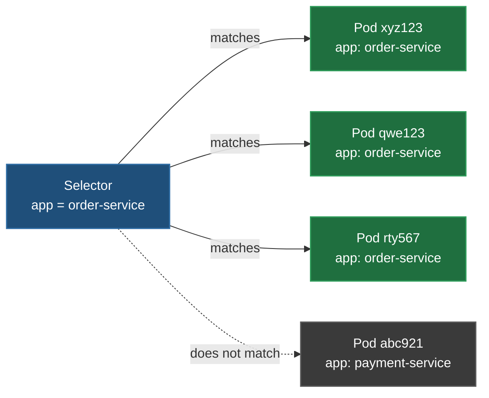
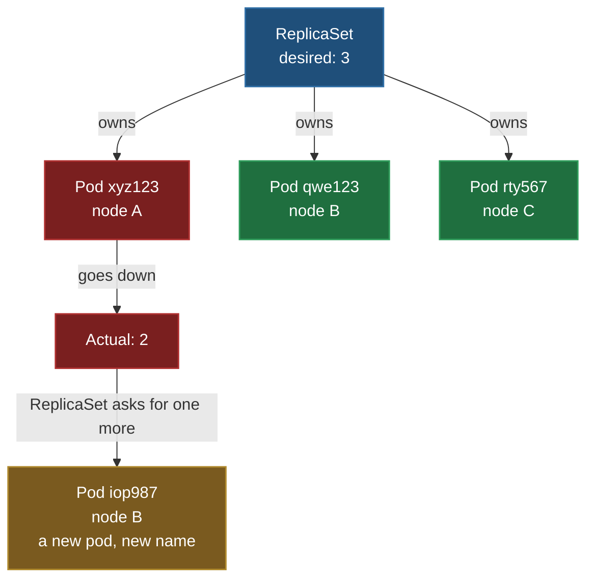
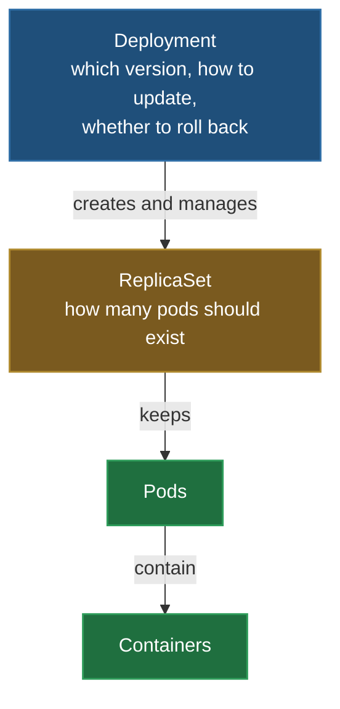
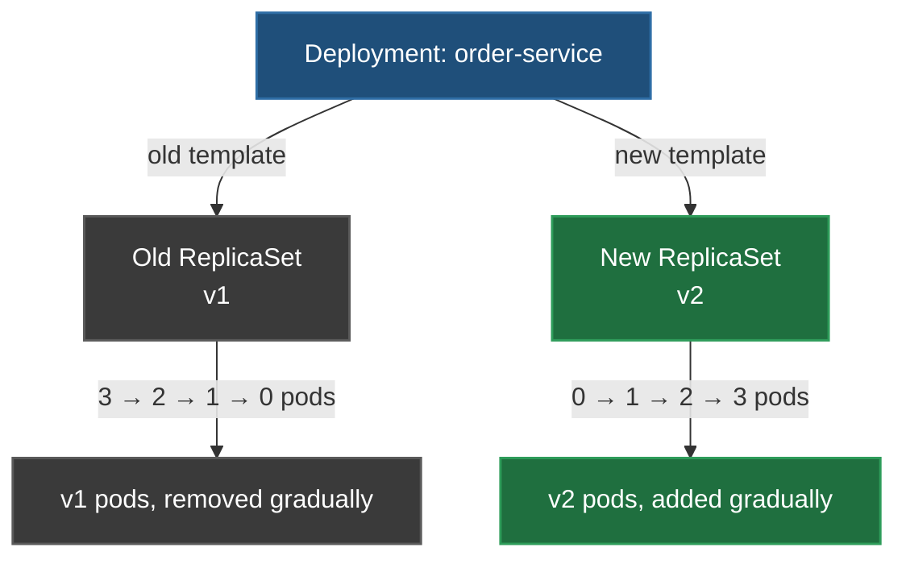
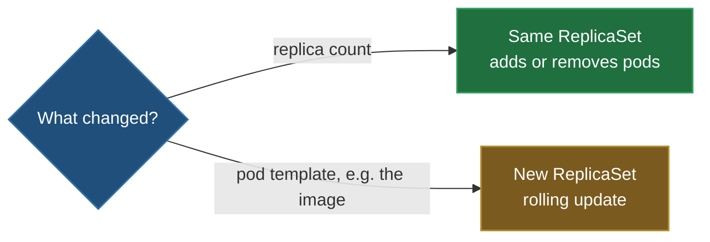

The previous note ended on a requirement — keep three replicas of this application running — and on the objects that turn a requirement like that into managed pods: ReplicaSet, Deployment, DaemonSet and StatefulSet. This note takes the first two, which between them run almost every ordinary application. Both depend on one idea that has to come first.

The running example is the bookshop's order service: one Spring Boot application, packaged as the image `bookcart/order-service:v1`, and the requirement **three replicas of it**.

## How a controller finds its own pods: labels and selectors

Picture three pods of the order service with random names (`xyz123`, `qwe123`, `rty567`) sitting in a cluster alongside hundreds of other pods belonging to the payment service, the user service and everything else. The controller manager looks after all of them. When one order-service pod disappears, how does the controller responsible for the order service even know which pods were its own, and so that it is now one short?

Not by name: the names are random, and a replacement gets a new one. Kubernetes uses **labels**.

> **A label is a key and a value attached to a Kubernetes object, as a tag that identifies it.**

Every order-service pod carries the same label, `app: order-service`. Payment-service pods carry `app: payment-service`. The key `app` is a convention, not a keyword; any key and value work.

> **A selector is a query that finds objects whose labels match.**

The controller is given a selector, `app = order-service`, and its pods are whatever matches: however many there are, whatever they are called and wherever they run. Together they are called a **label selector**.



The same query works from the command line, which is a good way to see what a controller sees:

```bash
kubectl get pods --show-labels
kubectl get pods -l app=order-service
```

```text
NAME                     READY   STATUS    RESTARTS   AGE   LABELS
order-service-rs-bnk82   1/1     Running   0          10s   app=order-service
order-service-rs-pjmc5   1/1     Running   0          10s   app=order-service
order-service-rs-wd8h2   1/1     Running   0          10s   app=order-service
```

Labels and selectors carry far more weight than their size suggests. Every controller in this folder finds its pods with them, and so does the Service, later on.

## ReplicaSet: keep N identical pods alive

A **ReplicaSet** solves the simplest problem there is: **always keep a set number of matching pods running.**

You ask for three. Initially the desired state is 3 and the actual state is 0, so the ReplicaSet asks for three pods. As the architecture note showed, it does not start them itself: its controller records that three pods should exist, the scheduler picks a node for each, and each node's kubelet has its container runtime start them. Say they land on nodes A, B and C. Actual is now 3, and everything matches.

Now the pod on node A goes down. Desired is 3, actual is 2. The ReplicaSet notices the difference and asks for one more pod. The scheduler might place it on node B — any node with room will do, including one that already runs a replica, since one node can host several pods. Actual is 3 again.



> [!important] **A ReplicaSet never brings the same pod back.**
> It does not repair or restart the pod that disappeared. It creates a **new** pod, with a new name, and it may land on a different node. That new pod is called a **replacement pod**. What the ReplicaSet cares about is the count of pods matching `app=order-service`, never the identity of any one of them. For an ordinary application that is exactly right, because one replica is as good as another.

This was run. Three pods from a ReplicaSet were listed, one of them was deleted, and three seconds later the ReplicaSet had a new one with a name that had never existed before:

```text
pod "order-service-rs-bnk82" deleted from default namespace
NAME                     READY   STATUS    RESTARTS   AGE
order-service-rs-ghv9v   1/1     Running   0          5s
order-service-rs-pjmc5   1/1     Running   0          16s
order-service-rs-wd8h2   1/1     Running   0          16s
```

## Reading a ReplicaSet's YAML

Every Kubernetes object is written down the same way, as YAML (the same format as the Compose file from the first note). A file that describes one or more Kubernetes objects is called a **manifest**. This one describes the order service's ReplicaSet:

```yaml
# k8s/replicaset.yaml
apiVersion: apps/v1
kind: ReplicaSet
metadata:
  name: order-service-rs
spec:
  replicas: 3
  selector:
    matchLabels:
      app: order-service
  template:
    metadata:
      labels:
        app: order-service
    spec:
      containers:
        - name: order-service
          image: bookcart/order-service:v1
```

Read it as English, top to bottom:

| Line | Means |
|---|---|
| `apiVersion: apps/v1` | which version of the Kubernetes API this kind of object belongs to |
| `kind: ReplicaSet` | create a ReplicaSet |
| `metadata.name` | this ReplicaSet is called `order-service-rs` |
| `replicas: 3` | maintain three pods |
| `selector.matchLabels` | the pods I manage are the ones labelled `app: order-service` |
| `template` | when another pod is needed, build it like this |
| `template.metadata.labels` | stamp every new pod with `app: order-service`, so the selector finds it |
| `template.spec.containers` | each pod holds one container, made from `bookcart/order-service:v1` |

The **template** is the pod template: the recipe for a new pod, which the ReplicaSet uses every time it has to create one, including every replacement. That is why it has to name an image: without one, there is nothing to build the pod from. Most of the rest is the same boilerplate in every object, and it does not need memorising: `apiVersion`, `kind`, `metadata` and `spec` appear in every manifest you will write.

**The labels in the template must match the selector.** A ReplicaSet whose template stamped pods with labels its own selector could not find would create pods forever without ever seeing its count reach three, so Kubernetes refuses it outright. Tried with the template labelled `app: orders` and the selector looking for `app: order-service`:

```text
The ReplicaSet "mismatch" is invalid: spec.template.metadata.labels: Invalid value: {"app":"orders"}: `selector` does not match template `labels`
```

A file like this is handed to the cluster with:

```bash
kubectl apply -f k8s/replicaset.yaml
```

```bash
kubectl get rs
```

```text
NAME               DESIRED   CURRENT   READY   AGE
order-service-rs   3         3         3       10s
```

## Where a ReplicaSet falls short: a new version

The ReplicaSet is very good at its one job. Then the developers ship version 2, `bookcart/order-service:v2`, and the job changes.

What you want is not three pods running. You want the three version-1 replicas replaced by three version-2 replicas **gradually** — the rolling update from the first note: one replica moves to version 2, then a pause, then the next, then the last, so the application never goes fully down.

```text
v1 v1 v1   →   v2 v1 v1   →   v2 v2 v1   →   v2 v2 v2
```

That is **version management**: knowing which version should run, replacing old pods with new ones at a controlled pace, and being able to go back. A ReplicaSet does not do any of it. It only knows a count and a template.

This was run, to see what a ReplicaSet does when its image changes. The template was changed from one image to a newer one, and the three running pods were checked straight afterwards:

```text
NAME                     IMAGE
order-service-rs-ghv9v   nginx:1.28-alpine
order-service-rs-pjmc5   nginx:1.28-alpine
order-service-rs-wd8h2   nginx:1.28-alpine
```

The ReplicaSet's template now named `nginx:1.29-alpine`, and **not one running pod changed**. Three pods still matched the selector, so as far as the ReplicaSet was concerned there was nothing to do. Then one pod was deleted, and its replacement was built from the new template:

```text
NAME                     IMAGE
order-service-rs-pjmc5   nginx:1.28-alpine
order-service-rs-wd8h2   nginx:1.28-alpine
order-service-rs-zrrmf   nginx:1.29-alpine
```

> [!failure] **Two versions running side by side, by accident.**
> That last listing is the failure in full. The application is now serving one request in three from the new version and two from the old, and it will stay that way until the old pods happen to die. Nothing rolled out; versions drifted. This is why ReplicaSets are not used directly for applications.

## Deployment: a ReplicaSet with version management on top

The architecture note named both objects in passing (a Deployment holding the description of an application, a ReplicaSet holding the count) and showed that each owns the next. Here is why the split exists. A **Deployment** is the controller built for exactly this. It is the one you will use most, by a long way: whatever the application is — a payment gateway, a notification system, a Spring Boot or FastAPI or Django service — it runs as a Deployment.

The interesting part is that **a Deployment is not a different mechanism from a ReplicaSet. It uses ReplicaSets.** It creates them and manages them, and the ReplicaSets do what they always did: keep the pods. On top, the Deployment adds what the ReplicaSet lacks:

- rolling updates from one version to the next;
- version management: a history of what ran before;
- rollback to an earlier version;
- control over how fast pods are replaced.

**Checked against the documentation:** a Deployment is a higher-level concept that manages ReplicaSets and provides declarative updates to pods, and the ReplicaSet page says plainly that you may never need to manipulate ReplicaSet objects yourself: use a Deployment instead. Understand the ReplicaSet; use the Deployment.

The hierarchy, with one responsibility at each level:



> Deployment: I want version 2 with three replicas.
> ReplicaSet: I will keep those three pods.

The YAML barely changes. The kind becomes `Deployment`, the selector and template stay as they were, and the port the container listens on is declared:

```yaml
# k8s/deployment.yaml
apiVersion: apps/v1
kind: Deployment
metadata:
  name: order-service
spec:
  replicas: 3
  selector:
    matchLabels:
      app: order-service
  template:
    metadata:
      labels:
        app: order-service
    spec:
      containers:
        - name: order-service
          image: bookcart/order-service:v1
          ports:
            - containerPort: 8080
```

This was run, with `nginx:1.28-alpine` standing in for version 1; nginx listens on port 80, so the file that was run declared `containerPort: 80` instead of 8080. Applying it created a Deployment, and the Deployment created a ReplicaSet of its own:

```bash
kubectl apply -f k8s/deployment.yaml
kubectl get deploy,rs,pods
```

```text
NAME                            READY   UP-TO-DATE   AVAILABLE   AGE
deployment.apps/order-service   3/3     3            3           1s

NAME                                       DESIRED   CURRENT   READY   AGE
replicaset.apps/order-service-7b884754c4   3         3         3       1s

NAME                                 READY   STATUS    RESTARTS   AGE
pod/order-service-7b884754c4-fdgvr   1/1     Running   0          1s
pod/order-service-7b884754c4-pzzgn   1/1     Running   0          1s
pod/order-service-7b884754c4-zjddz   1/1     Running   0          1s
```

The names show the hierarchy. The ReplicaSet is named after the Deployment plus a suffix, and each pod after the ReplicaSet plus a suffix of its own. Each pod records the ReplicaSet as its owner, and the ReplicaSet records the Deployment — the same chain the architecture note showed.

## Shipping version 2: a rolling update

To ship a new version, change the image in the YAML (`bookcart/order-service:v1` becomes `bookcart/order-service:v2`) and apply the file again:

```bash
kubectl apply -f k8s/deployment.yaml
kubectl rollout status deploy/order-service
```

The Deployment notices that its pod template changed and **creates a new ReplicaSet** for the new template. Then it moves pods across: the new ReplicaSet grows while the old one shrinks, a step at a time, until the new one holds all three and the old one holds none.



The ReplicaSets are not named v1 and v2; those are labels for explaining. Their names come from the pod template, as the hash on the end. Applying the same template on two different clusters produced the same ReplicaSet name on both.

This was run. The image was changed from `nginx:1.28-alpine` to `nginx:1.29-alpine`, and both ReplicaSets were sampled once a second while the rollout ran. Condensed to the three distinct states it passed through:

```text
new 58df66977f   desired 1   ready -   | old 7b884754c4   desired 3   ready 3
new 58df66977f   desired 3   ready 2   | old 7b884754c4   desired 1   ready 1
new 58df66977f   desired 3   ready 3   | old 7b884754c4   desired 0   ready -
```

The Deployment first added one new pod while all three old ones still served, then grew the new ReplicaSet and shrank the old one, and finished with the new one at 3 and the old one at 0. **At no point were fewer than three pods ready.** The pace comes from the Deployment's update strategy, which on that cluster was the default:

```text
strategy={"rollingUpdate":{"maxSurge":"25%","maxUnavailable":"25%"},"type":"RollingUpdate"}
```

**maxSurge** is how many pods above the desired count may exist during the update, and **maxUnavailable** is how many below it may be missing. **Checked against the documentation:** the surge percentage is rounded up and the unavailable percentage rounded down. With three replicas, 25% surge rounds up to 1 and 25% unavailable rounds down to 0: one extra pod is allowed, and none may be missing. That is exactly the sequence above: add one, then remove one, never dropping below three.

> [!tip] **The old ReplicaSet is kept, not deleted.**
> After the rollout, `kubectl get rs` still showed both:
> ```text
> NAME                       DESIRED   CURRENT   READY   AGE
> order-service-58df66977f   3         3         3       14s
> order-service-7b884754c4   0         0         0       16s
> ```
> The old one sits at zero pods, holding the old template. That is what makes rollback possible.

## Rolling back

Version 2 has a serious bug. A Deployment can return to an earlier revision, and each template it has run is a revision:

```bash
kubectl rollout history deploy/order-service
```

```text
REVISION  CHANGE-CAUSE
1         <none>
2         <none>
```

```bash
kubectl rollout undo deploy/order-service
```

This was run, and the result shows how rollback works underneath. **No new ReplicaSet was created.** The Deployment took the old ReplicaSet, the one sitting at zero, scaled it back up to three and scaled the new one down to zero (a rolling update in reverse):

```text
NAME                       DESIRED   IMAGE               REVISION
order-service-58df66977f   0         nginx:1.29-alpine   2
order-service-7b884754c4   3         nginx:1.28-alpine   3
```

The old template became the newest revision, 3, and the history now read 2 and 3.

> [!warning] **A rollback leaves your YAML file behind.**
> The undo printed a warning worth reading: the Deployment had been managed with `kubectl apply`, and rolling back does not update the record of what was last applied, which can cause unexpected behaviour on the next `kubectl apply`. The file on disk still says version 2. **If you roll back and later apply that file again, version 2 comes straight back.** After an emergency rollback, fix the file to match what is actually running.

> [!question] **Where is the old version kept? In etcd?**
> Yes. Everything a cluster knows is stored in etcd, and an old ReplicaSet is an ordinary object like any other: it stays there, scaled to zero, holding its template. The Deployment keeps the last ten by default (the run showed `revisionHistoryLimit=10`), and those retained ReplicaSets are the history that `kubectl rollout history` reads and that `kubectl rollout undo` scales back up. It is not a cache inside the ReplicaSet.

## Scaling is not a new version

Two different changes are easy to mix up.

**Scaling** changes the count. Desired goes from 3 to 10; the version stays the same. The same ReplicaSet simply creates seven more pods:

```bash
kubectl scale deploy/order-service --replicas=10
```

```text
NAME                       DESIRED   CURRENT   READY   AGE
order-service-58df66977f   0         0         0       28s
order-service-7b884754c4   10        10        10      30s
```

**A version change** changes the pod template (usually the image). That creates a new ReplicaSet and a rolling update.

| Change | Example | What the Deployment does |
|---|---|---|
| Scaling | `replicas: 3` → `replicas: 10` | the existing ReplicaSet grows; no new ReplicaSet |
| Version change | `image: …:v1` → `image: …:v2` | a new ReplicaSet, and a rolling update into it |



> [!question] **Does each controller do only one thing at a time?**
> Each object has one controller looking after it, and each kind has one behaviour: a ReplicaSet keeps a count, a Deployment manages versions. They combine by layering rather than by one object switching between behaviours. A Deployment always has ReplicaSets under it (one per template it has run), so using a Deployment means using ReplicaSets as well.

> [!question] **So is a Deployment just a ReplicaSet plus rolling deployment?**
> A ReplicaSet plus more than that: rolling updates, the revision history, rollback and control over the pace of replacement. Rolling deployment is one feature of several.

> [!question] **A rollout should go one pod at a time, but a ReplicaSet creates all three at once. Which wins?**
> The Deployment does. During a rollout it does not hand the new ReplicaSet a count of three straight away; it raises the new ReplicaSet's count and lowers the old one's in steps, within the surge and unavailability limits above. The ReplicaSet only ever sees the number it has been given at that moment.

> [!question] **What happens to a request a pod is processing when the rollout removes that pod?**
> This depends on how the application shuts down, and the full answer belongs with running many replicas in production. **Going further:** Kubernetes does not kill a pod instantly. It sends the container a signal to stop and waits for a grace period before forcing it (30 seconds by default; the pods in the run showed `terminationGracePeriodSeconds: 30`), so an application that finishes its in-flight requests when told to stop loses none of them.

## When a Deployment is the right choice

Ask one question: **are these pods interchangeable?** Three order-service pods, A, B and C. If any incoming request can go to any one of them and it makes no difference which pod serves it, a Deployment fits.

That does not mean the system holds no data. The order service still talks to MySQL, Redis, MongoDB or S3. What matters is that **the individual application pod does not need a lasting identity of its own** — and why that is true for most applications, and what to do for the ones where it is not, is where the next note begins.

> [!info] **This was run, not just read.**
> Everything in this note was executed on a Minikube cluster running Kubernetes v1.37.0, with kubectl 1.36: the label queries, the ReplicaSet replacement, the ReplicaSet ignoring a changed image, the Deployment's two ReplicaSets during a rollout, the retained old ReplicaSet, the rollback reusing it, and scaling within one ReplicaSet. The edit-the-YAML-and-apply route for a new version was repeated on a second cluster, k3s v1.37.2, with the same result. `nginx:1.28-alpine` and `nginx:1.29-alpine` stood in for `bookcart/order-service:v1` and `v2`.
