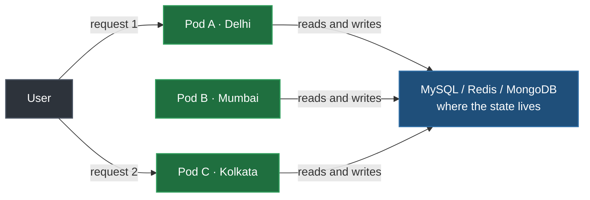
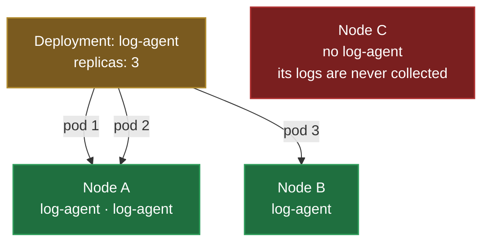
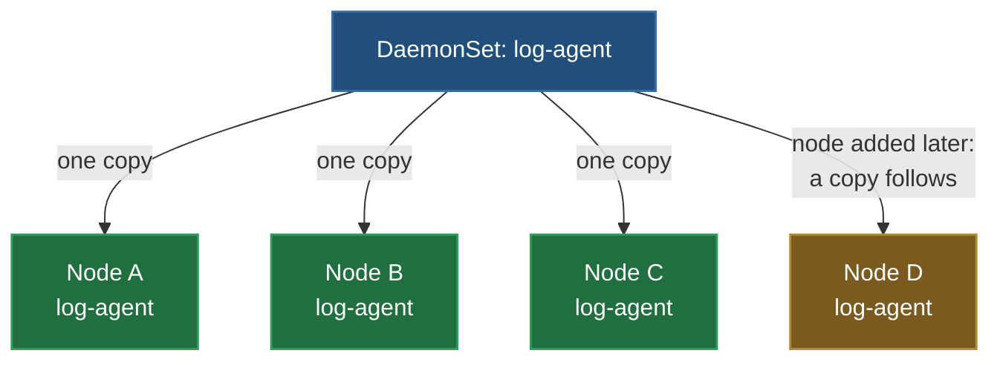
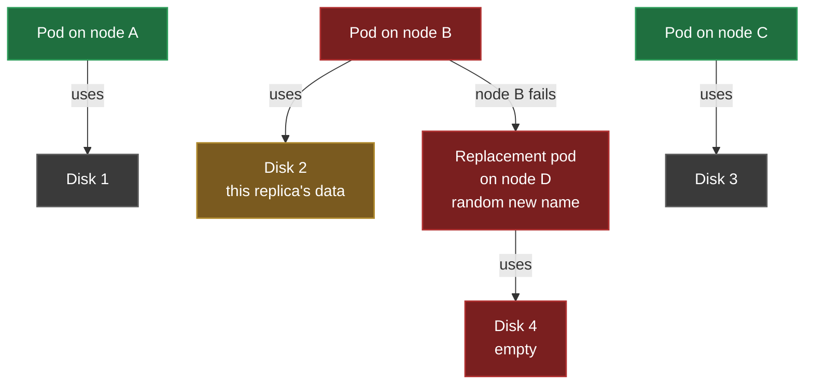
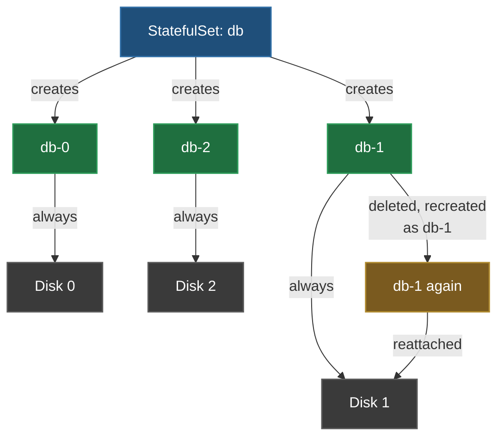
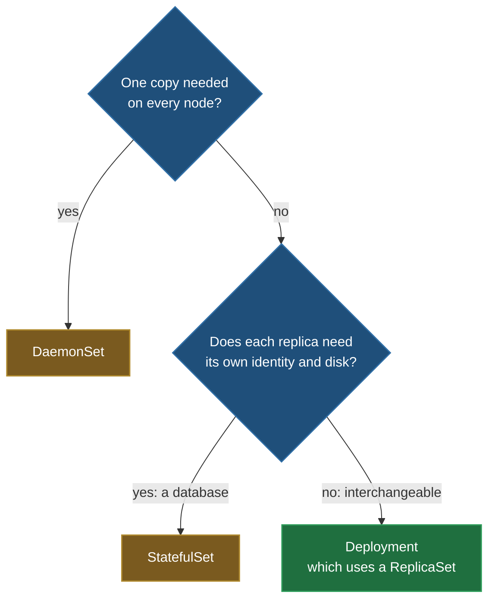

## Why most applications don't care which pod they get

Three replicas of the order service, on three nodes that may be in three different places: a server in Delhi, one in Mumbai, one in Kolkata. A user sends a request. It can land on any of the three pods, and it makes no difference which. The user's next request can land on a different pod, and that makes no difference either. All three pods contain only the business logic; wherever a request arrives, it is handled the same way.

That is a **stateless architecture**, a system design idea: **the application instances store nothing about any particular user between requests.** It is how applications are built now, and it is the reason a Deployment can treat its pods as replaceable and place them on whichever node it likes. A pod named A does not need to be on node A; it can be on node B or C, and nothing cares.



The opposite, **stateful**, is when the application code itself keeps something about a user. The familiar case is login. Your phone sends a request to a backend server, and the backend recognises that you are already logged in. In an older design, the instance that logged you in remembered it, in its own memory. Then your next request had to reach that same instance, because another one would not recognise you. Today the login lives somewhere else: a signed token the client sends with every request, such as a **JWT**, or a session kept in a separate store such as Redis or a database. Every instance can check it, so none of them needs to remember anything.

> [!important] **Stateless does not mean the system has no data.**
> The order service still stores orders. It stores them in MySQL, Redis, MongoDB or S3 — outside the application pod. The application pod itself needs no lasting identity and no disk of its own. That is the line that matters, and it is why **a Deployment is the right controller about 90 to 95% of the time**: most applications are stateless and are deliberately built that way.

The two exceptions are when you need something on every node, and when what you are running is the database itself.

## Something on every node: the DaemonSet

**The requirement.** Three worker nodes run the order service. You also have a **log agent**: a small program, in its own container, that collects the logs of the applications on a node and ships them somewhere central. You want exactly one copy of it on every node, because every node has applications producing logs.

**The naive attempt.** It is a container you want three of, so give it a Deployment with three replicas. The Deployment's ReplicaSet asks for three pods, and the scheduler places each one on whichever node has room. Nothing stops it from doing this:



Three pods exist, so the Deployment is satisfied. The requirement is not: node A has two agents and node C has none. A ReplicaSet does not care where its pods go; that is exactly the property that makes it right for stateless applications, and exactly what makes it wrong here.

This was run. A Deployment of three replicas on a two-node cluster put one pod on the first node and two on the second; on a one-node cluster, ten replicas all went onto the same node. Spreading replicas out is a preference, not a promise (the soft spreading default from the first note), and one per node is not a thing a Deployment can be asked for.

**The answer.** A **DaemonSet** makes sure that every node, or every node in a chosen subset, runs one copy of a pod. It looks at how many nodes there are and schedules one copy onto each. Five nodes, five copies. Ten nodes, ten.



Its YAML has no `replicas` field, because the number of copies is the number of nodes:

```yaml
# k8s/daemonset.yaml
apiVersion: apps/v1
kind: DaemonSet
metadata:
  name: log-agent
spec:
  selector:
    matchLabels:
      app: log-agent
  template:
    metadata:
      labels:
        app: log-agent
    spec:
      containers:
        - name: log-agent
          image: busybox:1.37
          command: ["sh", "-c", "sleep 3600"]
```

The container here only sleeps; it stands in for a real agent's image. This was run on a one-node cluster, and the DaemonSet wanted exactly one copy:

```text
NAME        DESIRED   CURRENT   READY   UP-TO-DATE   AVAILABLE   NODE SELECTOR   AGE
log-agent   1         1         1       1            1           <none>          8s
```

Then a second node was added to the cluster, and nothing else was done. Without being asked, the DaemonSet's count went to two and a copy appeared on the new node:

```text
NAME        DESIRED   CURRENT   READY   UP-TO-DATE   AVAILABLE   NODE SELECTOR   AGE
log-agent   2         2         2       2            2           <none>          2m20s

log-agent-rf58x   minikube-m02
log-agent-zm9vb   minikube
```

You have already seen DaemonSets without knowing it. Two of the control-plane listing's pods from the local-cluster note are DaemonSets — Kubernetes' own networking components, which every node needs:

```bash
kubectl get daemonsets -n kube-system
```

```text
NAME         DESIRED   CURRENT   READY   UP-TO-DATE   AVAILABLE   NODE SELECTOR            AGE
kindnet      1         1         1       1            1           <none>                   2m58s
kube-proxy   1         1         1       1            1           kubernetes.io/os=linux   2m58s
```

That is the general shape of a DaemonSet's job: **node-level infrastructure**, extra helper code that should sit next to every node's workloads but stay in a container of its own.

- log collection agents;
- monitoring agents;
- storage agents;
- networking components, like the two above;
- security and observability agents;
- hardware drivers and helpers.

It is used far less than a Deployment, but when you need one copy everywhere, nothing else does it.

> [!important] **A DaemonSet pod is not a helper container inside your application's pod.**
> The pod note described a helper (a sidecar) that lives in the same pod as one application and shares its network and volumes. A DaemonSet is a different thing. Its pod is a **separate pod of its own**, one per node, sitting next to all the application pods on that node rather than inside any of them. A log agent run as a DaemonSet collects the logs of every pod on its node; a log helper run as a sidecar serves only the one application it shares a pod with. Both are ways to keep helper code out of the application's container, at two different scopes: **per node** and **per application pod**.

> [!question] **If the log agent depends on the application, can the application and its helper be deployed together the first time?**
> You never place either of them yourself. You write YAML that says what should exist (three replicas of the main application, and one log agent on every node), and the controllers do the placing. What you control is the description: how many, and which kind of controller.

--- 

## The database: the StatefulSet

Now the database itself: MySQL, PostgreSQL, Kafka, ZooKeeper, Redis, Cassandra and their kind. Take MySQL, and suppose you want three replicas of it.

Recall how MySQL ran in the first note: **a database does not keep its data inside its container.** The container is one thing; the data lives on a **volume**, storage outside the container where the data actually sits on disk. So for each database replica, something has to remember which disk belongs to which replica.

**The naive attempt.** Three MySQL pods from a Deployment, on nodes A, B and C, with disks 1, 2 and 3.



Node B fails. The Deployment sees desired 3 and actual 2 and does what it always does: it creates a **new** pod, with a new random name, on any available node (node D, say). Nothing ties that new pod to disk 2, because a Deployment's pods all come from one identical template and none of them is the one that had disk 2. It ends up with some other storage, disk 4. Every row that replica held is still on disk 2, and **the database no longer uses it**. The data is not necessarily deleted; it is simply cut off from the replica that owned it.

**A database is stateful by nature**, so it cannot be run as a Deployment. When the replica that used disk 2 comes back, it has to come back attached to disk 2.

**The answer.** A **StatefulSet** gives each replica a lasting identity and keeps its storage tied to that identity. Three things change compared with a Deployment.

**Predictable names.** A Deployment's pods are called things like `web-k72sm` and `web-x82qp`, and nobody cares which is which. A StatefulSet numbers its pods in order, by their **ordinal**: `db-0`, `db-1`, `db-2`.

**A disk per name.** Each ordinal gets its own storage, created once and kept: `db-0` with disk 0, `db-1` with disk 1, `db-2` with disk 2. The StatefulSet holds that mapping.

**The same identity on the way back.** If `db-1` disappears for any reason, the StatefulSet recreates `db-1` — same name — and reattaches **disk 1**, the volume its old data is on.



In YAML, the new part is `volumeClaimTemplates`. A **PersistentVolumeClaim** is a request for a disk of a given size; the template tells the StatefulSet to make one per pod. A StatefulSet also expects a Service with no cluster address of its own, named in `serviceName`. Services are the next note's subject; this one exists only to give each pod a stable network name.

```yaml
# k8s/statefulset.yaml
apiVersion: v1
kind: Service
metadata:
  name: db
spec:
  clusterIP: None
  selector:
    app: db
  ports:
    - port: 3306
---
apiVersion: apps/v1
kind: StatefulSet
metadata:
  name: db
spec:
  serviceName: db
  replicas: 3
  selector:
    matchLabels:
      app: db
  template:
    metadata:
      labels:
        app: db
    spec:
      containers:
        - name: db
          image: busybox:1.37
          command: ["sh", "-c", "sleep 3600"]
          volumeMounts:
            - name: data
              mountPath: /data
  volumeClaimTemplates:
    - metadata:
        name: data
      spec:
        accessModes: ["ReadWriteOnce"]
        resources:
          requests:
            storage: 100Mi
```

The `---` separates two objects in one file. The container is again a stand-in that only sleeps, so the test is about the StatefulSet and its disks rather than about MySQL; a real database would use its own image and its own configuration.

> [!tip] **Going further: ordered startup, and a stable network name.**
> Some stateful systems care about order: `db-0` must be ready before `db-1` starts, and `db-1` before `db-2`. **Checked against the documentation:** a StatefulSet by default creates pods one at a time in ordinal order, waiting for each to be running and ready, and removes them in reverse (the order the run showed). And through that Service with no cluster address, each pod gets a DNS name of its own that survives recreation: on the check cluster, `db-1.db.default.svc.cluster.local` resolved to the new `db-1`'s address after it came back.

> [!warning] **A StatefulSet protects the link to the disk, not the disk.**
> If the node fails, the StatefulSet brings the replica back attached to its old volume: the node broke, not the disk. If the disk itself is lost, that is a different scenario, and nothing in Kubernetes' controllers recovers the data. Backups and the database's own replication handle that.

> [!question] **How do you decide how many replicas you need: from queries per second, from storage?**
> That is a calculation of its own, made per application in production, and it is not covered in this folder. Understand which controller to use first; how many replicas it should keep comes afterwards.

## Choosing the controller

| Controller | The question it answers | Typical example |
|---|---|---|
| ReplicaSet | how do I keep N identical pods? | used through a Deployment, not directly |
| Deployment | how do I run, update and roll back a stateless application? | a Spring Boot REST API, a FastAPI service, a front end |
| DaemonSet | how do I run one pod on every relevant node? | a node log collector |
| StatefulSet | how do I run pods whose identity, storage or order matters? | a database cluster |



In practice: **scaling an application means a Deployment, scaling a database means a StatefulSet**, and a DaemonSet is the occasional case where one particular thing must be on every node.

This also finishes the point from the local-cluster note. You do not create and delete pods by hand. You write down which controller you want and what it should maintain, and pods are created, replaced and placed from that. Whether they run stateless, stateful or one-per-node is decided by the controller you chose.

What none of these controllers settles is how anything reaches those pods. Every pod has its own IP address, and every replacement pod gets a new one — and that is where the next note starts.
