The controllers from the last two notes keep pods running: a Deployment keeps three order-service replicas alive, and replaces any that die. They leave a second problem untouched. Every pod has its own IP address, and something has to send requests to those pods. This note is about that problem and the Kubernetes object that solves it, the **Service**.

## The problem: pod addresses don't last

A Deployment keeps three order-service pods, and the pod note's rule applies: each pod has its own IP address. On a two-node cluster, the three got these:

```text
order-service-747899fc9d-5449s   10.244.0.30   minikube
order-service-747899fc9d-b9s48   10.244.1.4    minikube-m02
order-service-747899fc9d-flx6j   10.244.1.3    minikube-m02
```

The front end needs to call the order service. Here the front end is a **server-side** one: a web application running in its own pods inside the cluster, which builds pages and calls the order service from there (a Spring MVC application, say). A front end whose code runs in the customer's browser calls in from outside the cluster instead, which is a different path, covered later in this note. **Which address should it use?** Two questions hide in that one: which of the three pods a given request should go to, and how the front end would even know the addresses.

Suppose the front end simply uses the first one, `10.244.0.30`. Then that pod is deleted, and the Deployment does what the previous notes showed: it creates a **new** pod. A new pod gets a new address. Here the replacement came up at `10.244.0.31`. The old address now points at nothing, and the front end's requests fail until somebody gives it the new one.

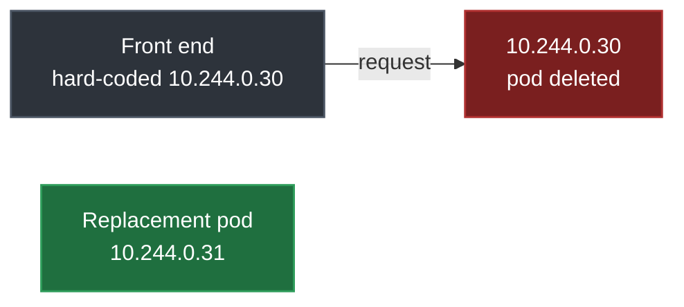

**Pods are ephemeral**, and so are their addresses. A pod's IP is not a permanent contract a client can rely on. The front end does not actually want to talk to pod A. It wants to talk to **the order service**, whichever pods happen to make it up right now. What is needed is something stable standing in front of the changing pods.

## The answer: a Service

> **A Service is a stable network address in front of a changing set of pods.**

The front end talks only to the Service. **The Service keeps track of every pod behind it and their addresses, and passes each request on to one of them.** Pods can die, restart, change IP, scale up and scale down, and the Service stays the one fixed place to send requests to. It works much like a load balancer, and the difference between the two comes up below.

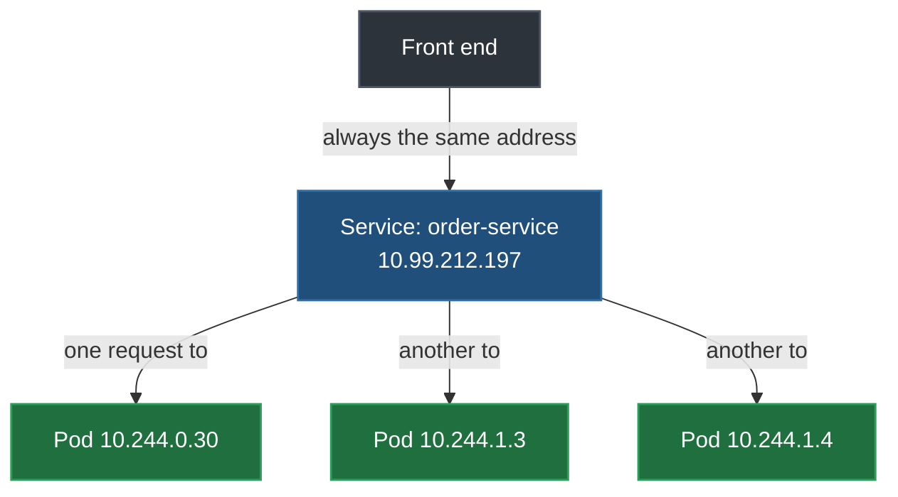

**How does the Service know which pods are its own, and their current addresses?** The same way the controllers did: **labels and selectors**. Every order-service pod carries `app: order-service`, because the Deployment's template stamps it on every pod it creates, replacements included. The Service is given the selector `app = order-service`, and its pods are whatever matches, at every moment. A pod labelled `app: payment-service` does not match and is ignored. Pod B dies and pod D replaces it; pod D carries the same label, so the Service's set goes from A, B, C to A, C, D, and the front end never notices.

Keeping that set up to date is called **service discovery**: the Service always knows which pods it should be sending traffic to. The term is used the same way well outside Kubernetes. Put formally, a Service creates a **network abstraction** (abstraction meaning that something is hidden). The front end does not need to know any pod's address, so it never sees them; it knows the Service.

```yaml
# k8s/service.yaml
apiVersion: v1
kind: Service
metadata:
  name: order-service
spec:
  selector:
    app: order-service
  ports:
    - port: 80
      targetPort: 8080
```

The two port numbers are explained later in this note: requests arrive at the Service on port 80 and are passed to the pods on port 8080, where the application listens.

### What a Service is, and what it is not

A Service passes requests on to the pods it has found, much as a load balancer spreads requests across replicas. But it is not a clever one. It does not know which pod is busy, or how much load a server is under, and it does not route by it. It spreads connections across the eligible pods by a simple rule. It is best understood as **stable service discovery plus routing towards matching pods**, not as an application-aware load balancer. The routing itself is carried out on every node by **kube-proxy**, the component the architecture note introduced for exactly this: it keeps each node's networking rules in step with the Services and their pods.

Nine requests in a row from one client were answered five times by one pod, three times by another and once by the third: spread, but not evenly and not in turn. **Going further:** in its default mode on Linux, kube-proxy chooses a backend pod at random for each connection, which is exactly that pattern.

> [!question] **To the front end it looks as if it is talking straight to the back end. So is a Service a reverse proxy?**
> You can think of it that way — a reverse proxy, as the local-cluster note put it, receives requests on an application's behalf and passes them on — or as a load balancer; one of its types is even called `LoadBalancer`, below. The distinction worth holding on to is scope. The Services here are about containers talking to containers inside Kubernetes: a front-end pod calling a back-end pod, or any pod calling any other. A load balancer in the usual sense sits at the edge of the whole system, where a request from the internet first arrives, and spreads it across backend servers. When a real application is deployed to the cloud, those two pictures meet, and the gap between them nearly disappears.

> [!tip] **Each service gets a Service of its own.**
> The Service above is the order service's: all its replicas run the same order-service code, and this Service fronts them. A payment service has its own pods and its own Service. A front end that calls both needs two addresses (one for the order service and one for the payment service), but never the address of any individual pod or replica. Each Service is the one intermediate layer in front of one application's replicas.

## Calling a Service by name: Service DNS

The Service's address, `10.99.212.197`, is stable — but a front end should not hard-code that either. Services can be deleted and recreated, and an address typed into configuration is fragile wherever it comes from. Kubernetes gives every Service a **DNS name**. **DNS**, the Domain Name System, is how the internet turns a name such as `bookcart.in` into the IP address of a server; Kubernetes runs the same idea inside the cluster, so that a name resolves to a Service's address.

Name the Service `order-service`, and a pod can reach it at:

```text
http://order-service
```

The front end sends its request to that name. The cluster's DNS (**CoreDNS**, explained below) looks up `order-service`, finds the Service's address, and the request goes to the Service, which passes it on to one of its pods.

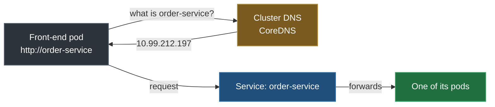

From a separate client pod, `http://order-service/hostname` is answered by the order-service pods, and a DNS lookup of the full name returns the Service's address:

```text
Name:    order-service.default.svc.cluster.local
Address: 10.99.212.197
```

The full name is built from four parts:

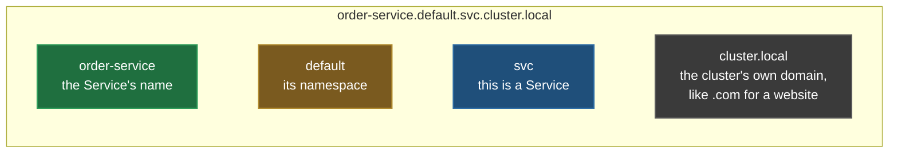

**From a pod in the same namespace, the short name `order-service` is enough**, the way a Java class in the same package is just `OrderService` while code elsewhere needs the full `in.bookcart.orders.OrderService`. Kubernetes fills in the rest: every pod's DNS settings carry a search list, and a pod in `default` has this one:

```text
search default.svc.cluster.local svc.cluster.local cluster.local
nameserver 10.96.0.10
```

So a bare `order-service` has `.default.svc.cluster.local` tried on the end automatically. A pod in another namespace gets a different search list, so it has to say at least `order-service.default`. The `nameserver` line is the address the pod sends its lookups to; who answers there is the subject of the next section.

That is what makes microservices manageable. Instead of configuring the order service with something like:

```text
PAYMENT_SERVICE=10.244.0.13
```

— one pod's address, wrong as soon as that pod is replaced — it is configured with a stable service identity:

```text
PAYMENT_SERVICE=http://payment-service
```

### CoreDNS: the cluster's phone book

**CoreDNS** is who answers at `10.96.0.10`. It is the cluster's phone book: it does not manage, start or route anything; it only answers one question, what is the address for this name?

| | |
|---|---|
| **What it is** | an ordinary DNS server program, the same kind of thing that answers when a browser looks up `bookcart.in` |
| **Where it runs** | as pods inside the cluster, in `kube-system`: the `coredns-…` pod from the control-plane listing in the local-cluster note, run by an ordinary Deployment |
| **How pods reach it** | every pod's DNS settings point at it, the `nameserver 10.96.0.10` line above |
| **How it knows the names** | it watches the API server; when a Service is created it starts answering for that name, and when the Service is deleted it stops |
| **What it does not do** | start, stop, scale or route anything; once it has answered, the caller talks to the Service directly |

Creating a Service is all the registration there is. Nobody picks the Service's address or enters its name anywhere: Kubernetes assigns the address (say `10.103.4.51` for `payment-service`), and CoreDNS learns the name from the API server.

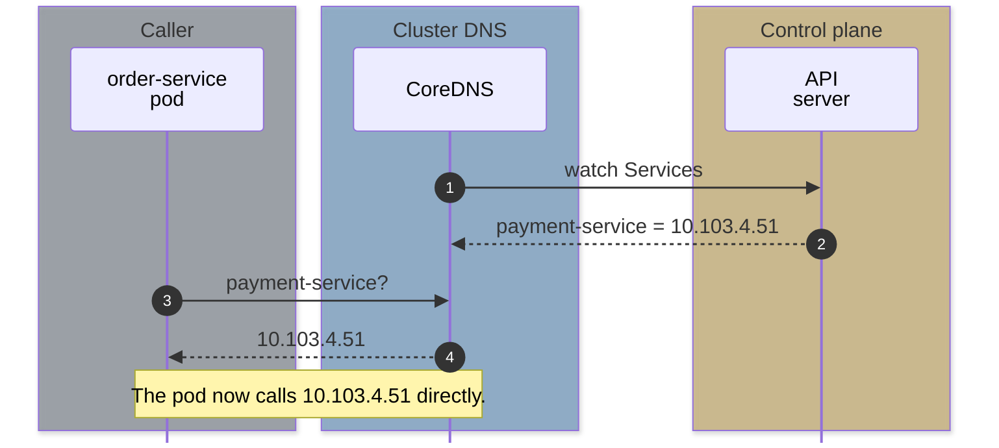

## Three types of Service

Every Service has a **type**, which decides who is allowed to reach it. Three matter here.

### ClusterIP: inside the cluster only

**ClusterIP is the default.** If a Service's YAML does not say which type it is, it is a ClusterIP Service; the one above was, without asking. It is exactly what has been described so far: any pod in the cluster can reach the Service and, through it, its pods.

**The point of ClusterIP is what it refuses.** Everything in the picture (the pods, the Service in between) is managed by Kubernetes inside one Kubernetes cluster. A ClusterIP Service only accepts requests that come from inside that cluster. A request from outside it, from an outside user or another system, cannot land on it directly.

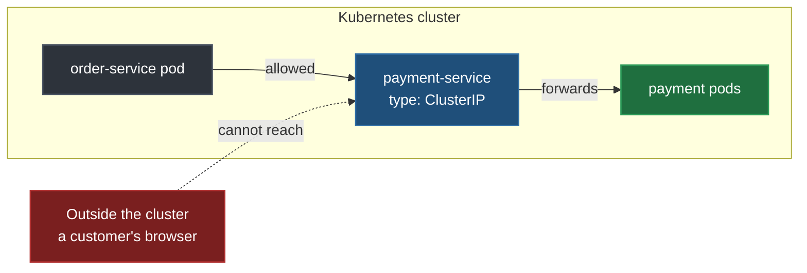

The Service's address answers pods inside the cluster. From the machine Minikube runs on, which is outside the cluster's network, the same address gives no answer at all:

```text
no answer from 10.99.212.197
```

That makes ClusterIP the right type for **service-to-service** calls, which is most of a microservice architecture. Take an online shop with a front end, an order service, a payment service, an inventory service and MySQL. The order service calls the payment service; it goes through `payment-service`, a ClusterIP Service, to the payment pods. There is no reason to expose every internal microservice to the internet, and with ClusterIP none of them are. It is the default, it needs no thought, and for internal traffic it is the best choice.

> [!question] **So ClusterIP is also the secure choice, since the cluster's network is never exposed?**
> Yes. Nothing outside the cluster can reach a ClusterIP Service, so the internal services are not exposed.

> [!question] **With ClusterIP, do the front end and the back end have to be in the same cluster?**
> Yes, and in practice they are. When you build an application, all its parts (payment, orders, users, the front end) are kept in one Kubernetes cluster, which manages every pod in it. That means the front end's server pods. A front end that runs in the browser is outside every cluster by nature, so the services it calls directly need one of the outside doors below, not ClusterIP.

> [!question] **Many companies use OpenShift to manage everything on top of Kubernetes. How is it different?**
> Understand Kubernetes first; that comparison is not covered in this folder. **Going further:** OpenShift is Red Hat's platform built on top of Kubernetes, so what is learned here carries over to it.

### NodePort: a fixed port on every node

Sometimes a request genuinely has to come from outside the cluster. The simplest way to allow it is a **NodePort** Service. Kubernetes picks a port number on the nodes themselves — a special port, reserved for this, in a range applications normally don't use — and opens it. An outside client sends its request to a node's IP address on that port. The node knows that whatever arrives there is meant for the Service, hands it to the Service, and the Service passes it to a pod.


```yaml
# k8s/service-nodeport.yaml
apiVersion: v1
kind: Service
metadata:
  name: order-service-public
spec:
  type: NodePort
  selector:
    app: order-service
  ports:
    - port: 80
      targetPort: 8080
      nodePort: 30080
```

On a two-node cluster, with node addresses `192.168.49.2` and `192.168.49.3`:

```text
NAME                   TYPE       CLUSTER-IP       EXTERNAL-IP   PORT(S)        AGE
order-service-public   NodePort   10.102.213.190   <none>        80:30080/TCP   0s
```

Requests from outside to port 30080 were answered on **both** nodes, including by pods running on the other node:

```text
192.168.49.2:30080 -> order-service-747899fc9d-zbftk
192.168.49.2:30080 -> order-service-747899fc9d-b9s48
192.168.49.3:30080 -> order-service-747899fc9d-zbftk
192.168.49.3:30080 -> order-service-747899fc9d-b9s48
```

So the port is opened on every node, not only on the nodes where the pods happen to run, and any node's address will do. Notice too that it still has a cluster address of its own: a NodePort Service is a ClusterIP Service with an outside door added.

> [!bug] **The port has to be in the NodePort range.**
> Asking for `nodePort: 8080` was refused outright:
> ```text
> The Service "bad-port" is invalid: spec.ports[0].nodePort: Invalid value: 8080: provided port is not in the valid range. The range of valid ports is 30000-32767
> ```
> That range is why NodePort numbers look like 30080: high enough to stay clear of the ports ordinary applications use. Leave `nodePort` out and Kubernetes picks a free one from the range.

> [!question] **So NodePort is for when an external service needs to talk to the cluster, a third-party service, say?**
> Exactly. Whenever a request comes into the Kubernetes cluster from outside it, NodePort is the basic way to let it in, for that kind of use case.

### LoadBalancer: the cloud's load balancer in front

The third type matters most once applications run in the cloud, which is where most DevOps work happens today. Suppose the cluster runs on AWS (or Azure, or any other cloud platform), and you already pay for that platform's load balancer: on AWS, the **Elastic Load Balancer**, or ELB. You want client requests to arrive at the ELB, and the ELB to pass them to your Service, which picks the pod.

A Service of type `LoadBalancer` asks the platform to provide or connect an external load balancer for it, where the platform supports that, and the major cloud platforms do. You do not write routing rules or configure where requests should go; you connect the Service to the cloud's load balancer. Requests then arrive at the ELB's address, are passed to the Service, and are spread across the pods however the ELB's rules say.


This is where an ordinary load balancer and the Kubernetes Service finally meet: the cloud's load balancer sits in front, and the Service behind it does the discovery.

> [!failure] **On a cluster with no cloud behind it, the load balancer never arrives.**
> On Minikube, which has no cloud platform to ask:
> ```text
> NAME               TYPE           CLUSTER-IP       EXTERNAL-IP   PORT(S)        AGE
> order-service-lb   LoadBalancer   10.109.118.146   <pending>     80:31385/TCP   6s
> ```
> `EXTERNAL-IP` stays at `<pending>`, because nothing exists to provide one. Note the port column too: Kubernetes gave it a NodePort, 31385, on its own. A LoadBalancer Service is built on top of a NodePort Service, the same way NodePort is built on top of ClusterIP.

> [!question] **So there is no load-balancing logic to write ourselves?**
> Right. An existing load balancer is used (the cloud platform's, or one you run yourself such as nginx), and the Service is connected to it.

> [!question] **Is this what ingress and egress mean?**
> It is the ingress half. The architecture note defined **ingress** as traffic coming into the cluster from outside and **egress** as traffic leaving it. NodePort and LoadBalancer are the basic ways to let ingress traffic reach a Service; ClusterIP deliberately lets none in. Egress (a pod calling something outside the cluster) is not what a Service is for. Kubernetes also has an object actually named **Ingress**, which routes outside HTTP traffic to different Services by host name and path; it has a note of its own later in this folder.

### The three side by side

| Type | Who can reach it | Use it for |
|---|---|---|
| ClusterIP | only pods inside the cluster | internal service-to-service calls; the default |
| NodePort | outside clients, at any node's IP on a port from 30000–32767 | letting outside traffic in, simply |
| LoadBalancer | outside clients, through the cloud platform's load balancer | production traffic on a cloud platform |

## Three ports, three meanings

Every Service manifest above carries up to three port numbers, and they are easy to confuse. Each one is a door at a different place along the path to the application:

| Line | The door on | Who knocks on it | Whose choice |
|---|---|---|---|
| `nodePort: 30080` | **every node**, at the node's own IP | anything **outside** the cluster | yours, but only from 30000–32767; leave it out and Kubernetes picks one |
| `port: 80` | **the Service**, at its own address | pods **inside** the cluster, such as `http://order-service` (80 is the HTTP default, so no port is needed in the URL) | yours, any port |
| `targetPort: 8080` | **the pod**, where the application listens | the Service, passing the request on | not really yours: it must be the port the application listens on, or requests arrive at a closed door |

**`targetPort` must match the application, `port` is what callers inside the cluster use, and `nodePort` is only for outside traffic.** That is why a plain ClusterIP Service has only `port` and `targetPort`: it has no outside door, so there is no `nodePort` line. Compared with Docker's `-p 8081:8080`, `targetPort` is the right-hand side, the container's port, and the left-hand host port is split in two: `port` for callers inside the cluster, `nodePort` for callers outside it.

Why two numbers for one application? The Spring Boot application listens on 8080, but HTTP requests conventionally go to port 80, so the Service accepts them on 80 and passes them on to 8080, translating the port as the reverse proxy from the local-cluster note would.

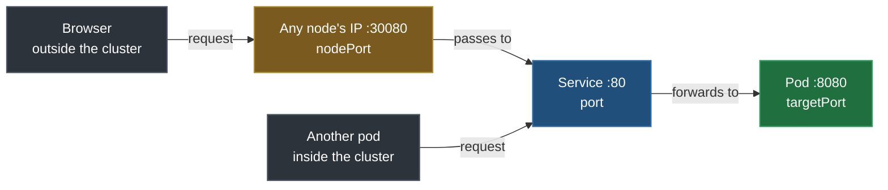

The `PORT(S)` column of `kubectl get svc` shows the outer two together: `80:30080/TCP` means Service port 80, node port 30080.

## A customer's click, end to end

With the outside doors in place, one customer's click can be followed all the way through, and it shows where each kind of name lookup belongs. CoreDNS is for communication **inside** the cluster: one service calling another (`order-service` calling `payment-service`), or a service finding its database (`db-1.db…` from the StatefulSet note). A customer's browser never talks to it, and could not: CoreDNS lives inside the cluster, and its names mean nothing outside it.

**The UI's code runs in the browser, not in the cluster.** A pod serves the UI's page, but what it sends back is the page and its JavaScript, which then run on the customer's own machine. So when the customer clicks Order, the API call starts in the browser, outside the cluster, and comes in the same way the page did: through public DNS and the load balancer. CoreDNS appears only once a call starts inside the cluster:

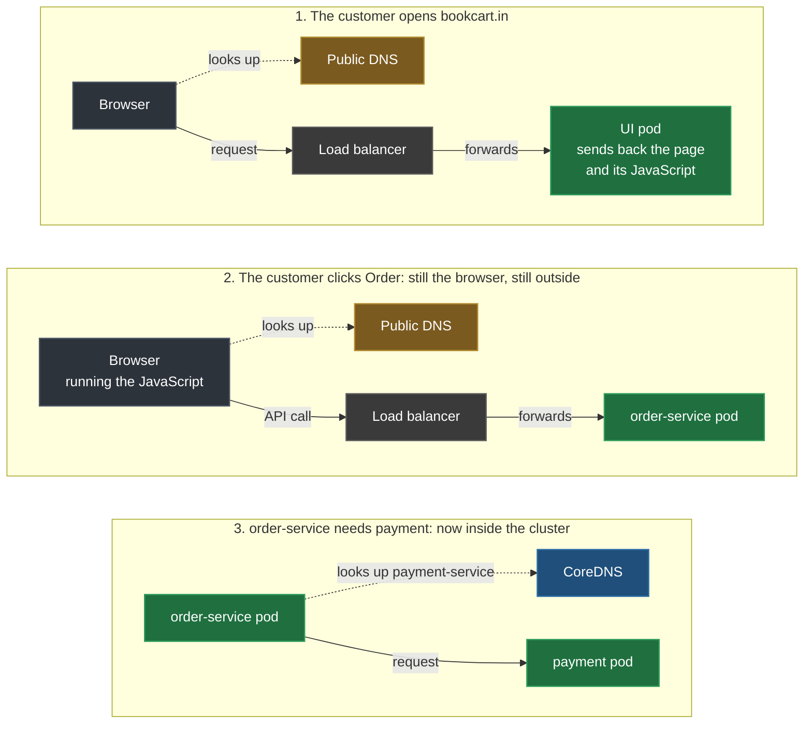

| Who asks | Asks whom | For what |
|---|---|---|
| the customer's browser | public DNS (on AWS, Route 53) | `bookcart.in`, the one public name |
| a pod inside the cluster | CoreDNS | `payment-service`, `order-service` and the other internal names |

**What decides it is where a call starts, not where the code came from.** If the UI is built on the server instead (a Spring MVC application that renders each page inside a pod, say), then the UI pod itself calls `order-service`, from inside the cluster, by name through CoreDNS.

**Nothing about a Service is registered in AWS.** On Amazon's managed Kubernetes, EKS, CoreDNS is there from the start: in Amazon's own words, two CoreDNS replicas are deployed by default once the cluster has a node, and they provide name resolution for all pods in the cluster. The only name that goes into public DNS is the one customers type, set up once for the way into the cluster, not once per microservice. That way in is the load balancer from the LoadBalancer section above.

## The whole application so far

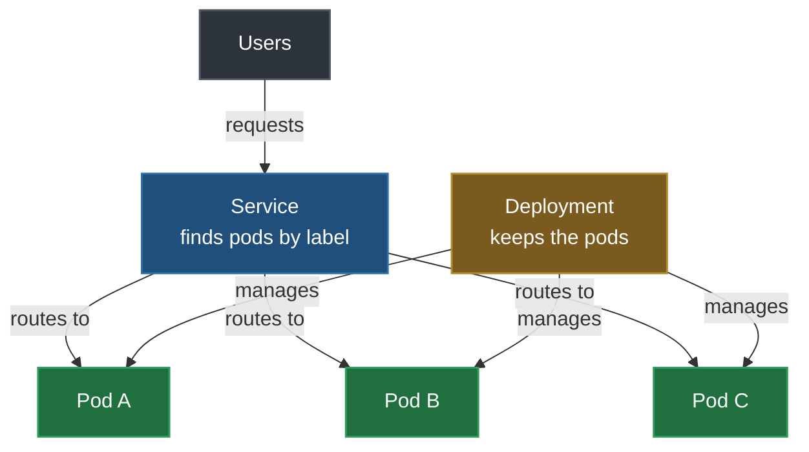

**These are two separate relationships**, and neither object knows about the other. The Deployment manages the pods: how many, which version, how they scale, and what replaces one that dies. The Service discovers the pods by their labels and decides how requests are distributed, so that pods can talk to each other and clients can reach them.

That separation is why scaling needs nothing on the calling side. The Deployment goes from 3 pods to 10, every new pod carries `app: order-service`, the Service's selector matches each one as it appears (exactly as it matched the replacement pod earlier), and the Service now has ten pods behind it. The client changes nothing. **Deployment for dynamic application instances; Service for a stable network identity** — that pairing is one of the most important ideas in Kubernetes.

## One request, end to end

Everything in this note now fits together. Take a production setup on AWS in which two services are public: the order service, for the bookshop's customers, and the payment service, for a payment partner that calls it directly. Each is a Service of type LoadBalancer, so each has its own NodePort (`31385` for `order-service`, as in the LoadBalancer section, and `32107` for `payment-service`, say) and its own ELB. A LoadBalancer Service still has a cluster address of its own, so pods inside the cluster keep calling `payment-service` by name as before.

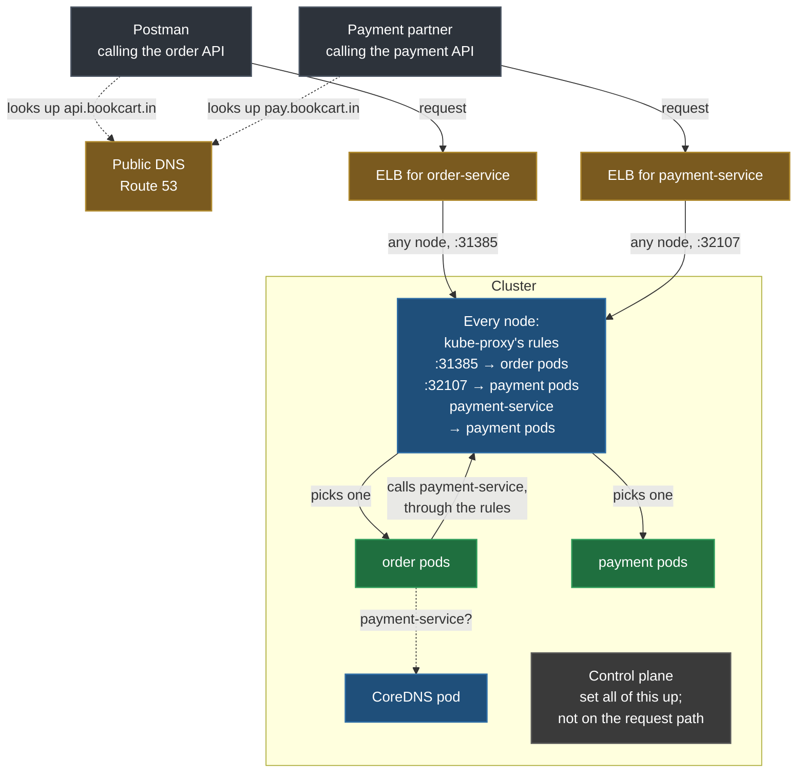

Four facts make the picture work:

- **Each ELB is wired to one Service.** The cloud controller manager (the optional `c-c-m` in the official diagram from the architecture note) asked AWS for one load balancer per LoadBalancer Service, and pointed each at its own Service's NodePort: the order ELB only ever sends to `:31385`, the payment ELB only to `:32107`. Neither knows the other exists, and neither knows where any pod runs.
- **Any node will do.** Every node opens every NodePort, and every node's kube-proxy has written rules for every Service. Whichever node receives a request can forward it to a matching pod anywhere in the cluster, with one extra hop if that pod is on another node.
- **There is no Service pod.** A Service is an address plus those rules; nothing runs for it.
- **CoreDNS gives a Service's address, not a pod's.** The rules pick the pod afterwards.

### Flow 1: Postman calls the order API

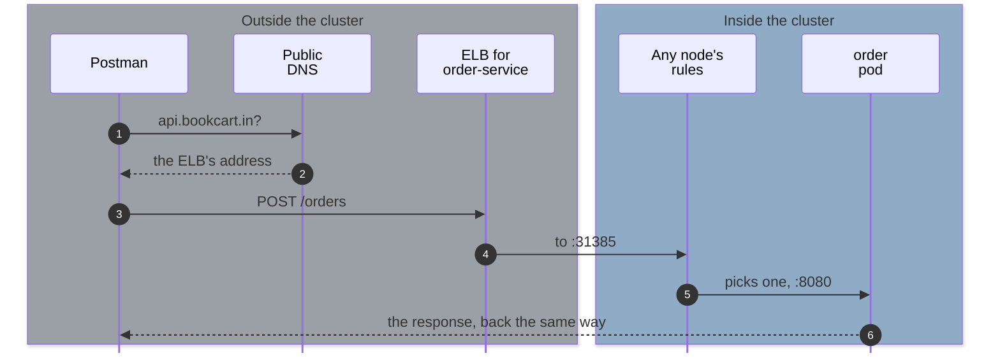

1. Postman asks public DNS for `api.bookcart.in` and gets back the order ELB's address.
2. It sends `POST /orders` to that ELB.
3. The ELB passes the request to any node, on `:31385`.
4. That node's rules match `:31385` to `order-service`, pick one order pod (on this node or another), and send the request to the pod's IP on `8080`.
5. Spring Boot handles the order, and the response travels back the same way.

### Flow 2: the order service calls the payment service

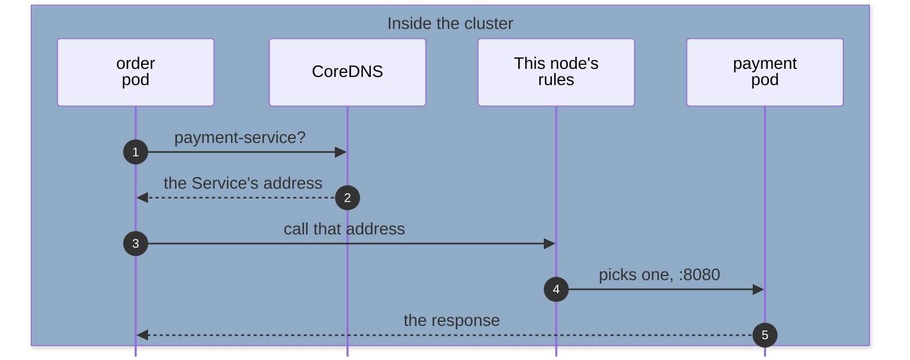

1. Spring Boot calls `http://payment-service`. The pod asks CoreDNS, and gets back the payment Service's cluster address.
2. The pod sends the request to that address. The rules on its own node pick a payment pod, anywhere in the cluster, and the request reaches it on `8080`.
3. The response comes back to the order pod. No ELB, no public DNS and no NodePort are involved: the call starts inside the cluster and stays inside.

### Flow 3: the payment partner calls the payment API

The same shape as flow 1, through a separate door. Public DNS gives the partner the payment ELB's address for `pay.bookcart.in`; the payment ELB passes the request to any node on `:32107`; that node's rules pick a payment pod. It never touches the order ELB, and the order ELB could not send traffic here even by mistake, because the only port it knows is `:31385`.

> [!note] **One load balancer per public Service adds up.**
> Every Service of type LoadBalancer gets an ELB of its own, and the cloud platform bills for each one. With two public services that is two load balancers; with twenty, twenty. Routing many services through one load balancer, by host name or URL path, is the subject of the Ingress note later in this folder.

### Set up beforehand, not on the path

None of the control plane appears in the three flows. It did its work before the first request arrived, and keeps the path correct as things change:

| Who | Did what, before any request arrived |
|---|---|
| You, through kubectl and the API server | applied the Deployments and the Services |
| Scheduler and kubelets | placed the pods on nodes and started them |
| Deployment and ReplicaSet | keep three order pods running, and replace any that die |
| kube-proxy, on every node | writes the forwarding rules, and rewrites them whenever pods come and go |
| CoreDNS | learned each Service's name and address from the API server |
| Cloud controller manager | asked AWS for each ELB and pointed it at the nodes |

If an order pod dies mid-afternoon, the ReplicaSet creates a replacement with a new IP, kube-proxy updates every node's rules to match, and the next request from Postman reaches the new pod. Nothing in Postman, the ELB or public DNS changes.

> [!tip] **Separate modules, one application.**
> Git, Docker, Kubernetes and Jenkins are learned as separate subjects, and each one makes sense on its own. They are meant to be joined: one application is deployed by putting them together, and a cloud platform is where that joining becomes concrete. Docker and Kubernetes already make more sense side by side than either did alone.
