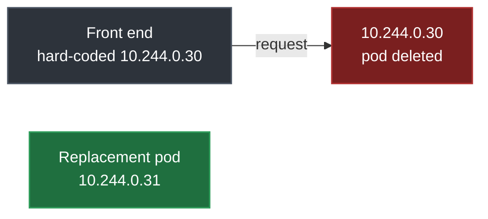
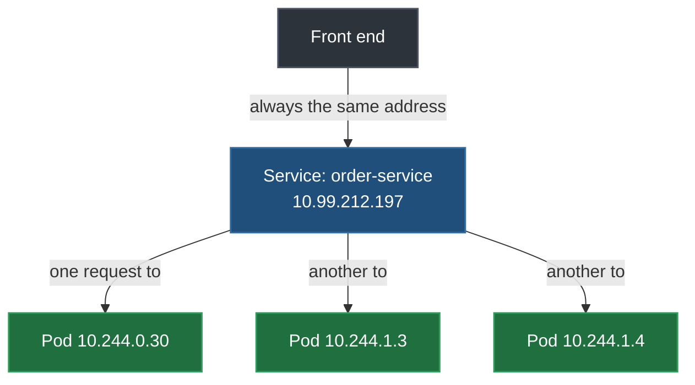
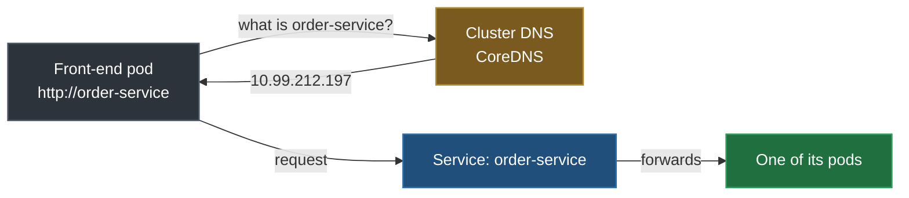
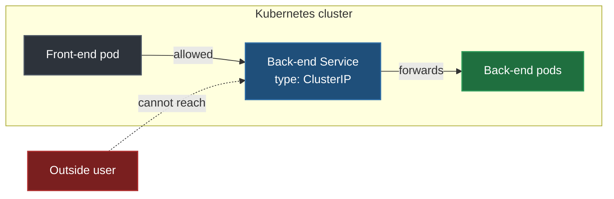
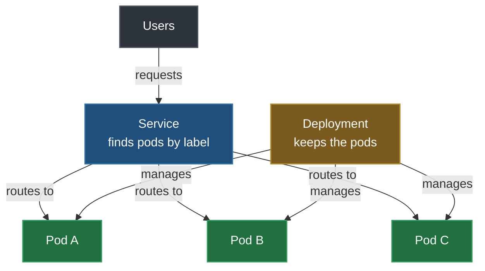

The controllers from the last two notes keep pods running: a Deployment keeps three order-service replicas alive, and replaces any that die. They leave a second problem untouched. Every pod has its own IP address, and something has to send requests to those pods. This note is about that problem and the Kubernetes object that solves it, the **Service**.

## The problem: pod addresses don't last

A Deployment keeps three order-service pods, and the pod note's rule applies: each pod has its own IP address. This was run, and the three got these:

```text
order-service-747899fc9d-5449s   10.244.0.30   minikube
order-service-747899fc9d-b9s48   10.244.1.4    minikube-m02
order-service-747899fc9d-flx6j   10.244.1.3    minikube-m02
```

The front end needs to call the order service. **Which address should it use?** Two questions hide in that one: which of the three pods a given request should go to, and how the front end would even know the addresses.

Suppose the front end simply uses the first one, `10.244.0.30`. Then that pod is deleted, and the Deployment does what the previous notes showed: it creates a **new** pod. A new pod gets a new address. In the run, the replacement came up at `10.244.0.31`. The old address now points at nothing, and the front end's requests fail until somebody gives it the new one.



**Pods are ephemeral**, and so are their addresses. A pod's IP is not a permanent contract a client can rely on. The front end does not actually want to talk to pod A. It wants to talk to **the order service**, whichever pods happen to make it up right now. What is needed is something stable standing in front of the changing pods.

## The answer: a Service

> **A Service is a stable network address in front of a changing set of pods.**

The front end talks only to the Service. The Service keeps track of every pod behind it and their addresses, and passes each request on to one of them. Pods can die, restart, change IP, scale up and scale down, and the Service stays the one fixed place to send requests to. It works much like a load balancer, and the difference between the two comes up below.



**How does the Service know which pods are its own, and their current addresses?** The same way the controllers did: **labels and selectors**. Every order-service pod carries `app: order-service`, because the Deployment's template stamps it on every pod it creates, replacements included. The Service is given the selector `app = order-service`, and its pods are whatever matches, at every moment. A pod labelled `app: payment-service` does not match and is ignored. Pod B dies and pod D replaces it; pod D carries the same label, so the Service's set goes from A, B, C to A, C, D, and the front end never notices.

Keeping that set up to date is called **service discovery**: the Service always knows which pods it should be sending traffic to. The term is used the same way well outside Kubernetes. Put formally, a Service creates a **network abstraction** — abstraction meaning that something is hidden. The front end does not need to know any pod's address, so it never sees them; it knows the Service.

```yaml
# k8s/service.yaml
apiVersion: v1
kind: Service
metadata:
  name: order-service
spec:
  selector:
    app: order-service
  ports:
    - port: 80
      targetPort: 8080
```

The two port numbers are explained later in this note: requests arrive at the Service on port 80 and are passed to the pods on port 8080, where the application listens.

> [!info] **This was run, not just read.**
> The order service was stood in for by a small test application from the Kubernetes project's own test images, which listens on 8080 and answers `/hostname` with the name of the pod that handled the request. Its Deployment is the order service's from the previous note with only the container changed — which is also why its pods carry a different hash, `747899fc9d`, from the ones there: the hash comes from the pod template.
> ```yaml
> # k8s/deployment-test.yaml — only the container differs from k8s/deployment.yaml
>       containers:
>         - name: order-service
>           image: registry.k8s.io/e2e-test-images/agnhost:2.53
>           args: ["netexec", "--http-port=8080"]
>           ports:
>             - containerPort: 8080
> ```
> With the Service applied:
> ```text
> NAME            TYPE        CLUSTER-IP      EXTERNAL-IP   PORT(S)   AGE
> order-service   ClusterIP   10.99.212.197   <none>        80/TCP    11s
> ```
> The addresses the Service had discovered can be listed directly; they are kept in an **EndpointSlice**, the object that records a Service's current pods:
> ```text
> NAME                  ADDRESSTYPE   PORTS   ENDPOINTS                           AGE
> order-service-74zfr   IPv4          8080    10.244.0.30,10.244.1.3,10.244.1.4   11s
> ```
> Then the pod at `10.244.0.30` was deleted. Six seconds later the list read `10.244.1.3,10.244.1.4,10.244.0.31` — the replacement already in, the dead pod already out — and a request to the Service by name was answered by the new pod. Nothing on the calling side changed.

### What a Service is, and what it is not

A Service passes requests on to the pods it has found, much as a load balancer spreads requests across replicas. But it is not a clever one. It does not know which pod is busy, or how much load a server is under, and it does not route by it. It spreads connections across the eligible pods by a simple rule. It is best understood as **stable service discovery plus routing towards matching pods**, not as an application-aware load balancer. The routing itself is carried out on every node by **kube-proxy**, the component the architecture note introduced for exactly this: it keeps each node's networking rules in step with the Services and their pods.

Nine requests in a row from one client in the run were answered five times by one pod, three times by another and once by the third — spread, but not evenly and not in turn. **Going further:** on a cluster where kube-proxy runs in its default mode on Linux, it chooses a backend pod at random for each connection, which matches what the run showed.

> [!question] **To the front end it looks as if it is talking straight to the back end. So is a Service a reverse proxy?**
> You can think of it that way — a reverse proxy, as the local-cluster note put it, receives requests on an application's behalf and passes them on — or as a load balancer; one of its types is even called `LoadBalancer`, below. The distinction worth holding on to is scope. The Services here are about containers talking to containers inside Kubernetes: a front-end pod calling a back-end pod, or any pod calling any other. A load balancer in the usual sense sits at the edge of the whole system, where a request from the internet first arrives, and spreads it across backend servers. When a real application is deployed to the cloud, those two pictures meet, and the gap between them nearly disappears.

> [!tip] **Each service gets a Service of its own.**
> The Service above is the order service's: all its replicas run the same order-service code, and this Service fronts them. A payment service has its own pods and its own Service. A front end that calls both needs two addresses — one for the order service and one for the payment service — but never the address of any individual pod or replica. Each Service is the one intermediate layer in front of one application's replicas.

## Calling a Service by name: Service DNS

The Service's address, `10.99.212.197`, is stable — but a front end should not hard-code that either. Services can be deleted and recreated, and an address typed into configuration is fragile wherever it comes from. Kubernetes gives every Service a **DNS name**. **DNS**, the Domain Name System, is how the internet turns a name such as `bookcart.in` into the IP address of a server; Kubernetes runs the same idea inside the cluster, so that a name resolves to a Service's address.

Name the Service `order-service`, and a pod can reach it at:

```text
http://order-service
```

The front end sends its request to that name. The cluster's DNS — **CoreDNS**, the component in the control-plane listing from the local-cluster note — looks up `order-service`, finds the Service's address, and the request goes to the Service, which passes it on to one of its pods.



This was run. From a separate client pod, `http://order-service/hostname` was answered by the order-service pods, and the full name resolved to the Service's address:

```text
Name:    order-service.default.svc.cluster.local
Address: 10.99.212.197
```

The full form is the Service's name, its namespace — `default` — and the cluster's domain. From a pod in the same namespace, the short name `order-service` is enough.

That is what makes microservices manageable. Instead of configuring the order service with something like:

```text
PAYMENT_SERVICE=10.244.0.13
```

— one pod's address, wrong as soon as that pod is replaced — it is configured with a stable service identity:

```text
PAYMENT_SERVICE=http://payment-service
```

> [!question] **Who runs the Service DNS?**
> Kubernetes does. It is part of the cluster: CoreDNS runs as pods in the `kube-system` namespace, as the control-plane listing showed, and the cluster keeps its records in step with the Services that exist.

## Three types of Service

Every Service has a **type**, which decides who is allowed to reach it. Three matter here.

### ClusterIP: inside the cluster only

**ClusterIP is the default.** If a Service's YAML does not say which type it is, it is a ClusterIP Service — the one above was, without asking. It is exactly what has been described so far: any pod in the cluster can reach the Service and, through it, its pods.

**The point of ClusterIP is what it refuses.** Everything in the picture — the pods, the Service in between — is managed by Kubernetes inside one Kubernetes cluster. A ClusterIP Service only accepts requests that come from inside that cluster. A request from outside it, from an outside user or another system, cannot land on it directly.



This was run. The Service's address answered pods inside the cluster. From the machine Minikube runs on — outside the cluster's network — the same address gave no answer at all:

```text
no answer from 10.99.212.197
```

That makes ClusterIP the right type for **service-to-service** calls, which is most of a microservice architecture. Take an online shop with a front end, an order service, a payment service, an inventory service and MySQL. The order service calls the payment service; it goes through `payment-service`, a ClusterIP Service, to the payment pods. There is no reason to expose every internal microservice to the internet, and with ClusterIP none of them are. It is the default, it needs no thought, and for internal traffic it is the best choice.

> [!question] **So ClusterIP is also the secure choice, since the cluster's network is never exposed?**
> Yes. Nothing outside the cluster can reach a ClusterIP Service, so the internal services are not exposed.

> [!question] **With ClusterIP, do the front end and the back end have to be in the same cluster?**
> Yes, and in practice they are. When you build an application, all its parts — payment, orders, users, the front end — are kept in one Kubernetes cluster, which manages every pod in it.

> [!question] **Many companies use OpenShift to manage everything on top of Kubernetes. How is it different?**
> Understand Kubernetes first; that comparison is not covered in this folder. **Going further:** OpenShift is Red Hat's platform built on top of Kubernetes, so what is learned here carries over to it.

### NodePort: a fixed port on every node

Sometimes a request genuinely has to come from outside the cluster. The simplest way to allow it is a **NodePort** Service. Kubernetes picks a port number on the nodes themselves — a special port, reserved for this, in a range applications normally don't use — and opens it. An outside client sends its request to a node's IP address on that port. The node knows that whatever arrives there is meant for the Service, hands it to the Service, and the Service passes it to a pod.


```yaml
# k8s/service-nodeport.yaml
apiVersion: v1
kind: Service
metadata:
  name: order-service-public
spec:
  type: NodePort
  selector:
    app: order-service
  ports:
    - port: 80
      targetPort: 8080
      nodePort: 30080
```

This was run on a two-node cluster, at node addresses `192.168.49.2` and `192.168.49.3`:

```text
NAME                   TYPE       CLUSTER-IP       EXTERNAL-IP   PORT(S)        AGE
order-service-public   NodePort   10.102.213.190   <none>        80:30080/TCP   0s
```

Requests from outside to port 30080 were answered on **both** nodes — including by pods running on the other node:

```text
192.168.49.2:30080 -> order-service-747899fc9d-zbftk
192.168.49.2:30080 -> order-service-747899fc9d-b9s48
192.168.49.3:30080 -> order-service-747899fc9d-zbftk
192.168.49.3:30080 -> order-service-747899fc9d-b9s48
```

So the port is opened on every node, not only on the nodes where the pods happen to run, and any node's address will do. Notice too that it still has a cluster address of its own: a NodePort Service is a ClusterIP Service with an outside door added.

> [!bug] **The port has to be in the NodePort range.**
> Asking for `nodePort: 8080` was refused outright:
> ```text
> The Service "bad-port" is invalid: spec.ports[0].nodePort: Invalid value: 8080: provided port is not in the valid range. The range of valid ports is 30000-32767
> ```
> That range is why NodePort numbers look like 30080: high enough to stay clear of the ports ordinary applications use. Leave `nodePort` out and Kubernetes picks a free one from the range.

> [!question] **So NodePort is for when an external service needs to talk to the cluster — a third-party service, say?**
> Exactly. Whenever a request comes into the Kubernetes cluster from outside it, NodePort is the basic way to let it in, for that kind of use case.

### LoadBalancer: the cloud's load balancer in front

The third type matters most once applications run in the cloud, which is where most DevOps work happens today. Suppose the cluster runs on AWS — or Azure, or any other cloud platform — and you already pay for that platform's load balancer: on AWS, the **Elastic Load Balancer**, or ELB. You want client requests to arrive at the ELB, and the ELB to pass them to your Service, which picks the pod.

A Service of type `LoadBalancer` asks the platform to provide or connect an external load balancer for it, where the platform supports that, and the major cloud platforms do. You do not write routing rules or configure where requests should go; you connect the Service to the cloud's load balancer. Requests then arrive at the ELB's address, are passed to the Service, and are spread across the pods however the ELB's rules say.


This is where an ordinary load balancer and the Kubernetes Service finally meet: the cloud's load balancer sits in front, and the Service behind it does the discovery.

> [!failure] **On a cluster with no cloud behind it, the load balancer never arrives.**
> This was run on Minikube, which has no cloud platform to ask:
> ```text
> NAME               TYPE           CLUSTER-IP       EXTERNAL-IP   PORT(S)        AGE
> order-service-lb   LoadBalancer   10.109.118.146   <pending>     80:31385/TCP   6s
> ```
> `EXTERNAL-IP` stays at `<pending>`, because nothing exists to provide one. Note the port column too: Kubernetes gave it a NodePort, 31385, on its own. A LoadBalancer Service is built on top of a NodePort Service, the same way NodePort is built on top of ClusterIP.

> [!question] **So there is no load-balancing logic to write ourselves?**
> Right. An existing load balancer is used — the cloud platform's, or one you run yourself such as nginx — and the Service is connected to it.

> [!question] **Is this what ingress and egress mean?**
> It is the ingress half. The architecture note defined **ingress** as traffic coming into the cluster from outside and **egress** as traffic leaving it. NodePort and LoadBalancer are the basic ways to let ingress traffic reach a Service; ClusterIP deliberately lets none in. Egress — a pod calling something outside the cluster — is not what a Service is for. **Going further:** Kubernetes also has an object actually named **Ingress**, which routes outside HTTP traffic to different Services by host name and path; it is not covered in this folder.

### The three side by side

| Type | Who can reach it | Use it for |
|---|---|---|
| ClusterIP | only pods inside the cluster | internal service-to-service calls; the default |
| NodePort | outside clients, at any node's IP on a port from 30000–32767 | letting outside traffic in, simply |
| LoadBalancer | outside clients, through the cloud platform's load balancer | production traffic on a cloud platform |

## Three ports, three meanings

Every Service manifest above carries up to three port numbers, and they are easy to confuse.

| Port | Belongs to | In the example | Means |
|---|---|---|---|
| `targetPort` | the pod | 8080 | where the application inside the container listens — the final destination |
| `port` | the Service | 80 | where the Service itself accepts requests |
| `nodePort` | every node | 30080 | the special port opened on the nodes for outside requests, NodePort only |

The Spring Boot application inside the container listens on 8080: that is the `targetPort`. HTTP requests conventionally go to port 80, so the Service accepts them on 80 — its `port` — and passes them on to 8080, translating the port as the reverse proxy from the local-cluster note would. With NodePort, outside requests first arrive at 30080 on a node.

```text
outside client → nodeIP:30080 → Service:80 → pod:8080
                 nodePort       port         targetPort
```

The `PORT(S)` column of `kubectl get svc` shows the outer two together: `80:30080/TCP` means Service port 80, node port 30080.

## The whole application so far



**These are two separate relationships**, and neither object knows about the other. The Deployment manages the pods: how many, which version, how they scale, and what replaces one that dies. The Service discovers the pods by their labels and decides how requests are distributed, so that pods can talk to each other and clients can reach them.

That separation is why scaling needs nothing on the calling side. The Deployment goes from 3 pods to 10, every new pod carries `app: order-service`, the Service's selector matches each one as it appears — exactly as it matched the replacement pod earlier — and the Service now has ten pods behind it. The client changes nothing. **Deployment for dynamic application instances; Service for a stable network identity** — that pairing is one of the most important ideas in Kubernetes.

> [!tip] **Separate modules, one application.**
> Git, Docker, Kubernetes and Jenkins are learned as separate subjects, and each one makes sense on its own. They are meant to be joined: one application is deployed by putting them together, and a cloud platform is where that joining becomes concrete. Docker and Kubernetes already make more sense side by side than either did alone.
