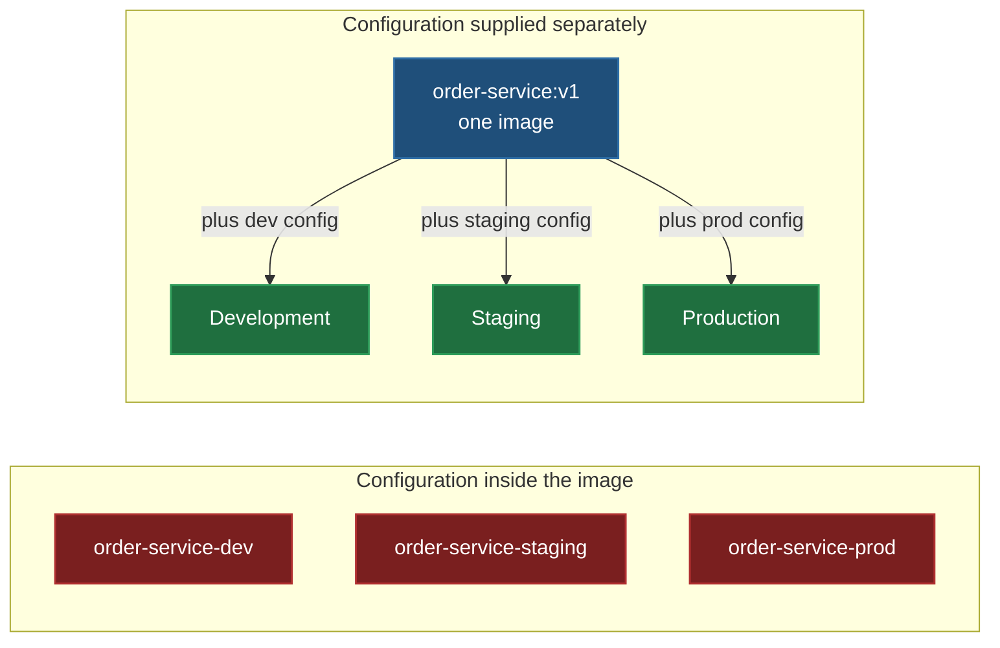
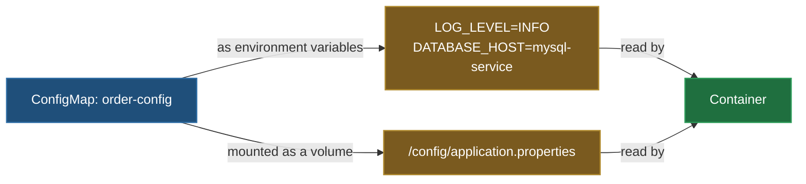
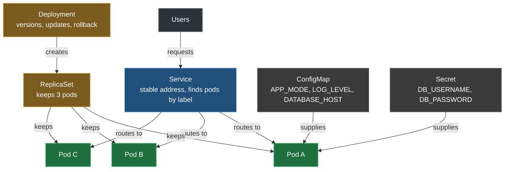
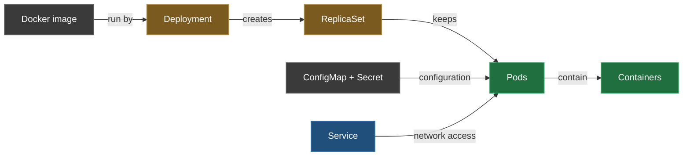

The order service can now run, scale, update and be reached reliably: a Deployment keeps its pods and a Service puts a stable address in front of them. One question is left before this is a whole application. The order service needs configuration — which database to connect to, how much to log, a password. Where should that information live?

## The problem: configuration baked into the image

A Spring Boot application like the order service needs settings such as:

```properties
server.port=8080
spring.datasource.url=jdbc:mysql://mysql-service:3306/bookcart
logging.level.root=INFO
```

The second line is a **JDBC URL** — JDBC being Java's standard interface for connecting to databases — which tells the application's database driver which server, port and database to use. There are also settings that are sensitive, such as a database username and password. The usual approach until now has been to put them into the image, or into environment variables set when the container is built. The image then contains the application code, plus the database address, plus the environment settings, plus the passwords.

Kubernetes' advice is: **don't put configuration or secrets inside the container.** It is not a reliable technique, for two reasons.

**First, the configuration is tied to the container.** If the container goes down and another comes up, the configuration has to be put back into it, every time.

**Second, every environment needs its own image.** The application's code is identical in development, testing, staging and production. Its configuration is not: the database in development is `localhost`, in testing `test-db`, in production `prod-database.internal`. With configuration baked in, one application becomes several images:

```text
order-service-dev:v1
order-service-test:v1
order-service-staging:v1
order-service-prod:v1
```

Building and maintaining an image per environment is hard work in itself. It also means the different environments **are no longer running the same artifact**, so what was tested is not exactly what goes to production.



The better model separates the two:

| | Holds |
|---|---|
| The image | the application code and its runtime — whatever it needs to run, and nothing that changes per environment |
| The configuration | everything that depends on the environment, supplied to the pod from outside |

Moving from staging to production then changes only the configuration supplied from outside. The image is never rebuilt for it. Kubernetes offers two objects for this, which work the same way and differ in what they are for: the **ConfigMap** and the **Secret**. Following this advice is a choice, not something Kubernetes forces — but these two objects are what it provides for those who follow it.

## ConfigMap: ordinary configuration

> **A ConfigMap stores configuration that is not confidential.**

The values in it are not passwords or private credentials — nothing in it is hidden:

```text
APP_MODE=production
LOG_LEVEL=INFO
DATABASE_HOST=mysql-service
```

`DATABASE_HOST` points at `mysql-service`, which, after the previous note, is the name of a Service: the order service reaches its database by Service name, not by any pod's address.

```yaml
# k8s/configmap.yaml
apiVersion: v1
kind: ConfigMap
metadata:
  name: order-config
data:
  APP_MODE: "production"
  LOG_LEVEL: "INFO"
  DATABASE_HOST: "mysql-service"
  application.properties: |
    server.port=8080
    logging.level.root=INFO
```

The `kind` is `ConfigMap`, it has a name like any other object, and `data` holds the configuration as keys and values. The last key holds a whole file: `|` means the indented lines below are one block of text, kept as written.

A pod can use a ConfigMap in two ways. **Either way, the configuration never becomes part of the container**; it is supplied from outside, and the pod uses it.

### As environment variables

Each value can be handed to the container as an environment variable, and the application refers to it exactly the way it refers to any environment variable — `$LOG_LEVEL`, `$DATABASE_HOST`. The application does not need to know that Kubernetes supplied them.

```yaml
      env:
        - name: LOG_LEVEL
          valueFrom:
            configMapKeyRef:
              name: order-config
              key: LOG_LEVEL
```

Read it as: set the environment variable `LOG_LEVEL` from the key `LOG_LEVEL` in the ConfigMap `order-config`.

### As files

Some applications expect a configuration file rather than variables — `application.properties`, `nginx.conf`, `logback.xml`. A ConfigMap can be **mounted** into the pod as a volume, the same idea as the database volumes in the previous notes, so that its keys appear as files:

```yaml
      volumeMounts:
        - name: config
          mountPath: /config
  volumes:
    - name: config
      configMap:
        name: order-config
        items:
          - key: application.properties
            path: application.properties
```

The application then reads `/config/application.properties` as an ordinary file.



| Use | When |
|---|---|
| Environment variables | small, separate values: `APP_MODE`, `LOG_LEVEL`, `DATABASE_HOST` |
| Mounted files | whole configuration files: `application.properties`, `nginx.conf`, `logback.xml` |

Neither is always better; use whichever matches what the application expects.

> [!question] **Could the configuration be deployed as a helper container in the pod instead?**
> No — that would be another container, which is exactly what the configuration is meant to stay out of. The two ways are the ones above: mount it as a volume, or use it as environment variables.

## Secret: sensitive configuration

> **A Secret holds configuration that has to be protected.**

Passwords, API tokens, authentication credentials, private keys and certificates go in a Secret instead of a ConfigMap. Everything else works the same way: a Secret is supplied to a pod as environment variables or as mounted files, and stays out of the container.

```yaml
# k8s/secret.yaml
apiVersion: v1
kind: Secret
metadata:
  name: order-secret
type: Opaque
stringData:
  DB_USERNAME: "bookcart_app"
  DB_PASSWORD: "change-me"
```

`stringData` lets the values be written as plain text in the manifest; Kubernetes converts them when it stores the Secret. Both values are placeholders, and a real one would never be committed to a repository.

Used as an environment variable, the reference names a Secret instead of a ConfigMap:

```yaml
        - name: DB_PASSWORD
          valueFrom:
            secretKeyRef:
              name: order-secret
              key: DB_PASSWORD
```

Mounted as a volume, each key becomes a file — `/etc/secrets/DB_PASSWORD`, here:

```yaml
    - name: secrets
      secret:
        secretName: order-secret
```

> [!info] **This was run, not just read.**
> A pod was given the ConfigMap's three values and the Secret's password as environment variables, the properties file mounted at `/config`, and the Secret mounted at `/etc/secrets`. Inside the container:
> ```text
> APP_MODE=production LOG_LEVEL=INFO DATABASE_HOST=mysql-service DB_PASSWORD=change-me
> ```
> `/config/application.properties` contained the two lines from the ConfigMap, and `/etc/secrets` held two files, `DB_PASSWORD` and `DB_USERNAME`, the first containing `change-me`. In the snippets above, `env` and `volumeMounts` belong under the container and `volumes` under the pod's `spec`; in a Deployment they go in the same places inside its pod template.

### A Secret is encoded, not encrypted

> [!danger] **Base64 is not encryption.**
> Ask Kubernetes for the stored Secret, and the values are not the plain text that went in:
> ```bash
> kubectl get secret order-secret -o jsonpath="{.data}"
> ```
> ```text
> {"DB_PASSWORD":"Y2hhbmdlLW1l","DB_USERNAME":"Ym9va2NhcnRfYXBw"}
> ```
> They look scrambled, and they are not. That is **base64**, an **encoding**: a reversible way of writing bytes as text, with no key involved. Anyone who can read the value can turn it back:
> ```bash
> kubectl get secret order-secret -o jsonpath="{.data.DB_PASSWORD}" | base64 -d
> ```
> ```text
> change-me
> ```
> **Encoding keeps a value readable by machines; encryption keeps it unreadable without a key.** A Secret gives you the first by default and not the second. Encryption is possible, but it is not on by default.

It goes further than that. **Checked against the documentation:** Kubernetes Secrets are, by default, stored unencrypted in etcd, the cluster's database, unless encryption at rest is configured. This was checked directly, by reading the Secret's record out of etcd on the Minikube cluster:

```text
	change-me
bookcart_app
```

The password and the username were sitting in the cluster's database as plain text.

> [!warning] **kubectl apply kept a plain-text copy of the password.**
> Reading the same record turned up something else. When an object is created with `kubectl apply`, kubectl saves the whole manifest it applied in an annotation on the object, so that the next `apply` can work out what changed. For a Secret written with `stringData`, that saved manifest is the plain text:
> ```text
> {"apiVersion":"v1","kind":"Secret",...,"stringData":{"DB_PASSWORD":"change-me","DB_USERNAME":"bookcart_app"},"type":"Opaque"}
> ```
> It is readable by anyone allowed to read the Secret, without even a base64 step. A Secret should be treated as no more private than the permission to read it.

So a Kubernetes Secret is **an object designed for sensitive data — not, on its own, a complete secret-management vault**. Production clusters typically add some of the following; they are named here, not demonstrated:

| Addition | What it adds |
|---|---|
| Encryption at rest | etcd stores Secrets encrypted instead of in plain text |
| RBAC | role-based access control: only the right people and programs may read Secrets |
| External secrets | Secrets synchronised from a dedicated store instead of written into manifests |
| Cloud secret managers, Vault, KMS | a dedicated system holds the secrets and the encryption keys |

> [!tip] **Going further: a changed ConfigMap reaches files, not environment variables.**
> The ConfigMap was changed while the pod was running — `LOG_LEVEL` and the properties file both moved from `INFO` to `DEBUG`. The mounted file inside the running container showed `logging.level.root=DEBUG` about 70 seconds later, with nothing restarted. The environment variable still read `LOG_LEVEL=INFO`: environment variables are fixed when the container starts. **A change to configuration supplied as environment variables needs the pods replaced** — with a Deployment, that means a rollout.

## The whole application

Put together, one Spring Boot application, `bookcart/order-service:v1`, running three instances:



The ConfigMap and the Secret supply every pod, not only pod A; the diagram draws one pair of arrows to stay readable. If any pod goes down, its replacement starts with the same configuration, because the configuration was never inside the container. There is nothing to set up again, whether the application is deployed to production, staging or development.

| Object | Its responsibility |
|---|---|
| Pod | runs one or more containers |
| ReplicaSet | keeps the desired number of matching pods |
| Deployment | manages a stateless application: versions, updates and rollbacks |
| DaemonSet | runs a pod on every relevant node |
| StatefulSet | manages pods with a lasting identity, storage or order |
| Service | gives stable network access to matching pods |
| ConfigMap | holds non-sensitive configuration |
| Secret | holds sensitive configuration |

A Docker image answers **what should run**. Kubernetes YAML answers **how that image should be run and managed inside the cluster**. For one application, that is usually a handful of files:

```text
k8s/
├── deployment.yaml
├── service.yaml
├── configmap.yaml
└── secret.yaml
```

Separate files are easier while learning. The same objects can also go into one file, `app.yaml`, separated by `---` lines, as the StatefulSet note did; both approaches work.



For specialised workloads, the controller changes and nothing else does: a normal stateless application is a Deployment, one pod per node is a DaemonSet, and a lasting identity or storage is a StatefulSet. The idea underneath all of it is the one this folder started with: **describe the desired state, and Kubernetes keeps working to make the actual state match it.**
