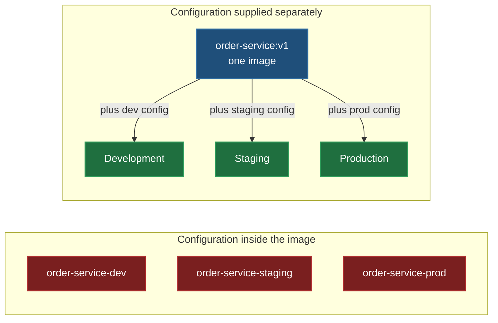
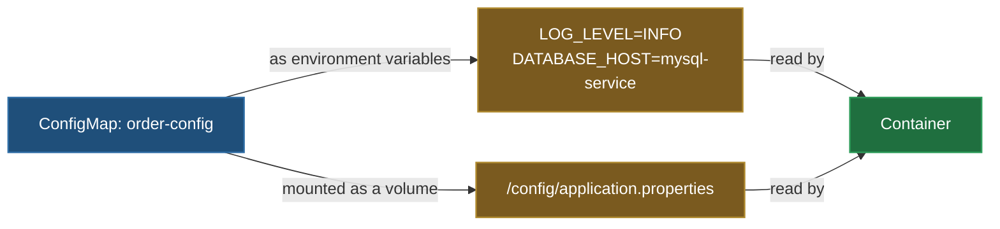
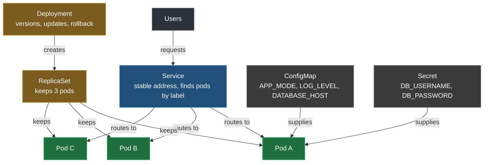
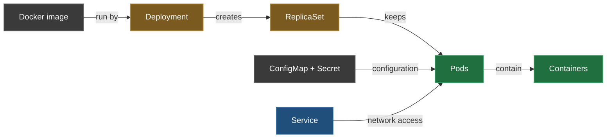

The order service can now run, scale, update and be reached reliably: a Deployment keeps its pods and a Service puts a stable address in front of them. One question is left before this is a whole application. The order service needs configuration: which database to connect to, how much to log, a password. Where should that information live?

## The problem: configuration baked into the image

A Spring Boot application like the order service needs settings such as:

```properties
server.port=8080
spring.datasource.url=jdbc:mysql://mysql-service:3306/bookcart
logging.level.root=INFO
```

The second line is a **JDBC URL** (JDBC being Java's standard interface for connecting to databases), which tells the application's database driver which server, port and database to use. There are also settings that are sensitive, such as a database username and password. The usual approach until now has been to put them into the image: written into the `application.properties` packed inside the jar, or set as environment variables in the Dockerfile when the image is built. The image then contains the application code, plus the database address, plus the environment settings, plus the passwords.

Kubernetes' advice is: **don't put configuration or secrets inside the container.** It is not a reliable technique, for two reasons.

**First, configuration is either lost with the container or locked into the image.** A setting typed into a running container by hand disappears when that container goes down; the replacement starts from the image and the setting has to be put back, every time. Putting the setting in the image avoids that, but then changing one line of configuration, such as raising the log level, means building, pushing and deploying a new image, exactly as if the code had changed.

**Second, every environment needs its own image.** The application's code is identical in development, testing, staging and production. Its configuration is not: the database in development is `localhost`, in testing `test-db`, in production `prod-database.internal`. With configuration baked in, one application becomes several images:

```text
order-service-dev:v1
order-service-test:v1
order-service-staging:v1
order-service-prod:v1
```

Building and maintaining an image per environment is hard work in itself. It also means the different environments **are no longer running the same artifact**, so what was tested is not exactly what goes to production.



The better model separates the two:

| | Holds |
|---|---|
| The image | the application code and its runtime: whatever it needs to run, and nothing that changes per environment |
| The configuration | everything that depends on the environment, supplied to the pod from outside |

Moving from staging to production then changes only the configuration supplied from outside. The image is never rebuilt for it. Kubernetes offers two objects for this, which work the same way and differ in what they are for: the **ConfigMap** and the **Secret**. Following this advice is a choice, not something Kubernetes forces — but these two objects are what it provides for those who follow it.

## ConfigMap: ordinary configuration

> **A ConfigMap stores configuration that is not confidential.**

The values in it are not passwords or private credentials; nothing in it is hidden:

```text
APP_MODE=production
LOG_LEVEL=INFO
DATABASE_HOST=mysql-service
```

`DATABASE_HOST` points at `mysql-service`, which, after the previous note, is the name of a Service: the order service reaches its database by Service name, not by any pod's address.

```yaml
# k8s/configmap.yaml
apiVersion: v1
kind: ConfigMap
metadata:
  name: order-config
data:
  APP_MODE: "production"
  LOG_LEVEL: "INFO"
  DATABASE_HOST: "mysql-service"
  application.properties: |
    server.port=8080
    logging.level.root=INFO
```

The `kind` is `ConfigMap`, it has a name like any other object, and `data` holds the configuration as keys and values.

**`data` has four keys, not three plus a nested group.** `application.properties` sits at the same level as `APP_MODE`; nothing is inside it. The `|` after it means the indented lines below are one block of text, kept as written, so `server.port` and `logging.level.root` are not keys of the ConfigMap at all. They are text inside one value. Read as data, the block above is exactly this:

```json
{
  "APP_MODE": "production",
  "LOG_LEVEL": "INFO",
  "DATABASE_HOST": "mysql-service",
  "application.properties": "server.port=8080\nlogging.level.root=INFO\n"
}
```

In Java terms, `data` is a `Map<String, String>` with four entries. Three of the values are short words; the fourth happens to be the whole contents of a properties file, with `\n` marking where each line ends.

**Why two shapes in one map: each entry is written for the way the pod will use it.** A pod can use a ConfigMap in two ways, as environment variables or as files, and the next two sections take them in turn. This is where each key ends up:

| Key in `data` | Value | How the pod receives it |
|---|---|---|
| `APP_MODE` | `production` | environment variable `APP_MODE` |
| `LOG_LEVEL` | `INFO` | environment variable `LOG_LEVEL` |
| `DATABASE_HOST` | `mysql-service` | environment variable `DATABASE_HOST` |
| `application.properties` | a two-line file | the file `/config/application.properties` |

Small, separate values suit environment variables. Whole configuration files (`application.properties`, `nginx.conf`, `logback.xml`) suit files. Neither is always better; use whichever matches what the application expects.

The last key is named `application.properties` on purpose. When a ConfigMap is mounted as files, each key becomes a file name and its value becomes that file's contents, and Spring Boot reads a file called `application.properties`. It wants the whole file, not `server.port` handed over as a separate value, so the file is stored as one piece.

**Either way, the configuration never becomes part of the container**; it is supplied from outside, and the pod uses it.

### As environment variables

Each value can be handed to the container as an environment variable. The application does not need to know that Kubernetes supplied it: it reads the variable the way any Java program reads one.

```yaml
# k8s/pod.yaml
apiVersion: v1
kind: Pod
metadata:
  name: order-service
spec:
  containers:
    - name: order-service
      image: bookcart/order-service:v1
      env:
        - name: LOG_LEVEL
          valueFrom:
            configMapKeyRef:
              name: order-config
              key: LOG_LEVEL
        - name: DATABASE_HOST
          valueFrom:
            configMapKeyRef:
              name: order-config
              key: DATABASE_HOST
```

`env` sits inside the container, next to `image`, because each container in a pod gets its own variables. Read each entry as: set the environment variable `LOG_LEVEL` from the key `LOG_LEVEL` in the ConfigMap `order-config`.

| Field | Whose value | Means |
|---|---|---|
| `name: LOG_LEVEL` | yours, free text | the variable's name inside the container |
| `configMapKeyRef.name: order-config` | must match | the ConfigMap's `metadata.name` |
| `key: LOG_LEVEL` | must match | one key in that ConfigMap's `data` |

The variable's name and the key are the same here only for readability; they do not have to be. **Each variable is one entry**, so `APP_MODE` would need a third entry of the same shape.

On the Java side, the jar's own `application.properties` refers to the variable instead of hard-coding the database:

```properties
# src/main/resources/application.properties
spring.datasource.url=jdbc:mysql://${DATABASE_HOST}:3306/bookcart
```

`${DATABASE_HOST}` is a Spring placeholder. When the application starts, Spring replaces it with the value of the environment variable `DATABASE_HOST`, so in this pod the URL becomes `jdbc:mysql://mysql-service:3306/bookcart`. Plain Java reads the same variable with `System.getenv("DATABASE_HOST")`. The same jar, started in staging with a different ConfigMap, connects to a different database without being rebuilt, which is the point this note opened with.

> [!failure] **A missing variable stops Spring Boot at startup.**
> If the pod does not supply `DATABASE_HOST`, the application refuses to start:
> ```text
> Could not resolve placeholder 'DATABASE_HOST' in value "jdbc:mysql://${DATABASE_HOST}:3306/bookcart"
> ```
> A default after a colon, `${DATABASE_HOST:localhost}`, means: use the variable if it is set, otherwise `localhost`. That keeps the application runnable on a laptop with no Kubernetes around it.

### As files

Some applications expect a configuration file rather than variables. A ConfigMap can be **mounted** into the pod as a volume, so that its keys appear as files. The StatefulSet in note 06 already mounted a volume, its disk, at `/data`; here the volume's contents come from a ConfigMap instead of a disk.

Mounting takes two halves, written in two different places in the pod:

```yaml
# k8s/pod.yaml
apiVersion: v1
kind: Pod
metadata:
  name: order-service
spec:
  containers:
    - name: order-service
      image: bookcart/order-service:v1
      env:
        - name: SPRING_CONFIG_ADDITIONAL_LOCATION
          value: "file:/config/"
      volumeMounts:            # where: inside this container
        - name: config
          mountPath: /config
  volumes:                     # what: belongs to the whole pod
    - name: config
      configMap:
        name: order-config
        items:
          - key: application.properties
            path: application.properties
```

| Half | Where it sits | Answers |
|---|---|---|
| `volumes` | under the pod's `spec`, next to `containers` | **what**: a volume called `config`, filled from the ConfigMap `order-config` |
| `volumeMounts` | inside one container | **where**: the volume `config` appears in this container as the folder `/config` |

`name: config` is free text, like a variable declared in one place and used in another; it only has to be the same in both halves. Volumes belong to the pod rather than to a container because one volume can be mounted into several containers of the pod, each at a path of its own. With plain Docker, the same thing is one flag, `docker run -v ./myconf:/config`: the source on the left is what `volumes` describes, the folder on the right is `mountPath`.

`items` picks which keys of `data` become files, and `path` names each file:

| `items` | Files that appear in `/config` |
|---|---|
| lists only `application.properties` | `application.properties` |
| left out | one file per key: `APP_MODE`, `LOG_LEVEL`, `DATABASE_HOST`, `application.properties` |

Without `items`, the container would also get a file called `LOG_LEVEL` containing `INFO`, which Spring Boot has no use for; that is why the pod picks out the one key it needs.

**Mounting the file does not make Spring Boot read it.** Spring Boot looks for `application.properties` inside the jar and in a `config` folder under the directory the application was started from, not in an arbitrary `/config`. The environment variable `SPRING_CONFIG_ADDITIONAL_LOCATION` adds a folder to that search. It is set with `value:`, a value written directly in the pod rather than taken from a ConfigMap. Where both files set the same key, the mounted file wins over the jar's own `application.properties`.



> [!tip] **A changed ConfigMap reaches mounted files, not environment variables.**
> Change `LOG_LEVEL` and the properties file from `INFO` to `DEBUG` while the pod is running. Within a minute or two, the mounted file inside the container reads `logging.level.root=DEBUG`, with nothing restarted. The environment variable still reads `LOG_LEVEL=INFO`, because environment variables are fixed when the container starts. Spring Boot behaves the same way towards its files: it reads them once, at startup, so the running application keeps `INFO` even though the file under it changed. **A configuration change reaches a Spring Boot application only when its pods are replaced**; with a Deployment, that means a rollout.

> [!question] **Could the configuration be deployed as a helper container in the pod instead?**
> No. That would be another container, which is exactly what the configuration is meant to stay out of. The two ways are the ones above: mount it as a volume, or use it as environment variables.

---

## Secret: sensitive configuration

> **A Secret holds configuration that has to be protected.**

Passwords, API tokens, authentication credentials, private keys and certificates go in a Secret instead of a ConfigMap. Everything else works the same way: a Secret is supplied to a pod as environment variables or as mounted files, and stays out of the container.

```yaml
# k8s/secret.yaml
apiVersion: v1
kind: Secret
metadata:
  name: order-secret
type: Opaque
stringData:
  DB_USERNAME: "bookcart_app"
  DB_PASSWORD: "change-me"
```

**`type: Opaque`** means the contents are free-form keys and values that Kubernetes does not check. It is also what a Secret gets when `type` is left out. Other types exist for data with a fixed shape, such as `kubernetes.io/tls` for a certificate and its private key.

**`stringData`** lets the values be written as plain text in the manifest. Kubernetes stores them base64-encoded under `data`, which the next section looks at. Both values are placeholders, and a real one would never be committed to a repository.

Used as an environment variable, the entry goes in the container's `env` list exactly like the ConfigMap ones, with `secretKeyRef` in place of `configMapKeyRef`:

```yaml
# inside the container, in the env list
- name: DB_PASSWORD
  valueFrom:
    secretKeyRef:
      name: order-secret
      key: DB_PASSWORD
```

The jar's `application.properties` then reads it the same way as before: `spring.datasource.password=${DB_PASSWORD}`.

Mounted as a volume, a Secret takes the same two halves as a ConfigMap, and each key becomes a file:

```yaml
# inside the container
volumeMounts:
  - name: secrets
    mountPath: /etc/secrets
# under the pod's spec, next to containers
volumes:
  - name: secrets
    secret:
      secretName: order-secret
```

The container then sees two files, `/etc/secrets/DB_PASSWORD` and `/etc/secrets/DB_USERNAME`, each holding one value.

> [!bug] **`secretName`, not `name`.**
> A ConfigMap volume names its ConfigMap with `name`; a Secret volume names its Secret with `secretName`. Write `name` under `secret:` and the pod is rejected:
> ```text
> strict decoding error: unknown field "spec.volumes[0].secret.name"
> ```

### A Secret is encoded, not encrypted

> [!danger] **Base64 is not encryption.**
> Ask Kubernetes for the stored Secret, and the values are not the plain text that went in:
> ```bash
> kubectl get secret order-secret -o jsonpath="{.data}"
> ```
> ```text
> {"DB_PASSWORD":"Y2hhbmdlLW1l","DB_USERNAME":"Ym9va2NhcnRfYXBw"}
> ```
> They look scrambled, and they are not. That is **base64**, an **encoding**: a reversible way of writing bytes as text, with no key involved. Anyone who can read the value can turn it back:
> ```bash
> kubectl get secret order-secret -o jsonpath="{.data.DB_PASSWORD}" | base64 -d
> ```
> ```text
> change-me
> ```
> **Encoding keeps a value readable by machines; encryption keeps it unreadable without a key.** A Secret gives you the first by default and not the second. Encryption is possible, but it is not on by default.

It goes further than that. By default, Kubernetes stores Secrets unencrypted in etcd, the cluster's database, unless encryption at rest is configured. Read straight out of etcd, the record for `order-secret` contains:

```text
change-me
bookcart_app
```

The password and the username sit in the cluster's database as plain text.

> [!warning] **kubectl apply keeps a plain-text copy of the password.**
> The same record holds something else. When an object is created with `kubectl apply`, kubectl saves the whole manifest it applied in an annotation on the object, so that the next `apply` can work out what changed. For a Secret written with `stringData`, that saved manifest is the plain text:
> ```text
> {"apiVersion":"v1","kind":"Secret",...,"stringData":{"DB_PASSWORD":"change-me","DB_USERNAME":"bookcart_app"},"type":"Opaque"}
> ```
> It is readable by anyone allowed to read the Secret, without even a base64 step. A Secret should be treated as no more private than the permission to read it.

So a Kubernetes Secret is **an object designed for sensitive data — not, on its own, a complete secret-management vault**. Production clusters typically add some of the following:

| Addition | What it adds |
|---|---|
| Encryption at rest | etcd stores Secrets encrypted instead of in plain text |
| RBAC | role-based access control: only the right people and programs may read Secrets; note 16 covers it |
| External secrets | Secrets synchronised from a dedicated store instead of written into manifests |
| Cloud secret managers, Vault, KMS | a dedicated system holds the secrets and the encryption keys |

## The whole application

Put together, one Spring Boot application, `bookcart/order-service:v1`, running three instances:



The ConfigMap and the Secret supply every pod, not only pod A; the diagram draws one pair of arrows to stay readable. If any pod goes down, its replacement starts with the same configuration, because the configuration was never inside the container. There is nothing to set up again, whether the application is deployed to production, staging or development.

| Object | Its responsibility |
|---|---|
| Pod | runs one or more containers |
| ReplicaSet | keeps the desired number of matching pods |
| Deployment | manages a stateless application: versions, updates and rollbacks |
| DaemonSet | runs a pod on every relevant node |
| StatefulSet | manages pods with a lasting identity, storage or order |
| Service | gives stable network access to matching pods |
| ConfigMap | holds non-sensitive configuration |
| Secret | holds sensitive configuration |

A Docker image answers **what should run**. Kubernetes YAML answers **how that image should be run and managed inside the cluster**. For one application, that is usually a handful of files:

```text
k8s/
├── deployment.yaml
├── service.yaml
├── configmap.yaml
└── secret.yaml
```

Separate files are easier while learning. The same objects can also go into one file, `app.yaml`, separated by `---` lines, as the StatefulSet note did; both approaches work.



For specialised workloads, the controller changes and nothing else does: a normal stateless application is a Deployment, one pod per node is a DaemonSet, and a lasting identity or storage is a StatefulSet. The idea underneath all of it is the one this folder started with: **describe the desired state, and Kubernetes keeps working to make the actual state match it.**
