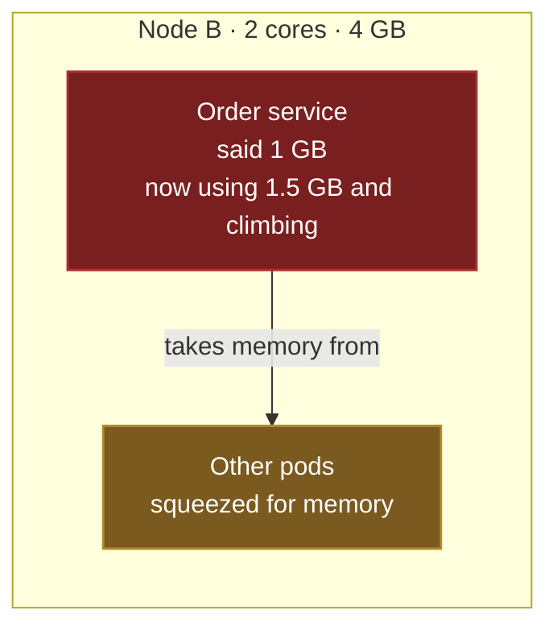
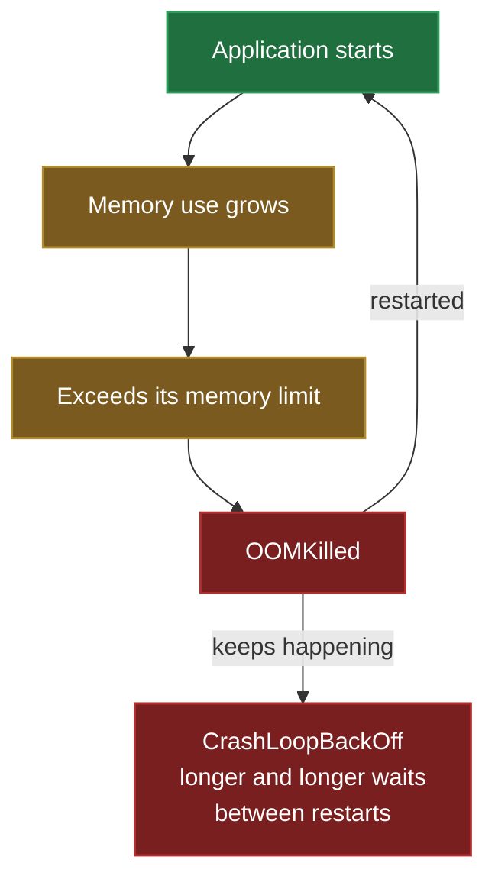
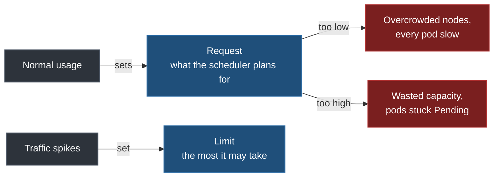

The previous note finished the basic application: a Deployment keeping the pods, a Service in front, configuration supplied from outside. One thing every pod in it has been silently assuming is that there is CPU and memory to run on. A node has a fixed amount of both, and many pods share it. This note is about how Kubernetes decides how much of each a pod gets — **requests** and **limits** — and what happens when a container tries to take more.

## Two problems on a shared node

The architecture note's scheduler chose a node by comparing what a workload needs with what each node has free: worker 1 with 1 core and 1 GB could not take a container needing 2 cores and 3 GB. Look at that again with two nodes:

| Node | CPU | Memory |
|---|---|---|
| node A | 4 cores | 8 GB |
| node B | 2 cores | 4 GB |

The order service is a Spring Boot application, and before deploying it you know two things about it: how much CPU it wants and how much memory. Say **1 CPU and 1 GB of RAM**. Either node could take it.

**The first problem is scheduling**: deciding which node a container's pod goes on, depending on how much CPU and memory it needs and how much each node has available. For the scheduler to decide, somebody has to tell it what the container needs.

**The second problem comes after the container is placed.** Put it on node B. It said it needs 1 GB, so node B has 1 core and 3 GB left for other pods. The container starts, and its memory use climbs as users arrive:

```text
100 MB → 200 MB → 400 MB → 800 MB → 1,000 MB → 1,500 MB
```

It said 1 GB, and now it wants more, because there are more users. Nothing so far stops it. If nothing ever does, one container can go on consuming memory until the whole node's memory is gone, and every other container on that node suffers. The same goes for CPU: it said one core, and under heavy load it starts trying to use 1.2. **This is the isolation problem**, sometimes called the runtime isolation problem, because it appears only while the application runs, never at the moment it is deployed. Each container was meant to run inside its own space, and nothing is keeping it there.



A common cause of that climb is a **memory leak** (a program that keeps allocating memory and never releases it), but the problem is the same whatever the cause: one container consuming resources that other containers on the node were relying on.

> [!question] **Can't the node just scale up when that happens?**
> Not in the way that would help here. Giving a server more RAM or more CPU cores is **vertical scaling**, and on a real machine it is physical work: take a chip out, put a bigger one in. Nothing like that happens in production while an application is running. What is possible is adding more servers (**horizontal scaling**), which is a separate subject. Within one node, the amount of CPU and memory is fixed, and the containers on it have to share it. (Note 15 uses the term vertical scaling for something else: making a pod bigger by raising its requests, which needs no new hardware as long as the node has room.)

Kubernetes answers the two problems with two settings, one for each:

| Problem | Question | Setting |
|---|---|---|
| Scheduling | how much should Kubernetes plan for when placing this container? | **request** |
| Isolation | how much should this container be allowed to consume while it runs? | **limit** |

Both are written inside the container, under `resources`, next to `image`:

```yaml
# k8s/pod.yaml
apiVersion: v1
kind: Pod
metadata:
  name: order-service
spec:
  containers:
    - name: order-service
      image: bookcart/order-service:v1
      resources:
        requests:
          cpu: "500m"
          memory: "256Mi"
        limits:
          cpu: "1000m"
          memory: "512Mi"
```

| Field | Whose value | Means |
|---|---|---|
| `resources` | Kubernetes' fixed name | holds this container's requests and limits |
| `requests`, `limits` | fixed names | the two settings in the table above |
| `cpu`, `memory` | fixed names | the two resources being planned and capped |
| `"500m"`, `"256Mi"` | yours | the amounts, in the units the next section explains |

In a Deployment the same block sits in the container inside the pod template.

**Requests and limits belong to each container, not to the pod.** A pod's request is the sum of its containers' requests. The order service requesting 500m, with a log helper from note 03 beside it requesting 100m, makes a pod that requests 600m, and the scheduler needs 600m free to place it.

## How CPU and memory are measured

**CPU.** Computers are described as quad-core, octa-core, deca-core: 4, 8, 10 cores, and machines with 12 or 18 are common. Each core is, for this purpose, one CPU: a computer with 4 cores can carry out 4 streams of computation at the same moment. **Kubernetes counts in CPUs**, where one CPU means one core of a physical machine or one virtual CPU (a **vCPU**) of a virtual machine or cloud server.

Applications rarely need whole CPUs, so Kubernetes measures in thousandths of one, called **millicpu** and written with a lowercase `m`:

| Written | Means |
|---|---|
| `1` or `1000m` | 1 CPU |
| `500m` | 0.5 CPU |
| `250m` | 0.25 CPU |
| `100m` | 0.1 CPU |

**Memory** is measured in bytes, with suffixes. The two families look alike and are not the same:

| Written | Means | Bytes |
|---|---|---|
| `256Mi` | 256 mebibytes | 268,435,456 |
| `256M` | 256 megabytes | 256,000,000 |
| `1Gi` | 1 gibibyte | 1,073,741,824 |

`Mi` and `Gi` are powers of 2; `M` and `G` are powers of 10. They are close but not equal, so use one family consistently; Kubernetes' own examples use `Mi` and `Gi`.

> [!danger] **A lowercase m on a memory value means thousandths of a byte.**
> `m` is the millicpu suffix, and it means a thousandth wherever it appears. Written for memory, `256m` is **0.256 bytes**. Kubernetes does not reject it: it prints a warning and creates the pod anyway:
> ```text
> Warning: spec.containers[0].resources.requests[memory]: fractional byte value "256m" is invalid, must be an integer
> pod/tiny-m created
> ```
> **For memory, write `Mi` or `Gi`.** A lowercase `m` there is never what was meant.

## Requests: what the scheduler plans for

> **A request is the amount of CPU and memory Kubernetes sets aside for a container when it decides where the pod can run.**

```yaml
resources:
  requests:
    cpu: "500m"
    memory: "256Mi"
```

This says the container needs half a CPU and 256 MiB. The kube-scheduler will only put its pod on a node that still has at least that much unclaimed, and once it is placed, that much of the node is counted as taken.

Take one node, node A, with 4 CPUs, and four pods on it:

| Pod | CPU request |
|---|---|
| Pod A | 1000m |
| Pod B | 500m |
| Pod C | 1500m |
| Pod D | 1000m |
| **Total** | **4000m** |

The four requests add up to 4000m (all 4 CPUs). The node cannot create a fifth CPU out of nowhere; 4 is its physical limit. So the next pod with any CPU request cannot go on node A. Memory works the same way: the memory requests on a node can never add up to more than the node offers.

A pod that fits nowhere is not refused outright. It is created and waits in `Pending`, and `kubectl describe pod` says why at the bottom, in its events. Here a pod requesting 5 CPUs on a 2-CPU node:

```text
NAME     READY   STATUS    RESTARTS   AGE
toobig   0/1     Pending   0          13s
```

```text
Warning  FailedScheduling  13s  default-scheduler  0/1 nodes are available: 1 Insufficient cpu. preemption: 0/1 nodes are available: 1 Preemption is not helpful for scheduling.
```

It stays `Pending` until a node with room appears or something else frees its requests.

### What a node has left

`kubectl describe node` shows the node's side of the sum. On a Minikube node:

```bash
kubectl describe node minikube
```

```text
Capacity:
  cpu:                2
  memory:             3985980Ki
Allocatable:
  cpu:                2
  memory:             3985980Ki
...
Allocated resources:
  (Total limits may be over 100 percent, i.e., overcommitted.)
  Resource           Requests      Limits
  --------           --------      ------
  cpu                1500m (75%)   1350m (67%)
  memory             1328Mi (34%)  1806Mi (46%)
```

| Line | Means |
|---|---|
| `Capacity` | everything the machine has |
| `Allocatable` | what the scheduler may hand out to pods. It is lower than `Capacity` when the cluster holds some back for the operating system and Kubernetes' own programs; on Minikube nothing is held back, so the two are equal |
| `Allocated resources` | the sum of the requests (and limits) of every pod on the node, the cluster's own pods in `kube-system` included |

So 1500m of this node's 2 CPUs is already promised before the order service asks for anything, and a new pod can request at most 500m here. The line under that heading says something about limits too: **requests can never add up to more than the node offers, but limits can**, because limits are ceilings, not reservations.

### A request is not what the container uses

A request is a plan, not a measurement. It says how much to set aside; it says nothing about how much the container is using right now.

Another node: 4 CPUs and 8 GB. Four pods are running, with these requests:

| Pod | CPU request | Memory request |
|---|---|---|
| Pod 1 | 500m | 1 GB |
| Pod 2 | 500m | 1 GB |
| Pod 3 | 500m | 1 GB |
| Pod 4 | 2000m | 3 GB |
| **Set aside** | **3500m** | **6 GB** |
| **Left** | **500m** | **2 GB** |

A new pod arrives requesting **600m and 3 GB**. It does not fit: 600m is more than the 500m left, and 3 GB more than the 2 GB left; either one alone would be enough to refuse it. Now look at what the four pods are actually using:

| Pod | CPU in use | Memory in use |
|---|---|---|
| Pod 1 | 100m | 0.2 GB |
| Pod 2 | 100m | 0.2 GB |
| Pod 3 | 100m | 0.2 GB |
| Pod 4 | 200m | 0.2 GB |
| **In use** | **500m of 4000m** | **0.8 GB of 8 GB** |

The node is nearly idle — and the new pod is still refused. Its pod would fit easily into what is free right now, but what is free right now does not matter: the existing pods have **set aside** 3500m and 6 GB for themselves, and that space is theirs whether they are using it or not.

It is the same as dividing a 2,000 GB disk into partitions. Make drive C 1,000 GB, and it is 1,000 GB whether you have filled it or not; you cannot say the space you have not used yet on C is free for something else, and only 1,000 GB is left for the other partitions. Or think of being handed a whole chocolate bar: it is yours, but you will not eat all of it at once. You start a little at a time. A container given a 500m request starts by using 20m, 50m, 100m; the rest is still reserved for it.

**Why doesn't Kubernetes schedule on current usage instead?** Because usage keeps changing. An application using almost no CPU right now can need much more a minute later under heavy traffic; a node that looked empty at placement time would then be badly overloaded. Requests let Kubernetes plan for what workloads are expected to need, not for a snapshot. One request of `500m` might in practice mean:

```text
normal traffic → 100m · moderate traffic → 350m · heavy traffic → 700m
```

**Request and actual usage are two different numbers**: the request is the capacity planned for at scheduling time; the usage is what the application consumes as it runs. That last line also shows usage above the request, 700m against 500m. A request is not a ceiling. The ceiling is the second setting.

## Limits: the most a container may use

> **A limit is the maximum amount of CPU and memory a container is allowed to consume while it runs.**

```yaml
resources:
  limits:
    cpu: "1000m"
    memory: "512Mi"
```

The request says at least this much will be set aside; the limit says this far and no further. If the order service's usage keeps climbing from 100m to 200m, 300m, 400m and past its request, the limit is where it stops.

What stopping means is different for CPU and for memory, because the two are different kinds of resource.

### CPU over its limit: throttled, not stopped

A container trying to use more CPU than its limit is **throttled**: it is simply given less CPU time.

Picture how a CPU runs programs. An application runs as **threads**, and one core runs one thread at a time. The core gives thread T1 a slice of time, then switches to thread T2 (a **context switch**), then perhaps back to T1, and so on. A thread waiting for its turn is **runnable**; the one on the core right now is **running**. When a container is throttled, its threads get fewer and shorter turns. They spend more time runnable and less time running, so everything the application does takes longer. You press submit, a thread has to run to handle it, and it waits.

Concretely, the limit becomes a budget of CPU time for every 100-millisecond window. A limit of `500m` is 50 ms of CPU time in each 100 ms; a limit of `200m` is 20 ms. Once the container's threads have used up the window's budget, all of them wait, runnable but not running, until the next window begins.


The application **slows down; it does not crash and it is not stopped.** That is deliberate. The first priority of any system — an ATM network, BookMyShow, Zomato, Swiggy, Instagram — is to keep running, because a running application earns money and a stopped one does not. If Instagram handles 1,000 users well and then 2,000 arrive, it is far better for those 2,000 to find it slow than to find it gone. And a throttled container leaves more CPU time for the other containers' threads, so the rest of the node keeps going.

This is a specific kind of throttling. A laptop that overheats also throttles its CPU, by lowering its clock speed; that is a different mechanism with the same name. **Kubernetes' CPU throttling is a quota of CPU time per container.**

### Memory over its limit: killed

Memory cannot be handed out in smaller time slices. Memory a process already holds cannot be throttled back; the bytes are either the process's or they are not. So when a container's memory use exceeds its limit, the operating system kills a process in it, through what is called the **out-of-memory killer** (**OOM** for short). Kubernetes reports the container as **OOMKilled**.

Here is a test container whose only job is to eat memory, given a `50Mi` limit. Seconds after it starts, `kubectl get pods` shows:

```text
NAME     READY   STATUS      RESTARTS      AGE
memhog   0/1     OOMKilled   1 (12s ago)   13s
```

and `kubectl describe pod memhog` shows how its last run ended:

```text
    Last State:     Terminated
      Reason:       OOMKilled
      Exit Code:    137
```

Exit code 137 is 128 plus 9: the process was ended by signal 9, **SIGKILL**, which a process cannot catch or delay.

It sounds like Java's `OutOfMemoryError`, and for a Spring Boot application it is a different event:

| | `OutOfMemoryError` | OOMKilled |
|---|---|---|
| Who acts | the JVM, when its heap is full | the Linux kernel, from outside the JVM |
| The application | gets an exception it can log, and may even keep running | is killed on the spot: no exception, no stack trace, no shutdown hooks |
| Where to look | the application's logs | `kubectl describe pod`: `Reason: OOMKilled`, `Exit Code: 137` |

A Java developer who searches the logs for an `OutOfMemoryError` after an OOMKill finds nothing, because the JVM never had the chance to write one.

Depending on the pod's restart policy, the container is then restarted. If the memory problem keeps happening, the restarts keep failing, and Kubernetes waits longer and longer between attempts, roughly doubling each time. The test container above was restarted after about 10 seconds, then 20, 40, 80 and 160; the wait stops growing at five minutes. That state is **CrashLoopBackOff**, the back-off being the growing wait:

```text
NAME     READY   STATUS             RESTARTS      AGE
memhog   0/1     CrashLoopBackOff   6 (81s ago)   7m9s
```



Enforcement is reactive. The kill comes when the kernel notices the container is over its limit, which is not necessarily the exact instant the threshold is crossed.

> [!tip] **Going further: the JVM sizes its heap from the container's limit.**
> Started in a container with a memory limit of `512Mi` and no `-Xmx`, Java 21 sets its maximum heap to 128 MB, a quarter of the limit; `java -XX:+PrintFlagsFinal -version` shows it as `MaxHeapSize = 134217728`. The other three quarters are left for what the JVM needs outside the heap. So a Spring Boot container given `512Mi` can throw `OutOfMemoryError` with 128 MB of heap full, long before the kernel's limit is reached. The share is set with `-XX:MaxRAMPercentage`, whose default is 25.

### Two containers sharing a node

Put the two behaviours side by side on one small node: **2 CPUs and 2 GB**. Two pods each have a limit of **1000m and 1 GB**. Right now each uses 800m and 500 MB, and everything runs well.

Pod 1's traffic grows and it tries to use **1100m**. That is over its limit, so it is throttled and held at 1000m, **even though the node has CPU to spare**: 1000m plus pod 2's 800m leaves 200m idle, and pod 1 still cannot have it. A limit is a fixed ceiling, not a share of whatever happens to be free; a container with a `200m` limit running flat out on an otherwise idle node is still held to 20 ms in every 100 ms. What the ceiling protects is pod 2. If both pods climb to their full 1000m, the node's 2000m is exactly used up and neither can take time from the other. Pod 1 is given less time and slows; nobody is stopped.

Pod 1 also tries to use **1,100 MB** of memory. That is over its 1 GB limit, and it is **OOMKilled**, straight away. **CPU time can be shared out more thinly;** memory cannot be stretched, and there is no extra RAM to hand over without physically adding it.

| | CPU limit | Memory limit |
|---|---|---|
| Enforced by | throttling | the out-of-memory killer |
| Over the limit means | less CPU time | a process is killed |
| The container | keeps running, slower | is terminated, and may be restarted |
| The cost | slower responses | crashes and restarts, possibly CrashLoopBackOff |

## Requests and limits together

They are almost always set together:

```yaml
resources:
  requests:
    cpu: "250m"
    memory: "256Mi"
  limits:
    cpu: "500m"
    memory: "512Mi"
```

| | Request | Limit |
|---|---|---|
| CPU | 250m | 500m |
| Memory | 256Mi | 512Mi |
| Used | when **scheduling**: what the node must have free | while **running**: the most the container may take |

**Requests help Kubernetes decide where a pod can run. Limits control what it consumes once it is running.** In between the two, the container can use more than it requested whenever the node has capacity free, up to the limit.

A request can never be larger than its limit. Kubernetes refuses it:

```text
The Pod "req-over-limit" is invalid: spec.containers[0].resources.requests: Invalid value: "1": must be less than or equal to cpu limit of 500m
```

> [!question] **What if only a limit is given, and no request?**
> That is allowed, and Kubernetes then uses the limit as the request, unless something in the cluster has been configured to supply a different default. Given only `limits: cpu 500m, memory 256Mi`, the pod Kubernetes creates carries both:
> ```text
> {"limits":{"cpu":"500m","memory":"256Mi"},"requests":{"cpu":"500m","memory":"256Mi"}}
> ```
> The same happens for CPU and for memory, and it matters for the next note: a pod whose requests equal its limits is in a class of its own.

> [!question] **And if neither is given?**
> Then the scheduler plans for nothing when placing the container, and nothing caps what it uses once it runs: the isolation problem this note opened with, left unsolved. Such a pod is in the lowest class of the next note, the first to go when a node runs short.

## Choosing the values

**Why not always set the request equal to the limit?** Then the scheduler sets aside the peak for every container, all the time. A container with request and limit both at 1000m and 512Mi takes 1000m of the node at placement whether its normal load is 100m or 900m. Most of the time most of that reservation sits unused, and the node fits far fewer pods than it could. So most applications do not set them equal, although for some pods it is exactly right, for a reason the next note explains.

Take an API server that normally uses 100m and needs 600m during a traffic spike:

```yaml
resources:
  requests:
    cpu: "100m"
  limits:
    cpu: "1"
```

Kubernetes plans for 100m when placing it, and the container can use more (up to a whole CPU) when it needs to and the node has room.

**Why not set the request very low, to fit more pods?** Say an application really needs about 500m, and its request is set to `10m`. The scheduler believes it is tiny. On a node with 4,000m of CPU:

```text
400 pods × 10m = 4,000m
```

By requests alone, 400 such pods fit on one node, and the scheduler will happily put them there. But every one of them actually wants 500m. They all compete for CPU time; each gets a sliver; every application on the node is slow, and none of them works properly. The low requests made the numbers look good and the node unusable. The job is not to fit the most pods on a node; it is to set requests that let the pods run well.

**Why not set the request very high, to be safe?** Say the normal usage is 500m and the request is 700m. Every replica sets aside 200m it does not need, the node fits fewer pods, and its capacity is wasted. Take it further — an application that normally uses 200m but requests 3 CPUs — and it leads to:

- poor use of the node: most of what is reserved is never used;
- pods that cannot be placed anywhere, because no node has 3 CPUs unclaimed;
- pods stuck in `Pending` even though actual CPU usage across the cluster is low.

So the trade-off has to be made carefully, and a rule of thumb captures it:

> **The request should reflect normal usage. The limit should allow for spikes.**

A **spike** is a sudden jump in traffic: Amazon's and Flipkart's big sales around Diwali, when far more users arrive at once. The request covers how the application behaves on an ordinary day; the limit is how far it may go on the day of the sale. Keep the gap between them sensible rather than enormous.



> [!question] **How are the right numbers decided? By load testing the application?**
> Yes: measure the application under normal and peak load and set the values from what was measured. What load and performance testing involve is a subject of its own.

> [!question] **Do the values grow by themselves when the application needs more?**
> No. They change only when you change the configuration; with a Deployment, changing them in the pod template rolls out new pods carrying the new values. Growing automatically with load is **autoscaling**, a separate concept that belongs with running Kubernetes in production, and the subject of two later notes in this folder.

> [!question] **What if the normal usage itself goes up for good (the ordinary day now looks like the old spike)?**
> Then the request and the limit should both be raised — say from 500m and 1000m to 1000m and 2000m, and the memory from 256Mi and 512Mi to 512Mi and 1Gi — and the application redeployed with them, which may mean onto bigger nodes. Alternatively, add replicas and servers: **horizontal scaling**. And replicas already help on their own: the traffic is split across them, and a replica that has been OOMKilled receives none until it is back. The split is not clever, though. A Service's rules, from note 07, pick a replica at random, so a replica that is merely throttled keeps receiving its full share and answers slowly. A load balancer that steers traffic away from slow replicas is a system design topic.

> [!question] **CPUs schedule threads with algorithms such as round robin, shortest job first and first-come-first-served. Does the same apply here?**
> That is the operating system's thread scheduling inside each node, and it is a different layer from the Kubernetes scheduler, which only picks a node for each pod. It is not covered in this folder.

