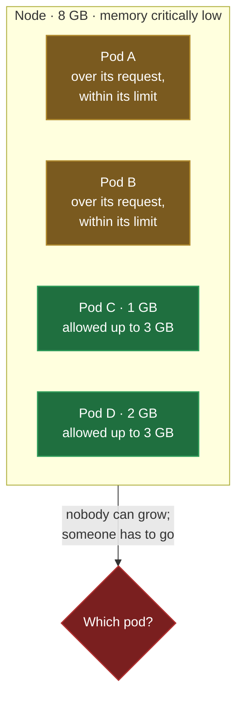
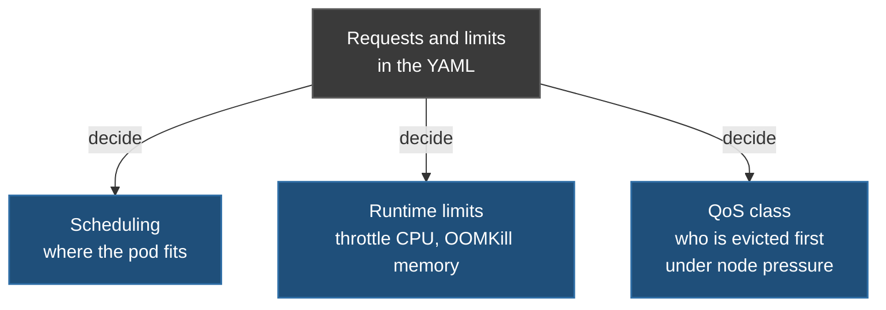

The previous note gave every container two numbers: a request, which the scheduler sets aside, and a limit, which the container may grow to. It also showed that a node can be fully booked by requests while being nearly idle. The opposite can happen too, and it leads to the last idea in this part of Kubernetes: what a node does when its pods, all within their own limits, use more memory than the node has. The answer is **Quality of Service**.

## When a node runs out of memory with nobody breaking a rule

A node has **8 GB** of memory. Four pods run on it, each with the same settings:

| Pod | Memory request | Memory limit |
|---|---|---|
| Pod A | 2 GB | 3 GB |
| Pod B | 2 GB | 3 GB |
| Pod C | 2 GB | 3 GB |
| Pod D | 2 GB | 3 GB |

Scheduling looks at requests, not limits: 2 + 2 + 2 + 2 = 8 GB, which the node has, so all four were placed. The limits add up to 12 GB, which the node does not have — and nothing about that is invalid. Each limit is only a promise of how far one pod may go, not a reservation.

Now the pods get busy. Pods A and B grow beyond their requests and between them use 5 GB, which their limits allow. Pods C and D are quiet, at 1 GB each. Total: 7 GB. So far there is still room.

Then pod D grows to 2 GB, exactly its request; it has not even used what was set aside for it. Total: 8 GB. Or it grows only part of the way, and the node is down to 300 or 400 MB free, which is already critically low. Either way:



No pod has broken its limit, so the previous note's OOMKilled-at-the-limit does not apply. Yet none of them can grow by even a little: pod A is allowed to 3 GB and cannot get there, and pod C has not even reached its 2 GB request and cannot either. The node itself is in danger. **Kubernetes has to make a tough decision: someone needs to go.** One pod has to be killed to protect the node and the others; if it belongs to a Deployment, its replacement will be placed somewhere with room, as the earlier notes showed. But on this node, now, one of A, B, C and D must be removed.

## Who goes first

Killing a pod at random would be wrong, because pods are not equally important. Suppose the four are:

| Pod | Runs |
|---|---|
| Pod A | the production payment service |
| Pod B | a background task (a one-off data migration, say) |
| Pod C | the order service |
| Pod D | the user service |

Nobody wants the payment service, the order service or the user service stopped. The background task can be run again later or somewhere else. Pod B is the obvious one to remove. Kubernetes cannot know what each pod does, but it needs some way to rank them, and the way it uses is the **Quality of Service class** (**QoS**).

## The three QoS classes

Kubernetes puts every pod into one of three classes, **based entirely on the requests and limits** of its containers.

**Guaranteed**: every container in the pod has both a CPU and a memory request and limit, and for each, the **request equals the limit**.

```yaml
      resources:
        requests:
          cpu: "500m"
          memory: "256Mi"
        limits:
          cpu: "500m"
          memory: "256Mi"
```

**Burstable**: at least one container has some CPU or memory request or limit, but the pod does not meet the Guaranteed conditions. The usual case is a request lower than the limit, the normal-usage-and-spikes setting from the previous note:

```yaml
      resources:
        requests:
          cpu: "200m"
          memory: "256Mi"
        limits:
          cpu: "1"
          memory: "512Mi"
```

A pod with only some of the values set (a CPU request and nothing else, for instance) is also Burstable.

**BestEffort**: no container in the pod has any CPU or memory request or limit at all. There is simply no `resources` section:

```yaml
      containers:
        - name: app
          image: nginx:alpine
```

| | Guaranteed | Burstable | BestEffort |
|---|---|---|---|
| CPU and memory requests | required | may be set | not set |
| CPU and memory limits | required | may be set | not set |
| Request = limit | yes, for CPU and memory, in every container | not required | not applicable |
| Protection when the node runs short | highest | in between | lowest |

### Why the classes rank the way they do

The three classes say how much Kubernetes knows about a pod, and so how much it can trust it.

A **Guaranteed** pod declared exactly what it uses, and its request and limit are the same. Kubernetes reads that as a **predictable** application: its normal usage and its maximum are the same number, so it is not going to spike up and drop back. It is the safest kind to keep running.

A **Burstable** pod has a request below its limit, so its traffic bursts: normal usage, then a jump towards the limit, then back down, then another jump. That is less predictable, and it is trusted a little less.

A **BestEffort** pod declared nothing. Kubernetes will make its best effort to give it CPU and memory — whatever is left over after the others — but it cannot promise anything. If there is room, it runs; if there is not, so be it. It is the least predictable of all, and the first to go.

## Eviction: the order under pressure

Removing a pod from a node to relieve the node is called **eviction**. When a node comes under memory pressure, the QoS class is what the eviction decision is built on, and the order is:


So in the four-pod example, if the background task were the BestEffort pod and the three services were Burstable or Guaranteed, the background task is the one removed. If there are no BestEffort pods on the node, a Burstable one goes. A Guaranteed pod is removed only when nothing else is left to remove.

**This happens only under node pressure.** As long as the node has enough, every pod runs, whatever its class. QoS is not a running priority; it is a ranking that matters only at the moment something has to be given up.

**And the pressure is about memory, not CPU.** **Checked against the documentation:** the signals that make a node start evicting are running short of memory, of disk space, or of process IDs. CPU is not among them. A node whose pods all want more CPU than it has simply shares the CPU out more thinly (the throttling from the previous note), and nobody is evicted for it, because CPU time, unlike memory, can always be handed out in smaller slices.

> [!important] **Guaranteed is the strongest protection, not an absolute one.**
> QoS is the main factor, not the only one. **Checked against the documentation:** when the kubelet evicts pods under node pressure, it ranks them by whether each pod's usage exceeds its requests, by the pod's **priority** (a separate setting that marks how important a pod is), and by how far its usage exceeds its requests. Because a Guaranteed pod's usage can never exceed its request, it naturally ranks last; a BestEffort pod has no requests, so any usage exceeds them, and it ranks first. That is where the class order comes from. **Guaranteed does not mean a pod can never be evicted or killed** — it means it is the last candidate.

> [!question] **Isn't it possible for a Burstable pod to be more stable than a BestEffort one, or even than a Guaranteed one?**
> Yes, in a particular case. A Burstable pod might in practice use the same steady amount all day. The classes are a general rule, not a guarantee about any one application. Kubernetes has to make the decision somehow, without knowing what each application does, and the requests and limits are the only description it has. Declared as identical, they describe a steady application; declared apart, they describe one that bursts; left out, they describe nothing.

## Choosing a class on purpose

This is the reason, promised in the previous note, that some pods should have their request equal to their limit. **Making a pod Guaranteed costs capacity and buys protection.** The node sets aside the pod's full maximum at all times, and in return it is the last pod to be evicted when the node runs short. That is the right trade for a small number of critical, steady workloads (the payment service in the four-pod example), and the wrong one for everything, because if every pod reserved its peak, the node would fit far fewer of them.

| You want | Set | Class |
|---|---|---|
| a critical, steady workload, protected first | request = limit, for CPU and memory | Guaranteed |
| an ordinary application, sized for normal use with room for spikes | request below limit | Burstable |
| a disposable task that may use spare capacity | nothing | BestEffort |



**Requests help Kubernetes decide where a pod runs; limits control what it may consume once it is running; and the QoS class those settings produce decides how the pod is treated when the node runs short.** Every one of those numbers comes from the same few lines of YAML, and they are boilerplate: the same fields in every manifest, with values chosen from what the application is measured to need.

