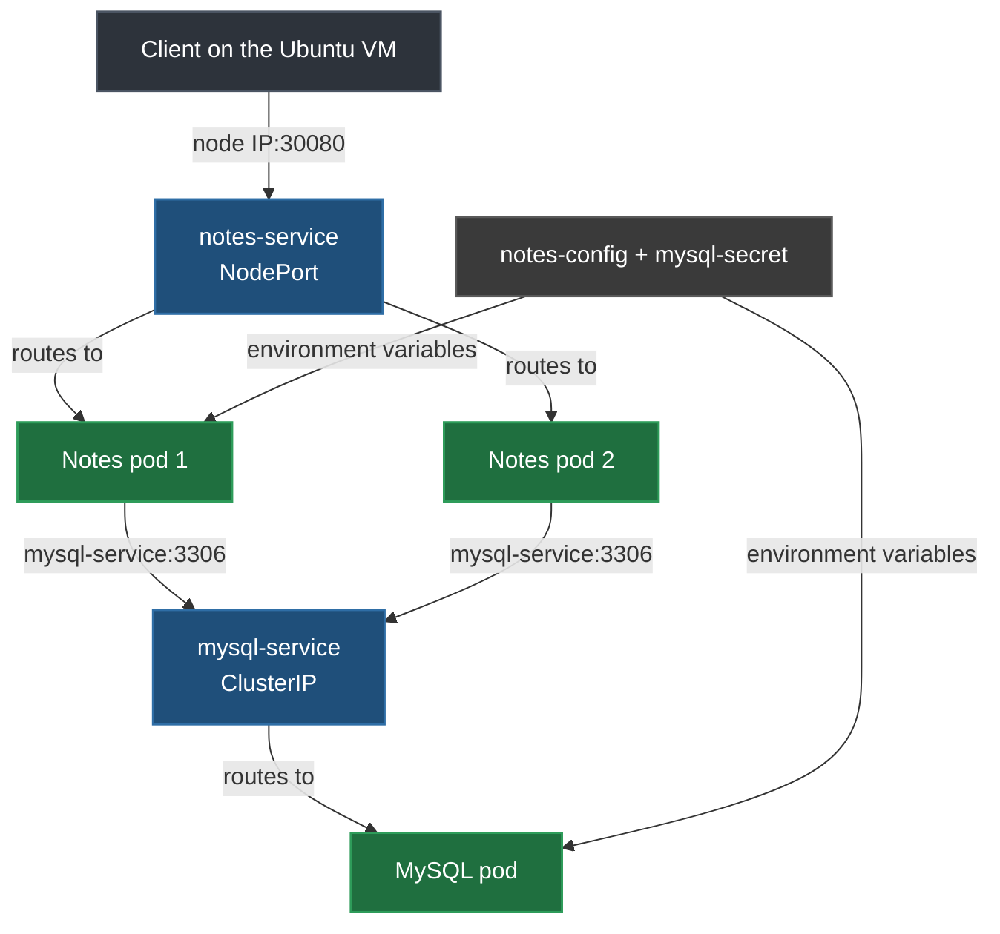
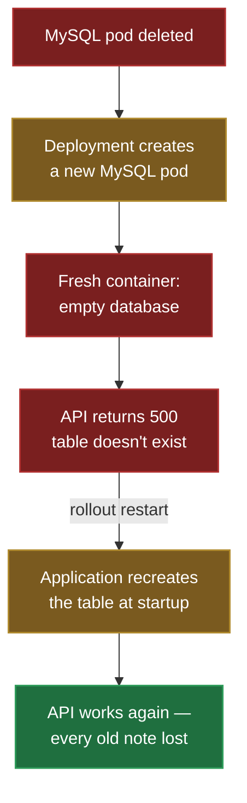

## What is being deployed

The application is a small Spring Boot service, a **Notes API**, backed by MySQL. It does very little, which is the point: the interest is in deploying it, not in the code. Its endpoints:

| Method and path | Does |
|---|---|
| `POST /notes?text=...` | stores a note in MySQL and returns it with its new id |
| `GET /notes` | returns every stored note |
| `GET /whoami` | returns the name of the machine handling the request, from the `HOSTNAME` environment variable (locally, `local-machine`) |
| `GET /version` | returns the application version, from the `APP_VERSION` environment variable (locally, `local`) |

The last two exist only for this demo: inside Kubernetes, `HOSTNAME` is the name of the pod, so `/whoami` shows which replica answered, and `/version` shows which version is running during an update.

Run on a laptop, the application works the familiar way: started from the IDE, a `POST` to `localhost:8080/notes?text=DevOps` from Postman stores a row, a database browser such as DBeaver shows the row with its id, and `GET /notes` returns the list. Its database settings come from environment variables, with local defaults:

```properties
# src/main/resources/application.properties
spring.datasource.url=${DB_URL:jdbc:mysql://localhost:3306/notesdb?allowPublicKeyRetrieval=true&useSSL=false}
spring.datasource.username=${DB_USERNAME:root}
spring.datasource.password=${DB_PASSWORD:123456}
spring.jpa.hibernate.ddl-auto=update
server.port=8080
```


With plain Docker, deploying this means two containers, the Spring Boot one and the MySQL one, on a server, with a network between them. With Kubernetes, the pieces are:

| Object | Name | Holds or does |
|---|---|---|
| ConfigMap | `notes-config` | the database name and the JDBC URL |
| Secret | `mysql-secret` | the database usernames and passwords |
| Deployment | `mysql` | keeps one MySQL pod |
| Service, ClusterIP | `mysql-service` | a stable internal address for MySQL |
| Deployment | `notes-app` | keeps two Notes API pods |
| Service, NodePort | `notes-service` | exposes the API on port 30080 of the node |



Everything runs on Minikube's single node, so all three pods share one machine. In production the same objects would spread across many nodes; nothing in the YAML would change.

## Step 1: get the project onto the server

The project lives on a Mac. Minikube runs inside the Ubuntu virtual machine, so the project has to be copied in. For a remote server, the tool would be **SSH** and a copy over it. This VM is managed by Multipass, which can copy into it directly; `-r` copies a folder recursively:

```bash
multipass transfer -r ~/Desktop/kubernetesDemo devops:/home/ubuntu/
multipass shell devops
cd /home/ubuntu/kubernetesDemo
ls
```

The project root holds `Dockerfile`, `pom.xml` and `src/`. A `target/` folder of compiled output, if one came along, is not needed, because the image build compiles everything itself. The Dockerfile is a **multi-stage build**: two `FROM` lines, two stages. The first starts from an image with Maven and a full JDK, copies in the source, and compiles and packages the jar. The second starts from a much smaller image holding only the Java runtime, and copies just the finished jar out of the first stage with `COPY --from=build`. Maven, the compiler and the source never reach the final image, which is smaller for it:

```dockerfile
# Dockerfile
FROM maven:3.9-eclipse-temurin-21 AS build
WORKDIR /app
COPY pom.xml .
COPY src ./src
RUN mvn clean package -DskipTests

FROM eclipse-temurin:21-jre
WORKDIR /app
COPY --from=build /app/target/*.jar app.jar
EXPOSE 8080
ENTRYPOINT ["java", "-jar", "app.jar"]
```

Check that Minikube is running, and start it with Docker as its driver if it is not:

```bash
minikube status
minikube start --driver=docker
kubectl get nodes
```

## Step 2: build the image inside Minikube

The image could be built with Docker and pushed to Docker Hub. For a local demo there is a shorter route: Minikube can build the image straight into its own node, where the pods will look for it, and nothing needs publishing.

```bash
minikube image build -t notes-app:v1 .
minikube image ls | grep notes-app
```

```text
docker.io/library/notes-app:v1
```

The name `notes-app:v1` follows the endpoints (it is an app for notes), and `v1` leaves room for a version 2 later. Built on the check machine, including downloading Maven's dependencies and compiling, it took 59 seconds.

## Step 3: a folder for the manifests

Keep every manifest in one folder, numbered in the order they are applied. Nothing in Kubernetes requires this; it is a convention that keeps a project readable:

```bash
mkdir -p k8s
```

```text
kubernetesDemo/
├── Dockerfile
├── pom.xml
├── src/
└── k8s/
    ├── 01-config.yaml
    ├── 02-secret.yaml
    ├── 03-mysql.yaml
    └── 04-app.yaml
```

Every step from here has the same rhythm: **write a manifest, apply it, check what it created.**

## Step 4: the ConfigMap

The non-sensitive settings: the database's name, and the JDBC URL the application connects with.

```yaml
# k8s/01-config.yaml
apiVersion: v1
kind: ConfigMap
metadata:
  name: notes-config
data:
  MYSQL_DATABASE: notesdb
  DB_URL: "jdbc:mysql://mysql-service:3306/notesdb?allowPublicKeyRetrieval=true&useSSL=false"
```

The URL's host is `mysql-service`: **the name of the Service that will stand in front of MySQL, not the address of any pod.** As the Services note showed, a pod's address changes when the pod is replaced; the Service's name does not.

```bash
kubectl apply -f k8s/01-config.yaml
kubectl get configmaps
kubectl describe configmap notes-config
```

```text
NAME               DATA   AGE
kube-root-ca.crt   1      155m
notes-config       2      0s
```

`DATA 2` is the two keys. `kube-root-ca.crt` is a ConfigMap Kubernetes keeps in every namespace for its own use. Applying a file that has not changed is harmless and says so:

```text
configmap/notes-config unchanged
```

## Step 5: the Secret

```yaml
# k8s/02-secret.yaml
apiVersion: v1
kind: Secret
metadata:
  name: mysql-secret
type: Opaque
stringData:
  MYSQL_ROOT_PASSWORD: change-me-root
  MYSQL_USER: notesuser
  MYSQL_PASSWORD: change-me
```

`type: Opaque` is the generic kind of Secret: arbitrary keys and values, with no particular structure Kubernetes needs to understand. The values are demo placeholders; a real deployment would never commit its passwords to a file.

```bash
kubectl apply -f k8s/02-secret.yaml
kubectl get secrets
kubectl describe secret mysql-secret
```

```text
NAME           TYPE     DATA   AGE
mysql-secret   Opaque   3      0s

Data
====
MYSQL_PASSWORD:       9 bytes
MYSQL_ROOT_PASSWORD:  14 bytes
MYSQL_USER:           9 bytes
```

`describe` shows the keys and their sizes, never the values — though, as the ConfigMaps note showed, anyone allowed to read the Secret can still decode them.

> [!important] **Nothing is running yet.**
> A ConfigMap and a Secret are resources, not workloads. No pod and no container exists at this point; there are only two stored objects that pods will read from.

## Step 6: MySQL, with a ClusterIP Service

MySQL needs a controller to keep its pod running, and a Service so the application can reach it. Recall the four controllers. A StatefulSet is the right choice for a database, because a recreated database pod must get its own disk back. Setting that up properly means persistent storage and more configuration than a single-node demo can show to any advantage, so **this demo uses a Deployment for MySQL**, and what that costs is shown at the end of this note.

The Deployment and its Service go in one file, separated by `---`:

```yaml
# k8s/03-mysql.yaml
apiVersion: apps/v1
kind: Deployment
metadata:
  name: mysql
spec:
  replicas: 1
  selector:
    matchLabels:
      app: mysql
  template:
    metadata:
      labels:
        app: mysql
    spec:
      containers:
        - name: mysql
          image: mysql:8.4
          ports:
            - containerPort: 3306
          env:
            - name: MYSQL_DATABASE
              valueFrom:
                configMapKeyRef:
                  name: notes-config
                  key: MYSQL_DATABASE
            - name: MYSQL_USER
              valueFrom:
                secretKeyRef:
                  name: mysql-secret
                  key: MYSQL_USER
            - name: MYSQL_PASSWORD
              valueFrom:
                secretKeyRef:
                  name: mysql-secret
                  key: MYSQL_PASSWORD
            - name: MYSQL_ROOT_PASSWORD
              valueFrom:
                secretKeyRef:
                  name: mysql-secret
                  key: MYSQL_ROOT_PASSWORD
          readinessProbe:
            tcpSocket:
              port: 3306
            initialDelaySeconds: 10
            periodSeconds: 5
          resources:
            requests:
              cpu: "250m"
              memory: "512Mi"
            limits:
              cpu: "250m"
              memory: "512Mi"
---
apiVersion: v1
kind: Service
metadata:
  name: mysql-service
spec:
  type: ClusterIP
  selector:
    app: mysql
  ports:
    - port: 3306
      targetPort: 3306
```

| Field | Means |
|---|---|
| `kind: Deployment`, `replicas: 1` | a Deployment that keeps one MySQL pod |
| `selector.matchLabels` and `template.metadata.labels` | the label `app: mysql` that both the Deployment and the Service find the pod by |
| `template` | how to build the pod, including any replacement |
| `image: mysql:8.4`, `containerPort: 3306` | the official MySQL image, listening on its conventional port |
| `env` with `valueFrom` | each variable read from the ConfigMap or the Secret, by object name and key |
| `readinessProbe` | how Kubernetes decides the container is ready for traffic |
| `resources`, requests equal to limits | Guaranteed QoS: the last pod to be evicted under pressure |
| `type: ClusterIP` | reachable only from inside the cluster |

The `env` block is where the previous notes pay off. The official MySQL image reads `MYSQL_DATABASE`, `MYSQL_USER`, `MYSQL_PASSWORD` and `MYSQL_ROOT_PASSWORD` on first start, to create the database and the user. Each one is pulled from `notes-config` with `configMapKeyRef` or from `mysql-secret` with `secretKeyRef`; nothing is written into the image.

**The readiness probe.** A MySQL container is not usable the moment it starts; the server takes a while to initialise before it accepts connections (about half a minute in the run below). A **readiness probe** is a check Kubernetes runs against a container to decide whether it should receive traffic yet. This one tries to open a TCP connection to port 3306: wait 10 seconds after the container starts, then try every 5 seconds, and mark the pod ready once the port accepts. It only checks that the port is open; it does not run a database query. It is optional, but without it a pod counts as ready as soon as its container has started.

**Guaranteed, on purpose.** The requests equal the limits, so the MySQL pod is Guaranteed: the QoS note's choice for a critical, steady workload. If the node runs short, the database is the last pod to go.

**ClusterIP, on purpose.** Only the application's pods need the database. Nothing outside the cluster should reach MySQL directly, so its Service is ClusterIP, and it routes to whichever pod carries `app: mysql`. `port` and `targetPort` are both 3306; they could differ, but there is no benefit here.

```bash
kubectl apply -f k8s/03-mysql.yaml
kubectl get pods -w
```

`-w` watches: the list keeps updating until `Ctrl+C`. Sampled every few seconds on the check machine:

```text
mysql-5fbcffb88-hsgmd   0/1   ContainerCreating   0     0s
mysql-5fbcffb88-hsgmd   0/1   ContainerCreating   0     19s
mysql-5fbcffb88-hsgmd   0/1   Running             0     26s
mysql-5fbcffb88-hsgmd   0/1   Running             0     45s
```

**`Running` but `0/1`** for about half a minute: the container was up, and the readiness probe had not yet seen port 3306 accept a connection. That is the probe doing its job.

```bash
kubectl rollout status deployment/mysql --timeout=240s
kubectl get deployments
kubectl get replicasets
kubectl get pods
kubectl get services
```

```text
deployment "mysql" successfully rolled out

NAME              DESIRED   CURRENT   READY   AGE
mysql-5fbcffb88   1         1         1       52s

NAME            TYPE        CLUSTER-IP      EXTERNAL-IP   PORT(S)    AGE
mysql-service   ClusterIP   10.106.101.25   <none>        3306/TCP   52s
```

The Deployment manages a ReplicaSet, the ReplicaSet keeps the pod, and the pod holds the MySQL container. The pod's QoS class was reported as `Guaranteed`. Inside the cluster, MySQL is now reachable as `mysql-service`, whatever the pod's own address.

> [!question] **If a variable is set in the YAML and also in the image, which value wins?**
> In the YAML, each variable names exactly where its value comes from (a literal `value`, a ConfigMap key or a Secret key), so there is no ambiguity inside the manifest. **Checked against the documentation:** environment variables set in the pod's configuration override any variables of the same name baked into the container image.

> [!question] **Does all this YAML have to be memorised?**
> No. The syntax is boilerplate, the same fields in every manifest. What has to be understood is which configuration each part needs: a database reachable only from inside the cluster needs a ClusterIP Service; an application reached from outside needs something else, which is the next step.

## Step 7: the Spring Boot application, with a NodePort Service

The application's pods talk to MySQL through `mysql-service`, inside the cluster. But the API is called from **outside** the cluster: a request to `/notes` comes from a client on the VM, not from another pod. Of the three Service types, ClusterIP would refuse it, and LoadBalancer needs a cloud platform to provide the load balancer. **NodePort** is the one that fits: a fixed port on the node that outside traffic can reach.

```yaml
# k8s/04-app.yaml
apiVersion: apps/v1
kind: Deployment
metadata:
  name: notes-app
spec:
  replicas: 2
  selector:
    matchLabels:
      app: notes-app
  template:
    metadata:
      labels:
        app: notes-app
    spec:
      containers:
        - name: notes-app
          image: notes-app:v1
          imagePullPolicy: Never
          ports:
            - containerPort: 8080
          env:
            - name: DB_URL
              valueFrom:
                configMapKeyRef:
                  name: notes-config
                  key: DB_URL
            - name: DB_USERNAME
              valueFrom:
                secretKeyRef:
                  name: mysql-secret
                  key: MYSQL_USER
            - name: DB_PASSWORD
              valueFrom:
                secretKeyRef:
                  name: mysql-secret
                  key: MYSQL_PASSWORD
            - name: APP_VERSION
              value: "v1"
          resources:
            requests:
              cpu: "100m"
              memory: "128Mi"
            limits:
              cpu: "500m"
              memory: "512Mi"
---
apiVersion: v1
kind: Service
metadata:
  name: notes-service
spec:
  type: NodePort
  selector:
    app: notes-app
  ports:
    - port: 8080
      targetPort: 8080
      nodePort: 30080
```

| Setting | Means |
|---|---|
| `replicas: 2` | two interchangeable API pods |
| `image: notes-app:v1` | the image built inside Minikube in step 2 |
| `imagePullPolicy: Never` | use the image already on the node; never try to download it from a registry |
| `DB_URL`, `DB_USERNAME`, `DB_PASSWORD` | the variables `application.properties` reads, filled from the ConfigMap and the Secret |
| `APP_VERSION: v1` | a literal value, for `/version` and for the update later |
| requests below limits | Burstable QoS: protected less than MySQL, more than a BestEffort pod |
| `type: NodePort`, `nodePort: 30080` | outside requests to port 30080 on the node reach the Service, which passes them to a pod on 8080 |

`imagePullPolicy: Never` matters because `notes-app:v1` exists only on this node. Real images live in a registry and are pulled from it; this one was never published, so Kubernetes must not try. Notice also that the application gets its database password from the **same** Secret key MySQL used to create the user: one value, read by both.

```bash
kubectl apply -f k8s/04-app.yaml
kubectl get deployments
kubectl get replicasets
kubectl get pods
kubectl get services
```

```text
NAME        READY   UP-TO-DATE   AVAILABLE   AGE
mysql       1/1     1            1           61s
notes-app   2/2     2            2           2s

NAME                         READY   STATUS    RESTARTS   AGE
mysql-5fbcffb88-hsgmd        1/1     Running   0          62s
notes-app-6dcd96f98c-kt27g   1/1     Running   0          3s
notes-app-6dcd96f98c-r9mqs   1/1     Running   0          3s

NAME            TYPE        CLUSTER-IP      EXTERNAL-IP   PORT(S)          AGE
mysql-service   ClusterIP   10.106.101.25   <none>        3306/TCP         63s
notes-service   NodePort    10.100.104.72   <none>        8080:30080/TCP   4s
```

Three pods on one node (two for the API, one for MySQL) and two Services with two different jobs: `mysql-service` for internal database traffic, `notes-service` to expose the API through the node.

## Step 8: call the API

The node's address:

```bash
minikube ip
```

```text
192.168.49.2
```

Store it in a shell variable rather than typing it every time:

```bash
MINIKUBE_IP=$(minikube ip)
curl -X POST "http://$MINIKUBE_IP:30080/notes?text=Hello-Kubernetes"
curl -X POST "http://$MINIKUBE_IP:30080/notes?text=Hello-bookcart"
curl -X POST "http://$MINIKUBE_IP:30080/notes?text=DevOps"
curl "http://$MINIKUBE_IP:30080/notes"
```

```text
{"text":"Hello-Kubernetes","id":1}
{"text":"Hello-bookcart","id":2}
{"text":"DevOps","id":3}
[{"text":"Hello-Kubernetes","id":1},{"text":"Hello-bookcart","id":2},{"text":"DevOps","id":3}]
```

Each request went in through the NodePort Service to one of the API pods, and that pod reached MySQL through the ClusterIP Service. The terminal prints the JSON on one line, without the formatting Postman adds. Port 30080 was reached from the Ubuntu VM that runs Minikube; reaching it from the Mac itself may need a different network setup.

> [!bug] **Ready is not the same as serving.**
> The rollout reported both API pods available after 2 seconds — and the first request, sent straight away, was refused outright (`curl` exit code 7, connection refused). Spring Boot took about another 9 seconds before it answered. The API pods have **no readiness probe**, so Kubernetes counted them ready the moment their containers started, while the application inside was still booting. MySQL did not have this problem, because its probe held it at `0/1` until its port was open. A readiness probe on the application (an HTTP check against one of its endpoints) would close the gap.

## Step 9: scale

```bash
kubectl scale deployment notes-app --replicas=3
kubectl get pods -l app=notes-app
```

```text
NAME                         READY   STATUS              RESTARTS   AGE
notes-app-6dcd96f98c-kt27g   1/1     Running             0          30s
notes-app-6dcd96f98c-r9mqs   1/1     Running             0          30s
notes-app-6dcd96f98c-zv4hj   0/1     ContainerCreating   0          1s
```

Nobody created a pod. The desired count went from 2 to 3, the actual count was 2, and the ReplicaSet created one more to close the gap. Fifteen `/whoami` calls afterwards were answered five times by each of the three pods.

> [!warning] **`kubectl scale` changes the cluster, not your file.**
> After scaling, `04-app.yaml` still said `replicas: 2`. Applying that file again puts the count back to 2. For a lasting change, edit the YAML and apply it.

> [!question] **If deleting pods by hand is wrong, how do you scale down?**
> The same way as up: lower the desired count, with `kubectl scale deployment notes-app --replicas=2` or by editing the YAML and applying it. The ReplicaSet removes pods until the count matches. On the check cluster, going from 3 to 2 simply removed one pod. Scaling a whole system down (fewer servers, with requests rebalanced across those that remain) is a broader system design question.

## Step 10: self-healing

Delete one of the application's pods, which you would never do in practice, to watch what happens:

```bash
POD_TO_DELETE=$(kubectl get pods -l app=notes-app -o jsonpath='{.items[0].metadata.name}')
kubectl delete pod "$POD_TO_DELETE"
kubectl get pods -l app=notes-app
```

The first command stores the name of the first matching pod; `-o jsonpath` picks one field out of the output. The second deletes it.

```text
pod "notes-app-6dcd96f98c-kt27g" deleted from default namespace
NAME                         READY   STATUS    RESTARTS   AGE
notes-app-6dcd96f98c-r9mqs   1/1     Running   0          59s
notes-app-6dcd96f98c-twk76   1/1     Running   0          2s
notes-app-6dcd96f98c-zv4hj   1/1     Running   0          30s
```

Desired 3, actual 2, and the ReplicaSet made a new pod (`twk76`, a new name, built from the same template) within two seconds. Nobody ran a command to create it. This is **self-healing**: reconciliation restoring the desired state. It is not autoscaling, which changes the desired count itself in response to load.

## Step 11: a rolling update and a rollback

The Deployment starts with `APP_VERSION=v1`. Changing anything in the pod template starts a rolling update, and the simplest change to see is that variable:

```bash
curl "http://$MINIKUBE_IP:30080/version"
kubectl set env deployment/notes-app APP_VERSION=v2
kubectl rollout status deployment/notes-app
kubectl get replicasets
curl "http://$MINIKUBE_IP:30080/version"
```

```text
Application version: v1
deployment.apps/notes-app env updated
deployment "notes-app" successfully rolled out
Application version: v2
```

A new ReplicaSet came up with the new template while the old one was scaled to zero: the rolling update from the ReplicaSets note. A real release would change the image tag instead, to something like `notes-app:v2`; the mechanism is identical. And like `kubectl scale`, `kubectl set env` changes the live Deployment, not `04-app.yaml`.

```bash
kubectl rollout history deployment/notes-app
kubectl rollout undo deployment/notes-app
kubectl rollout status deployment/notes-app
curl "http://$MINIKUBE_IP:30080/version"
```

```text
Application version: v1
```

The undo printed the same warning the ReplicaSets note met — a rollback does not update the record of what `kubectl apply` last applied — and the version was back to `v1`. One detail is worth knowing. Rollback returns to the **previous revision**, which is not necessarily the original one. On the check cluster a restart had been done in between, which is a revision too, and the undo went back to that restart's ReplicaSet (still `v1`, but not the first ReplicaSet).

## The failure: a database with nowhere to keep its data

With the application running and three notes stored, the MySQL pod was deleted (standing in for a node failure, an eviction, or anything else that replaces a pod). The Deployment did its job and created a new MySQL pod, which became ready. Then:

```bash
curl "http://$MINIKUBE_IP:30080/notes"
```

```text
{"timestamp":"2026-11-16T15:34:47.708Z","status":500,"error":"Internal Server Error","path":"/notes"}
```

Both `GET` and `POST` failed with **500 Internal Server Error**. `/version` and `/whoami` still worked, because they never touch the database. The application's log said why:

```text
Table 'notesdb.note' doesn't exist
```

And asking the new MySQL pod directly for its tables returned none at all:

```bash
kubectl exec deployment/mysql -- mysql -unotesuser -p<password> notesdb -e "SHOW TABLES;"
```

`kubectl exec` runs a command inside a running container: here, the MySQL command-line client inside the MySQL pod. Typing the password on the command line makes MySQL print a warning that it can be insecure, and it is right.

**What happened.** The old MySQL pod kept its data inside its own container. The Deployment's replacement is a **new** pod with a fresh, empty container: the official image created the `notesdb` database and the user again from the environment variables, but nothing else. The `note` table and every row in it went with the old pod. The application, meanwhile, had never restarted. Hibernate creates missing tables only **at startup**, so the running application kept querying a table that no longer existed.

**The fix for the error** was to restart the application, so that Hibernate runs again and creates the table:

```bash
kubectl rollout restart deployment/notes-app
```

`rollout restart` replaces every pod of the Deployment, gradually, like a rolling update with nothing changed. Afterwards:

```text
[]
{"text":"after-restart","id":1}
```

The API worked again. **The list was empty, and the new note got id 1.** The three earlier notes were gone for good.



> [!danger] **A database run as a plain Deployment loses its data whenever its pod is replaced.**
> This is the StatefulSets note's warning, shown live. Restarting the application made the error go away and hid the real problem: the data was already gone. Data that must survive needs storage that outlives the pod: a **PersistentVolume** claimed by the pod, the disk-per-replica that a StatefulSet manages. For a real database, use a StatefulSet with persistent storage, or a managed database service outside the cluster.

## Which controller, and why

| Controller | Fits | In this demo |
|---|---|---|
| Deployment | interchangeable, usually stateless application pods | the Notes API — correct |
| StatefulSet | stable identity and persistent storage | what MySQL should have used |
| DaemonSet | one pod on every eligible node | not needed: neither workload must run on every node |

The whole sequence, from a project on a laptop to a running, scaled, self-healing application:

1. copy the project into the machine running Minikube;
2. build the image inside Minikube;
3. create the ConfigMap and the Secret;
4. deploy MySQL with a ClusterIP Service;
5. deploy the API with a NodePort Service;
6. call the API, and watch requests reach different pods;
7. scale the Deployment;
8. delete a pod and watch it come back;
9. roll out a change to the pod template, and roll it back;
10. learn why a real database needs persistent storage.

Underneath every step is the idea the whole folder rests on: **you declare the desired state, and Kubernetes keeps working to make the actual state match it.**

