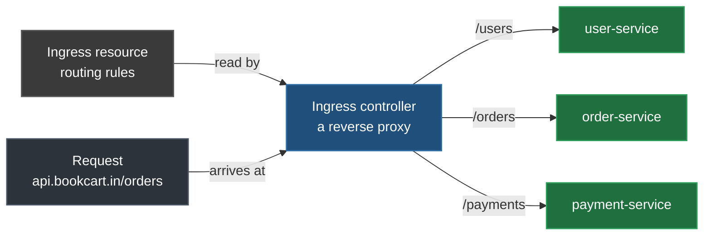
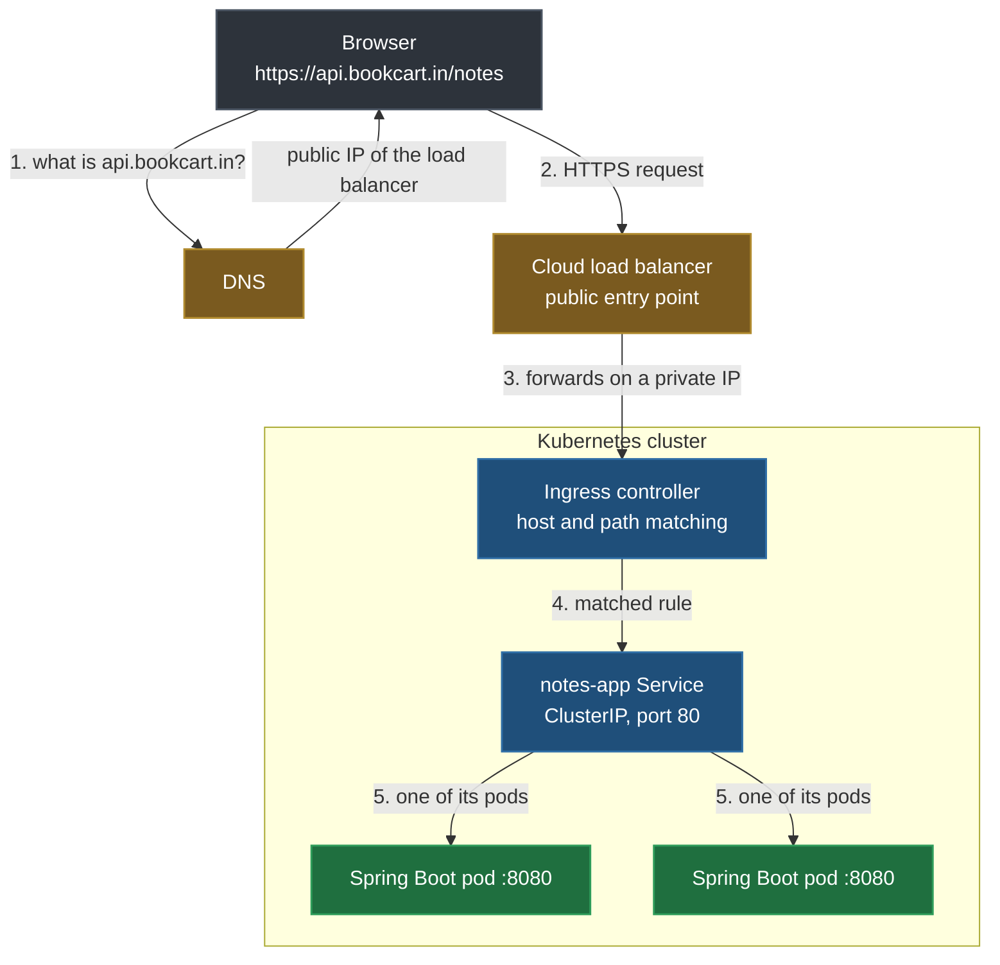
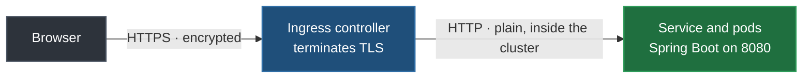
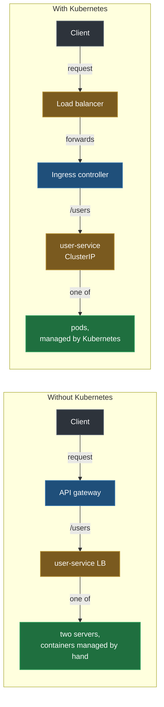

The previous note deployed a real application — a Spring Boot Notes API with MySQL — and it worked: two API pods behind a NodePort Service, MySQL behind a ClusterIP Service, scaling, self-healing, rolling updates. It also ended on a failure that no amount of restarting fixed. A setup that runs is only the first requirement for production, and this note and the next take the two gaps a production system cannot live with: how users reach the application, and where its data lives.

## Why the demo is not production

Recall how a request reached the Notes API. The client sent it to the node's IP address on port 30080 (the NodePort) and the NodePort Service passed it to one of the two Spring Boot pods; the pods reached MySQL through the ClusterIP Service. The whole cluster handled replacement, scaling and routing. And still, this is not what a production application looks like, for several reasons:

| Production needs | Kubernetes answer | Covered |
|---|---|---|
| users reach the application by a domain name, over HTTPS | Ingress, an Ingress controller and TLS | this note |
| database files survive a pod being replaced | PersistentVolumes and claims | the next note |
| traffic may grow far beyond two replicas | autoscaling | the two autoscaling notes |
| applications must not have unrestricted access to the cluster, and only approved applications should reach the database | RBAC, service accounts, NetworkPolicies, Pod Security | RBAC and service accounts in their own note; NetworkPolicies and Pod Security are beyond this folder |

The terms in the last row are named here and not taught yet: **RBAC**, role-based access control, decides who may do what through the Kubernetes API; a **service account** is the identity a pod uses when it calls that API; a **NetworkPolicy** limits which pods may talk to which; and the **Pod Security** standards limit what a pod may do on its node, such as running as root.

Start with the first. A user sending a request had to know `192.168.49.2:30080`. Nobody types an IP address and a port into a browser. They type a name (`bookcart.in`, `google.com`) and DNS turns it into an address, as the Services note described. **Customers should never have to remember IP addresses.**

> [!important] **Not every application needs Kubernetes.**
> Before the production features: everything here only matters if Kubernetes is the right tool in the first place. It earns its place when an application has many microservices with many replicas, more pods than people can manage by hand. A real production project usually does not start with Kubernetes; it adopts it when the application has become complicated enough. Three services with two replicas each do not need it, and adding it there is over-engineering.

## The problem with a port per service

Make it concrete with three microservices (a user service, an order service and a payment service), each with two pods, each reachable from outside through its own NodePort Service:

| Service | Reached at |
|---|---|
| user service | `http://192.168.49.2:30080/users` |
| order service | `http://192.168.49.3:30081/orders` |
| payment service | `http://192.168.49.4:30082/payments` |

Every service has its own address and its own port, and every client has to know all of them. What everybody actually wants is one entry point:

```text
https://api.bookcart.in/users     → user service
https://api.bookcart.in/orders    → order service
https://api.bookcart.in/payments  → payment service
```

One domain, and the path decides where a request goes. A separate `LoadBalancer` Service per application would avoid the ports, but it means a separate external load balancer for each, which costs money and adds infrastructure, depending on the provider.

Without Kubernetes, the familiar answer is an **API gateway**: a single entry point that reads each request's path and forwards `/users` to the user service, `/orders` to the order service, and so on. Inside a Kubernetes cluster, the equivalent is called **Ingress**.

## Ingress: a resource and a controller

Ingress comes in two parts, and the difference between them is the most important thing in this note.

> **An Ingress resource is a Kubernetes object that declares routing rules for HTTP and HTTPS: which host and path should reach which Service.**

> **An Ingress controller is the software that reads those rules and actually routes the traffic.**

The resource is only configuration. Write one and nothing happens to any traffic; it is a description stored in the cluster like any other object. The controller is a program running in the cluster (usually a reverse proxy) that watches Ingress resources through the Kubernetes API, works out the routing rules from them, receives incoming HTTP and HTTPS requests, and forwards each one to the right Service.

| Component | Responsibility |
|---|---|
| Ingress resource | defines host and path routing rules |
| Ingress controller | applies those rules and processes the matching traffic |
| Service | a stable destination for one application |
| Pod | runs the application |



Recall the reverse proxy from the local-cluster note: a server that receives requests on an application's behalf and passes them on. An Ingress controller is exactly that, fed its configuration by Ingress resources. Two of the best known are **NGINX** and **Traefik**. They are different implementations of the same job, and either can serve as the controller. nginx in particular turns up in many roles — reverse proxy, load balancer, API gateway, Ingress controller — because all of them come down to receiving a request and forwarding it.

## The complete request path

For a request to `https://api.bookcart.in/notes`, a common cloud setup works like this:



1. **DNS resolution.** The browser asks DNS for `api.bookcart.in` and gets back an IP address. Whose address? The public address of the first thing a request reaches: the load balancer. That is the address registered in DNS for the domain, because the load balancer is the entry point.
2. **External load balancer.** The request reaches the public load balancer (on AWS, the Elastic Load Balancer), which forwards it to the Ingress controller over the cluster's private network. Only the load balancer needs a public address.
3. **Ingress controller.** The controller matches the request's host and path against its rules. `/notes` under `api.bookcart.in` matches the rule for the Notes API.
4. **Service.** The matched backend is the `notes-app` Service, a ClusterIP Service on port 80.
5. **Pod.** The Service passes the request to one of its pods on port 8080, chosen among those its label selector matches, and the Spring Boot application answers.

Everything from the controller onwards is inside the cluster. **The cloud load balancer and the Ingress controller are not competing parts.** The external load balancer provides the public entry point; the Ingress controller does the HTTP-level routing inside the cluster. A load balancer can also send traffic to several Ingress controllers, to spread the routing work itself.

> [!question] **What address does the load balancer forward to?**
> The controller's own address, inside the cluster's private network. It can be anything; it is internal. Only the address the browser reaches (the load balancer's public one) has to be public, and that is the one DNS hands out.

## Path-based and host-based routing

An Ingress controller can route in two ways.

**Path-based routing** keeps one domain and uses the path:

```text
api.bookcart.in/users     → user-service
api.bookcart.in/orders    → order-service
api.bookcart.in/payments  → payment-service
```

**Host-based routing** gives each service its own hostname, subdomains of one domain:

```text
api.bookcart.in       → the API
admin.bookcart.in     → the admin site
orders.bookcart.in    → order-service
payments.bookcart.in  → payment-service
```

Both work, and DNS can serve both shapes. Which one to use is a design decision.

## The Service and the Ingress, in YAML

With an Ingress in front, the Notes API no longer needs a NodePort. Nothing outside the cluster talks to it directly any more; only the controller does, from inside. So the application gets an ordinary ClusterIP Service, on port 80 in front of the pods' 8080:

```yaml
# k8s/06-notes-clusterip.yaml
apiVersion: v1
kind: Service
metadata:
  name: notes-app
spec:
  type: ClusterIP
  selector:
    app: notes-app
  ports:
    - port: 80
      targetPort: 8080
```

And the Ingress resource routes the public hostname to that Service:

```yaml
# k8s/07-ingress.yaml
apiVersion: networking.k8s.io/v1
kind: Ingress
metadata:
  name: notes-ingress
spec:
  ingressClassName: nginx
  rules:
    - host: api.bookcart.in
      http:
        paths:
          - path: /
            pathType: Prefix
            backend:
              service:
                name: notes-app
                port:
                  number: 80
```

| Property | Means |
|---|---|
| `kind: Ingress` | an Ingress resource: rules, not a Service |
| `ingressClassName` | which Ingress controller should apply these rules (`nginx` here, `traefik` on a cluster running Traefik) |
| `host: api.bookcart.in` | match requests for this hostname |
| `path: /` | match requests under the root path |
| `pathType: Prefix` | match the path and everything beneath it: `/notes`, `/whoami`, `/notes/123` |
| `service.name: notes-app` | the destination Service |
| `service.port.number: 80` | the **Service's** port, not the container's |

The NodePort Service `notes-service` from the deployment note does not conflict with this one. Two Services may select the same pods (each is just another way in), and in the run it was left in place; once everything goes through the Ingress it can be deleted. The chain is **Ingress → Service port 80 → pod port 8080**. The controller's job ends at the Service; choosing a pod is the Service's job, as before. And this assumes a working Ingress controller of the named class is already installed. The resource alone routes nothing.

> [!info] **This was run, not just read.**
> Minikube ships an Ingress controller as an add-on:
> ```bash
> minikube addons enable ingress
> kubectl get ingressclass
> ```
> ```text
> NAME              CONTROLLER             PARAMETERS   AGE
> nginx (default)   k8s.io/ingress-nginx   <none>       29s
> ```
> It installed ingress-nginx v1.15.1, whose class is `nginx`, so the rule above names `nginx`; a manifest written for a cluster running Traefik would say `traefik` there and nothing else would change. With the ClusterIP Service and the Ingress applied, the Notes API answered on plain port 80 — no `:30080` anywhere. The two notes it returns, `survives-1` and `survives-2`, were stored during the storage test in the next note, which was run on this same deployment before the Ingress was added:
> ```bash
> curl --resolve api.bookcart.in:80:$(minikube ip) http://api.bookcart.in/notes
> ```
> ```text
> [{"text":"survives-1","id":1},{"text":"survives-2","id":2}]
> ```
> There is no DNS record for `api.bookcart.in` on the test machine, so `--resolve` tells `curl` which IP that name should go to, exactly as DNS would. A request for any other host (`admin.bookcart.in`, or the bare IP) got `HTTP 404` from the controller: no rule matched it.

### More than one service behind one hostname

Adding a second service is a second path rule. A test application was deployed as `questions-app` with its own ClusterIP Service, and the Ingress given both:

```yaml
        paths:
          - path: /questions
            pathType: Prefix
            backend:
              service:
                name: questions-app
                port:
                  number: 80
          - path: /
            pathType: Prefix
            backend:
              service:
                name: notes-app
                port:
                  number: 80
```

`kubectl describe ingress` shows the routing the controller works from, down to the pod addresses behind each Service:

```text
Rules:
  Host             Path  Backends
  ----             ----  --------
  api.bookcart.in
                   /questions   questions-app:80 (10.244.0.26:8080)
                   /            notes-app:80 (10.244.0.20:8080,10.244.0.21:8080)
```

When two paths both match, the longer one wins: `/questions/...` goes to `questions-app`, everything else to `notes-app`.

> [!bug] **Ingress forwards the full path. It does not strip the prefix.**
> The test application answers `/hostname` with its pod's name. Asked for `https://api.bookcart.in/questions/hostname`, it answered with its default page instead:
> ```text
> NOW: 2026-11-16 16:32:24.35699993 +0000 UTC m=+153.215905350
> ```
> The request reached `questions-app` as `/questions/hostname`, not `/hostname`, and the application had no such route. Routing by path does not remove or rewrite the prefix; the application behind `/questions` must expect paths that start with `/questions`, or the controller must be configured to rewrite them, which is implementation-specific.

## TLS termination

HTTP sends everything as readable text; anybody on the path can read a password in it. HTTPS protects it with **TLS**: the client checks the server's **certificate**, the two agree on encryption keys in a handshake, and only then does encrypted HTTP flow. **TLS termination** is the point where a component accepts the HTTPS connection, completes the handshake and decrypts the request.

Earlier designs terminated TLS at the API gateway. **An Ingress controller can terminate TLS too.** The browser's connection is encrypted as far as the controller; the controller decrypts it and passes the request on as plain HTTP:



The Spring Boot application keeps listening on plain HTTP on 8080 and knows nothing about certificates; the controller handles the client-facing HTTPS. **Is that safe?** It depends on the application. The traffic after the controller travels on the cluster's private network, where nobody outside can read it, and for most applications that is acceptable. For an application that must be secure end to end (a banking application, say), encryption to the controller is not enough, because it does not encrypt the connection behind it. Then TLS is **re-encrypted**: the controller terminates the browser's TLS and opens a new TLS connection to the backend, which needs certificates and TLS configuration on the backend too. In other designs, TLS terminates even earlier, at the external load balancer. Where it terminates is an infrastructure decision.

### Configuring it

A TLS certificate and its private key (`tls.crt` and `tls.key`) are stored in a Kubernetes Secret of type `tls`, in the same namespace as the Ingress:

```bash
kubectl create secret tls notes-tls --cert=tls.crt --key=tls.key
```

```text
NAME        TYPE                DATA   AGE
notes-tls   kubernetes.io/tls   2      0s
```

The Ingress gains a `tls` section naming the host and the Secret:

```yaml
# k8s/08-ingress-tls.yaml
apiVersion: networking.k8s.io/v1
kind: Ingress
metadata:
  name: notes-ingress
spec:
  ingressClassName: nginx
  tls:
    - hosts:
        - api.bookcart.in
      secretName: notes-tls
  rules:
    - host: api.bookcart.in
      http:
        paths:
          - path: /
            pathType: Prefix
            backend:
              service:
                name: notes-app
                port:
                  number: 80
```

The controller uses `notes-tls` for HTTPS on that hostname. **The certificate must be valid for the hostname and trusted by the clients.** In production, a tool such as **cert-manager** can issue and renew certificates automatically from a configured issuer, so nobody copies certificate files around by hand.

> [!info] **This was run, not just read.**
> A self-signed certificate was made for `api.bookcart.in` with `openssl`, stored as `notes-tls`, and the Ingress above applied. `kubectl describe ingress` then reported:
> ```text
> TLS:
>   notes-tls terminates api.bookcart.in
> ```
> With the certificate trusted, HTTPS worked and the Spring Boot pods — still on plain HTTP behind it — answered as before:
> ```bash
> curl --cacert tls.crt --resolve api.bookcart.in:443:$(minikube ip) https://api.bookcart.in/notes
> ```
> ```text
> [{"text":"survives-1","id":1},{"text":"survives-2","id":2}]
> ```
> **Without** `--cacert`, `curl` refused, because nothing vouches for a self-signed certificate (the reason a real certificate must come from an authority clients trust):
> ```text
> curl: (60) SSL certificate OpenSSL verify result: self-signed certificate (18)
> ```
> And plain HTTP to the same host was now redirected to HTTPS, ingress-nginx's behaviour once TLS is configured for a host:
> ```text
> http: HTTP 308 -> https://api.bookcart.in/notes
> ```

## Do we still need an API gateway?

If an Ingress controller routes by path and terminates TLS, is an API gateway still needed? The answer is yes or no, and it depends on the architecture: the API gateway, the load balancer and the Ingress controller overlap a great deal.

**Without Kubernetes.** Three microservices, each running in Docker containers on two servers. The client's request goes to the API gateway, which reads the path and sends `/users` to the user service's load balancer, `/payments` to the payment service's and `/orders` to the order service's; each load balancer picks one of its two servers. No Ingress anywhere, because there is no cluster. When a container crashes, a person runs `docker run` again from the image. With two replicas of three services, that is manageable.

**With Kubernetes.** With 50 microservices and 50 replicas each, restarting containers by hand is impossible, so Kubernetes takes over managing them. Requests reach one external load balancer, which passes them to the Ingress controller; the controller sends `/users` to the user service's ClusterIP Service, `/orders` to the order service's, and each Service picks a pod.



In the second design, the Ingress controller already does the API gateway's main job (forwarding requests by path) and can terminate TLS. A gateway is no longer required for routing. One can still be placed in front of the cluster, between the client and the load balancer, but its role narrows to what the controller does not do: rate limiting (capping how many requests a client may send in a given time), adding headers, idempotency checks — making sure a request repeated by mistake is not processed twice — and, depending on the product, API keys, usage plans, developer portals and analytics. Both may handle authentication or rate limiting, depending on which products are used, so the two are not automatically interchangeable.

> [!question] **Is Kubernetes just for running Docker across many servers?**
> Docker alone can run an application on many servers; that is what was done before Kubernetes existed. What Docker alone does not do is manage the containers: when one of four Spring Boot containers crashes, somebody runs a new one from the image. Kubernetes' core job is managing those containers (in pods) and keeping the desired number running. Ingress is part of what is needed when it does that in production: a way for outside requests to get in.

> [!info] **Going further: the ingress-nginx controller has been retired.**
> The controller Minikube's add-on installs is the community **ingress-nginx** project. The Kubernetes project announced its retirement in November 2025 and confirmed it in January 2026: from **March 2026** there are no further releases, bug fixes or security patches, though existing installations keep running. The announcements recommend migrating to **Gateway API** (a newer Kubernetes routing model) or to another Ingress controller. The Ingress API itself is not deprecated, and other NGINX-based and Traefik controllers continue. Checked 2026-11-16 against the Kubernetes blog posts of 2025-11-11 and 2026-01-29, read through a summary because the pages' text was truncated. To see whether a cluster relies on it:
> ```bash
> kubectl get pods --all-namespaces --selector app.kubernetes.io/name=ingress-nginx
> ```
> On the Minikube cluster used here, it found the add-on's controller — fine for learning, not a choice for a new production cluster.
