The previous note deployed the Notes API end to end: two Spring Boot pods behind a NodePort Service on port 30080, MySQL behind a ClusterIP Service, and the settings in a ConfigMap and a Secret. It works, but every request still has to name an IP address and a port. This note gives the application a front door: a hostname, HTTPS, and routing by path. First, though, a step-by-step look at how a request reaches the Notes API today, because the front door is built on top of it.

## How a request reaches the Notes API today

The pieces from the previous note, with the addresses they have on a Minikube cluster:

| Piece | What it is | Address |
|---|---|---|
| node | the one Minikube machine | `192.168.49.2` |
| `notes-service` | NodePort Service: port `30080` on the node, `8080` on the pods | |
| two Spring Boot pods | label `app: notes-app`, listening on `8080` | `10.244.0.20`, `10.244.0.21` |
| `mysql-service` | ClusterIP Service on port `3306` | `10.106.101.25` |
| one MySQL pod | listening on `3306` | `10.244.0.22` |

One fact from the Services note carries the whole walk-through: **a Service (such as `notes-service` or `mysql-service`) is a record, not a program.** Nothing called `notes-service` is running anywhere, waiting for requests. Kubernetes turns each Service (NodePort or ClusterIP) into **forwarding rules** on every node (if a request is for this address and port, send it to one of these pods), and those rules move every request. The steps below follow one request from a client to the database.

### Step 0: before any request, kube-proxy writes the rules

Before the client sends anything, **kube-proxy**, the component that runs on every node, reads both Services (`notes-service` and `mysql-service`) and the current list of pods each one selects. From them it writes the rules into the node's operating system (its Linux kernel), which is what checks every incoming request.

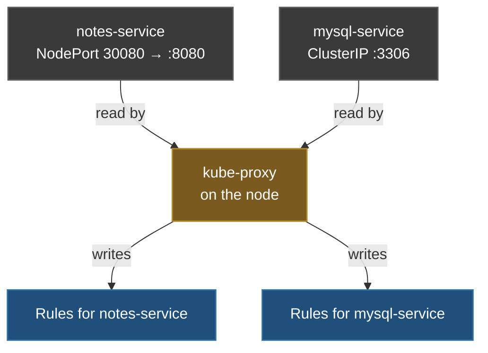

| Rules for | If a request is for | send it to |
|---|---|---|
| `notes-service` | port `30080` on the node | `10.244.0.20:8080` or `10.244.0.21:8080` |
| `mysql-service` | `10.106.101.25:3306` | `10.244.0.22:3306` |

From here on, the node applies these rules to every request by itself. It does not ask kube-proxy or the API server anything while a request is in flight.

### Step 1: the client sends the request to the node

The client knows two things: the node's IP address and the NodePort set in the `notes-service` YAML. It sends the request to `192.168.49.2:30080`, and the request arrives at the node, where the rules for `notes-service` match it.

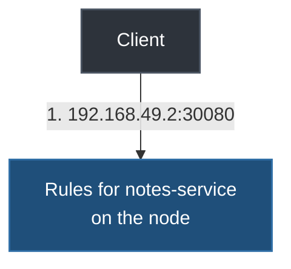

> [!question] **The pod's real address is `10.244.0.20:8080`. Why not send the request straight there?**
> For two reasons. A pod's IP changes every time the pod is replaced, so a client that saved it would break at the first restart. And pod IPs belong to the cluster's internal network, which a client outside the cluster usually cannot reach at all. The node's address and the NodePort stay the same however often the pods change.

### Step 2: the rules pick a pod

The rules for `notes-service` change the request's destination from `192.168.49.2:30080` to one of the two Spring Boot pods, on port `8080` (the `targetPort` of `notes-service`). The request carries on to that pod, and the Spring Boot application handles it. As the Services note showed, the pod is picked at random for each connection, so the load spreads across both pods but not strictly in turn.

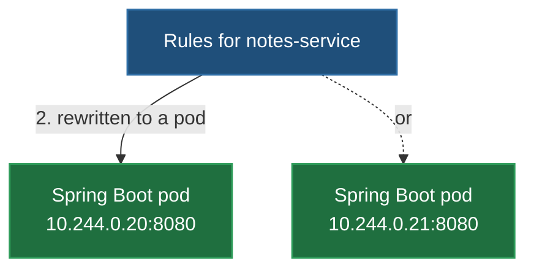

Every node in a cluster opens every NodePort, so on a cluster with several nodes the client could send the request to any of them. Minikube has only one.

**When a pod is replaced, the rules follow it.** Suppose the pod at `10.244.0.20` crashes and the Deployment starts a replacement, which gets a new address, say `10.244.0.23`. The replacement carries the same label, `app: notes-app`, so Kubernetes updates the pod list of `notes-service`. kube-proxy is watching that list, and it rewrites the rules: `.20` out, `.23` in. On Minikube this takes a few seconds.

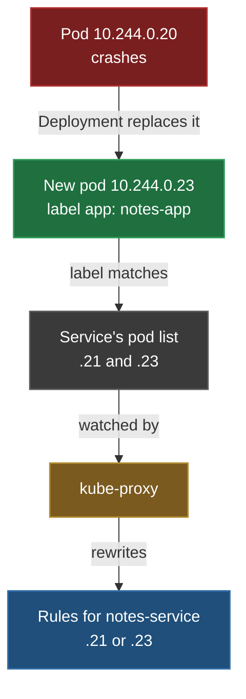

The `notes-service` YAML does not change at all. Only the pod list and the rules do, which is why the client never notices the crash.

### Step 3: the Spring Boot pod looks up MySQL by name

To answer the request, the Spring Boot application needs the database. Its configuration names the database as `mysql-service:3306`: a name, not an IP address. The rules match on addresses, so the name has to be turned into one first. The pod asks **CoreDNS**, the cluster's DNS server from the Services note, and CoreDNS answers with the ClusterIP of `mysql-service`, `10.106.101.25`. It returns the address of the Service (`mysql-service`), not the MySQL pod's, so the answer stays correct when the MySQL pod is replaced.

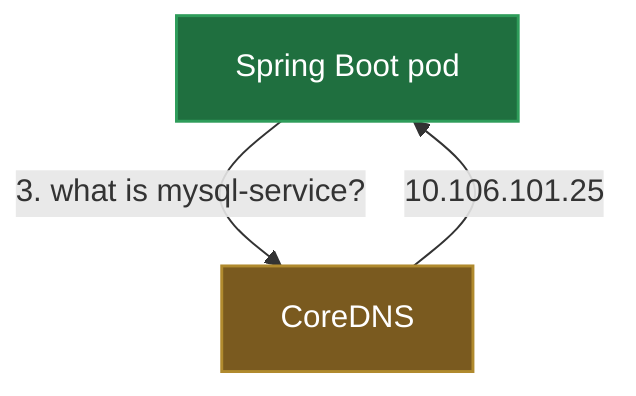

### Steps 4 and 5: the rules for mysql-service pick the MySQL pod

The pod sends its database connection to `10.106.101.25:3306`. From here it is steps 1 and 2 again, with two differences: the caller is a pod inside the cluster rather than an outside client, and the rules that match are the ones for `mysql-service`. They change the destination to the MySQL pod, `10.244.0.22:3306`, and MySQL answers.

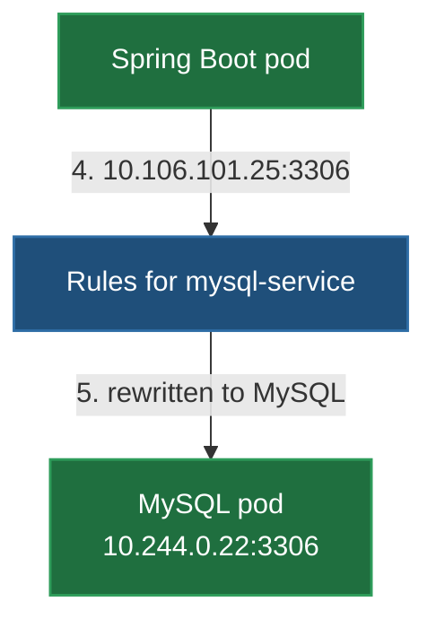

### The whole path

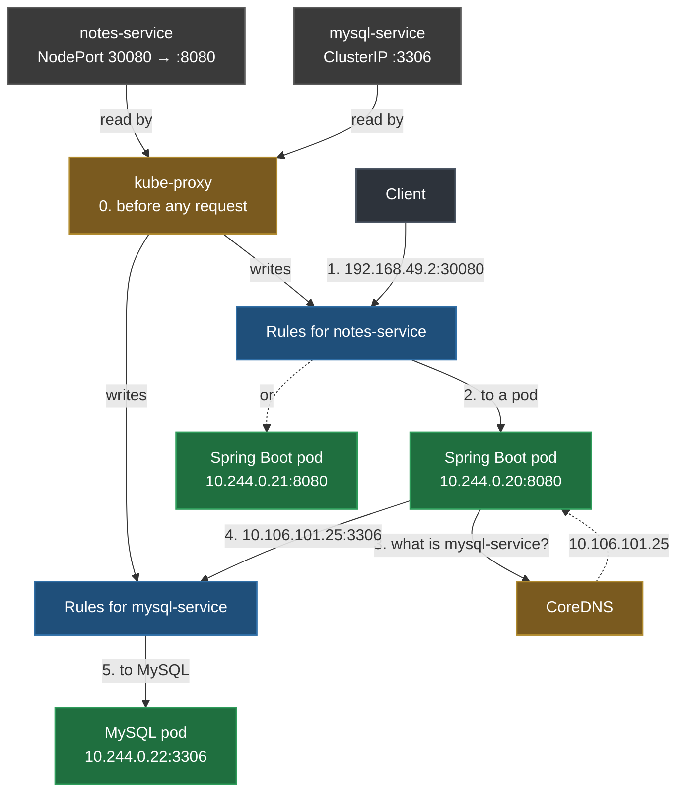

| Step | Who does the work | When |
|---|---|---|
| 0 | kube-proxy reads both Services (`notes-service`, `mysql-service`) and writes the rules | before any request, and again whenever the pods change |
| 1–2 | the rules for `notes-service` send `192.168.49.2:30080` to a Spring Boot pod | on every request |
| 3 | CoreDNS turns `mysql-service` into `10.106.101.25` | on every lookup |
| 4–5 | the rules for `mysql-service` send `10.106.101.25:3306` to the MySQL pod | on every database connection |

> [!question] **How many times does kube-proxy itself act during one request, from the client's click to MySQL's answer?**
> None. kube-proxy did its work in step 0, before the request existed, and it acts again only when a Service (such as `notes-service`) or its pods change. During the request, the rules it wrote do all of the forwarding.

## Why the demo is not production

Everything above works. The cluster handled replacement, scaling and routing. And still, this is not what a production application looks like, for several reasons:

| Production needs | Kubernetes answer | Covered |
|---|---|---|
| users reach the application by a domain name, over HTTPS | Ingress, an Ingress controller and TLS | this note |
| database files survive a pod being replaced | PersistentVolumes and claims | the next note |
| traffic may grow far beyond two replicas | autoscaling | the two autoscaling notes |
| applications must not have unrestricted access to the cluster, and only approved applications should reach the database | RBAC, service accounts, NetworkPolicies, Pod Security | RBAC and service accounts in their own note; NetworkPolicies and Pod Security are beyond this folder |

The terms in the last row are named here and not taught yet: **RBAC**, role-based access control, decides who may do what through the Kubernetes API; a **service account** is the identity a pod uses when it calls that API; a **NetworkPolicy** limits which pods may talk to which; and the **Pod Security** standards limit what a pod may do on its node, such as running as root.

> [!important] **Not every application needs Kubernetes.**
> Before the production features: everything here only matters if Kubernetes is the right tool in the first place. It earns its place when an application has many microservices with many replicas, more pods than people can manage by hand. A real production project usually does not start with Kubernetes; it adopts it when the application has become complicated enough. Three services with two replicas each do not need it, and adding it there is over-engineering.

Start with the first. A user sending a request had to know `192.168.49.2:30080`. Nobody types an IP address and a port into a browser. They type a name (`bookcart.in`, `google.com`) and DNS turns it into an address, as the Services note described. **Customers should never have to remember IP addresses.**

## The problem with a port per service

Make it concrete with three microservices (a user service, an order service and a payment service), each with two pods, each reachable from outside through its own NodePort Service.

> [!tip] **One word, two meanings.**
> In this folder, a lower-case **service** is an application: a microservice such as the payment service, your own code. A capitalised **Service** is the Kubernetes object, `kind: Service` in YAML, the stable address in front of one application's pods. NodePort and ClusterIP are not separate things but types of that object, chosen with its `type:` field. So the payment service is reached through its Service (a NodePort Service such as `payment-service`).

Recall from the walk-through above that every node opens **every** NodePort and holds the rules for every Service (NodePort or ClusterIP). A request from outside therefore names two numbers, and they belong to different things: **the IP address belongs to a node, and the port belongs to a Service (a NodePort Service).** Any node's address works with any NodePort Service's port. On a cluster with three nodes:

| | user service, NodePort `30080` | order service, NodePort `30081` | payment service, NodePort `30082` |
|---|---|---|---|
| node `192.168.49.2` | `192.168.49.2:30080` | `192.168.49.2:30081` | `192.168.49.2:30082` |
| node `192.168.49.3` | `192.168.49.3:30080` | `192.168.49.3:30081` | `192.168.49.3:30082` |
| node `192.168.49.4` | `192.168.49.4:30080` | `192.168.49.4:30081` | `192.168.49.4:30082` |

So a client needs only one node's address, and a port for every service:

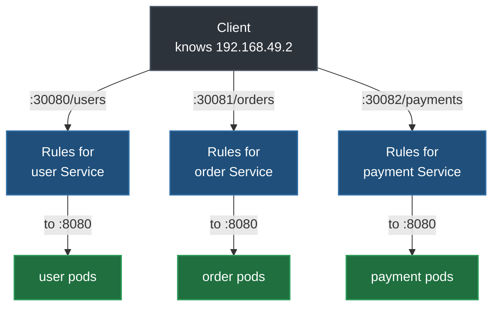

The address is shared, but every service still has its own port, and every client has to know all of them: three arbitrary numbers in the 30000s, one more for each new service, on top of a raw IP address that belongs to one particular node. What everybody actually wants is one entry point:

```text
https://api.bookcart.in/users     → user service
https://api.bookcart.in/orders    → order service
https://api.bookcart.in/payments  → payment service
```

One domain, and the path decides where a request goes.

Switching each Service from NodePort to `type: LoadBalancer` would get rid of the ports, but not the problem. As the Services note showed, on a cloud such as AWS that type makes the cloud build a load balancer (an ELB) for that LoadBalancer Service: a server outside the cluster with its own public address, listening on an ordinary port such as 80. The cloud builds **one load balancer for every Service of that type**, not one shared between them:

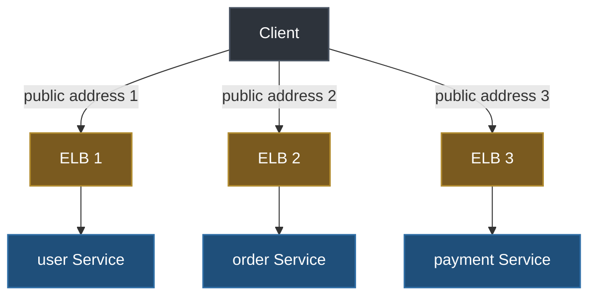

Put the two side by side, as the client sees them. The ELB addresses are hostnames AWS generates; the ones below are shortened, made-up examples:

| What the client has to know | with NodePort | with `type: LoadBalancer` |
|---|---|---|
| user service | `192.168.49.2:30080` | `a1b2.elb.amazonaws.com` (ELB 1) |
| order service | `192.168.49.2:30081` | `c3d4.elb.amazonaws.com` (ELB 2) |
| payment service | `192.168.49.2:30082` | `e5f6.elb.amazonaws.com` (ELB 3) |
| load balancers on the AWS bill | none | three |

Before, the client had to remember three ports. Now it has to remember three addresses: the ports are gone, but it is the same problem in a different form. And each of those ELBs costs money every month, so every new service adds one more to the bill.

Without Kubernetes, the familiar answer is an **API gateway**: a single entry point that reads each request's path and forwards `/users` to the user service, `/orders` to the order service, and so on. In Spring terms, it is the difference between deploying three Spring Boot applications each at its own public URL and putting one Spring Cloud Gateway in front of them at `api.bookcart.in`, routing by path. Inside a Kubernetes cluster, the equivalent of that gateway is called **Ingress**.

## Ingress: a resource and a controller

Ingress comes in two parts, and the difference between them is the most important thing in this note.

|                               | Ingress resource                                                       | Ingress controller                                                       |
| ----------------------------- | ---------------------------------------------------------------------- | ------------------------------------------------------------------------ |
| what it is                    | a Kubernetes object, written in YAML like a Deployment or a Service (ClusterIP, NodePort)    | a program running in the cluster as pods: a reverse proxy, such as nginx |
| what it does                  | declares routing rules: which host and path should reach which Service (such as the `notes-app` ClusterIP Service) | reads those rules and routes the actual HTTP and HTTPS requests          |
| on its own                    | routes nothing; it is only a description stored in the cluster         | has nothing to route until a resource gives it rules                     |
| in Spring Cloud Gateway terms | the routes listed in the gateway's `application.yml`                   | the running gateway application that reads them                          |

What the controller does, in order. The first step runs in the background all the time; the other four run for every request:

1. **Watches** the Ingress resources through the Kubernetes API, and keeps its routing table in step with them.
2. **Receives** the request.
3. **Matches** its host and path against the rules.
4. **Looks up** the Service (such as `notes-app`, a ClusterIP Service) the matching rule names, to get that application's current pod addresses.
5. **Forwards** the request to one of those pods.

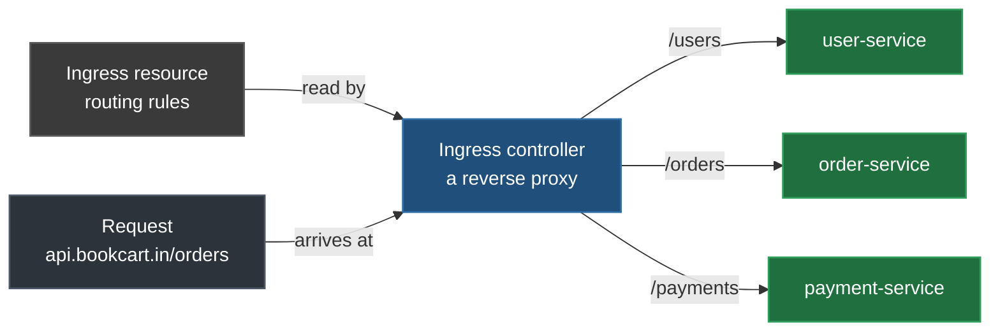


## Path-based and host-based routing

An Ingress controller can route in two ways.

1. **Path-based routing** keeps one domain and uses the path: the `api.bookcart.in , /users`, `/orders`, `/payments` shape from the port-per-service section above.

2. **Host-based routing** gives each service its own hostname, subdomains of one domain:

```text
api.bookcart.in       → the API
admin.bookcart.in     → the admin site
orders.bookcart.in    → order-service
payments.bookcart.in  → payment-service
```

Both work, and DNS can serve both shapes. Which one to use is a design decision.

## The complete request path

The walk-through at the start of this note followed a request that came in on a NodePort. This section follows the same kind of request, `https://api.bookcart.in/notes`, through a common cloud setup with an Ingress in front. It takes four hops, and at each one something different decides where the request goes next:

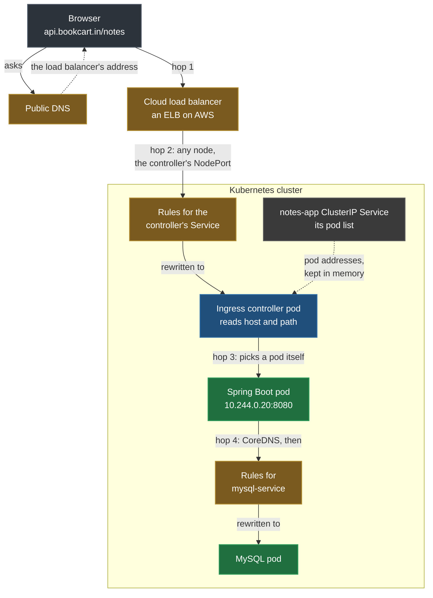

One idea runs through all four hops: **what each part can see of the request.** The load balancer and kube-proxy's rules see only the IP address and the port a request is sent to. They cannot see the hostname or the path (`/notes`, `/payments`), because those are written inside the HTTP request itself, and only a program that receives the request and reads it can see them. The Ingress controller is the first part on the path that does.

### Hop 1: browser → load balancer

The browser asks public DNS for `api.bookcart.in`, and DNS answers with the load balancer's public address. That is the address registered for the domain, because the load balancer is the only part of the setup with a public address at all: not the nodes, not the controller, not the pods. The browser sends its HTTPS request there.

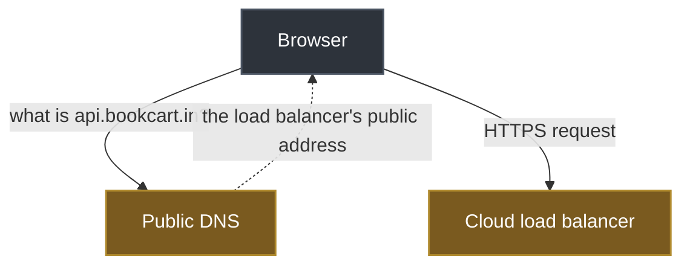

### Hop 2: load balancer → Ingress controller pod

The load balancer now has to pass the request into the cluster. It does not know where the Ingress controller pod is, and it does not need to. This is how it was set up, before any request:

1. The Ingress controller is an ordinary application running as pods, and like any application it gets a Service of its own. On a typical cloud install, that Service has `type: LoadBalancer`.
2. As the Services note showed, a LoadBalancer Service makes the cloud controller manager ask the cloud for a load balancer, which is how this ELB came to exist.
3. A LoadBalancer Service is also given a NodePort, a number from 30000–32767 opened on every node, exactly like a NodePort Service. (Kubernetes' own field documentation, `kubectl explain service.spec.allocateLoadBalancerNodePorts`, says NodePorts are allocated for LoadBalancer Services by default.)
4. The load balancer is pointed at **every node, on that NodePort**.

So at request time the load balancer sends the request to any one of the nodes, on the controller Service's NodePort. From there it is steps 1 and 2 of the walk-through again, with the load balancer as the client: the node's rules for the controller's Service (written by kube-proxy) rewrite the destination to one of the controller pods.

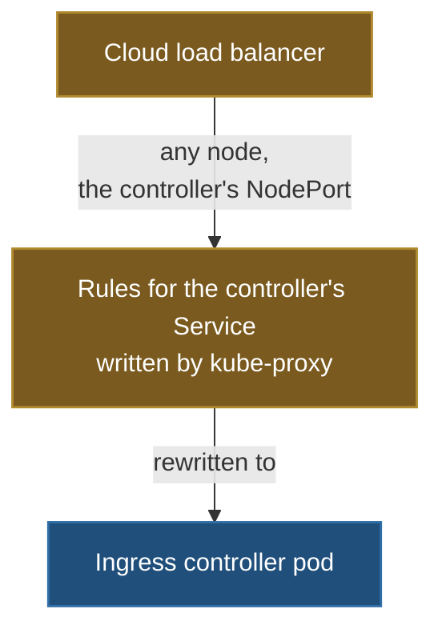

**At this hop, every request looks the same.** The load balancer and the rules see only an address and a port, so a request for `/notes` and a request for `/payments` take exactly the same route: both end up at the Ingress controller. Deciding which application should answer is not their job.

> [!question] **The controller pod runs only on node 3, and the load balancer picks node 1. Does the request still arrive?**
> Yes. kube-proxy writes the rules for every Service on every node, and those rules list all of the Service's pod addresses, including pods running on other nodes. Node 1's rules rewrite the destination to the controller pod's address on node 3, and the cluster's network delivers it there, which costs one extra hop between nodes. Which node the load balancer picks does not matter.

> [!note] **Not the only possible setup.**
> The same field documentation says NodePorts can be switched off when the cloud's load balancer does not rely on them. In that setup the load balancer is pointed at the controller pods' own addresses directly, and the node's rules are not used for this hop. Which setup a given cloud uses is a detail of that cloud's integration, and neither can be shown on Minikube, which has no cloud load balancer.

Minikube does it a third way. Its Ingress add-on runs the controller pod on the node's own ports 80 and 443, so a request to the node's address on port 80 reaches the controller with no load balancer and no NodePort in between. That is why the `curl` commands later in this note need no port number.

### Hop 3: Ingress controller → Spring Boot pod

This is the hop that works differently. The controller is a running program (nginx, on this cluster) that has received the whole request, so it can read what the load balancer and the rules could not: the hostname and the path.

Before any request arrives, the controller has already done two things, and keeps doing them in the background:

- it has read every Ingress resource, so it knows its routing rules: `api.bookcart.in` with path `/` goes to the ClusterIP Service `notes-app`;
- it has read the pod list of every ClusterIP Service those rules name, and keeps it in memory, updated as pods come and go: for `notes-app`, `10.244.0.20` and `10.244.0.21`, both on port `8080`.

Then, for each request:

1. **Read** the request: host `api.bookcart.in`, path `/notes`.
2. **Match** it against the rules: the rule for `/` matches, and it names the ClusterIP Service `notes-app`.
3. **Look up** `notes-app`'s pod list, already in memory.
4. **Pick** one pod, and **connect** to it directly, on `10.244.0.20:8080`.

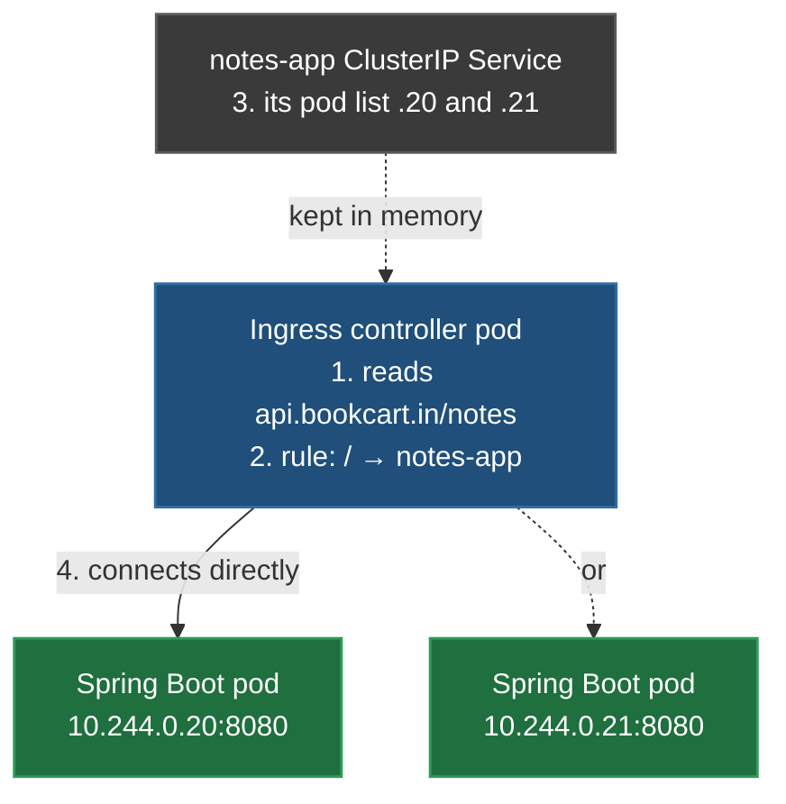

**The rules kube-proxy wrote for `notes-app` play no part in this hop.** The controller never sends the request to the ClusterIP address of `notes-app` (`10.107.110.193`, port 80); it already knows the pod addresses, so it goes straight to one. The ClusterIP Service is used only as a list: it says which pods belong to `notes-app`.

The same steps route any other request. A request for `api.bookcart.in/payments` would match a `/payments` rule naming the payment application's ClusterIP Service, and the controller would connect to one of the payment pods instead.

In Spring Cloud terms, this is Spring Cloud Gateway with Eureka:

| Spring Cloud | Ingress |
|---|---|
| Spring Cloud Gateway reads the path and picks the route | the Ingress controller reads the path and picks `notes-app` |
| Eureka holds the list of running `notes-app` instances | the `notes-app` ClusterIP Service holds the list of its pods |
| the gateway picks one instance and calls it directly | the controller picks one pod and connects to it directly |

**Going further: seeing it.** ingress-nginx ships a small debugging command inside its pod, `/dbg`, which prints what the controller will send traffic to. On the Minikube cluster from this note, the entry for `notes-app` lists the two pod addresses and port 8080, not the ClusterIP address `10.107.110.193` and port 80 (the first lines of the output):

```bash
kubectl -n ingress-nginx exec deploy/ingress-nginx-controller -- /dbg backends get default-notes-app-80
```

```text
{
  "endpoints": [
    {
      "address": "10.244.0.20",
      "port": "8080"
    },
    {
      "address": "10.244.0.21",
      "port": "8080"
    }
  ],
  "name": "default-notes-app-80",
  "noServer": false,
  "port": 80,
```

This is how ingress-nginx, the controller used in this note, behaves by default. Other controllers make their own choice, and their documentation says which.

### Hop 4: Spring Boot pod → MySQL

Nothing here is new. The Spring Boot application connects to `mysql-service:3306` exactly as in steps 3 to 5 of the walk-through: CoreDNS turns the name into the ClusterIP of `mysql-service`, and the node's rules for `mysql-service` (written by kube-proxy) rewrite the destination to the MySQL pod. The Ingress only changes how requests get in from outside; traffic between pods inside the cluster is unchanged.

### The four hops side by side

| Hop | Who picks the next destination | What it can see | kube-proxy's rules used? |
|---|---|---|---|
| 1. browser → load balancer | public DNS | the hostname | no |
| 2. load balancer → controller pod | the node's rules for the controller's Service (LoadBalancer type) | address and port only | **yes** |
| 3. controller → Spring Boot pod | the controller itself, from the pod list of the `notes-app` ClusterIP Service | host and path | **no** |
| 4. Spring Boot pod → MySQL | CoreDNS, then the node's rules for `mysql-service` (ClusterIP) | address and port only | **yes** |

**The cloud load balancer and the Ingress controller are not competing parts.** The load balancer is the public entry point, and it cannot tell one request from another; the Ingress controller does the HTTP-level routing inside the cluster, where it can read each request. A load balancer can also send traffic to several Ingress controller pods, which spreads the routing work itself.

## The ClusterIP Service and the Ingress, in YAML

Putting the Notes API behind an Ingress takes two files, and each has one job:

| File | Object | Its one job |
|---|---|---|
| `k8s/06-notes-clusterip.yaml` | a ClusterIP Service called `notes-app` | groups the Notes API pods under one name, and records which port they listen on |
| `k8s/07-ingress.yaml` | an Ingress resource called `notes-ingress` | the routing rule: requests for `api.bookcart.in` go to `notes-app` |

### Step 1: the ClusterIP Service

With an Ingress in front, nothing outside the cluster talks to the Notes API pods any more. Only the Ingress controller does, and it runs inside the cluster. A NodePort would open a port on every node that nobody needs, so the application gets an ordinary ClusterIP Service instead:

```yaml
# k8s/06-notes-clusterip.yaml
apiVersion: v1
kind: Service
metadata:
  name: notes-app
spec:
  type: ClusterIP
  selector:
    app: notes-app
  ports:
    - port: 80
      targetPort: 8080
```

| Field | Whose value | Means |
|---|---|---|
| `metadata.name: notes-app` | yours | the Service's name; the Ingress will refer to it by exactly this name |
| `type: ClusterIP` | one of a fixed set | reachable only from inside the cluster |
| `selector: app: notes-app` | yours, and must match the pods' label | which pods belong to this Service |
| `port: 80` | yours | the Service's own port; the Ingress will refer to it by this number |
| `targetPort: 8080` | must match the port Spring Boot listens on | the port on the pods that port 80 leads to |

The NodePort Service `notes-service` from the deployment note does not conflict with this one. Two Services (here a NodePort and a ClusterIP) may select the same pods; each is just another way in. It can stay in place for now, and once everything goes through the Ingress it can be deleted.

### Step 2: the Ingress resource

```yaml
# k8s/07-ingress.yaml
apiVersion: networking.k8s.io/v1
kind: Ingress
metadata:
  name: notes-ingress
spec:
  ingressClassName: nginx
  rules:
    - host: api.bookcart.in
      http:
        paths:
          - path: /
            pathType: Prefix
            backend:
              service:
                name: notes-app
                port:
                  number: 80
```

Read top to bottom, the `spec` is one sentence: **using the `nginx` controller, send requests for host `api.bookcart.in` whose path starts with `/` to the Service `notes-app`, on its port 80.** The fields fall into four groups:

| Group          | Field                              | Whose value                                                       | Means                                                                                                                                                                         |
| -------------- | ---------------------------------- | ----------------------------------------------------------------- | ----------------------------------------------------------------------------------------------------------------------------------------------------------------------------- |
| what this is   | `apiVersion: networking.k8s.io/v1` | Kubernetes' fixed name                                            | the API group and version Ingress belongs to                                                                                                                                  |
|                | `kind: Ingress`                    | Kubernetes' fixed name                                            | an Ingress resource: routing rules, not a Service (ClusterIP, NodePort)                                                                                                       |
| who applies it | `ingressClassName: nginx`          | the cluster's                                                     | which installed Ingress controller should apply these rules: `nginx` here, `traefik` on a cluster running Traefik. It must name a controller class that exists in the cluster |
| which requests | `rules`                            | fixed name                                                        | the list of routing rules, one entry per hostname                                                                                                                             |
|                | `host: api.bookcart.in`            | yours                                                             | match requests for this hostname                                                                                                                                              |
|                | `http.paths`                       | fixed names                                                       | the path rules for that hostname                                                                                                                                              |
|                | `path: /`                          | yours                                                             | the path to match                                                                                                                                                             |
|                | `pathType: Prefix`                 | one of `Prefix`, `Exact`, `ImplementationSpecific`                | how to compare it, explained below                                                                                                                                            |
| where they go  | `backend.service.name: notes-app`  | yours, and must match the **ClusterIP** Service's `metadata.name` | the destination Service, `notes-app`                                                                                                                                          |
|                | `backend.service.port.number: 80`  | yours, and must match the **ClusterIP Service's `port**`          | the **Service's** port (80 on `notes-app`), not the container's 8080                                                                                                          |

**Why the `apiVersion` is longer than a Service's.** The YAML is the body of a request to the API server, as with every earlier manifest. Services and Pods live in the core API, written as plain `v1`. Ingress lives in a separate group of networking objects, so its `apiVersion` names the group as well: `networking.k8s.io/v1`. It is like a Spring application serving its order endpoints under `/api/v1/orders` and its payment endpoints under a different prefix.

**`pathType` decides how `path` is compared with the request's path.**

| `pathType` | Matches | Spring analogy |
|---|---|---|
| `Exact` | only exactly that path | `@GetMapping("/notes")` |
| `Prefix` | that path and anything beneath it | `@GetMapping("/notes/**")` |
| `ImplementationSpecific` | whatever the controller decides | none |

`Prefix` compares whole segments between the `/` characters, not letters. With `path: /questions`, the request `/questions` matches and `/questions/hostname` matches, but `/questionsxyz` does not, because `questionsxyz` is a different segment. With `path: /`, as here, every path matches.

### Step 3: how the two files connect

The Ingress names only two things: `name: notes-app` and `port: 80`. It never mentions a pod, a pod address or port 8080. The controller gets all of that by following a chain of lookups through the API server, starting from the name:

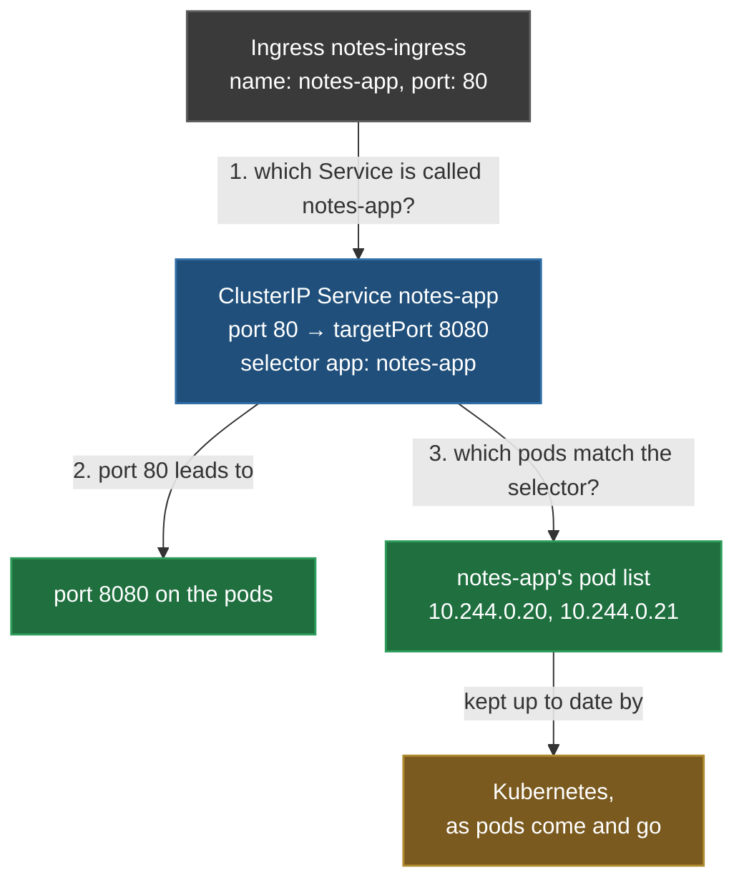

| Lookup | Starts from                      | Gives the controller                                                               |
| ------ | -------------------------------- | ---------------------------------------------------------------------------------- |
| 1      | `name: notes-app` in the Ingress | the ClusterIP Service record called `notes-app`                                    |
| 2      | `port: 80` in the Ingress        | that Service's line `port: 80 → targetPort: 8080`, so the pods are reached on 8080 |
|        |                                  |                                                                                    |
### Trying it on Minikube

The Ingress resource on its own routes nothing; it needs an Ingress controller of the named class running in the cluster. Minikube ships one as an add-on. Four steps:

1. **Install the controller.**

```bash
minikube addons enable ingress
```

2. **Check its class name.**

```bash
kubectl get ingressclass
```

```text
NAME              CONTROLLER             PARAMETERS   AGE
nginx (default)   k8s.io/ingress-nginx   <none>       29s
```

The add-on installs ingress-nginx (v1.15.1 at the time of writing), whose class is `nginx`. That is why the Ingress says `ingressClassName: nginx`; a cluster running Traefik would say `traefik` there and nothing else would change.

3. **Apply both files.**

```bash
kubectl apply -f k8s/06-notes-clusterip.yaml -f k8s/07-ingress.yaml
```

4. **Send a request by hostname.** The Notes API now answers on plain port 80, with no `:30080` (Noderport's port)anywhere, and returns the stored notes:

```bash
curl --resolve api.bookcart.in:80:$(minikube ip) http://api.bookcart.in/notes
```

```text
[{"text":"survives-1","id":1},{"text":"survives-2","id":2}]
```

> [!tip] **No DNS record yet? `--resolve` stands in for one.**
> `api.bookcart.in` has no DNS record pointing at a local Minikube cluster, so `--resolve` tells `curl` which IP that name should go to, exactly as DNS would. A request for any other host (`admin.bookcart.in`, or the bare IP) gets `HTTP 404` from the controller: no rule matches it.

### More than one service behind one hostname

A second application is one more path rule. Suppose `questions-app` runs with its own ClusterIP Service, also called `questions-app`, on port 80. The `paths` list in the Ingress gets a second entry:

```yaml
# k8s/07-ingress.yaml: the paths list under rules[0].http
paths:
  - path: /questions
    pathType: Prefix
    backend:
      service:
        name: questions-app
        port:
          number: 80
  - path: /
    pathType: Prefix
    backend:
      service:
        name: notes-app
        port:
          number: 80
```

`kubectl describe ingress` shows the result of the lookups from step 3 for both rules, down to the pod addresses behind each ClusterIP Service:

```text
Rules:
  Host             Path  Backends
  ----             ----  --------
  api.bookcart.in
                   /questions   questions-app:80 (10.244.0.26:8080)
                   /            notes-app:80 (10.244.0.20:8080,10.244.0.21:8080)
```

A request can now match both rules, because `/` matches every path. **When two paths both match, the longer one wins:**

| Request path          | Rules that match     | Winner                                         |
| --------------------- | -------------------- | ---------------------------------------------- |
| `/questions/hostname` | `/questions` and `/` | `/questions`, the longer one → `questions-app` |
| `/notes`              | `/` only             | `/` → `notes-app`                              |
|                       |                      |                                                |


--- 

## TLS termination

HTTP sends everything as readable text; anybody on the path can read a password in it. HTTPS protects it with **TLS**: the client checks the server's **certificate**, the two agree on encryption keys in a handshake, and only then does encrypted HTTP flow. **TLS termination** is the point where a component accepts the HTTPS connection, completes the handshake and decrypts the request.

Without Kubernetes, TLS is usually terminated at the API gateway. **An Ingress controller can terminate TLS too.** The browser's connection is encrypted as far as the controller; the controller decrypts it and passes the request on as plain HTTP:

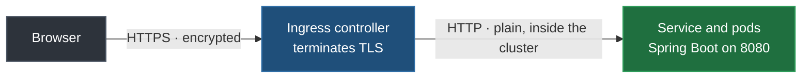

The Spring Boot application keeps listening on plain HTTP on 8080 and knows nothing about certificates; the controller handles the client-facing HTTPS.

**Is that safe?** It depends on the application. The traffic after the controller travels on the cluster's private network, where nobody outside can read it, and for most applications that is acceptable. For an application that must be secure end to end (a banking application, say), encryption to the controller is not enough, because it does not encrypt the connection behind it. Then TLS is **re-encrypted**: the controller terminates the browser's TLS and opens a new TLS connection to the backend, which needs certificates and TLS configuration on the backend too. In other designs, TLS terminates even earlier, at the external load balancer. Where it terminates is an infrastructure decision.

### Configuring it

A TLS certificate and its private key (`tls.crt` and `tls.key`) are stored in a Kubernetes Secret of type `tls`, in the same namespace as the Ingress. For a test, a self-signed certificate made with `openssl` will do:

```bash
kubectl create secret tls notes-tls --cert=tls.crt --key=tls.key
kubectl get secret notes-tls
```

```text
NAME        TYPE                DATA   AGE
notes-tls   kubernetes.io/tls   2      0s
```

`DATA 2` is the two keys, `tls.crt` and `tls.key`. The Ingress gains a `tls` section naming the host and the Secret:

```yaml
# k8s/08-ingress-tls.yaml
apiVersion: networking.k8s.io/v1
kind: Ingress
metadata:
  name: notes-ingress
spec:
  ingressClassName: nginx
  tls:
    - hosts:
        - api.bookcart.in
      secretName: notes-tls
  rules:
    - host: api.bookcart.in
      http:
        paths:
          - path: /
            pathType: Prefix
            backend:
              service:
                name: notes-app
                port:
                  number: 80
```

| Field | Whose value | Means |
|---|---|---|
| `tls` | Kubernetes' fixed name | the list of HTTPS settings, one entry per certificate |
| `hosts` | yours | the hostnames this certificate is used for |
| `secretName: notes-tls` | yours, and must match the Secret's name | the Secret holding `tls.crt` and `tls.key` |

The controller uses `notes-tls` for HTTPS on that hostname. **The certificate must be valid for the hostname and trusted by the clients.** In production, a tool such as **cert-manager** can issue and renew certificates automatically from a configured issuer, so nobody copies certificate files around by hand.

`kubectl describe ingress` now reports:

```text
TLS:
  notes-tls terminates api.bookcart.in
```

With the certificate trusted (`--cacert tls.crt` tells `curl` to trust it), HTTPS works, and the Spring Boot pods answer as before, still on plain HTTP behind the controller:

```bash
curl --cacert tls.crt --resolve api.bookcart.in:443:$(minikube ip) https://api.bookcart.in/notes
```

```text
[{"text":"survives-1","id":1},{"text":"survives-2","id":2}]
```

## Do we still need an API gateway?

If an Ingress controller routes by path and terminates TLS, is an API gateway still needed? The answer is yes or no, and it depends on the architecture: the API gateway, the load balancer and the Ingress controller overlap a great deal.

**Without Kubernetes.** Three microservices, each running in Docker containers on two servers. The client's request goes to the API gateway, which reads the path and sends `/users` to the user service's load balancer, `/payments` to the payment service's and `/orders` to the order service's; each load balancer picks one of its two servers. No Ingress anywhere, because there is no cluster. When a container crashes, a person runs `docker run` again from the image. With two replicas of three services, that is manageable.

**With Kubernetes.** With 50 microservices and 50 replicas each, restarting containers by hand is impossible, so Kubernetes takes over managing them. Requests reach one external load balancer, which passes them to the Ingress controller; the controller matches `/users` to the user service's ClusterIP Service, `/orders` to the order service's, reads that ClusterIP Service's list of pods, and connects to one of them itself.

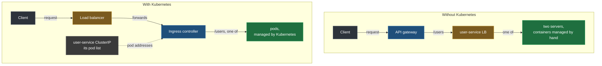

In the second design, the Ingress controller already does the API gateway's main job (forwarding requests by path) and can terminate TLS. **A gateway is no longer required for routing**. One can still be placed in front of the cluster, between the client and the load balancer, but its role narrows to what the controller does not do: rate limiting (capping how many requests a client may send in a given time), adding headers, idempotency checks (making sure a request repeated by mistake is not processed twice) and, depending on the product, API keys, usage plans, developer portals and analytics. Both may handle authentication or rate limiting, depending on which products are used, so the two are not automatically interchangeable.

> [!question] **Is Kubernetes just for running Docker across many servers?**
> Docker alone can run an application on many servers; that is what was done before Kubernetes existed. What Docker alone does not do is manage the containers: when one of four Spring Boot containers crashes, somebody runs a new one from the image. Kubernetes' core job is managing those containers (in pods) and keeping the desired number running. Ingress is part of what is needed when it does that in production: a way for outside requests to get in.

