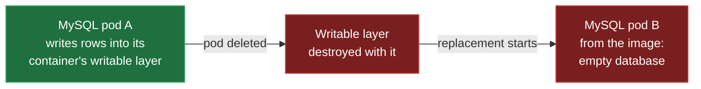
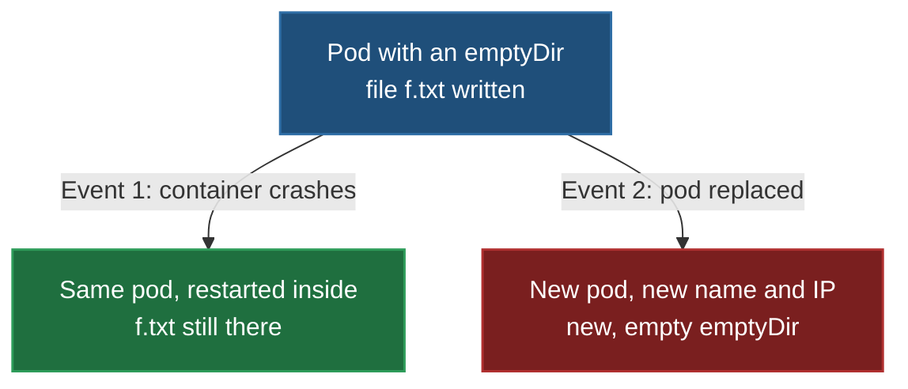
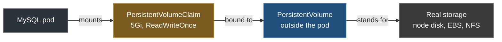
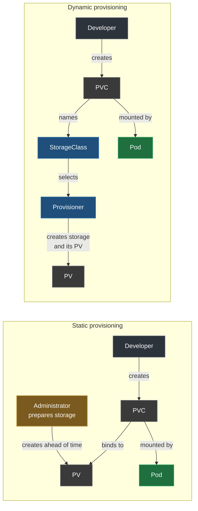
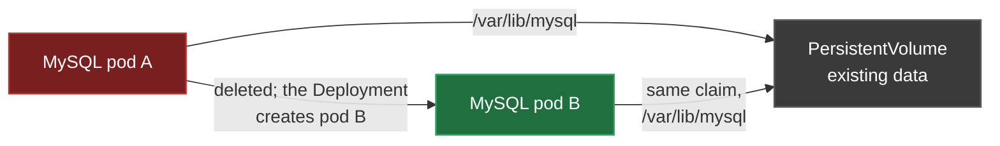
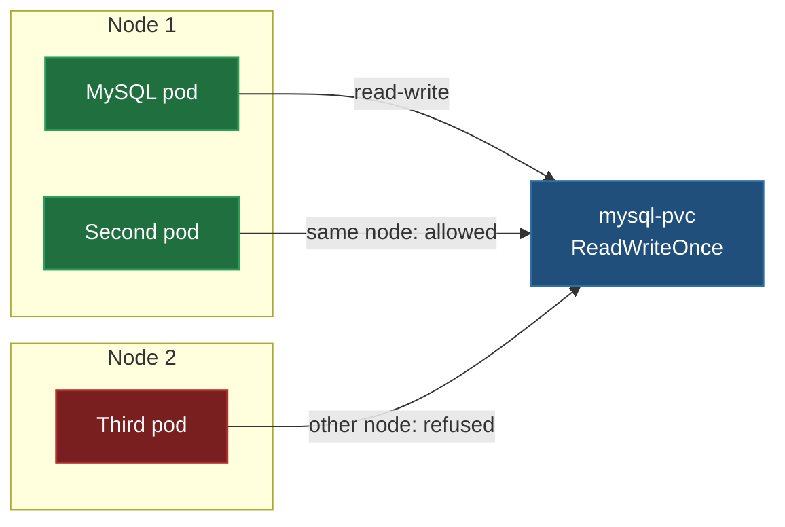
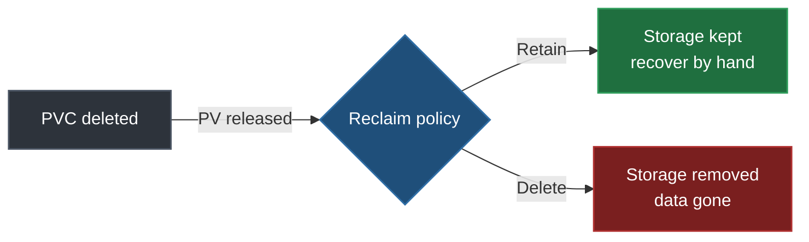

The previous note gave the application a front door: a hostname, HTTPS and routing through an Ingress controller. The deployment note before it left a worse problem open: delete the MySQL pod, and every note the application had stored was gone. This note is about storage that outlives a pod, which is the second thing a production deployment cannot do without.

## Why the container's own filesystem is not enough

When the Notes API receives `POST /notes?text=Hello`, MySQL writes the row into its database files, in its data directory, `/var/lib/mysql`.

A container runs from an image, and the image itself is read-only: it is built as a stack of layers that never change. A running container adds one **writable layer** of its own on top, and anything it writes goes there. That writable layer belongs to that container. It is **perishable**: when the container is destroyed, the layer and everything in it go with it, and a replacement container starts again from the image with an empty layer of its own. That is exactly what happened in the deployment note, where the replacement MySQL pod started with a fresh, empty database.



**Database files need storage whose life is independent of the container's.**

### Volumes, and why a pod's volume is not enough either

With Docker, the answer was a **volume**: storage outside the container, mounted into it at a path, so that a replacement container can be attached to the same volume and find the data still there.

Kubernetes has volumes too (storage mounted into a container at a filesystem path), but different kinds of volume live for different lengths of time. The simplest, an **`emptyDir`**, is created for a pod and lives exactly as long as the pod:

```yaml
volumes:
  - name: temp-storage
    emptyDir: {}
```

| Field | Whose value | Means |
|---|---|---|
| `name: temp-storage` | yours, free text | the label a `volumeMounts` entry uses to find this volume, as in the ConfigMaps note |
| `emptyDir: {}` | Kubernetes' fixed name | the kind of volume: an empty directory made when the pod is created; `{}` means no options |

It is useful for temporary files, caches and scratch space, and for sharing files between the containers of one pod, as the pod note showed.

**Two different things can happen to a pod, and an `emptyDir` survives only one of them.** The `emptyDir` belongs to the pod, not to the container running inside it, so what matters is whether the pod itself is kept or thrown away:

| | Event 1: the container crashes | Event 2: the pod is replaced |
|---|---|---|
| What is thrown away | only the running container | the whole pod |
| Who acts | the kubelet restarts the container inside the same pod | the ReplicaSet creates a new pod |
| Pod name and IP | unchanged | new |
| Restart count (`RESTARTS` in `kubectl get pods`) | goes up by one | starts again at 0 |
| The `emptyDir` | the same one, files intact | a new, empty one |
| Example from an earlier note | a container killed for using more memory than its limit, in the requests and limits note | the MySQL pod deleted in the deployment note |



> [!failure] **An `emptyDir` survives a container crash, and nothing more.**
> A test pod mounts an `emptyDir` at `/scratch` and writes `temp-data` to `/scratch/f.txt`. It also writes a second file, `/tmp/layer.txt`, outside the volume, which puts it in the container's own writable layer. Then the container is made to crash, and after that the pod is deleted and created again from the same manifest:
>
> | Moment | Pod | Restarts | `/scratch/f.txt` (the `emptyDir`) | `/tmp/layer.txt` (the writable layer) |
> |---|---|---|---|---|
> | before | the original pod | 0 | `temp-data` | written |
> | after the container crashed | the same pod | 1 | `temp-data` | gone |
> | after the pod was replaced | a new pod, new IP | 0 | gone | gone |
>
> After the pod was replaced, reading the file fails:
> ```text
> cat: can't open '/scratch/f.txt': No such file or directory
> ```
> The new pod has a new, empty `emptyDir`.

Put side by side, the three places a file can live:

| Where the file lives | Survives a container crash | Survives the pod being replaced |
|---|---|---|
| the container's writable layer (the previous section) | no | no |
| an `emptyDir` volume | yes | no |
| storage outside the pod (the rest of this note) | yes | yes |

**The trouble for a database is that event 2 is the common one.** Kubernetes does not manage containers one at a time; **it manages pods**, and whenever something changes it replaces whole pods. Every situation below is event 2, and each would leave MySQL with an empty `emptyDir`:

| Situation | What Kubernetes does | Covered in |
|---|---|---|
| the pod is deleted, by hand or by mistake | the ReplicaSet creates a replacement pod with a new name | the ReplicaSets and Deployments note; the deployment note did this to MySQL |
| a new image version is applied (`mysql:8.0` to `mysql:8.4`) | a rolling update replaces every old pod with a new one | the ReplicaSets and Deployments note |
| the node runs short of memory | it evicts the pod, and the ReplicaSet creates a replacement | the QoS note |
| the node fails | replacement pods are created on other nodes | the ReplicaSets and Deployments note |

So an `emptyDir` protects against the less common event and is lost in the common one, which is why it cannot be the only storage for production MySQL data. What is needed is storage that sits **outside the pod entirely**: storage that persists however many times the pod is destroyed and recreated.

---

## PersistentVolumes and claims

Kubernetes splits persistent storage into three objects:

| Resource | Meaning | Role |
|---|---|---|
| **PersistentVolume** (PV) | a piece of persistent storage, represented as a Kubernetes object | the storage that has been made available |
| **PersistentVolumeClaim** (PVC) | a request for storage: how much, and with which access mode | what an application asks for |
| **StorageClass** | a description of a kind of storage on offer | how, and by which provisioner, storage of that kind is created |

A **PersistentVolume** is a Kubernetes API object standing for real storage that lives independently of any pod. What is behind it can be many things:

- the disk of a server in the cluster;
- a cloud disk: on AWS, an **EBS** volume, Amazon's block storage;
- **network-attached storage**: a storage server reached over the network, such as an NFS share (NFS being a long-established protocol for sharing a filesystem over a network), managed by you rather than by a cloud company;
- any other compatible storage system.

A PV is the Kubernetes representation of the storage, not necessarily the physical disk itself. **The main benefit is decoupling**: the application asks for an amount of storage and never depends on a particular cloud disk's ID.



> [!question] **Is a PersistentVolume inside the pod, with the container?**
> No. If it were inside the pod, it would be destroyed with the pod, which is the whole problem. It lives outside the pod, and the pod **mounts** it.

A **PersistentVolumeClaim** works like the resource requests from the requests-and-limits note. A container states the CPU and memory it needs, and the scheduler places its pod where those are available. A pod using storage states, through a claim, how much it needs and how it will use it, and Kubernetes finds or creates storage that satisfies the claim.

```yaml
# k8s/05-mysql-pvc.yaml
apiVersion: v1
kind: PersistentVolumeClaim
metadata:
  name: mysql-pvc
spec:
  accessModes:
    - ReadWriteOnce
  resources:
    requests:
      storage: 5Gi
```

| Field | Whose value | Means |
|---|---|---|
| `kind: PersistentVolumeClaim` | Kubernetes' fixed name | the object is a request for storage, not the storage itself |
| `name: mysql-pvc` | yours, free text | the name a pod uses to refer to this claim |
| `accessModes` | one of Kubernetes' fixed names | how the storage may be mounted; `ReadWriteOnce` is explained under access modes below |
| `resources.requests.storage` | fixed names | the amount being asked for, as `requests.cpu` asks for CPU |
| `5Gi` | yours | the minimum size, in the binary units of the requests-and-limits note |

This claim asks for at least 5 GiB of persistent storage that one node can mount for reading and writing. Kubernetes either binds it to a compatible PersistentVolume that already exists, or creates one through dynamic provisioning if the cluster is set up for it.

---

### Static and dynamic provisioning

**Static provisioning.** An administrator prepares the storage and creates PersistentVolume objects for it ahead of time. A developer's claim then binds to a compatible one.

**Dynamic provisioning.** The developer only creates the claim. A **StorageClass** names a **provisioner** (a component that knows how to create storage), and the provisioner creates the storage and its PV on demand.



The amber box is the manual work that dynamic provisioning removes: nobody prepares a disk and a PV by hand for every application. How each of these is set up on a real cloud platform belongs with that platform.

Minikube comes with a default StorageClass, which `kubectl get storageclass` lists:

```text
NAME                 PROVISIONER                RECLAIMPOLICY   VOLUMEBINDINGMODE   ALLOWVOLUMEEXPANSION
standard (default)   k8s.io/minikube-hostpath   Delete          Immediate           false
```

Applying the claim above, with no PersistentVolume prepared, produces one within about three seconds. That is dynamic provisioning, and `kubectl get pvc` shows the claim bound to it:

```text
NAME        STATUS   VOLUME                                     CAPACITY   ACCESS MODES   STORAGECLASS
mysql-pvc   Bound    pvc-526a0b6c-bad7-4e37-b508-6a898327e8d4   5Gi        RWO            standard
```

Minikube's provisioner creates the storage as a directory on the node itself, and the PV records its path: `/tmp/hostpath-provisioner/default/mysql-pvc`. **On a cloud platform, the same claim would produce a cloud disk instead.**

---

### StorageClasses

A **StorageClass** defines a type of **storage available in the cluster**, and the provisioner and parameters used to create it. A cluster may offer several, for example:

| StorageClass | Intended for | Possible use |
|---|---|---|
| `standard` | general-purpose storage, not especially fast | ordinary applications |
| `fast-ssd` | higher-performance storage on SSDs | databases, which need fast reads and writes |
| `shared-storage` | a shared filesystem, where supported | files several applications share |

**These names are examples, not built-in types.** A cluster offers whatever StorageClasses its administrators have configured, under whatever names they chose; the Minikube cluster above has exactly one, `standard`. A claim can ask for a particular class:

```yaml
spec:
  storageClassName: fast-ssd
  accessModes:
    - ReadWriteOnce
  resources:
    requests:
      storage: 5Gi
```

`storageClassName` is Kubernetes' field name, and its value must be the name of a class that exists in the cluster. A claim that leaves it out, like `mysql-pvc`, gets the class marked `(default)`, which is how `mysql-pvc` ended up on `standard`. If a `fast-ssd` class exists and dynamic provisioning is supported, Kubernetes can arrange suitable storage for the claim. If no class of that name exists, nothing can satisfy it.

> [!question] **Who actually provides the storage?**
> Whatever the cluster runs on. On a cloud platform, the platform's provisioner creates a cloud disk for the claim. On Minikube, the hostpath provisioner creates a directory on the node. The claim is written the same way in both cases; that is the point of the abstraction.

---

## Mounting the claim into MySQL

The claim has to be connected to the MySQL pod. That means editing the deployment note's `k8s/03-mysql.yaml` in place, adding two things to the Deployment's pod template:

```yaml
# k8s/03-mysql.yaml (the additions, inside the Deployment's pod template)
spec:
  containers:
    - name: mysql
      image: mysql:8.4
      # ... env, ports, readinessProbe and resources as before ...
      volumeMounts:
        - name: mysql-storage
          mountPath: /var/lib/mysql
  volumes:
    - name: mysql-storage
      persistentVolumeClaim:
        claimName: mysql-pvc
```

In the Deployment, this `spec` is the one under `template`, as in the deployment note.

| Field                           | Whose value                            | Means                                                                           |
| ------------------------------- | -------------------------------------- | ------------------------------------------------------------------------------- |
| `volumes[].name: mysql-storage` | yours, free text                       | the label that links the volume to its mount, as in the ConfigMaps note         |
| `persistentVolumeClaim`         | Kubernetes' fixed name                 | the kind of volume: storage from a claim, in place of `emptyDir` or `configMap` |
| `claimName: mysql-pvc`          | must match the claim's `metadata.name` | which claim's storage to attach                                                 |
| `mountPath: /var/lib/mysql`     | fixed by the MySQL image               | the directory where MySQL keeps its database files                              |

Then apply the claim and the edited Deployment; the Deployment rolls out a new MySQL pod with the storage attached:

```bash
kubectl apply -f k8s/05-mysql-pvc.yaml
kubectl apply -f k8s/03-mysql.yaml
```

`volumes` attaches the storage associated with the claim to the pod, under the name `mysql-storage`. `volumeMounts` decides where that storage appears inside the container. **The mount path matters**: `/var/lib/mysql` is where the MySQL image keeps its database files by default, so mounting the claim there puts every file MySQL writes onto the persistent storage instead of the container's writable layer. The claim must be in the same namespace as the pod.

Now repeat the deployment note's failure with the claim in place. Store two notes through the application, delete the MySQL pod as before, and the Deployment creates a replacement that is ready about eleven seconds later. Asking the application for its notes then gives:

```text
[{"text":"survives-1","id":1},{"text":"survives-2","id":2}]  [HTTP 200]
```

**Both notes survive.** And unlike last time, the API does not need restarting: its table is still there, because the database files are.



When the same claim remains available and its storage can be attached and mounted, the replacement pod reads the existing database files. **Kubernetes does not reconstruct the data; it reconnects the new pod to storage that already contains it.** This is the same disk-follows-the-replica idea the StatefulSets note showed with one claim per ordinal; here a single Deployment pod uses one claim, which is enough for a single MySQL instance.

---

## Access modes

How a volume may be mounted is its **access mode**:

| Access mode | Short | Means |
|---|---|---|
| ReadWriteOnce | RWO | the volume can be mounted read-write by **one node** at a time |
| ReadOnlyMany | ROX | many nodes can mount it, read-only |
| ReadWriteMany | RWX | many nodes can mount it read-write |
| ReadWriteOncePod | RWOP | **one pod** can mount it read-write, where supported |



> [!important] **ReadWriteOnce does not mean exactly one pod.**
> It means one **node**. Every pod on that node can mount the volume. With MySQL using `mysql-pvc`, a second pod scheduled on the same node (`minikube`) can mount the same claim, read-only, and list MySQL's files:
> ```text
> #ib_16384_0.dblwr
> #innodb_redo
> auto.cnf
> binlog.000001
> ```
> For a guarantee that only a single pod can use the volume, the mode is **ReadWriteOncePod**, where the storage supports it.

Which modes are available depends on the storage behind the volume. A cloud block disk is typically ReadWriteOnce; a shared filesystem may support ReadWriteMany.

---

## Reclaim policy, and what a claim is not

When a claim is deleted, its PersistentVolume is **released**, and the **reclaim policy** decides what happens to the storage:

| Policy | After the claim is released |
|---|---|
| `Retain` | the storage is kept, for manual recovery or management |
| `Delete` | the storage is removed, where the provisioner supports deletion |



The outcome depends on the PV and the StorageClass. Minikube's `standard` class uses `Delete`, and it does what it says. Create a 1Gi claim, let it bind to a new PV, then delete the claim: eight seconds later the PV no longer exists, and asking for it gives:

```text
Error from server (NotFound): persistentvolumes "pvc-817d0540-726b-4094-9f7c-b9859c15d32f" not found
```

> [!danger] **With `Delete`, deleting the claim deletes the data.**
> Removing a PVC is not tidying up a pointer: under a `Delete` policy, the storage behind it goes too. For important data, use `Retain`, or be very sure before deleting a claim.

> [!warning] **A PersistentVolume is not a backup.**
> It keeps data across pod replacement. It does nothing about a disk failing, a table being dropped by mistake, or data being corrupted: those reach the persistent storage just as surely as good writes do. Volumes are far less likely to fail than containers, which run code that can crash for any number of reasons; but they can fail, and they can be copied to replicas. A production database needs a separate backup and recovery plan, beyond its PersistentVolume.
