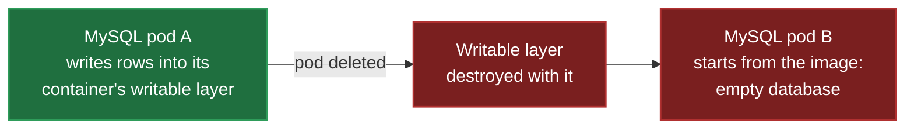
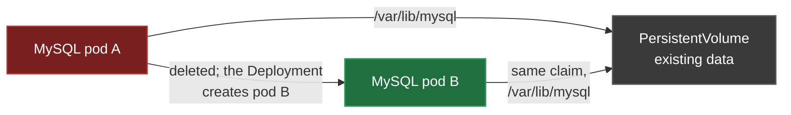

The previous note gave the application a front door: a hostname, HTTPS and routing through an Ingress controller. The deployment note before it left a worse problem open: delete the MySQL pod, and every note the application had stored was gone. This note is about storage that outlives a pod, which is the second thing a production deployment cannot do without.

## Why the container's own filesystem is not enough

When the Notes API receives `POST /notes?text=Hello`, MySQL writes the row into its database files, in its data directory, `/var/lib/mysql`.

A container runs from an image, and the image itself is read-only: it is built as a stack of layers that never change. A running container adds one **writable layer** of its own on top, and anything it writes goes there. That writable layer belongs to that container. It is **perishable**: when the container is destroyed, the layer and everything in it go with it, and a replacement container starts again from the image with an empty layer of its own. That is exactly what happened in the deployment note: the replacement MySQL pod started with a fresh, empty database.



**Database files need storage whose life is independent of the container's.**

### Volumes, and why a pod's volume is not enough either

With Docker, the answer was a **volume**: storage outside the container, mounted into it at a path, so that a replacement container can be attached to the same volume and find the data still there.

Kubernetes has volumes too (storage mounted into a container at a filesystem path), but different kinds of volume live for different lengths of time. The simplest, an **`emptyDir`**, is created for a pod and lives exactly as long as the pod:

```yaml
  volumes:
    - name: temp-storage
      emptyDir: {}
```

It is useful for temporary files, caches and scratch space, and for sharing files between the containers of one pod, as the pod note showed. If a container restarts inside the same pod, the data generally remains. **If the pod is deleted, the data is deleted with it.**

> [!info] **This was run, not just read.**
> A pod with an `emptyDir` volume mounted at `/scratch` wrote `temp-data` to `/scratch/f.txt` and read it back. The pod was deleted and created again from the same manifest:
> ```text
> cat: can't open '/scratch/f.txt': No such file or directory
> ```
> The new pod had a new, empty `emptyDir`.

That is the problem for a database. Kubernetes does not manage containers one at a time; it manages pods, and replaces whole pods. A volume that dies with its pod survives a container crash, but not the pod being replaced — and replacing pods is what Kubernetes does all the time. So `emptyDir` cannot be the only storage for production MySQL data. What is needed is storage that sits **outside the pod entirely**: storage that persists however many times the pod is destroyed and recreated.

## PersistentVolumes and claims

Kubernetes splits persistent storage into three objects:

| Resource | Meaning | Role |
|---|---|---|
| **PersistentVolume** (PV) | a piece of persistent storage, represented as a Kubernetes object | the storage that has been made available |
| **PersistentVolumeClaim** (PVC) | a request for storage: how much, and with which access mode | what an application asks for |
| **StorageClass** | a description of a kind of storage on offer | how, and by which provisioner, storage of that kind is created |

A **PersistentVolume** is a Kubernetes API object standing for real storage that lives independently of any pod. What is behind it can be many things:

- the disk of a server in the cluster;
- a cloud disk: on AWS, an **EBS** volume, Amazon's block storage;
- **network-attached storage**: a storage server reached over the network, such as an NFS share (NFS being a long-established protocol for sharing a filesystem over a network), managed by you rather than by a cloud company;
- any other compatible storage system.

A PV is the Kubernetes representation of the storage, not necessarily the physical disk itself. **The main benefit is decoupling**: the application asks for an amount of storage and never depends on a particular cloud disk's ID.

> [!question] **Is a PersistentVolume inside the pod, with the container?**
> No. If it were inside the pod, it would be destroyed with the pod, which is the whole problem. It lives outside the pod, and the pod **mounts** it.

A **PersistentVolumeClaim** works like the resource requests from the requests-and-limits note. A container states the CPU and memory it needs, and the scheduler places its pod where those are available. A pod using storage states, through a claim, how much it needs and how it will use it, and Kubernetes finds or creates storage that satisfies the claim.

```yaml
# k8s/05-mysql-pvc.yaml
apiVersion: v1
kind: PersistentVolumeClaim
metadata:
  name: mysql-pvc
spec:
  accessModes:
    - ReadWriteOnce
  resources:
    requests:
      storage: 5Gi
```

This claim asks for at least 5 GiB of persistent storage that one node can mount for reading and writing. Kubernetes either binds it to a compatible PersistentVolume that already exists, or creates one through dynamic provisioning if the cluster is set up for it.

### Static and dynamic provisioning

**Static provisioning.** An administrator prepares the storage and creates PersistentVolume objects for it ahead of time. A developer's claim then binds to a compatible one:

```text
Administrator prepares storage → creates PV → developer creates PVC → PVC binds to PV → pod mounts it
```

**Dynamic provisioning.** The developer only creates the claim. A **StorageClass** names a **provisioner** (a component that knows how to create storage), and the provisioner creates the storage and its PV on demand:

```text
Developer creates PVC → StorageClass selects a provisioner → provisioner creates storage → PV created and bound → pod mounts it
```

Dynamic provisioning removes the need to prepare a disk and a PV by hand for every application. How each of these is set up on a real cloud platform belongs with that platform.

> [!info] **This was run, not just read.**
> Minikube comes with a default StorageClass:
> ```text
> NAME                 PROVISIONER                RECLAIMPOLICY   VOLUMEBINDINGMODE
> standard (default)   k8s.io/minikube-hostpath   Delete          Immediate
> ```
> Applying the claim above, with no PersistentVolume prepared, produced one within three seconds — dynamic provisioning:
> ```text
> NAME        STATUS   VOLUME                                     CAPACITY   ACCESS MODES   STORAGECLASS
> mysql-pvc   Bound    pvc-526a0b6c-bad7-4e37-b508-6a898327e8d4   5Gi        RWO            standard
> ```
> Minikube's provisioner creates the storage as a directory on the node itself, which the PV records:
> ```text
> /tmp/hostpath-provisioner/default/mysql-pvc  reclaim=Delete  modes=["ReadWriteOnce"]
> ```
> **The `storage-provisioner` pod from the control-plane listing in the local-cluster note is this provisioner.** On a cloud platform, the same claim would produce a cloud disk instead.

### StorageClasses

A **StorageClass** defines a type of storage available in the cluster, and the provisioner and parameters used to create it. A cluster may offer several, for example:

| StorageClass | Intended for | Possible use |
|---|---|---|
| `standard` | general-purpose storage, not especially fast | ordinary applications |
| `fast-ssd` | higher-performance storage on SSDs | databases, which need fast reads and writes |
| `shared-storage` | a shared filesystem, where supported | files several applications share |

**These names are examples, not built-in types.** A cluster offers whatever StorageClasses its administrators have configured, under whatever names they chose; the Minikube cluster above has exactly one, `standard`. A claim can ask for a particular class:

```yaml
spec:
  storageClassName: fast-ssd
  accessModes:
    - ReadWriteOnce
  resources:
    requests:
      storage: 5Gi
```

If a `fast-ssd` class exists and dynamic provisioning is supported, Kubernetes can arrange suitable storage for the claim. If no class of that name exists, nothing can satisfy it.

> [!question] **Who actually provides the storage?**
> Whatever the cluster runs on. On a cloud platform, the platform's provisioner creates a cloud disk for the claim. On Minikube, the hostpath provisioner creates a directory on the node. The claim is written the same way in both cases; that is the point of the abstraction.

## Mounting the claim into MySQL

The claim has to be connected to the MySQL pod. That means editing the deployment note's `k8s/03-mysql.yaml` in place, adding two things to the Deployment's pod template:

```yaml
# k8s/03-mysql.yaml — the additions to the MySQL Deployment
    spec:
      containers:
        - name: mysql
          image: mysql:8.4
          # ... env, ports, readinessProbe and resources as before ...
          volumeMounts:
            - name: mysql-storage
              mountPath: /var/lib/mysql
      volumes:
        - name: mysql-storage
          persistentVolumeClaim:
            claimName: mysql-pvc
```

Then apply the claim and the edited Deployment; the Deployment rolls out a new MySQL pod with the storage attached:

```bash
kubectl apply -f k8s/05-mysql-pvc.yaml
kubectl apply -f k8s/03-mysql.yaml
```

`volumes` attaches the storage associated with the claim to the pod, under the name `mysql-storage`. `volumeMounts` decides where that storage appears inside the container. **The mount path matters**: `/var/lib/mysql` is where the MySQL image keeps its database files by default, so mounting the claim there puts every file MySQL writes onto the persistent storage instead of the container's writable layer. The claim must be in the same namespace as the pod.

> [!info] **This was run, not just read — the deployment note's failure, repeated with a claim.**
> The MySQL Deployment from the deployment note was given the claim above, and the application stored two notes. Then the MySQL pod was deleted, as before. The Deployment created a replacement (`mysql-76dd666d45-zgg65`, ready eleven seconds later), and the application was asked for its notes:
> ```text
> [{"text":"survives-1","id":1},{"text":"survives-2","id":2}]  [HTTP 200]
> ```
> **Both notes survived.** And unlike last time, the API did not need restarting: its table was still there, because the database files were.



When the same claim remains available and its storage can be attached and mounted, the replacement pod reads the existing database files. **Kubernetes does not reconstruct the data; it reconnects the new pod to storage that already contains it.** This is the same disk-follows-the-replica idea the StatefulSets note showed with one claim per ordinal; here a single Deployment pod uses one claim, which is enough for a single MySQL instance.

## Access modes

How a volume may be mounted is its **access mode**:

| Access mode | Short | Means |
|---|---|---|
| ReadWriteOnce | RWO | the volume can be mounted read-write by **one node** at a time |
| ReadOnlyMany | ROX | many nodes can mount it, read-only |
| ReadWriteMany | RWX | many nodes can mount it read-write |
| ReadWriteOncePod | RWOP | **one pod** can mount it read-write, where supported |

> [!important] **ReadWriteOnce does not mean exactly one pod.**
> It means one **node**. Every pod on that node can mount the volume. This was run: with MySQL using `mysql-pvc`, a second pod was created on the same node mounting the same claim, read-only, and listed MySQL's files:
> ```text
> #ib_16384_0.dblwr
> #innodb_redo
> auto.cnf
> binlog.000001
> ```
> Both pods were on node `minikube`. For a guarantee that only a single pod can use the volume, the mode is **ReadWriteOncePod**, where the storage supports it.

Which modes are available depends on the storage behind the volume. A cloud block disk is typically ReadWriteOnce; a shared filesystem may support ReadWriteMany.

## Reclaim policy, and what a claim is not

When a claim is deleted, its PersistentVolume is **released**, and the **reclaim policy** decides what happens to the storage:

| Policy | After the claim is released |
|---|---|
| `Retain` | the storage is kept, for manual recovery or management |
| `Delete` | the storage is removed, where the provisioner supports deletion |

The outcome depends on the PV and the StorageClass. Minikube's `standard` class uses `Delete`, and it does what it says. This was run: a 1Gi claim was created, bound to a new PV, and then the claim was deleted. Eight seconds later the PV no longer existed:

```text
Error from server (NotFound): persistentvolumes "pvc-817d0540-726b-4094-9f7c-b9859c15d32f" not found
```

> [!danger] **With `Delete`, deleting the claim deletes the data.**
> Removing a PVC is not tidying up a pointer: under a `Delete` policy, the storage behind it goes too. For important data, use `Retain`, or be very sure before deleting a claim.

> [!warning] **A PersistentVolume is not a backup.**
> It keeps data across pod replacement. It does nothing about a disk failing, a table being dropped by mistake, or data being corrupted: those reach the persistent storage just as surely as good writes do. Volumes are far less likely to fail than containers, which run code that can crash for any number of reasons; but they can fail, and they can be copied to replicas. A production database needs a separate backup and recovery plan, beyond its PersistentVolume.

## The two production gaps, closed

| Concept | In one line |
|---|---|
| Ingress | rules describing how HTTP and HTTPS requests should reach Services |
| Ingress controller | the software that actually implements those rules |
| TLS termination | the point where HTTPS is accepted and decrypted |
| PersistentVolume | the Kubernetes representation of persistent storage |
| PersistentVolumeClaim | an application's request for persistent storage |
| StorageClass | the kind of storage, and the provisioner used to create it |
| Dynamic provisioning | storage created automatically in response to a claim |

The Notes application now has a hostname instead of an IP and a port, HTTPS terminated at the Ingress controller, and a database whose files survive its pod being replaced. **A running pod shows that a workload is running. It does not, by itself, prove that the application is secure, durable, reachable or healthy** — and the remaining production concerns, scaling with load and restricting what workloads may do and reach, are subjects of their own.

> [!info] **Versions, checked 2026-11-16.**
> Everything in this note and the previous one was run on Minikube v1.39.0 with Kubernetes v1.37.0, its `ingress` add-on (ingress-nginx controller v1.15.1) and its default `standard` StorageClass, against the Notes application from the deployment note.
