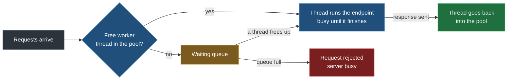
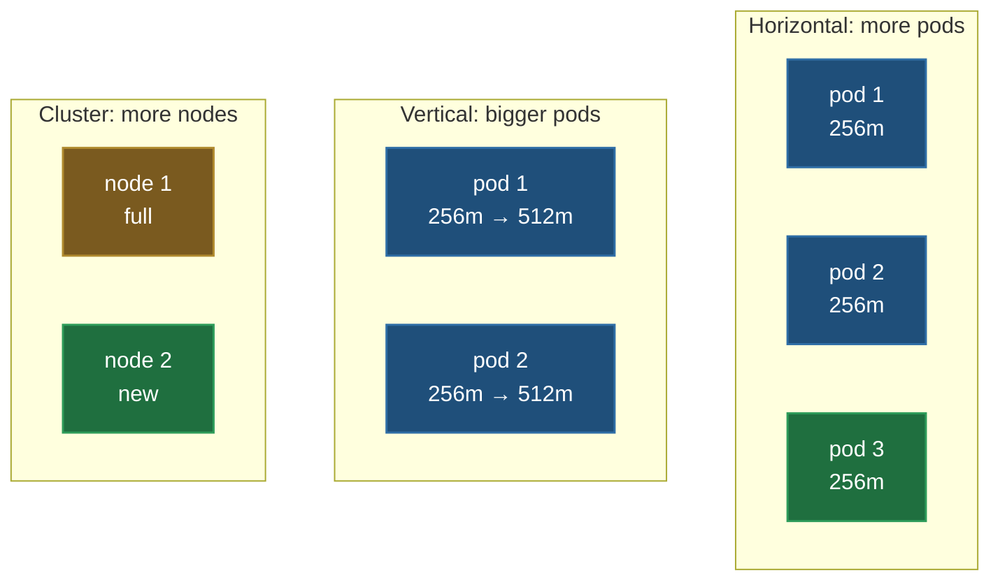
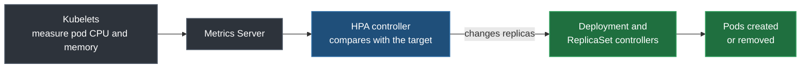
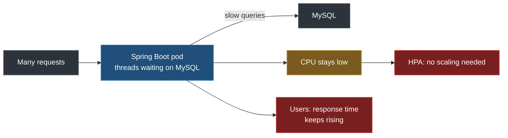

The previous note closed the storage gap, which leaves the production concern from the Ingress note's table still open: **traffic may grow far beyond what two replicas can handle**. Recall how the Notes API is deployed: a Deployment with `replicas: 2`, whose ReplicaSet keeps two Spring Boot pods running and replaces either one if it dies, and a Service that spreads requests across them. What the ReplicaSet maintains is the count it was given. If traffic goes from 100 requests a second to 1,000, it still keeps two pods, because two is what the manifest says. Nothing in that setup adds a third pod when load rises — until somebody edits `replicas` by hand. This note is about the first of three ways Kubernetes can add capacity by itself.

## What a pod does with many requests at once

To see why more pods are needed, look inside one of them. Forget Kubernetes for a moment and picture the plainest deployment there is: one server, one Spring Boot application on it, one MySQL database.

On a laptop it works the familiar way. The application listens on `localhost:8080`; Postman or a browser sends `GET /hello`; the function behind that endpoint runs and the reply comes back, `hello from spring boot`. A request that stores data goes one step further: Spring Boot sends it to MySQL, MySQL stores it and answers, and Spring Boot answers the client.

Deployed to a server, nothing changes except the address. The client sends the same request to the server's IP address, say `143.45.156.67:8080/hello`. Usually the client types a name such as `api.bookcart.in` instead, but DNS turns the name into that IP address, so underneath every request still goes to an IP address and a port.

The difference is that a production application is not used by one person. Four people send `/hello` at the same moment. If the application served them one at a time (the first, then the second, then the third), the fourth would wait for all three; with 10,000 people arriving at once, most of them would simply wait. So that is not what happens.

### The thread pool

A program can run several pieces of work at the same time as separate **threads**. In Java a thread can be created by hand, `Thread t1 = new Thread(...)`, and every language has its own way to do the same. A server cannot sensibly create a brand-new thread for every request, because creating threads costs time and memory; instead it uses a **thread pool**: when the application starts, it sets aside a space inside itself and creates a number of threads in advance: the **worker threads**, so called because doing the work is their whole job.

When a request arrives:

1. The server checks the pool for a free thread.
2. If there is one, it takes it out of the pool and gives it the request. The thread runs the endpoint's function, which may take one second, two or three, and the thread is busy until it finishes.
3. A second request arriving meanwhile gets a second thread, a third request a third thread, and so on.
4. When a thread finishes, it sends the response and goes **back into the pool**, ready for the next request. Threads are reused, again and again.

**As many requests can be handled at the same moment as the pool has threads.** (Running things at the same time is called concurrency; it is not quite the same thing as parallelism, a distinction that belongs to multithreading in depth.)



What if every thread is busy and another request arrives? That depends on how the pool is implemented. A common design adds a **waiting queue**: the request waits there until one of the busy threads finishes and returns to the pool, and then it is served. And if the queue fills up too, there are two choices:

| Queue design | What happens when traffic keeps coming |
|---|---|
| unbounded (a linked list that just keeps growing) | every request is kept and waits, however long that takes |
| bounded (a fixed size) | requests beyond it are **discarded**, and the client is told the server is busy |

That rejection is why a website sometimes answers that the server is busy. It is different from being told you sent too many requests yourself, which is **rate limiting**: a server capping how often one client may call it.

How many threads a pool should have is worked out properly for each application; there is a formula for it, which belongs to multithreading rather than to Kubernetes. Too few and requests queue; too many and the threads spend their time competing for the CPU. **Neither too many nor too few is good.**

### Two pods, thousands of requests

Now back to the cluster. One node (one server) runs two pods, two replicas of the same Spring Boot application, each with its own thread pool. Ten or twenty thousand users arrive at once, so each pod receives thousands of requests while it has, say, six or seven worker threads. All of them are busy, and the rest of the requests wait. Three things go wrong together:

| Symptom | Why |
|---|---|
| **high CPU utilisation** | every pod is using as much CPU as it can |
| **high response time** | a core runs one thread at a time and switches between them (the context switching described in the resource requests note), so with many threads competing, work that should have finished quickly takes longer |
| **the waiting queue fills** | requests pile up faster than threads free up, and once it is full they are rejected |

Put together, **the whole system becomes slow**: every request takes longer to answer, and many are refused outright. A server in that state is **unavailable**, and that is the most dangerous state a server can be in, because availability — the share of the time an application actually answers — is what users see. Customers who were about to buy something get errors instead.

This is a real and recurring failure. An e-commerce site at peak time is the usual example: Flipkart's Big Billion Days and Amazon's Great Indian Festival around Diwali, or a flash sale where an ₹80,000 iPhone is offered for ₹50–60,000, bring a crowd onto the site at the same moment, and if the scaling has not been handled properly the servers slow down or fail. Snapdeal once ran deals such as a pen drive for one rupee, and the click simply did not go through. The CBSE results site is the most familiar case of all: when class 10 and 12 results came out, the whole site would hang: the user's internet was fast, but so many people arrived at once that the servers had not been scaled to handle them.

## Scaling by hand, and why that is not enough

The simplest fix is the one from the Deployments note: raise the replica count by hand, so a third pod running the same Spring Boot application is created. The Service now spreads the requests three ways (20,000 requests become about 7,000 each), so each pod's CPU utilisation falls, response time improves, the queues drain, and the system is fast again.

> [!question] **Does a new pod need a new server?**
> Not necessarily. A server has its own capacity and each pod has its own, and they are separate numbers. Three pods requesting 256m CPU and 512Mi of memory each, on a server with 8 cores (8,000m) and 128 GB of RAM, use a tiny fraction of it, and many more pods fit on the same machine. Whether a new pod goes onto the same node or another one is the scheduler's decision, as the architecture note described: it looks for a node with enough room for the pod's requests. Only when the existing nodes are full does it need another node — which is the problem the next note returns to.

But doing this by hand defeats the reason for using Kubernetes. Kubernetes earns its place when there are many replicas and many microservices; if a person must notice the load and add pods manually, plain Docker would have been enough. **The point is for the cluster to scale itself.**

## Three ways to add capacity

| Method | What changes | Kubernetes mechanism | Example |
|---|---|---|---|
| **horizontal scaling** | the number of pods | Horizontal Pod Autoscaler (HPA) | the Notes API goes from 2 pods to 5 |
| **vertical scaling** | the CPU and memory of each pod | Vertical Pod Autoscaler (VPA) | a pod's memory request goes from 128Mi to 512Mi |
| **cluster scaling** | the number of nodes | Cluster Autoscaler | another worker node joins when the existing ones are full |

In system design, horizontal and vertical scaling describe servers: more servers, or bigger ones. In Kubernetes the same words describe **pods** (more pods, or bigger pods), and the servers are the third row.



> [!question] **Horizontal scaling also puts pods on another node when one is full, so how is that different from cluster scaling?**
> It can only use nodes that already exist. If the cluster has one node and that node is full, horizontal scaling has nowhere to put the new pod; it cannot create a node. Creating nodes is the one thing only cluster scaling does.

This note covers the first row. The other two are the next note.

## The Horizontal Pod Autoscaler

A **HorizontalPodAutoscaler** (HPA) is a Kubernetes object that adjusts the replica count of a workload (a Deployment, for instance) from observed metrics. In outline, it is told a lower bound and an upper bound: start at 3 pods, say, never go above 10, and in between add pods as load rises. When 3 are not enough it asks for a fourth, when 4 are not enough a fifth, and so on up to 10.

How does it know that the pods are not enough? It does not read the Java code, and it does not watch requests itself. **It reads metrics** — measurements such as how much CPU and memory each pod is using — that another component collects. And it does not decide anything on its own initiative: **it is not intelligence.** It follows the rule written in its manifest, exactly like a program: above this level, add pods; below it, remove them.

### The target is a percentage of the request

The usual rule is a CPU target: min 2 replicas, max 8, **target average CPU utilisation 50%**. Recall from the resource requests note that each container states a **request** (what the scheduler reserves for it) and a **limit**, the most it may use. A pod requesting 256m CPU, with a limit of 512m, could be at 50% of either. (The pod sizes in this section and the next — 256m here, 250m in the worked example — are round numbers chosen to make the arithmetic easy to follow. The real Notes API, which the run later in this note uses, requests 100m.)

> [!important] **CPU utilisation for an HPA is measured against the request, never the limit.**
> The limit is an upper bound the pod is not meant to reach; the request is what the pod was scheduled on. So 50% of a 256m request is 128m. When the pods, **on average across all the pods of the Deployment**, use more than 128m each, the HPA adds a pod, and the Service spreads the requests over three. If the three together still average more than 50% of their requests, it adds a fourth, and so on up to the maximum of 8.

Utilisation is computed the same way for every pod:

```text
CPU utilisation = (CPU usage / CPU request) × 100
```

A pod requesting 250m and using 200m is at (200 / 250) × 100 = **80%**, regardless of a 500m limit above it.

What is the limit for, then? It is the most CPU the pod may use in the worst case; above it, the container is throttled, as the resource requests note showed. Without an HPA, it is the limit that caps a pod's CPU. And a pod whose requests equal its limits is **Guaranteed**, the quality-of-service class the eviction note described as the last to be evicted when a node runs short — the last, not never.

### How many replicas the HPA asks for

With 2 replicas at 80% average utilisation and a target of 50%, the HPA computes:

```text
desired replicas = ceil(current replicas × current utilisation / target utilisation)
                 = ceil(2 × 80 / 50)
                 = ceil(3.2)
                 = 4
```

`ceil` rounds up, because 3.2 pods is not a number of pods. So the HPA scales the Deployment from 2 pods to 4, and the Deployment and ReplicaSet controllers create the two new pods, as they would after any replica change.

That is the simplified calculation. The real controller also accounts for pods that are not ready yet, for missing metrics, and for rules that keep it from reacting to every small movement. Three of those defaults, read from the Kubernetes v1.37.0 source:

| Default | Value | Effect |
|---|---|---|
| sync period | 15 seconds | how often the HPA re-evaluates |
| tolerance | 10% | a utilisation within 10% of the target, relative to it, causes no change: for a 50% target, anything from 45% to 55% |
| downscale stabilisation window | 5 minutes | the HPA scales down only to the highest replica count it recommended in the last 5 minutes, so a brief dip does not remove pods |

All you supply is the minimum, the maximum and the target; the controller calculates the rest itself.

### Choosing the target

**50% is not a number to pick at random.** Set the target very low and the HPA adds a pod at the first sign of load, wasting CPU on pods that have nothing to do. Set it very high and the pods stay busy for longer before help arrives, so users wait. The right value is worked out for each application, usually by testing it under load, and differs from one application to the next; 50% is simply an easy number to explain with.

### Where the metrics come from

In a CPU-based setup, the **Metrics Server** collects the resource usage of every pod from the kubelets and serves it through the Kubernetes API; the HPA controller reads it and decides the replica count; the Deployment does the rest.



**The Metrics Server supplies numbers; it makes no scaling decisions.**

## The manifest

Saved as `hpa.yaml`, the HPA for the Notes API is:

```yaml
apiVersion: autoscaling/v2
kind: HorizontalPodAutoscaler
metadata:
  name: notes-app-hpa
spec:
  scaleTargetRef:
    apiVersion: apps/v1
    kind: Deployment
    name: notes-app
  minReplicas: 2
  maxReplicas: 8
  metrics:
  - type: Resource
    resource:
      name: cpu
      target:
        type: Utilization
        averageUtilization: 50
```

| Field | Purpose |
|---|---|
| `scaleTargetRef` | the workload the HPA controls: the Deployment named `notes-app`. `apps/v1` is the API version of Deployments (the same `apiVersion` line every Deployment manifest starts with), not the name of the application |
| `minReplicas: 2` | never fewer than two replicas |
| `maxReplicas: 8` | never more than eight |
| `metrics` | what to measure: here the `cpu` resource, against a target of 50% average utilisation of the requests |

**`maxReplicas: 8` is a ceiling, not a promise.** It does not guarantee the cluster has room to run eight pods.

The Deployment it points at must have CPU requests set, or there is nothing to compute a percentage of. The Notes API from the deployment note requests `cpu: "100m"`, with a limit of `500m`.

## Running it on Minikube

The Metrics Server is a Minikube add-on:

```bash
minikube addons enable metrics-server
kubectl get pods -n kube-system
kubectl top pods
kubectl top nodes
```

Then the HPA is applied and inspected:

```bash
kubectl apply -f hpa.yaml
kubectl get hpa
kubectl describe hpa notes-app-hpa
kubectl get pods -w
```

> [!info] **This was run, not just read.**
> With the Notes API idle (its pods using 2m CPU each against the 100m request), the HPA reported:
> ```text
> NAME            REFERENCE              TARGETS       MINPODS   MAXPODS   REPLICAS   AGE
> notes-app-hpa   Deployment/notes-app   cpu: 2%/50%   2         8         2          1s
> ```
> and `kubectl describe hpa` spelled out what the percentage is of:
> ```text
> resource cpu on pods  (as a percentage of request):  2% (2m) / 50%
> ```
> 2m of a 100m request is 2%. Measured against the 500m limit it would have been 0.4%.

Installing the Metrics Server creates no load. To see the HPA act, something has to make the application use CPU. The pods below send requests to the Notes API in an endless loop. `notes-app` in the URL is the ClusterIP Service the Ingress note created in front of the API pods, on port 80; inside the cluster, a Service's name resolves to its address through cluster DNS, as the Services note showed, so a pod can reach the API simply as `http://notes-app`. Read the warning further down before running this on a small machine.

```bash
for i in 1 2 3; do
  kubectl run load-$i --image=busybox:1.36 --restart=Never -- /bin/sh -c "while true; do wget -q -O- http://notes-app/notes >/dev/null; done"
done
```

Stopping the load is the first thing to do afterwards, and removing the HPA returns the Deployment to a fixed count:

```bash
kubectl delete pod load-1 load-2 load-3
kubectl delete -f hpa.yaml
kubectl scale deployment notes-app --replicas=2
```

> [!info] **This was run, not just read.**
> About a minute after the three load pods started, utilisation reached `cpu: 204%/50%`. The HPA's events then showed two steps, 17 seconds apart:
> ```text
> SuccessfulRescale   horizontalpodautoscaler/notes-app-hpa   New size: 4; reason: cpu resource utilization (percentage of request) above target
> SuccessfulRescale   horizontalpodautoscaler/notes-app-hpa   New size: 8; reason: cpu resource utilization (percentage of request) above target
> ```
> The formula gives ceil(2 × 204 / 50) = 9, and `maxReplicas` caps that at 8. It went to 4 first because, when the manifest sets no scaling behaviour of its own, the controller limits each step up to **twice the current replicas, or 4, whichever is larger**: from 2 that is 4, and from 4 it is 8. That rule is in the HPA controller's source for Kubernetes v1.37.0.

> [!failure] **Eight replicas asked for, and one pod stuck in `Pending`.**
> The single node had 2 CPUs (2,000m), and its existing pods already requested 1,500m of it. Each new Notes API pod requests 100m, so five more fitted and the sixth did not:
> ```text
> 0/1 nodes are available: 1 Insufficient cpu. preemption: 0/1 nodes are available: 1 No preemption victims found for incoming pod.
> ```
> **Preemption** is the scheduler's last resort: when a pod cannot be placed, it may evict pods of lower priority to make room for it. Every pod here had the same priority, so there was nothing to evict: no victims. The HPA had done its part; the scheduler had nowhere to put the pod. **An HPA can ask for more pods than the cluster can run.** Without a way to add nodes, those pods simply wait — the gap the Cluster Autoscaler in the next note fills.

> [!warning] **Autoscaling a Java application on a small machine can take the whole cluster down.**
> The run above did more than leave a pod pending. Every new pod was a JVM starting up, on top of the load generators, on a 2-CPU, 3.8 GB virtual machine. Its load average reached 91, and the Kubernetes API server stopped answering for about five minutes: `kubectl` failed with `net/http: TLS handshake timeout` and `connection refused`.
> A gentler run did not avoid it. With **one** load pod and `maxReplicas: 4`, utilisation reached `cpu: 87%/50%` and the HPA went from 2 pods to 4 within 45 seconds, as ceil(2 × 87 / 50) = 4 predicts — and within two minutes the machine's load average had gone from 1.4 to 31 and `kubectl` was failing to connect again. On a machine this size, the load generators and the starting JVMs compete with the control plane itself for the same two CPUs.
> **When `kubectl` cannot reach the API server, `kubectl delete` cannot stop the load either.** What worked both times was stopping the load containers from inside the node, where the container runtime still answers. On Minikube's Docker driver the node is a Docker container named `minikube`, and its runtime is driven with `crictl`:
> ```bash
> sudo docker exec minikube crictl ps --name load -q
> sudo docker exec minikube crictl stop -t 0 <container-id>
> ```
> Within two minutes the API server answered again, and the cleanup commands above finished the job. Load-test an HPA on a machine with room to spare, and keep `maxReplicas` within what the nodes can actually hold.

> [!question] **What if the node does not have the capacity for 8 replicas?**
> Then the pods that do not fit are not created on any node; they stay `Pending`, exactly as above, and the application stays busy. Only adding a node helps.

> [!question] **When load drops, what decides the scale-down: the number of requests in progress, or simply lower CPU?**
> Whatever metric the HPA was given. With a CPU target, scaling down follows CPU too, after the five-minute stabilisation window, so the count does not drop on a momentary lull.

> [!question] **When a pod is removed, does it finish the requests it is handling first?**
> You would want it to, so that no request is cut off. Kubernetes sends the container a termination signal and then waits (30 seconds by default, the pod's `terminationGracePeriodSeconds`) before killing it. Finishing in-flight requests inside that window is the application's job: it has to shut down gracefully when it receives the signal.

## When CPU is the wrong signal

A CPU target works for an application whose work is computing. **High traffic does not always mean high CPU.** Take one Spring Boot pod connected to one MySQL pod, and a request that stores data, where MySQL takes a long time (a **database-heavy request**):

1. Request 1 arrives. A worker thread takes it and passes the work to MySQL, and MySQL is slow to finish.
2. Request 2 arrives and does the same. So does request 3.
3. Each of those threads is waiting for MySQL. It cannot go back to the pool, because its request is not finished, so it **looks busy, but it is doing nothing**. It sits idle, waiting for the data.
4. The pod's CPU stays low, because nothing is computing.

So the HPA sees a healthy pod. Meanwhile the requests keep arriving, the pool runs out of threads, the queue grows and users wait longer and longer. **The HPA fails completely here: it waits for a CPU rise that never comes.**



That is why, in production, an HPA rarely depends on CPU alone but on several signals together:

| Signal | What it shows |
|---|---|
| CPU utilisation | how hard the pods are computing |
| response time, latency | how long a request takes to be answered (say, scale up above one second) |
| pending requests | how many requests are waiting |
| queue size | how full the waiting queue is |
| thread pool size in use | how many worker threads are taken |

Whatever signals are used must be written into the manifest; **the HPA decides only on the metrics it has been given.**

### Those metrics do not come from the Metrics Server

The Metrics Server collects CPU and memory, and nothing else. A response time or a queue length comes from the application or from a monitoring system, and reaches the HPA through two other APIs, the custom metrics API and the external metrics API, which only exist once an adapter that serves them has been installed in the cluster. The `metrics` field of an `autoscaling/v2` HPA accepts five types:

| Type | Meaning, as the API describes it |
|---|---|
| `Resource` | CPU or memory of each pod, from the Metrics Server |
| `ContainerResource` | CPU or memory of one named container in each pod |
| `Pods` | a custom metric for each pod, averaged (for example, transactions processed per second) |
| `Object` | a metric of a single Kubernetes object (for example, hits per second on an Ingress) |
| `External` | a metric from outside the cluster (for example, the length of a queue in a cloud messaging service) |

> [!failure] **An HPA on a response-time metric, in a cluster with no custom metrics adapter.**
> This HPA targets an average of one second per request, using a per-pod custom metric:
> ```yaml
>   metrics:
>   - type: Pods
>     pods:
>       metric:
>         name: http_server_requests_seconds
>       target:
>         type: AverageValue
>         averageValue: "1"
> ```
> Applied to the same cluster, where the only metrics API registered was `v1beta1.metrics.k8s.io`, served by the Metrics Server, it never got a number:
> ```text
> NAME                    REFERENCE              TARGETS       MINPODS   MAXPODS   REPLICAS   AGE
> notes-app-hpa-latency   Deployment/notes-app   <unknown>/1   2         8         2          40s
> ScalingActive  False  FailedGetPodsMetric  the HPA was unable to compute the replica count: unable to get metric http_server_requests_seconds: unable to fetch metrics from custom metrics API: no custom metrics API (custom.metrics.k8s.io) registered
> ```
> The manifest was valid; the metric had no source. Scaling on anything other than CPU and memory means installing a metrics pipeline first, which is outside this folder.

## Summary

| Term | Meaning |
|---|---|
| Thread pool | worker threads created in advance and reused for each request |
| Waiting queue | where requests wait when every worker thread is busy |
| Horizontal scaling | adding or removing pods |
| HorizontalPodAutoscaler | the object that changes a workload's replica count from metrics |
| Target utilisation | the average usage the HPA aims for, as a percentage of each pod's request |
| Metrics Server | the component that serves pod CPU and memory usage to the HPA |
| Custom and external metrics | other signals (latency, queue length) served by an adapter, not the Metrics Server |

An HPA watches a metric and changes the number of pods. **It guarantees more pods are asked for when the metric crosses its target. It does not guarantee those pods can be scheduled, and it does not see load that never shows up in the metric it watches.**

> [!info] **Versions, checked 2026-11-17.**
> Run on Minikube v1.39.0 with Kubernetes v1.37.0 on a single node with 2 CPUs and about 3.8 GiB, with the metrics-server add-on, against the Notes API from the deployment note (request 100m CPU, limit 500m). The HPA API is `autoscaling/v2`. The defaults in the table above (15-second sync, 10% tolerance, five-minute downscale window) and the step limit of twice the replicas or 4 are from the Kubernetes v1.37.0 source. An HPA manifest can also carry its own scaling rules, which replace the step limit, and the cluster's settings can change the other defaults; neither is covered in this folder.
