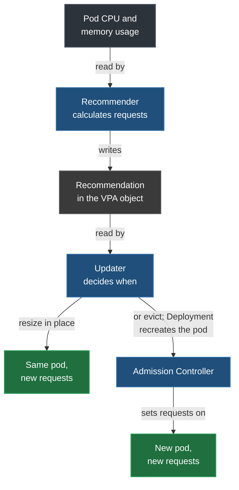
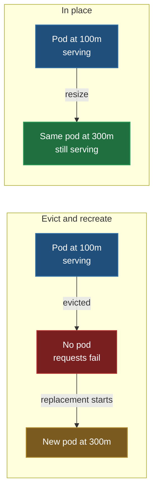
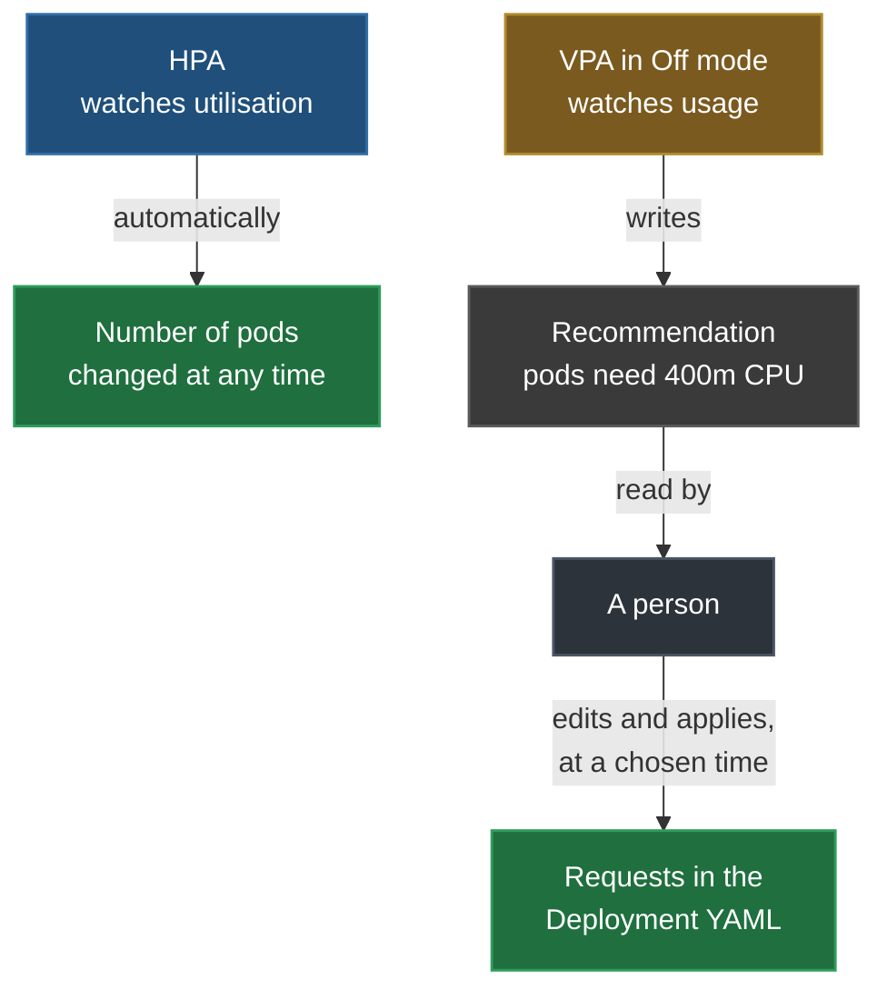
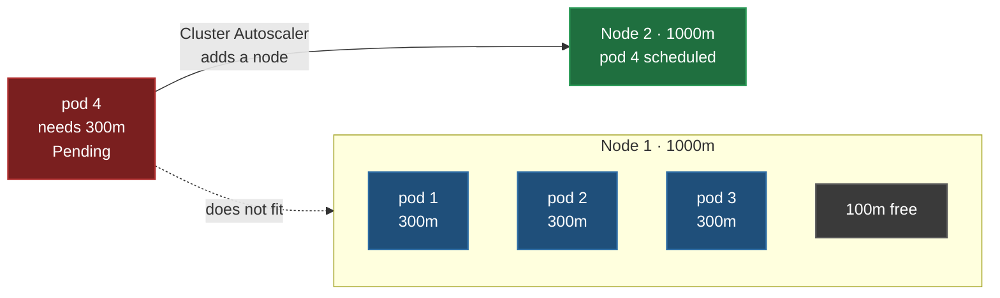
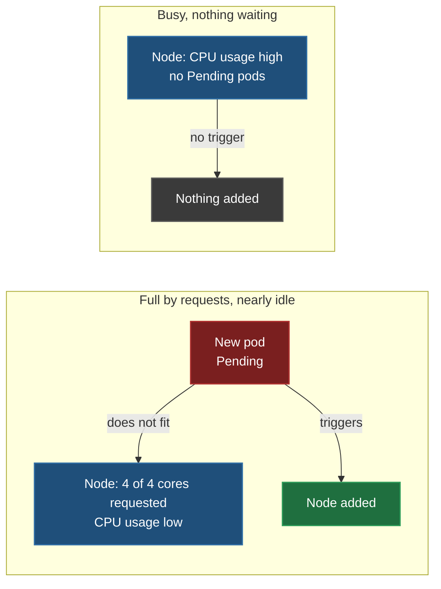
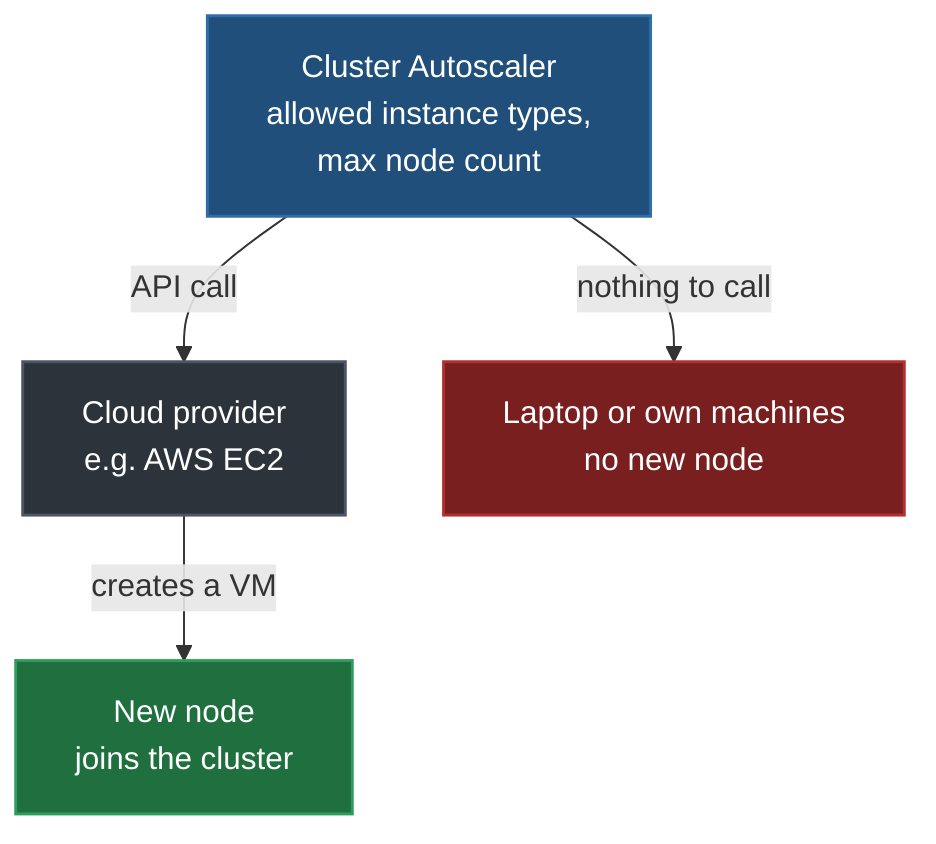
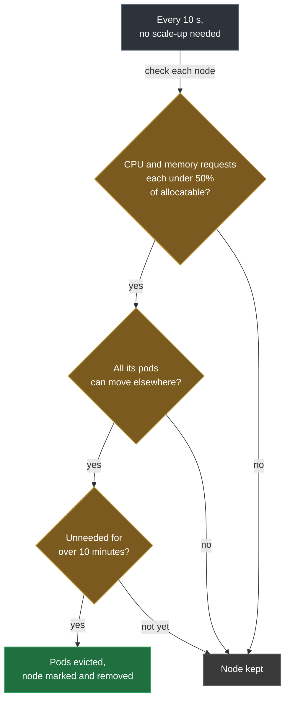
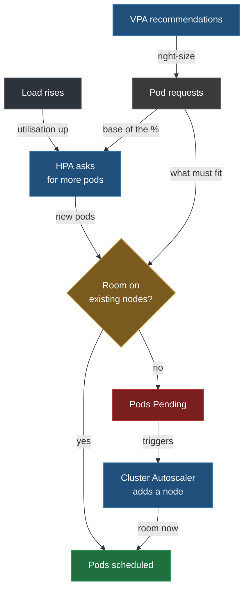

## Vertical Pod Autoscaler

Take two pods, each requesting 256m CPU and 512Mi of memory (the round illustrative sizes from the previous note, not the real Notes API's 100m and 128Mi), and the same problem: they are not enough for the traffic. Instead of creating a third pod, what if each existing pod were made bigger, its CPU request raised from 256m to 512m and its memory from 512Mi to 1Gi? Nothing new is created; the same pods get more capacity. That is **vertical scaling**, and the Kubernetes mechanism for it is the **Vertical Pod Autoscaler** (VPA). Like the HPA it watches metrics, and like the HPA it works on **requests**.

Its other use is just as important: finding out what a pod's requests should have been in the first place. A Spring Boot application might start with:

```yaml
resources:
  requests:
    cpu: "100m"
    memory: "128Mi"
```

and after watching it run, a VPA might recommend something like this (an illustration of the kind of recommendation, not a real one):

| Resource | Original request | Example recommendation |
|---|---|---|
| CPU | 100m | 400m |
| Memory | 128Mi | 512Mi |

That guards against **under-provisioning** (requests so low the pod is starved or squeezed onto a node without enough room) and **over-provisioning**, requests far beyond anything the pod uses, which the resource requests note showed blocking other pods from a node that was almost idle.

> [!important] **By default a VPA changes the limits too.**
> Each container in a VPA's resource policy has a `controlledValues` setting, and its default is `RequestsAndLimits`: the request is set to the recommendation, and **the limit is scaled in proportion to it**, so a pod with a 100m request and a 500m limit keeps that one-to-five ratio. Only `controlledValues: RequestsOnly` leaves the limits untouched.

### Three components

| Component | Responsibility |
|---|---|
| **Recommender** | watches the pods' CPU and memory usage and calculates what their requests should be |
| **Updater** | checks whether running pods have the recommended resources and, if not, either resizes them in place or **evicts** them so that their controller recreates them |
| **Admission Controller** | as each new pod is created (including one recreated after the Updater evicted it), sets its requests to the recommended values |

Two of those words need a line each. **Admission** is a step inside the API server: after a request has been authenticated and authorized, and before the object is stored, admission controllers may inspect it, change it or reject it. The VPA's Admission Controller plugs into that step for new pods, which is how it can rewrite a pod's requests before the pod exists. And **evict** here is not the eviction from the QoS note. That was a node under memory pressure removing pods in QoS order to save itself; this is the Updater deliberately asking the API server to remove a healthy pod on a node under no pressure at all, so that its Deployment replaces it with a correctly sized one.



The Recommender decides **whether** a pod needs more; the Updater decides **when** an existing pod is changed (it need not act the moment usage rises, and it evicts at most a limited share of a Deployment's pods at a time, always allowing at least one); the Admission Controller **applies** the values, but only to pods being created. Together they let the VPA decide whether a pod's capacity should grow, and carry it out.

### Why changing a pod's resources used to mean replacing it

A pod's resources were fixed when it was created. So for a long time the only way for a VPA to change them was to **evict the pod and let a new one be created with the new values**, which for that pod meant shutting it down. While the replacement started, the pod could not serve anything, and a user whose request reached it in that moment got nothing. To make a pod bigger, the VPA briefly made it unavailable, which is exactly what scaling was meant to prevent.

Newer versions can resize a running pod **in place**, without recreating it.



A VPA's `updateMode` decides which of the two it is allowed to do:

| `updateMode` | Behaviour |
|---|---|
| `Off` | never changes pods; the Recommender still writes its recommendation into the VPA object (a dry run) |
| `Initial` | sets resources only when a pod is created, never afterwards |
| `Recreate` | the default: sets resources at creation and also changes running pods by evicting and recreating them |
| `InPlaceOrRecreate` | tries to resize a running pod in place, and falls back to recreating it when that is not possible |
| `Auto` | deprecated; currently the same as `Recreate` |

### A CPU change in place, under traffic

Is an in-place resize also a moment of unavailability? Take a running pod, an nginx web server with a 100m CPU request and a 200m limit, in a namespace of its own created with `kubectl create namespace devops-demo` (the RBAC note uses the same namespace):

```yaml
# k8s/resize-demo.yaml
apiVersion: v1
kind: Pod
metadata:
  name: resize-demo
  namespace: devops-demo
spec:
  containers:
    - name: web
      image: nginx:1.27
      resources:
        requests:
          cpu: 100m
          memory: 64Mi
        limits:
          cpu: 200m
          memory: 128Mi
```

A second pod, running the `curlimages/curl:8.11.1` image, sends it a request every quarter of a second, 40 in all, to the pod's own IP address. Meanwhile the pod is resized, which is a patch to the pod's `resize` subresource:

```bash
kubectl patch pod resize-demo -n devops-demo --subresource resize --patch '{"spec":{"containers":[{"name":"web","resources":{"requests":{"cpu":"300m"},"limits":{"cpu":"400m"}}}]}}'
```

The pod's status shows the new values, its restart count stays at `0`, it stays `Ready` throughout, and **all 40 requests sent during the resize succeed**. Inside the container, the kernel's CPU quota (the same per-period quota the resource requests note read for a throttled container) has changed to:

```text
40000 100000
```

That is 40ms of CPU per 100ms, which is 400m. So for a CPU change, in place really does mean no interruption. A memory change is a different case: whether a container must restart for a particular resource change depends on that container's resize policy.

### The manifest

A VPA is not part of Kubernetes itself, and not part of Minikube either. It is an add-on from the Kubernetes autoscaler project, with its own components and its own resource type, which have to be installed into the cluster before a VPA object means anything.

> [!failure] **A VPA applied to a cluster where it is not installed.**
> ```text
> error: resource mapping not found for name: "notes-app-vpa" namespace: "" from "vpa.yaml": no matches for kind "VerticalPodAutoscaler" in version "autoscaling.k8s.io/v1"
> ensure CRDs are installed first
> ```
> A **CRD**, custom resource definition, is how an add-on teaches the API server a new kind of object. It is like writing `new VerticalPodAutoscaler()` in a Java project that lacks the Maven dependency declaring that class: until the dependency is added, the compiler has never heard of it, and until the VPA's CRD is installed, the API server has never heard of `VerticalPodAutoscaler`. Minikube v1.39.0 has no add-on for it.

With the VPA installed, a manifest for the Notes API that only recommends looks like this:

```yaml
# k8s/vpa.yaml
apiVersion: autoscaling.k8s.io/v1
kind: VerticalPodAutoscaler
metadata:
  name: notes-app-vpa
spec:
  targetRef:
    apiVersion: apps/v1
    kind: Deployment
    name: notes-app
  updatePolicy:
    updateMode: "Off"
```

It is the same request body to the API server as every earlier manifest. The difference is the address: `autoscaling.k8s.io/v1` is an API group the add-on brings with it, the way a dependency brings packages the JDK does not have.

| Field | Whose value | Means |
|---|---|---|
| `apiVersion: autoscaling.k8s.io/v1` | the add-on's fixed name | the API group and version the VPA's CRD adds; it exists only once the VPA is installed |
| `kind: VerticalPodAutoscaler` | fixed name, from the CRD | the kind of object being created |
| `metadata.name` | yours, free text | how `kubectl describe vpa notes-app-vpa` finds it |
| `targetRef` | fixed name | the workload to watch, named by its `apiVersion`, `kind` and `name`, as in the HPA |
| `targetRef.name: notes-app` | yours | must match the Deployment's own name |
| `updatePolicy.updateMode` | fixed name, one of the five values in the table above | what the VPA may do to pods |

`updateMode: "Off"` means **you are not allowed to change the pods; just tell me what they need.** The quotes matter: unquoted, YAML reads `Off` as the boolean false rather than the word `Off`. Leave `updatePolicy` out and the mode is `Recreate`, so pods will be evicted to apply the recommendations, something to set deliberately rather than by omission.

The recommendation is stored in the VPA object itself. According to the VPA's quickstart documentation, it is read with:

```bash
kubectl describe vpa notes-app-vpa
```

The same documentation notes that, in the modes that apply recommendations, the VPA changes the requests of the running pods, not the pod template in the Deployment's manifest, so the manifest in version control keeps the old numbers until somebody updates it. With `Off`, updating the Deployment's requests from the recommendation is the human step.

> [!note] **What a Minikube cluster can and cannot show here.**
> Without the VPA's components, a Minikube cluster produces no live recommendation, so no `describe` output is reproduced above. The update modes, the default of `Recreate`, the limit behaviour, the component roles and the way recommendations are read come from the VPA's own source and documentation. The failure above and the in-place resize are what a plain Minikube cluster shows.

---

### HPA and VPA together

Three questions decide how the two are used together: why the VPA is usually not allowed to change pods by itself, what is done instead, and why the two should not both change the same pods.

**1. Why the VPA is not left to change pods by itself.** In its default mode, `Recreate`, the VPA changes a running pod's requests by evicting it: the pod is stopped, and the Deployment starts a new one with the new requests. The requests that pod was serving are cut off. A busy pod being stopped in the middle of the day is exactly what nobody wants, so in production the VPA usually runs in `Off` mode, where it only writes down its advice.

**2. The common setup: the HPA acts, the VPA only advises.**

| | HPA | VPA in `Off` mode |
|---|---|---|
| What it watches | utilisation: usage ÷ request | how much CPU and memory the pods use over time |
| What it changes | the **number** of pods | nothing |
| Who acts on its output | the HPA itself, automatically, at any time | a person, who reads the recommendation, edits the requests in the Deployment YAML and applies it at a time they choose |



**Nothing connects the two automatically.** The VPA's recommendation never reaches the HPA: the VPA does not say add pods, and only the HPA adds pods. If the recommendation says a pod needs more, the usual answer is still more pods, from the HPA.

**3. Why the two should not both change the same pods.** The HPA's utilisation is a fraction, **usage ÷ request**. The HPA changes the number of pods; the VPA changes the bottom of that fraction. When both act on the same pods, the VPA can undo the HPA's signal:

| | CPU usage | CPU request | Utilisation (usage ÷ request) | HPA with a 50% target |
|---|---|---|---|---|
| traffic rises | 200m | 250m | 200 ÷ 250 = 80% | too busy: adds pods |
| the VPA raises the request | 200m | 400m | 200 ÷ 400 = 50% | looks fine: does nothing |

Look at the usage column: 200m in both rows. The traffic did not drop at all. Only the request changed, so the percentage fell and the HPA stopped adding pods. The two autoscalers were reacting to the same rise in traffic, and one cancelled the other. **Two autoscalers acting on the same CPU or memory signal undo each other's arithmetic**, and keeping the VPA in `Off` mode means only one of them acts on the pods. The VPA's own documentation states it as a limitation: it should not be used with an HPA on the same resource metric, CPU or memory. It can be combined with an HPA on a different one (VPA on memory and HPA on CPU) or with an HPA on custom or external metrics.

Two more limitations from that documentation: a VPA does not update pods that are not run by a controller such as a Deployment, and **a recommendation can exceed what any node can provide, leaving the recreated pod `Pending`.** All of this only works while the node has room. When it does not, neither autoscaler can help.

> [!question] **What if the node does not have the room for the bigger pod, or the extra pods?**
> Then the pods wait in `Pending`. That is the problem the Cluster Autoscaler exists for.

---

## The Cluster Autoscaler

Put numbers on it. One node, with 1,000m CPU available. Two pods each request 300m, with an HPA set to add a pod when they average more than 50% of their requests.

1. Traffic rises, the two pods pass 50%, and the HPA asks for a third. Pod 3 requests 300m too: 900m of the node's 1,000m is now requested, and **100m is left**.
2. Traffic keeps rising, and all three pods pass 50%. The HPA asks for a fourth.
3. The HPA does not create pods itself; the Deployment does, and the scheduler must place it. Pod 4 requests 300m, and the node has 100m. It cannot fit.
4. Pod 4 goes into **`Pending`** and waits for one of the other three to crash and free its 300m, which is not a plan. The requests that were piling up stay piled up.

**The HPA cannot help, and neither can the VPA, because there is no second node.** This is the same `Insufficient cpu` the previous note's eighth replica hit, and the one the architecture note first showed.



Without automation, the only way out is manual: buy a new server (a new node), add it to the Kubernetes cluster, and let the scheduler use it. If the new node also has 1,000m, the scheduler places pod 4 there, and it takes its 300m.

The **Cluster Autoscaler** does that part automatically: it adds a node to the cluster when pods cannot be scheduled, and removes one when it is no longer needed. In the order of events:

1. The HPA increases the desired number of pods.
2. The Deployment and ReplicaSet create the extra pods.
3. Some cannot be scheduled for lack of capacity and stay `Pending`.
4. The Cluster Autoscaler checks whether adding a node like the existing ones would let them run.
5. The infrastructure provider creates the node.
6. It joins the cluster.
7. The scheduler places the pending pods on it.

### It reacts to pending pods, not to busy nodes

**The Cluster Autoscaler does not add a node because CPU usage passed 80%.** Its trigger is scheduling: according to its documentation, it grows the cluster when there are pods that failed to schedule on any current node **because of insufficient resources**, and when adding a node similar to the current ones would help.

So the two can disagree in both directions. A node's **allocatable** resources are the share of its capacity available to pods (the whole machine minus anything set aside for the operating system and Kubernetes' own daemons), and the scheduler never promises pods more than that. On the Minikube node used in these notes, nothing is set aside, so allocatable equals capacity: 2 CPUs and about 3.8 GiB. A node with four allocatable cores whose pods have requested all four is full to the scheduler even if those pods are nearly idle. The resource requests note showed exactly that: a pod using 1m blocking a node that was 10% busy. Another pod that requests CPU will not fit there, so a node may be added. The reverse holds too: a node can be busy, with high CPU usage, but if no pod is waiting to be scheduled, the Cluster Autoscaler adds nothing.



### Where the new node comes from

A node is a machine. If the cluster runs on physical machines in your own room, or on a laptop as Minikube does, **the Cluster Autoscaler can do nothing**: it cannot conjure a second machine. On Minikube, enabling an HPA will never produce a new node.

It works when the cluster runs on a cloud platform it is integrated with. There, a new node is a **virtual machine** (on AWS, an EC2 instance), and creating one is an API call. The cloud company runs enormous physical servers, with a terabyte of RAM and a great many CPUs, and hands each customer a slice of one; each slice is a virtual machine that can become a node. You configure in advance which kinds and sizes of instance may be used, and how many at most, and the Cluster Autoscaler adds and removes nodes within those bounds as load changes.



It is not limited to AWS. Its documentation lists support for around thirty providers, among them AWS, Azure, Alibaba Cloud, DigitalOcean, Hetzner and Oracle Cloud, plus **Cluster API**: a Kubernetes subproject that provisions and manages the machines of clusters declaratively, through Kubernetes objects, which lets the Cluster Autoscaler work wherever Cluster API can create machines.

### Paying for it

A cloud bills for the nodes and the CPU you have provisioned, whether or not anything uses them. It is like a Google Drive plan: buy 100 GB and you pay for 100 GB whether you store anything; upgrade to 200 GB and you pay for 200 GB even with 15 GB stored. So more nodes means a bigger bill. Giving a Cluster Autoscaler room to add nodes is like a small car that seats five, and a manager who has been allowed to buy another car whenever more people turn up. Every new car costs money. If cost matters more than capacity, you can cap the cluster at a single machine; then a pod that does not fit simply cannot be created, and nothing more can be done.

The same logic works in the other direction. **The Cluster Autoscaler also scales down**: it removes a node the cluster no longer needs, so that the node stops costing money. Its documentation gives the steps:

1. Every 10 seconds, if no scale-up is needed, it looks at each node.
2. **A node is a candidate when its pods request little of it.** The CPU requests of all the pods on it add up to less than 50% of the node's allocatable CPU, and their memory requests add up to less than 50% of its allocatable memory. (Allocatable, from the requests and limits note, is what the scheduler may hand out to pods.)
3. **Every pod on it must be able to move to another node.** The table below lists what stops a pod from moving.
4. **It must stay a candidate for more than 10 minutes**, so that a short quiet spell does not remove a node that will be needed again.
5. Then the Cluster Autoscaler evicts the node's pods, marks the node so that the scheduler places nothing new there (a mark called a **taint**), and removes it. The Deployments recreate the evicted pods on the remaining nodes. A node that still has pods is removed one at a time; empty nodes can go up to 10 at once.

An example. Node 3 has 4,000m of allocatable CPU and 8 GiB of allocatable memory. Its pods request 1,200m of CPU (30%) and 2 GiB of memory (25%). Both are under 50%, so node 3 is a candidate, and if its pods fit on the other nodes for more than 10 minutes, node 3 is removed.

| A pod on the node that | Keeps the node, because |
|---|---|
| has no room on any other node | evicting it would only leave it `Pending` |
| is protected by a **PodDisruptionBudget** that allows no more of its pods to be down | the eviction is refused. A PodDisruptionBudget is an object an application's owner creates to limit how many of its pods may be down at once from voluntary disruptions such as this one |
| is one of Kubernetes' own system pods, such as CoreDNS, with no PodDisruptionBudget | by default the Cluster Autoscaler does not move them |
| is not run by a controller such as a Deployment | nothing would recreate it after the eviction |
| keeps files in local storage such as an `emptyDir` | the files would be lost with the pod, as the persistent storage note showed |

**Requests decide, not usage.** The check adds up what the pods request, not what they use. A node whose pods request 80% of its CPU but use only 5% is not a candidate, so **a node is not removed just because its CPU usage is low**, and even a candidate is removed only if its pods can go somewhere else.



## How the three fit together

| Mechanism | What it changes | The problem it solves |
|---|---|---|
| HPA | the number of pod replicas | the application needs more or fewer pods |
| VPA | the CPU and memory requests of pods | individual pods are under- or over-provisioned |
| Cluster Autoscaler | the number of worker nodes | the cluster needs more or fewer machines to schedule its pods |



The HPA asks for more pods; if there is no room, the Cluster Autoscaler may add nodes; the VPA keeps each pod's requests a sensible size, which is what both the scheduler and the HPA's percentages are computed from. **None of the three makes capacity appear by itself.** Somebody pays for every node, either by buying a machine or through a cloud bill, and on a laptop cluster only the first two can work at all.
