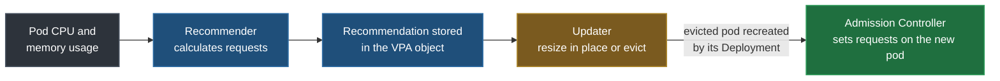
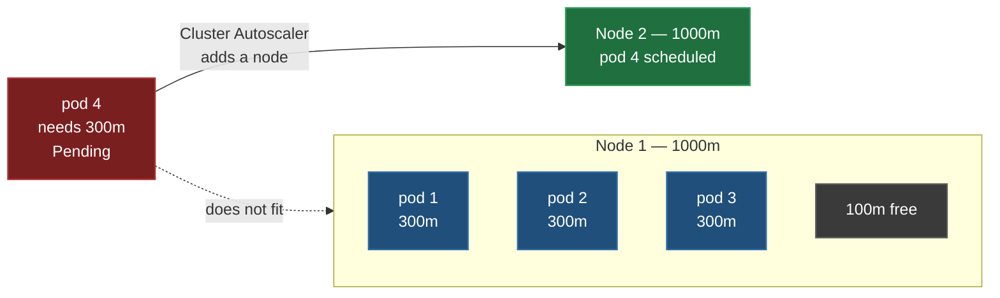
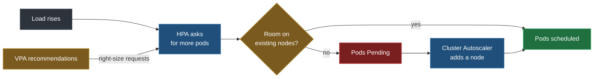

The previous note's autoscaler changed the number of pods. It ended with two loose ends: the HPA asked for eight Notes API pods and one of them stayed `Pending` because the node was full, and it can only spread pods over the nodes that already exist. This note covers the other two rows of the scaling table — making each pod bigger, and making the cluster bigger.

| Method | What changes | Mechanism |
|---|---|---|
| horizontal scaling | the number of pods | Horizontal Pod Autoscaler — the previous note |
| **vertical scaling** | the CPU and memory requests of each pod | **Vertical Pod Autoscaler** |
| **cluster scaling** | the number of nodes | **Cluster Autoscaler** |

## The Vertical Pod Autoscaler

Take the same two pods, each requesting 256m CPU and 512 MB of memory, and the same problem: they are not enough for the traffic. Instead of creating a third pod, what if each existing pod were made bigger — its CPU request raised from 256m to 512m, its memory from 512 MB to 1 GB? Nothing new is created; the same pods get more capacity. That is **vertical scaling**, and the Kubernetes mechanism for it is the **Vertical Pod Autoscaler** (VPA). Like the HPA it watches metrics, and like the HPA it works on **requests**.

Its other use is just as important: finding out what a pod's requests should have been in the first place. A Spring Boot application might start with:

```yaml
resources:
  requests:
    cpu: "100m"
    memory: "128Mi"
```

and after watching it run, a VPA might recommend something like this (an illustration of the kind of recommendation, not a measured one):

| Resource | Original request | Example recommendation |
|---|---|---|
| CPU | 100m | 400m |
| Memory | 128Mi | 512Mi |

That guards against **under-provisioning** — requests so low the pod is starved or squeezed onto a node without enough room — and **over-provisioning**, requests far beyond anything the pod uses, which the resource requests note showed blocking other pods from a node that was almost idle.

> [!important] **By default a VPA changes the limits too.**
> Each container in a VPA's resource policy has a `controlledValues` setting, and its default is `RequestsAndLimits`: the request is set to the recommendation, and **the limit is scaled in proportion to it**, so a pod with a 100m request and a 500m limit keeps that one-to-five ratio. Only `controlledValues: RequestsOnly` leaves the limits untouched. That is from the VPA's own API definition, version 1.8.1.

### Three components

| Component | Responsibility |
|---|---|
| **Recommender** | watches the pods' CPU and memory usage and calculates what their requests should be |
| **Updater** | checks whether running pods have the recommended resources and, if not, either resizes them in place or **evicts** them so that their controller recreates them |
| **Admission Controller** | as each new pod is created — including one recreated after the Updater evicted it — sets its requests to the recommended values |



The Recommender decides **whether** a pod needs more; the Updater decides **when** an existing pod is changed — it need not act the moment usage rises, and it evicts at most a limited share of a Deployment's pods at a time, always allowing at least one; the Admission Controller **applies** the values, but only to pods being created. Together they let the VPA decide whether a pod's capacity should grow, and carry it out.

### Why changing a pod's resources used to mean replacing it

A pod's resources were fixed when it was created. So for a long time the only way for a VPA to change them was to **evict the pod and let a new one be created with the new values** — which, for that pod, meant shutting it down. While the replacement started, the pod could not serve anything, and a user whose request reached it in that moment got nothing. To make a pod bigger, the VPA briefly made it unavailable, which is exactly what scaling was meant to prevent.

Newer versions can resize a running pod **in place**, without recreating it. A VPA's `updateMode` decides what it is allowed to do:

| `updateMode` | Behaviour |
|---|---|
| `Off` | never changes pods; the Recommender still writes its recommendation into the VPA object — a dry run |
| `Initial` | sets resources only when a pod is created, never afterwards |
| `Recreate` | the default: sets resources at creation and also changes running pods by evicting and recreating them |
| `InPlaceOrRecreate` | tries to resize a running pod in place, and falls back to recreating it when that is not possible |
| `Auto` | deprecated; currently the same as `Recreate` |

> [!info] **This was run, not just read: a CPU change in place, under traffic.**
> Is an in-place resize also a moment of unavailability? A running pod — an nginx web server with a 100m CPU request and a 200m limit — was resized while another pod sent it a request every quarter of a second:
> ```bash
> kubectl patch pod resize-demo -n devops-demo --subresource resize --patch '{"spec":{"containers":[{"name":"web","resources":{"requests":{"cpu":"300m"},"limits":{"cpu":"400m"}}}]}}'
> ```
> The pod's status showed the new values, its restart count stayed at `0`, it stayed `Ready` throughout, and **all 40 requests sent during the resize succeeded**. Inside the container, the kernel's CPU limit had changed to `40000 100000` — 40ms of CPU per 100ms, which is 400m. So for a CPU change, in place really did mean no interruption here. A memory change was not tested, and whether a container must restart for a particular resource change depends on that container's resize policy.

### The manifest

A VPA is not part of Kubernetes itself, and not part of Minikube either. It is an add-on from the Kubernetes autoscaler project, with its own components and its own resource type, which have to be installed into the cluster before a VPA object means anything.

> [!failure] **A VPA applied to a cluster where it is not installed.**
> ```text
> error: resource mapping not found for name: "notes-app-vpa" namespace: "" from "vpa.yaml": no matches for kind "VerticalPodAutoscaler" in version "autoscaling.k8s.io/v1"
> ensure CRDs are installed first
> ```
> A **CRD**, custom resource definition, is how an add-on teaches the API server a new kind of object. Until the VPA's CRD is installed, the API server has never heard of `VerticalPodAutoscaler`. Minikube v1.39.0 has no add-on for it.

With the VPA installed, a manifest for the Notes API that only recommends looks like this:

```yaml
apiVersion: autoscaling.k8s.io/v1
kind: VerticalPodAutoscaler
metadata:
  name: notes-app-vpa
spec:
  targetRef:
    apiVersion: apps/v1
    kind: Deployment
    name: notes-app
  updatePolicy:
    updateMode: "Off"
```

`targetRef` names the Deployment, as in the HPA. `updateMode: "Off"` means **you are not allowed to change the pods; just tell me what they need.** Leave `updatePolicy` out and the mode is `Recreate`, so pods will be evicted to apply the recommendations — something to set deliberately rather than by omission.

> [!info] **The VPA itself was not run.**
> Its components were not installed on the test cluster, so no live recommendation is shown here. The update modes, the default of `Recreate`, the limit behaviour and the component roles were read from the source and documentation of the VPA, release 1.8.1; the failure above and the in-place resize were run.

### HPA and VPA together

In production a VPA is rarely left to change pods by itself — the eviction it relies on interrupts the pod, and a busy pod being stopped is exactly what nobody wants. A common combination is **an HPA to change the number of pods, and a VPA in `Off` mode whose recommendations are used to set the requests right**, by updating the Deployment. Nothing connects the two automatically: a VPA's recommendation does not tell the HPA to add pods. If the recommendations say a pod needs more, the usual answer is still more pods, from the HPA.

The reason to keep them apart is arithmetic. An HPA's utilisation is a percentage of the request, and the VPA changes the request:

| | CPU usage | CPU request | Utilisation | HPA with a 50% target |
|---|---|---|---|---|
| before | 200m | 250m | 80% | adds pods |
| after the VPA raises the request | 200m | 400m | 50% | does nothing |

The load did not change at all; only the denominator did. **Two autoscalers acting on the same CPU or memory signal undo each other's arithmetic.** The VPA's own documentation states it as a limitation: it should not be used with an HPA on the same resource metric, CPU or memory. It can be combined with an HPA on a different one — VPA on memory and HPA on CPU — or with an HPA on custom or external metrics.

Two more limitations from that documentation: a VPA does not update pods that are not run by a controller such as a Deployment, and **a recommendation can exceed what any node can provide, leaving the recreated pod `Pending`.** All of this only works while the node has room. When it does not, neither autoscaler can help.

> [!question] **What if the node does not have the room for the bigger pod, or the extra pods?**
> Then the pods wait in `Pending` — the problem the Cluster Autoscaler exists for.

## The Cluster Autoscaler

Put numbers on it. One node, with 1,000m CPU available. Two pods each request 300m, with an HPA set to add a pod when they average more than 50% of their requests.

1. Traffic rises, the two pods pass 50%, and the HPA asks for a third. Pod 3 requests 300m too: 900m of the node's 1,000m is now requested, and **100m is left**.
2. Traffic keeps rising, and all three pods pass 50%. The HPA asks for a fourth.
3. The HPA does not create pods itself; the Deployment does, and the scheduler must place it. Pod 4 requests 300m, and the node has 100m. It cannot fit.
4. Pod 4 goes into **`Pending`** and waits — for one of the other three to crash and free its 300m, which is not a plan. The requests that were piling up stay piled up.

**The HPA cannot help, and neither can the VPA, because there is no second node.** This is the same `Insufficient cpu` the previous note's run produced, and the one the architecture note first showed.



Without automation, the only way out is manual: buy a new server — a new node — add it to the Kubernetes cluster, and let the scheduler use it. If the new node also has 1,000m, the scheduler places pod 4 there, and it takes its 300m.

The **Cluster Autoscaler** does that part automatically: it adds a node to the cluster when pods cannot be scheduled, and removes one when it is no longer needed. In the order of events:

1. The HPA increases the desired number of pods.
2. The Deployment and ReplicaSet create the extra pods.
3. Some cannot be scheduled for lack of capacity and stay `Pending`.
4. The Cluster Autoscaler checks whether adding a node like the existing ones would let them run.
5. The infrastructure provider creates the node.
6. It joins the cluster.
7. The scheduler places the pending pods on it.

### It reacts to pending pods, not to busy nodes

**The Cluster Autoscaler does not add a node because CPU usage passed 80%.** Its trigger is scheduling: according to its documentation, it grows the cluster when there are pods that failed to schedule on any current node because of insufficient resources, and when adding a node similar to the current ones would help.

So the two can disagree in both directions. A node with four allocatable cores whose pods have requested all four is full to the scheduler even if those pods are nearly idle — the resource requests note showed a pod using 1m blocking a node 10% busy — and another pod that requests CPU will not fit, so a node may be added. The reverse holds too: a node can be busy, with high CPU usage, but if no pod is waiting to be scheduled, the Cluster Autoscaler adds nothing.

### Where the new node comes from

A node is a machine. If the cluster runs on physical machines in your own room, or on a laptop as Minikube does, **the Cluster Autoscaler can do nothing**: it cannot conjure a second machine. On Minikube, enabling an HPA will never produce a new node.

It works when the cluster runs on a cloud platform it is integrated with. There, a new node is a **virtual machine** — on AWS, an EC2 instance — and creating one is an API call. The cloud company runs enormous physical servers, with a terabyte of RAM and a great many CPUs, and hands each customer a slice of one; each slice is a virtual machine that can become a node. You configure in advance which kinds and sizes of instance may be used, and how many at most, and the Cluster Autoscaler adds and removes nodes within those bounds as load changes.

It is not limited to AWS. Its documentation lists support for around thirty providers, among them AWS, Azure, Alibaba Cloud, DigitalOcean, Hetzner and Oracle Cloud, plus Cluster API for clusters that manage their own machines.

> [!question] **Is adding a node time-consuming?**
> Not the way buying hardware is: no machine is ordered or racked, a virtual machine is created. But it is not instant either. The Cluster Autoscaler's documentation puts its own reaction at under 30 seconds in most cases, and the node's provisioning time is the cloud provider's: on Google's cloud, usually 3 to 4 minutes from the request until pods can be scheduled on the new node, about 5 minutes in all from load rising to new pods running. **A Cluster Autoscaler absorbs growth over minutes. It does not absorb a sudden spike in seconds.** Those numbers are the documentation's, not measured here.

### Paying for it

A cloud bills for the nodes and the CPU you have provisioned, whether or not anything uses them. It is like a Google Drive plan: buy 100 GB and you pay for 100 GB whether you store anything; upgrade to 200 GB and you pay for 200 GB even with 15 GB stored. So more nodes means a bigger bill. Giving a Cluster Autoscaler room to add nodes is like a small car that seats five, and a manager who has been allowed to buy another car whenever more people turn up — every new car costs money. If cost matters more than capacity, you can cap the cluster at a single machine; then a pod that does not fit simply cannot be created, and nothing more can be done.

The same logic works in the other direction. **The Cluster Autoscaler also scales down**, removing a node that is not needed so that it stops costing money. Its documentation gives the conditions: every 10 seconds, if no scale-up is needed, it checks for nodes where the pods' CPU and memory requests add up to less than 50% of the node's allocatable capacity, and whose pods can all be moved to other nodes; a node that stays unneeded for more than **10 minutes** is removed, one busy node at a time, by evicting its pods and marking the node so nothing is scheduled there again. A pod disruption budget that forbids evicting a pod, or certain system pods, can keep a node from being removed. **A node is not removed just because its CPU usage is low** — only if its pods can go somewhere else.

## How the three fit together

| Mechanism | What it changes | The problem it solves |
|---|---|---|
| HPA | the number of pod replicas | the application needs more or fewer pods |
| VPA | the CPU and memory requests of pods | individual pods are under- or over-provisioned |
| Cluster Autoscaler | the number of worker nodes | the cluster needs more or fewer machines to schedule its pods |



The HPA asks for more pods; if there is no room, the Cluster Autoscaler may add nodes; the VPA keeps each pod's requests a sensible size, which is what both the scheduler and the HPA's percentages are computed from. **None of the three makes capacity appear by itself.** Somebody pays for every node, either by buying a machine or through a cloud bill, and on a laptop cluster only the first two can work at all.

> [!info] **Versions, checked 2026-11-17.**
> The VPA behaviour is from the Vertical Pod Autoscaler release 1.8.1, released 2026-10-21, in the `kubernetes/autoscaler` repository: its API types for update modes and controlled values, and its component and known-limitations documentation. The Cluster Autoscaler facts are from that repository's README and FAQ, read the same day. The VPA's `Auto` mode is deprecated and may be removed in a later API version. The in-place resize was run on Minikube v1.39.0 with Kubernetes v1.37.0; the Cluster Autoscaler cannot be run on Minikube at all.
