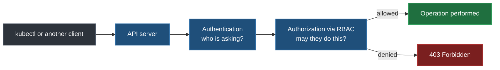

The last production gap in the Ingress note's table was that applications must not have unrestricted access to the cluster. The two previous notes made the Notes application scale; this one is about **who is allowed to do what** inside the cluster. The Ingress note named the terms in a line: **RBAC**, role-based access control, decides who may do what through the Kubernetes API, and a **service account** is the identity a pod uses when it calls that API. This note teaches both.

## Why permissions matter inside a cluster

Picture a Spring Boot pod and a MySQL pod in one cluster, and a ConfigMap (part of the same cluster) holding the Spring Boot application's configuration.

One distinction first, because the Notes API from the deployment note already reads a ConfigMap and needs no permission at all to do it. Its values arrive as environment variables through `configMapKeyRef`, and it is the kubelet that fetches them and hands them to the container when it starts; the application itself never talks to the Kubernetes API. The questions below are about the other kind of pod: one whose code calls the Kubernetes API directly, to read ConfigMaps, list pods or change Deployments while it runs.

- If such a pod can read the ConfigMap, should it also be able to **delete** it? No; nothing about its job requires that.
- Another pod runs some background task. Should it be able to store things in the database? Perhaps not. Delete the database? Certainly not.
- Should any of them be able to delete the Spring Boot pod? No.

A production cluster runs many more things than this: Spring Boot services, MySQL databases, payment systems, analytics jobs, monitoring tools. People, CI/CD pipelines and running applications all talk to the cluster, and none of them should have the same rights by default:

| Who | Needs | Should not be able to |
|---|---|---|
| a developer who reads logs | to inspect logs | delete the payment Deployment |
| an application that reads ConfigMaps | to read ConfigMaps | read Secrets, delete pods |
| a monitoring system | read-only access to specific resources | administer everything |

The reason is not only mistakes. **If an attacker breaks into one pod, whatever that pod is allowed to do, the attacker can now do.** A pod with every right lets them harm every other pod; a pod with narrow rights limits the damage to what those rights allow.

## Authentication and authorization

Two different questions get asked of every request:

| Concept | Question | Meaning |
|---|---|---|
| **Authentication** | who are you? | establishes the identity making the request (logging in, for example) |
| **Authorization** | what are you allowed to do? | decides whether that identity has permission for the requested action |

On Instagram, a logged-in user is authenticated, but is not authorized to do what an Instagram administrator does. Someone who only watches YouTube videos has an account, but no YouTube Studio (the part of YouTube where videos are uploaded and managed), so they are not authorized to upload or manage videos; they can only watch. **Authorization is about capabilities, not identity.**

Kubernetes uses both, and RBAC is how it does the second. Take a command that deletes a pod:

```bash
kubectl delete pod mysql-xyz
```

It sends a request to the API server. The API server establishes who sent it, then checks whether that identity is allowed to delete that pod, and only then allows or refuses the operation.



> [!important] **RBAC governs the Kubernetes API, not your application's endpoints.**
> It decides whether an identity may get, create or delete Kubernetes objects. It does not decide whether a customer may call an endpoint of the Spring Boot application; that is the application's own security, such as Spring Security, and it is entirely separate.

## Four objects

| Object | Purpose | Scope |
|---|---|---|
| **Role** | defines permissions on resources within a namespace | one namespace |
| **RoleBinding** | grants a Role's permissions (or a ClusterRole's) to an identity, in a namespace | one namespace |
| **ClusterRole** | defines permissions that can include cluster-wide resources, or be reused across namespaces | the whole cluster |
| **ClusterRoleBinding** | grants a ClusterRole's permissions across the whole cluster | the whole cluster |

**A Role or ClusterRole defines permissions. A binding gives them to someone.** Two separate manifests, and neither does anything without the other.

### A Role

This Role allows reading ConfigMaps in the namespace `devops-demo`, the one the previous note's resize test created with `kubectl create namespace devops-demo`. Recall from the local cluster note that a **namespace** is a named partition of one cluster, keeping different sets of objects apart; most objects belong to one.

```yaml
apiVersion: rbac.authorization.k8s.io/v1
kind: Role
metadata:
  name: configmap-reader
  namespace: devops-demo
rules:
- apiGroups: [""]
  resources: ["configmaps"]
  verbs: ["get", "list"]
```

| Field | Meaning |
|---|---|
| `namespace: devops-demo` | the Role applies in this namespace only |
| `resources: ["configmaps"]` | the permissions are about ConfigMaps |
| `verbs: ["get", "list"]` | reading one ConfigMap by name, and listing them |
| `apiGroups: [""]` | the API group the resources belong to (see below) |

What the Role does not say is denied. It grants no `create`, `update` or `delete` on ConfigMaps, and it grants nothing at all on Secrets, Deployments or pods. **RBAC permissions are purely additive: there are no deny rules**, as the Kubernetes documentation puts it, so whatever no rule grants is refused.

> [!warning] **`apiGroups: [""]` is the core API group only, not every group.**
> It is tempting to read the empty string as a wildcard. It is not. Kubernetes resources belong to API groups: ConfigMaps, pods, Secrets, Services, nodes and namespaces belong to the original **core** group, whose `apiVersion` is plain `v1`, and the core group's name is the empty string. Deployments belong to the `apps` group, which is why their `apiVersion` is `apps/v1`.
> A Role granting `get` and `list` on `deployments` with `apiGroups: [""]` gave nothing:
> ```text
> apiGroups [""] + deployments -> list deployments: no
> apiGroups ["apps"] -> list deployments: yes
> ```
> A rule for Deployments that names the wrong group silently grants nothing. `kubectl api-resources` shows each resource's group.

### A RoleBinding

Defining a Role does not give it to anybody. A RoleBinding connects the permission definition to an identity, here a service account named `notes-reader`:

```yaml
apiVersion: rbac.authorization.k8s.io/v1
kind: RoleBinding
metadata:
  name: notes-configmap-binding
  namespace: devops-demo
subjects:
- kind: ServiceAccount
  name: notes-reader
  namespace: devops-demo
roleRef:
  kind: Role
  name: configmap-reader
  apiGroup: rbac.authorization.k8s.io
```

`subjects` is who receives the permissions: the service account `notes-reader`. `roleRef` is which permissions: the Role `configmap-reader`. The binding is in `devops-demo`, so the permissions apply there.

## Service accounts

Anything that calls the Kubernetes API falls into one of two groups:

| Identity | Example |
|---|---|
| **a human** | a DevOps engineer running `kubectl get nodes`, `kubectl get pods`, and the rest |
| **a workload** | an application inside a pod that needs to query the Kubernetes API: to read a ConfigMap, list pods, or update a Deployment |

Kubernetes has no objects that represent human users. A person proves who they are with a credential that kubectl sends: on Minikube, a client certificate that `minikube start` created, whose location it recorded in the kubeconfig file. The certificate's common name becomes the username and its organization fields become the groups; that is the whole identity. `kubectl auth whoami` shows it:

```text
Username   minikube-user
Groups     [system:masters system:authenticated]
```

That is why a RoleBinding's `subjects` can name three kinds of identity: a `User` or a `Group` for people, and a `ServiceAccount` for workloads. The Minikube user is in the group `system:masters`, which is bound to the built-in ClusterRole **`cluster-admin`**: a role whose single rule grants every verb on every resource in every API group. That is why everything in this folder so far has simply worked from kubectl.

A **ServiceAccount** is a Kubernetes identity for a workload. The rules are attached to the service account, and every pod that runs as it gets them.

```yaml
apiVersion: v1
kind: ServiceAccount
metadata:
  name: notes-reader
  namespace: devops-demo
```

A pod runs as a service account when its Deployment's pod template names it:

```yaml
spec:
  template:
    spec:
      serviceAccountName: notes-reader
      containers:
        - name: notes-app
          image: notes-app:v1
```

The Deployment, its pods and the service account must be in the same namespace.

### How the pod proves who it is

The pod does not log in by hand. In a modern cluster:

1. The pod is assigned a service account.
2. Kubernetes places a short-lived token for that service account inside the pod's filesystem, at `/var/run/secrets/kubernetes.io/serviceaccount/token`, alongside `ca.crt` (the certificate needed to trust the API server) and `namespace`.
3. The application, or the Kubernetes client library it uses, sends that token with each request to the API server.
4. The API server authenticates the token as the service account, and RBAC decides what it may do.

**A service account is an identity. It grants nothing by itself;** the RoleBindings and ClusterRoleBindings that name it decide what it can do.

> [!info] **This was run, not just read.**
> The ServiceAccount, Role and RoleBinding above were applied in `devops-demo`, with one ConfigMap and one Secret to try them against:
> ```bash
> kubectl create configmap app-settings -n devops-demo --from-literal=MODE=demo
> kubectl create secret generic db-pass -n devops-demo --from-literal=password=x
> ```
> `kubectl auth can-i` answers what an identity may do; a service account's identity is `system:serviceaccount:<namespace>:<name>`:
> ```bash
> kubectl auth can-i get configmaps -n devops-demo --as=system:serviceaccount:devops-demo:notes-reader
> ```
> | Question | Answer |
> |---|---|
> | get, list configmaps in devops-demo | yes |
> | create, delete configmaps in devops-demo | no |
> | get secrets in devops-demo | no |
> | delete pods, delete deployments in devops-demo | no |
> | get configmaps in default | no |
> | list nodes | no |
>
> Then from inside pods, against the real API server. Three test pods ran the `curlimages/curl:8.11.1` image, which contains `curl`, and just slept so that commands could be run in them — one as `notes-reader`, one naming no service account, and one, used further down, with the token switched off:
> ```yaml
> apiVersion: v1
> kind: Pod
> metadata:
>   name: api-client
>   namespace: devops-demo
> spec:
>   serviceAccountName: notes-reader
>   containers:
>   - name: curl
>     image: curlimages/curl:8.11.1
>     command: ["sleep", "3600"]
> ```
> The other two, `default-client` and `no-token`, were the same apart from their names: `default-client` without the `serviceAccountName` line, and `no-token` with `automountServiceAccountToken: false` added. Inside a pod, the API server is reachable at `https://kubernetes.default.svc`: every cluster has a Service named `kubernetes` in the `default` namespace whose endpoint is the API server itself — on this cluster `10.96.0.1:443`, forwarding to `192.168.49.2:8443` — and by the Services note's DNS rule, `kubernetes.default.svc` is that Service's name. Run inside `api-client`, using its own token:
> ```bash
> D=/var/run/secrets/kubernetes.io/serviceaccount
> curl --cacert $D/ca.crt -H "Authorization: Bearer $(cat $D/token)" https://kubernetes.default.svc/api/v1/namespaces/devops-demo/configmaps/app-settings
> curl --cacert $D/ca.crt -H "Authorization: Bearer $(cat $D/token)" https://kubernetes.default.svc/api/v1/namespaces/devops-demo/secrets/db-pass
> ```
> Reading the ConfigMap returned `200` and the ConfigMap itself; reading the Secret was refused:
> ```text
> 403 secrets "db-pass" is forbidden: User "system:serviceaccount:devops-demo:notes-reader" cannot get resource "secrets" in API group "" in the namespace "devops-demo"
> ```
> The token's mount declared an expiry of 3,607 seconds (about an hour). The Kubernetes documentation says the kubelet requests a fresh token once the current one is older than 80% of its lifetime, and that reloading it is the application's responsibility — re-reading the file on a schedule, say every five minutes, is usually enough.

> [!failure] **A pod that names no service account.**
> A pod without `serviceAccountName` runs as its namespace's `default` service account. Running the same calls from `default-client` refused every one of them — even the ConfigMap:
> ```text
> 403 configmaps "app-settings" is forbidden: User "system:serviceaccount:devops-demo:default" cannot get resource "configmaps" in API group "" in the namespace "devops-demo"
> ```
> The default service account has an identity and no permissions. That is the safe starting point.

### A ClusterRole for cluster-wide resources

Some resources belong to no namespace. Nodes are one: `kubectl get nodes` lists the nodes of the whole cluster. A monitoring application that needs to list them needs a ClusterRole:

```yaml
apiVersion: rbac.authorization.k8s.io/v1
kind: ClusterRole
metadata:
  name: node-reader
rules:
- apiGroups: [""]
  resources: ["nodes"]
  verbs: ["get", "list"]
```

and a ClusterRoleBinding to give it to the monitoring identity across the cluster.

> [!info] **This was run, not just read.**
> Before any binding, `notes-reader` got `403` listing nodes, with the message `cannot list resource "nodes" in API group "" at the cluster scope`. After
> ```bash
> kubectl create clusterrolebinding node-reader-binding --clusterrole=node-reader --serviceaccount=devops-demo:notes-reader
> ```
> it could list nodes (the same request returned `200`) and still could not delete them.

## Does every Spring Boot application need a service account?

No. A typical Spring Boot application handles HTTP requests and talks to MySQL:

```text
HTTP request → Spring Boot controller → MySQL
```

If it never calls the Kubernetes API (never lists pods, reads ConfigMaps through the API or updates Deployments), it needs no Kubernetes API permissions at all. It still runs as the namespace's `default` service account, and there is no reason to give that account anything.

**A service account token is for the Kubernetes API only.** It does not let a pod connect to MySQL, and it is not how one pod talks to another. A database connection is ordinary networking to the MySQL Service, with the database's own username and password, as the ConfigMaps and Secrets note set up.

For an application that never needs the API, the token need not be placed in the pod at all:

```yaml
spec:
  template:
    spec:
      automountServiceAccountToken: false
```

> [!info] **This was run, not just read.**
> In `no-token`, the test pod with `automountServiceAccountToken: false`, the token directory did not exist:
> ```text
> ls: /var/run/secrets/kubernetes.io/serviceaccount: No such file or directory
> ```
> If that container is ever compromised, there is no Kubernetes credential in it to steal.

## The principle of least privilege

**Give every identity only the permissions it needs to do its job — the minimum, and nothing more.** If `notes-reader` only reads ConfigMap values, it gets read access and no write access. If the Spring Boot application genuinely needs to create ConfigMaps, give it create; otherwise do not. This is the **principle of least privilege**, and it applies to developers, CI/CD pipelines, monitoring tools, Kubernetes controllers and application pods alike.

| A compromised Spring Boot container whose workload has | What an attacker gets |
|---|---|
| excessive permissions, such as a binding to `cluster-admin`, the everything role | with its Kubernetes credentials, the ability to read or change much of the cluster |
| least privilege: read ConfigMaps in its own namespace | through that identity, only that; it cannot delete Deployments, read Secrets or touch cluster-wide resources |

The goal is to limit what an application or a person can do if their credentials are misused. **Least privilege does not stop a pod being broken into; it limits what the break-in is worth.**

> [!question] **Is it mandatory to use RBAC?**
> On a modern cluster it is already on, and it is not something to bolt on later. Minikube's API server runs with `--authorization-mode=Node,RBAC`: two authorizers, consulted in turn — `Node`, a special-purpose authorizer for the requests kubelets make, and `RBAC` for everyone else. As the run above showed, a pod's default service account could do nothing at all until a binding gave it something. So the choice is not whether to have RBAC but what to grant: a cluster where every workload is bound to `cluster-admin` has thrown the protection away. Writing narrow Roles is what puts least privilege into practice.

> [!question] **What is the difference between DevOps and DevSecOps?**
> In practice, very little: you need to know all of it. The separation into titles matters less than the responsibility, which should be end to end: from thinking of an idea, to writing it, deploying it, managing it, and making it sustainable and scalable. A developer should know DevOps, and security is part of the same job. Rather than playing with terms, call yourself an engineer and learn what the work requires.

## Summary

| Term | Meaning |
|---|---|
| Authentication | establishing who is making a request |
| Authorization | deciding whether that identity may do what it asks |
| RBAC | Kubernetes' authorization of API requests by roles |
| Role, ClusterRole | a set of permissions (resources and verbs) in a namespace, or cluster-wide |
| RoleBinding, ClusterRoleBinding | the grant of a role to a user, group or service account |
| ServiceAccount | the identity a workload uses to call the Kubernetes API |
| Least privilege | only the permissions the job needs |

With the scaling notes and this one, the production gaps the Ingress note listed are covered as far as this folder goes: a domain and HTTPS, storage that outlives a pod, capacity that follows load, and workloads that can do only what they must. Two items from that list remain beyond it — **NetworkPolicies**, which restrict which pods may talk to which over the network, and the **Pod Security** standards — along with running all of it on a real cloud.

> [!info] **Versions, checked 2026-11-17.**
> Run on Minikube v1.39.0 with Kubernetes v1.37.0, whose API server runs with `--authorization-mode=Node,RBAC`. The RBAC API is `rbac.authorization.k8s.io/v1`, stable for many releases. The test pods used `curlimages/curl:8.11.1`. The projected token's lifetime of about an hour is this cluster's default and is set by the cluster.
